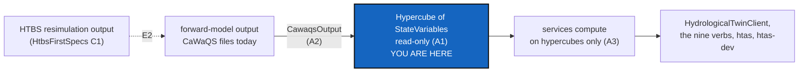

# HtasHypercube — HTAS centred on its hypercube of state variables

*Created: 2026-11-27*

*Branch: HT-BETA*

## Abstract — read this first

**The one-line version.** Give HTAS explicit, read-only `StateVariable`
and `Hypercube` classes, filled by a forward-model output class
(`CawaqsOutput`), so that no service reads CaWaQS `.bin` files and no
`Compartment` holds a path into a model's output folder.

**What this document is.** The request (§1), what exists today (§2), the
design (§3), the steps (§4), the decisions for the owner (§5), and
acceptance (§6).

**Why it exists.** HTAS is built around the files CaWaQS writes, which
depend on the forward model. The owner wants HTAS to protect a hypercube of
state variables instead. HydrologicalTwinBetaSeries (HTBS) relies on this
work at two points: the forward-model output contract (A2) and HTAS reading
a resimulation's output (E2).

**Who it is for.** The owner, who answers §5, and the agents that implement
§4 in HTAS's development space.

**What you need to do with it.** Answer D9 to start A1. Answer D2 and D6
before A2, and D10 and D11 before A3.

---

## 1. The request

The owner, 2026-11-26, short ticket `htbs` (closed as
`archive/.closedUserTicket/20261126_htbs.md`). The part that concerns HTAS
alone:

- **HTAS is centred on its hypercube**, not on the `.bin` files CaWaQS
  writes, because those depend on the forward model.
- **HTAS protects the hypercube of state variables** read from the current
  `.bin`. State variables and hypercubes appear explicitly as classes.
- **The forward model's outputs are a data type of that model.** Filling the
  hypercubes from them is a method of that data class.

The rest of the request (HTBS, its operating spaces, the pipeline and the
invariant DATA) is `HtbsFirstSpecs`, filed in
`DevTickets/dependency/HTBS/`. The two were one ticket until 2026-11-27,
when the owner split them. Decision numbers are kept from the joint ticket,
so references to them stay true.

## 2. What exists today

| Concern | Where it is | What is wrong with it for this request |
|---|---|---|
| Reading CaWaQS output | `services/public/temporal.py`: `Temporal.readSimDataFromBin`, `decode_and_cache`; the record counts in `config/constants.py` (`nbRecs`, `paramRecs`) | The reader sits in a service and is the only way data enters HTAS. It knows CaWaQS's file names, record layout and hydrological year. |
| Finding the files | `domain/Compartment.py`: `defineOutCawPath`, `out_caw_path`; `services/public/twin_io.py`: `_ensure_disk_cache`; `services/public/automatic_detection_config.py` (the `.bin` name patterns) | The domain object carries a path into one forward model's output folder. |
| The data itself | the `.npy` disk cache, and the `sim_matrix` arrays `read_values` returns | No class names a state variable, its unit, its axes or its compartment. Nothing stops a caller from changing the array. |
| The forward model | nowhere | HTAS does not know which model, version or run produced the data it reads. |
| The first twin's output | `ht-synthcase-1`, `HYDRO_COUPLED.COMM` | Every output is written `FORMATTED`. HTAS reads only unformatted `.bin`, so it cannot read that reference today (D6). |

## 3. The design

- `domain/` gains a **`StateVariable`**: its name, unit and compartment,
  the output type it comes from, and steady or transient.
- `domain/` gains a **`Hypercube`**: the values of state variables of one
  compartment, over named axes (D9). It is read-only once filled (arrays
  not writeable, operations return new objects). This is what "HTAS
  protects the hypercube" means inside one process. Protection across
  machines, a GATE that serves the hypercube without its files, is
  HtbsFirstSpecs's later gate space.
- A **forward-model output class**, one subclass per model, with
  `CawaqsOutput` for the proof of concept. It knows where its files are, how
  they are encoded, which state variables they hold, and the model's hash and
  version when known. Its method fills the hypercubes. The following move
  into it:
  - `Temporal.readSimDataFromBin` and `decode_and_cache`;
  - the `.bin` patterns of `automatic_detection_config.py`;
  - `nbRecs` and `paramRecs`.

  Where the class lives is D2.
- `Compartment` loses `out_caw_path`. No module under `services/` opens a
  forward-model file. The public interface keeps working, unless D10 says
  otherwise.
- `AdditionalSpecs.md` §2 gains the two classes and the output class, in the
  same change (step 6 of the checklist).

## 4. The steps

| Step | What | Depends on | Runs alongside |
|---|---|---|---|
| **A1** | `StateVariable` and `Hypercube` in `domain/`, read-only, with tests; no caller changed | D9 | HtbsFirstSpecs P1, B1, B2 |
| **A2** | The forward-model output class and `CawaqsOutput`; the reader, the patterns and the record counts move into it; `Compartment` loses its path. The contract HTBS relies on is fixed here | A1, D2, D6 | HtbsFirstSpecs B2, G, C1 |
| **A3** | Every service computes on hypercubes; the `.npy` cache becomes the hypercube's persistence, or goes (D11); docs per the doc-impact map; the version per D10 | A2, D10, D11 | HtbsFirstSpecs E1 |
| **E2** | HTAS reads the output DATA of an HTBS resimulation through `CawaqsOutput` (HtbsFirstSpecs C1's `postproc` task) | A2, HtbsFirstSpecs C1 | HtbsFirstSpecs E1 |

A1, A2 and A3 are each one `implement`, with its own quote and commit
message. E2 needs a resimulation's output to read, so it waits for HTBS.

## 5. Decisions for the owner

- **D2. Where `CawaqsOutput` lives.** (a) In HTAS: HTAS still reads CaWaQS
  output on its own, as today. (b) In HTBS: HTAS defines only the interface
  a forward-model output must meet.
- **D6. The output format.** (a) The COMM writes what HTAS reads unformatted
  (`.bin`): HtbsFirstSpecs P1 changes the twin's COMM. (b) `CawaqsOutput`
  reads `FORMATTED` too.
- **D9. The hypercube's axes.** (a) time × cell × state variable, one
  hypercube per compartment and output type, the layer a cell attribute.
  (b) time × layer × cell × state variable.
- **D10. HTAS's public interface.** (a) Unchanged: a minor bump. (b) Taking
  hypercubes or a forward-model output: 2.0.0.
- **D11. The `.npy` cache.** Keep it as the hypercube's persistence, or drop
  it.
- **D12. DocsOnTheFly's tutorials.** Wait for A3 and write them on the
  hypercube API, or write tutorial 1 on today's API once ht-synthcase-1's
  reference is restored (HtbsFirstSpecs G), and rewrite it after A3.
- **D13. This ticket's rank.** Pile 1 after DocsOnTheFly, as filed, or ahead
  of it.

## 6. Acceptance

- HTAS has read-only `StateVariable` and `Hypercube` classes, documented and
  in `AdditionalSpecs.md` §2.
- The forward-model output class exists where D2 puts it, and
  `CawaqsOutput` fills the hypercubes from ht-synthcase-1's output.
- No module under `services/` opens a forward-model file, and `Compartment`
  holds no output path.
- The public interface behaves as D10 says, and the version moves
  accordingly.
- For each step: `pixi run lint` shows no new error, `pixi run test` passes,
  and `cgitsync status` shows `errors=0`.
