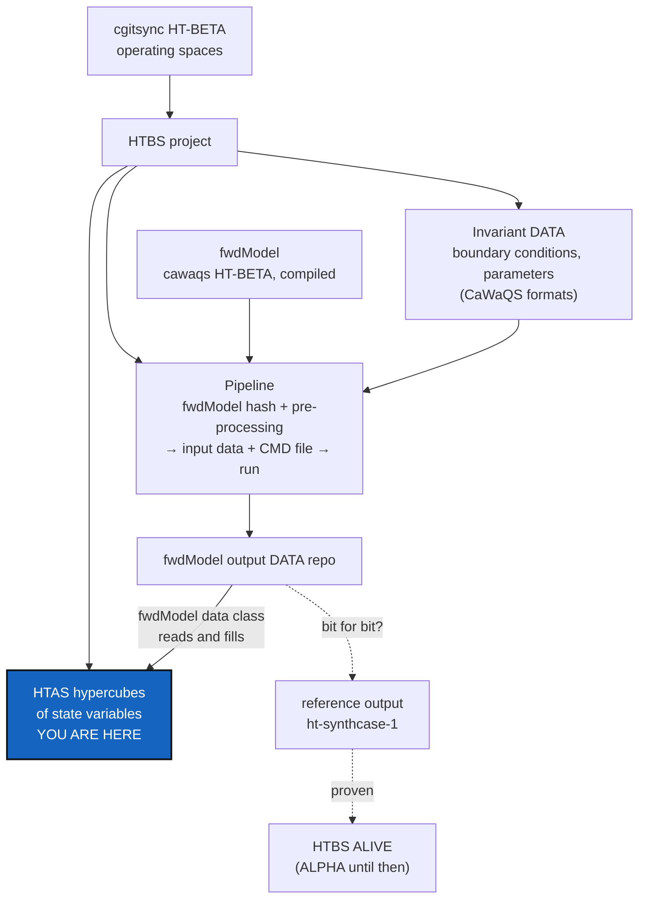
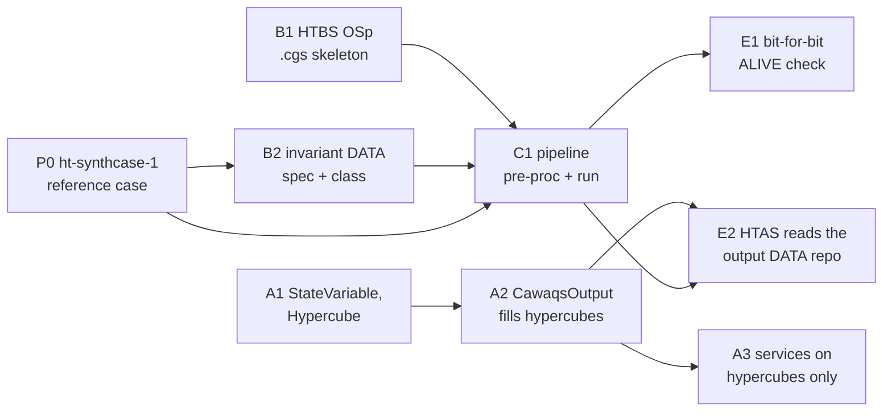

# HtbsFirstSpecs — HTAS centred on its hypercube, and the first specifications of HydrologicalTwinBetaSeries

*Created: 2026-11-26*

*Branch: HT-BETA*

## Abstract — read this first

**The one-line version.** Make HTAS own explicit state-variable and
hypercube classes, and move the reading of CaWaQS `.bin` files into a
forward-model output data class. On that base, specify
HydrologicalTwinBetaSeries (HTBS). HTBS is a cgitsync project that couples
HTAS, a forward-model pipeline (CaWaQS for the proof of concept) and an
invariant data set. It is ALIVE once the pipeline resimulates the
forward model's output bit for bit.

**What this document is.** The request (§1), what exists today (§2), the
design (§3), the work split into tasks that can run in parallel (§4), the
decisions for the owner (§5), and acceptance (§6).

**Why it exists.** Today HTAS is built around the files CaWaQS writes:
`Compartment` holds `out_caw_path`, `Temporal.readSimDataFromBin` decodes
the `.bin` files, and the data HTAS computes on is an unnamed array cached
as `.npy`. That couples HTAS to one forward model's output layout, which
the owner calls wrong: what HTAS protects is the hypercube of state
variables, not the files.

**Who it is for.** The owner, who answers §5, and the agents that implement
the tasks of §4.

**What you need to do with it.** Answer §5 first, at least D1 to D4, which
change the design. Then the tasks of §4 can be implemented, several at
once.

---

## 1. The request

The owner, 2026-11-26, short ticket `htbs`, filed closed as
`archive/.closedUserTicket/20261126_htbs.md`. In short:

- **HTAS is centred on its hypercube**, not on the `.bin` files CaWaQS
  writes, because those depend on the forward model of the pipeline. The
  state variables and hypercubes appear explicitly as classes, and HTAS
  protects them.
- **HTBS builds on HTAS and its classes**, and takes forward-model outputs
  as its input. Those outputs are a data type of the forward model. Filling
  the hypercubes from them is a method of that data class.
- **HTBS adds an invariant data class**: the boundary conditions and
  parameters needed to run a pipeline, in CaWaQS formats. Neumann
  conditions are flux forcings: rainfall, ETP, upstream discharge for
  river reaches at the frontier, the same at aquifer unit (layer)
  boundaries, and withdrawals in river and aquifer units. Dirichlet and
  Cauchy conditions may sit at the frontiers, or on river cells for
  aquifer units alone. The parameters are CaWaQS's.
- **A pipeline** holds the forward model's Git hash (SemVer). A
  pre-processing step generates the input data and the forward model's
  CMD file. The pipeline runs the compiled forward model on them and
  produces output DATA. That output is, for now, what HTAS reads as
  `.bin`; for HTBS, the input is a forward-model output DATA repository.
- **HTBS is a cgitsync project** that couples operating spaces: HTAS, the
  pipeline (the forward model for the proof of concept) and the invariant
  DATA. Its first use is to resimulate, bit for bit, the forward-model
  output that HTAS takes as input, from the invariant DATA and the
  compiled forward model. Once that is proven, HTBS is **ALIVE**; until
  then it is **ALPHA**.
- **Projects required:** `github.com:flipoyo/ComplexGitSync` HT-BETA,
  `github.com:flipoyo/HydrologicalTwinAlphaSeries` HT-BETA,
  `gitlab.com:cawaqs/cawaqs` HT-BETA. The first twin comes in
  `gitlab.com:htas1/ht-synthcase-1`, which holds `cawaqs/gtest/testcases`.
- **Structure:** operating spaces (OSp) of order 1, modelled on
  `github.com:flipoyo/MOLONARI1D`, branch CGS-MOLO.
- **Later:** coupling with `gitlab.com:cawaqs/gviz/cawaqsviz`, which would
  serve forward-model output while HTAS, deployed on a GATE (a separate
  server the client cannot reach directly), protects the data and the
  hypercube.

## 2. What exists today

| Concern | Where it is | What is wrong with it for this request |
|---|---|---|
| Reading CaWaQS output | `services/public/temporal.py`: `Temporal.readSimDataFromBin`, `decode_and_cache`; the record counts in `config/constants.py` (`nbRecs`, `paramRecs`) | The reader sits in a service and is the only way data enters HTAS. It knows CaWaQS's file names, record layout and hydrological year. |
| Finding the files | `domain/Compartment.py`: `defineOutCawPath`, `out_caw_path`; `services/public/twin_io.py`: `_ensure_disk_cache`; `services/public/automatic_detection_config.py` (the `.bin` name patterns) | The domain object carries a path into one forward model's output folder. |
| The data itself | the `.npy` disk cache, and `sim_matrix` arrays returned by `read_values` | No class names a state variable, its unit, its axes or its compartment. Nothing protects the array from being changed by a caller. |
| The forward model | nowhere | HTAS does not know which model, version or run produced the data it reads. |
| Boundary conditions, parameters, pipelines | nowhere | Not in HTAS. The Beta series is not in this repository (`CLAUDE.md`). |

**Collisions with open tickets.** DocsOnTheFly's M2 and M3 wait for "D3's
test case", a synthetic case built on `cawaqs/gtest/testcases` that
"will come later with its own ad hoc twin". That case is
`gitlab.com:htas1/ht-synthcase-1` (task P0 below). Its tutorials must be
written against the hypercube API of task A, or rewritten after it: see D9.

## 3. The design

**3.1 In HTAS (this repository).**

- `domain/` gains a **`StateVariable`**: name, unit, compartment, the
  output type it comes from, and whether it is steady or transient.
- `domain/` gains a **`Hypercube`**: the values of one or more state
  variables of a compartment, over named axes (D3). It is read-only once
  filled: its arrays are not writeable, and every operation returns a new
  object. This is what "HTAS protects the hypercube" means inside the
  process (D5).
- A **forward-model output data class**, with one subclass per forward
  model: `CawaqsOutput` for the proof of concept. It knows where its files
  are, how they are encoded and which state variables they hold. Its
  method fills the hypercubes. It carries the forward model's hash and
  version when they are known. `Temporal.readSimDataFromBin`, the `.bin`
  patterns and `nbRecs`/`paramRecs` move into it. Where it lives is D2.
- `Compartment` no longer holds an output path. The services compute on
  hypercubes only, so no service under `services/` opens a forward-model
  file.
- The public interface (`HydrologicalTwinClient`, the nine verbs, the
  `htas` and `htas-dev` commands) keeps working, unless D4 says otherwise.

**3.2 In HTBS (a new project, not this repository).**

- **Invariant DATA**: a data class for the boundary conditions and the
  parameters, in CaWaQS formats:
  - Neumann (flux forcings): rainfall, ETP, upstream discharge at river
    frontiers, fluxes at aquifer unit boundaries, withdrawals in river and
    aquifer units;
  - Dirichlet and Cauchy: at the frontiers, or on river cells for aquifer
    units alone;
  - the CaWaQS parameters.
- **Pipeline**: the forward model's repository and hash (SemVer), a
  pre-processing step that writes the input data and the CMD file, the
  run of the compiled forward model, and an output DATA repository.
- **The operating spaces** (OSp of order 1, after MOLONARI1D CGS-MOLO): one
  for HTAS, one for the pipeline and forward model, one for the invariant
  DATA, one for the output DATA; coupled by a `.cgs` and recorded by
  cgitsync, the environment included.
- **ALIVE**: a check that the pipeline's output from ht-synthcase-1's
  invariant DATA equals its reference output bit for bit. Until it
  passes, HTBS is ALPHA.

**3.3 Not in scope here.** The GATE deployment and the cawaqsviz coupling.
They are named so that nothing in §3.1 makes them harder: the hypercube
must be servable without its files.

## 4. The work — tasks and what can run in parallel

Tasks in the same column of this table can be implemented at the same
time, by different agents, without touching the same files. Each HTAS task
is one `implement`, with its own quote and commit message.

| Task | Repository | Depends on | Can run alongside |
|---|---|---|---|
| **P0** ht-synthcase-1: the reference case (invariant DATA and reference output from `cawaqs/gtest/testcases`) | `htas1/ht-synthcase-1` | the owner | A1, B1 |
| **A1** `StateVariable` and `Hypercube` in `domain/`, read-only, with tests; no caller changed yet | HTAS | D3, D5 | P0, B1, B2 |
| **A2** the forward-model output class and `CawaqsOutput`: the `.bin` reader, the name patterns and the record counts move into it; `Compartment` loses its output path | HTAS | A1, D2 | B1, B2 |
| **A3** every service computes on hypercubes; the `.npy` cache becomes the hypercube's own persistence, or goes (D6); public interface kept (D4); docs per the doc-impact map | HTAS | A2 | B2, C1 |
| **B1** the HTBS repository and its `.cgs`: operating spaces of order 1, the four projects of §1 at HT-BETA, the environment's minimum tools | HTBS | D1, D7 | P0, A1, A2 |
| **B2** the invariant DATA: the list of boundary conditions and parameters in CaWaQS formats, then the class that reads them | HTBS | P0 for the files; D8 | A1, A2, A3 |
| **C1** the pipeline: record the forward model's hash, pre-process into input data and the CMD file, run the compiled CaWaQS, write the output DATA repository | HTBS | B1, B2, P0 | A3 |
| **E1** the ALIVE check: the pipeline's output equals ht-synthcase-1's reference output bit for bit, with the environment recorded | HTBS | C1, D10 | E2 |
| **E2** HTAS reads the pipeline's output DATA repository through `CawaqsOutput` | HTAS | A2, C1 | E1 |

The HTAS side (A1 → A2 → A3) and the HTBS side (B1, B2 → C1) are
independent until E2: they meet only through the forward-model output
class's contract, which A2 fixes first.

## 5. Decisions for the owner

- **D1. Where HTBS's plans live.**
  - (a) Here, in HTAS's `DevTickets/`, until the HTBS repository exists,
    then moved.
  - (b) In the HTBS repository's own `.dev` from B1 on; this ticket keeps
    only A1 to A3 and E2.
- **D2. Where the forward-model output class lives.**
  - (a) In HTAS (`domain/` or a new package below `services`): HTAS still
    reads CaWaQS output on its own, as today.
  - (b) In HTBS: HTAS only defines the interface a forward-model output
    must meet, and reads nothing itself.
- **D3. The hypercube's axes.** (a) time × cell × state variable, one
  hypercube per compartment and output type, with the layer as a cell
  attribute; (b) time × layer × cell × state variable; (c) other.
- **D4. The public interface.** (a) Keep every `HydrologicalTwinClient`
  method and `htas` command unchanged: a minor bump. (b) Let them take
  hypercubes or a forward-model output: a major bump, 2.0.0.
- **D5. What "protects" means in HTAS now.** (a) Read-only in the process
  (non-writeable arrays, immutable objects). (b) That, plus access only
  through HTAS's interface, preparing the GATE.
- **D6. The `.npy` disk cache.** (a) Keep it as the hypercube's
  persistence. (b) Drop it: the forward-model output is read on demand.
- **D7. The HTBS repository.** Its host and name, and whether its branch is
  HT-BETA from the start.
- **D8. The output DATA and invariant DATA repositories.** Their host and
  name, and whether they are private.
- **D9. DocsOnTheFly's tutorials.** (a) Wait for A3 and write them once,
  on the hypercube API. (b) Write tutorial 1 on today's API when P0
  lands, and rewrite it after A3.
- **D10. "Bit for bit".** (a) The output files' bytes are equal. (b) The
  decoded values are equal, so the record layout may change. Either way,
  the same compiler and platform, as cgitsync records them.
- **D11. This ticket's rank.** Pile 1, after DocsOnTheFly (as filed), or
  ahead of it.

## 6. Acceptance

- HTAS has `StateVariable` and `Hypercube` classes, read-only, documented
  and in `AdditionalSpecs.md` §2. No module under `services/` opens a
  forward-model file, and `Compartment` holds no output path.
- The forward-model output class exists where D2 puts it, and
  `CawaqsOutput` fills the hypercubes from ht-synthcase-1's output.
- The public interface behaves as D4 says, and the version moves
  accordingly.
- The HTBS repository exists with its `.cgs` and operating spaces, and its
  pipeline produces an output DATA repository from the invariant DATA.
- The ALIVE check passes on ht-synthcase-1, or HTBS is labelled ALPHA with
  the reason.
- For each HTAS task: `pixi run lint` shows no new error, `pixi run test`
  passes, and `cgitsync status` shows `errors=0`.
