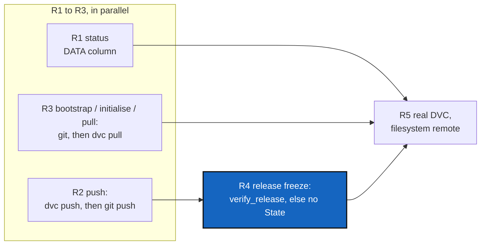

# DataRoundTrip — `push`, `pull`, `status` and `release freeze` run the DVC phase of each data repository, in the order that keeps a State true

*Created: 2026-11-27*

*Branch: HT-BETA*

> **Ticket review — 2026-11-27, on the owner's request** *"shortTicket review and write DevPlanTickets in a proper
> order of execution. Merge paralell tasks in the same tickets. The goal is a CGS-HT-BETA ready for htbs."* This
> ticket is the second half of the short ticket
> [dvc-backend-registration](../archive/.closedUserTicket/20261127_dvc-backend-registration.md). It asks that
> `push`, `pull`, `status` and `release freeze` run the matching DVC phase, that a push whose pointers name data
> missing on the remote be refused, and that `status` report the data. DvcBackend is the first half.
>
> **What it takes from the data milestones.** The four commands are spread over three milestones that were planned
> to land one after the other. This ticket takes from each only what HTBS needs, so the commands land together:
> - from DataAuthoring (M3): WP-A5, the `status` data column, with its D1;
> - from DataMaterialisation (M4): WP-M1 (Git first, then data, for `bootstrap`, `initialise` and `pull`) and the
>   `.gts` restore part of WP-M5, with its D2 and D4;
> - from DataPublication (M5): WP-P1 (`push` publishes the objects, then the refs), and the `release freeze` part of
>   WP-P2 and WP-P3, with its D1 and D3;
> - from DataAcceptance (M6): WP-E1 to WP-E3 and WP-E5 (the scenario, its two negative tests and the CI job), with
>   its D1.
>
> Those tickets keep the rest (DataWorkspace, DataPublication, DataAcceptance), and say what moved here.

## Abstract — read this first

**The one-line version.** HTBS types three DVC rules by hand around cgitsync today (report
`20261125_Report_TwinLaunch.md` of `ht-synthcase-1`, steps F and G). `dvc push` comes before `cgitsync push`.
`dvc pull` comes after `cgitsync initialise`. `dvc status -c` is the only check before a State is frozen. This
ticket makes cgitsync do all three, in that order, for every repository that declares `data`, and refuse when the
data is not there.

**What this document is.** Five steps, R1 to R5. R1, R2 and R3 can run in parallel. R4 needs R2, and R5 needs all
of them. Each step names the decision it inherits from its source ticket, renamed RD1 to RD6 in §4.

**Why it exists.** A State is a promise that a tree can be rebuilt from it. With DVC in the tree, a Git push of a
`.dvc` pointer whose object never reached the remote breaks that promise silently. So does a restore that reports
`READY` with an empty cache, or a freeze of data that is only on one laptop. These are the failures DataArchitecture
was opened for. This ticket closes them for the four commands HTBS uses, and leaves `add` routing, `rm`, offline
`checkout`, `merge` and `tag` for later.

**Who it is for.** The worker and orchestrator, and the owner, who answers §4.

**What you need to do with it.** Start once DvcBackend is archived. Answer §4, then follow §2.

---

## 1. The order (from DataMaterialisation §1 and DataPublication §1)

| Command | Order | On a data failure |
|---|---|---|
| `bootstrap`, `initialise`, `pull` | Git first, then `materialize` (`dvc pull`) for the **final** revision | Git is not rolled back. The repository is `NOT_MATERIALIZED`, and the command it needs is named (RD3, RD4) |
| `push` | `publish` (`dvc push`) of the objects the **final** commit names, then the Git push | That repository's refs are not pushed. The rest of the tree follows `TreePartialFailure` (RD5) |
| `release freeze` | `verify_release` (`dvc status -c`) on every data repository, then the freeze | No `.gts` is written, and no ledger entry (RD5, as for any partial tree-wide write) |
| `status` | `inspect(offline=True)`. Offline, the remote is `UNKNOWN`, never assumed | — |
| `.gts` restore (`release load`, `bootstrap <.gts>`) | The recorded Git revision, then `materialize`, then a check that the bytes are there | `NOT_READY`, never `READY` |

A Git-only repository is never handed to a backend, and a Git-only tree behaves byte for byte as before.

## 2. Steps

- **R1. `status` gains a `DATA` column** (DataAuthoring §3, WP-A5, RD1). The column is printed only when the tree
  holds a data repository, with a legend. Its values are the `DataResult` states, offline. `--json` gains a field
  and reinterprets none. `view-tree` marks a data repository `[DVC]` without walking its files.
  `status_render.py` owns the words.
- **R2. `push` publishes first** (DataPublication §1, WP-P1, RD2). Before each data repository's Git push, it calls
  `publish` for the objects the final local commit references. If `publish` fails, that repository's refs are not
  pushed. A commit made outside cgitsync whose pointers name an object neither the cache nor the remote has is
  refused by name: repository, pointer file, *"not in the remote"*. The check reuses `inspect(offline=False)`, and
  the refusal sits beside EncryptionGuard's, after the push preflight.
- **R3. `bootstrap`, `initialise`, `pull` and restore materialise last** (DataMaterialisation §1, WP-M1 and the
  restore part of WP-M5, RD3, RD4). After the Git side has settled on its final revision, `materialize` runs with
  the network allowed. A restore checks that the bytes are present before reporting `READY`. The install report
  joins DvcBackend's S5 line, so one line per data repository says *remote answers / data present*, or what is
  missing.
- **R4. `release freeze` verifies before it writes** (DataPublication WP-P2 and WP-P3, freeze only, RD5).
  `verify_release` runs on every data repository before anything is frozen. Any repository that is not available
  stops the freeze before the `.gts` and before the root's annotated tag. The report reuses `RepoOutcome` and names
  each repository. The State records the backend and `service` alias that DataSchema and DvcBackend put on
  `repo_state`, and never an object hash, an address or a credential.
- **R5. Acceptance with real DVC** (DataAcceptance §1 and §2, WP-E1 to E3 and E5, RD6). In `tests/integration/`,
  marked `dvc`, there are two local repositories (code, forcing), a temporary filesystem DVC remote, and a `.cgs`
  declaring `data = { backend = "dvc" }` on the forcing repository. The scenario:
  1. bootstrap, and dataset A is materialised;
  2. `dvc add` by hand (routing `add` is DataWorkspace's), `cgitsync commit`, `cgitsync push`;
  3. `release freeze R1`;
  4. dataset B, then commit and push;
  5. a fresh `release load R1`, checking that the SHAs and the bytes are A's.

  Then the two negative tests. First, an object removed from the remote and the cache makes the restore fail as
  `NOT_READY`. Second, no object hash, credential or address appears in the `.gts`, the State, the ledger or the
  logs. The `dvc` CI job (DvcBackend A3) runs it on every push.

## 3. Acceptance

- R5's scenario and its two negative tests pass in the `dvc` environment, and skip in the default one.
- A `git push` made by hand of a pointer to a missing object is caught by the next `cgitsync push`. The refusal
  names the repository and the pointer, and nothing is pushed for that repository.
- `release freeze` with one data repository unavailable writes no `.gts`, no tag and no ledger entry, and names
  the repository.
- `status` of a Git-only tree is unchanged byte for byte. `status` of a data tree shows `DATA`, and its `--json`
  has the field.
- User guide: a section, *A tree with DVC data*, gives the order of §1, what each refusal means, and the command to
  run next. CHANGELOG entry. The README is not touched.
- `pixi run lint`, `pixi run test`, `pixi run check-ceilings`, and `cgitsync status` with `errors=0`.
- **HTBS check:** on `ht-synthcase-1`'s shape (a root repository holding DVC results), the hand steps F and G of
  the TwinLaunch report become `cgitsync push`, `cgitsync initialise` and `cgitsync release freeze`, with no `dvc`
  typed.

## 4. Decisions for the owner

- **RD1** (DataAuthoring D1). How does the data state reach `status`: a column, a suffix on `LOCAL`, or a second
  line? Its recommendation: a column, printed only when there is data.
- **RD2** (DataPublication D1). Does `push` publish data by default? Its recommendation: yes, with no flag to skip.
  The Git half alone is `git push`.
- **RD3** (DataMaterialisation D2). `pull` when materialisation fails after a successful Git sync? Its
  recommendation: report partial readiness, never roll back Git, never report success.
- **RD4** (DataMaterialisation D4). Which command is named on a cache miss? Its recommendation: the one that fits
  (`pull`, or `release load` during a restore).
- **RD5** (DataPublication D3). The shape of a partial failure? Its recommendation: `RepoOutcome` per repository.
  This review adds: `TreePartialFailure` for the tree, as push already does.
- **RD6** (DataAcceptance D1). Does R5 run in CI or on demand? Its recommendation: in CI, in the `dvc` environment,
  on every push.
