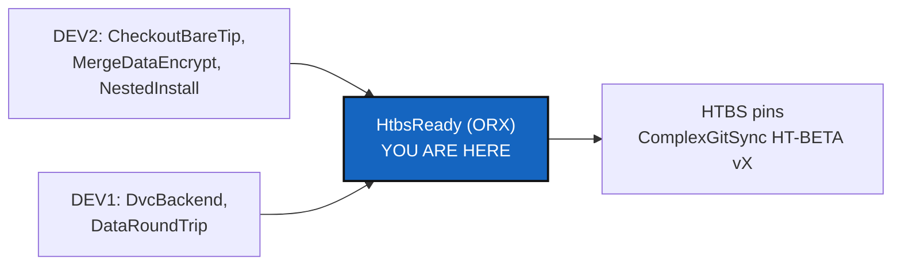

# HtbsReady — the gate that says `HT-BETA` is ready for HydrologicalTwinBetaSeries

*Created: 2026-11-27*

*Branch: HT-BETA*

> **From the owner, 2026-11-27** (short ticket [htbs-roadmap](../archive/.closedUserTicket/20261127_htbs-roadmap.md)):
> the data class and DVC serving are developed by a collaborator, DEV1; DEV2 holds the other mandatory work; ORX
> holds the sync of the DevPlanTickets towards the goal. This is ORX's ticket. It is the last step of the
> [HTBS roadmap](../Roadmap/HTBS_Roadmap.md), and it waits for every DEV1 and DEV2 ticket on it.

## Abstract — read this first

**The one-line version.** When the five DEV tickets of the HTBS roadmap are archived, ORX checks the result
against HTBS's real trees, gives HTBS a ComplexGitSync version to pin, and closes the dependencies HTBS filed.

**What this document is.** The acceptance of the whole roadmap, and the bookkeeping only ORX does: archiving the
two landed data tickets, and closing the dependency short tickets on HTBS's side.

**Why it exists.** Each DEV ticket proves its own part, mostly on local bare remotes and synthetic data. None
proves that HTBS's own `.cgs` files install and run end to end. That is the claim HTBS relies on when it moves its
pin.

**Who it is for.** ORX, and DEV1 and DEV2, who learn here what their work is finally measured against.

**What you need to do with it.** Wait for gate G4 of the roadmap, then follow §1.

---

## 1. Steps

1. **Bookkeeping, at any time before the end.**
   - Archive DataSchema and DataBackendContract once their orchestrator's records are on the shared memory
     (`pixi run check-tickets` names them `ok`).
   - After each DEV ticket is archived, re-rank the pile and update the roadmap's table (status column).
2. **Check HTBS's trees on the last `HT-BETA` release**, from clean directories:
   - `bootstrap .config/htbs-dev-beta.cgs` ends `READY` with `errors=0`. The CaWaQS libraries are on `cawaqs_4X`
     (HtbsFirstSpecs §7.1, step 4).
   - A nested `.cgs` that declares ComplexGitSync installs without deleting it, and its States record its commit
     (NestedInstall).
   - On `ht-synthcase-1`'s shape: the TwinLaunch report's steps F and G run as `cgitsync push`, `initialise`,
     `release freeze` and `release load`, with the DVC remote named by its alias, and no `dvc` typed. A restore on
     a second machine matches `sha256sum` file by file (HtbsFirstSpecs step G).
3. **Hand the version over.** Tell HTBS the version to pin (`HT-BETA` vX), and close the five
   `dependency/CGS/` short tickets in HTAS's `DevTickets/`. That is done in HTAS's own development space, with
   HtbsFirstSpecs' dependency table updated there.

## 2. Acceptance

- Every check of §1.2 passes and is written down, with the commands and their output, in the history ticket.
- The roadmap's table shows every ticket archived. `pixi run check-tickets` names all of them `ok`.
- `cgitsync status` shows `errors=0` on the release commit.

## 3. Decisions for the owner

- **O1. Does reaching HtbsReady also merge `HT-BETA` into `CGS-ALPHA`?** Recommended: no. That is a release
  decision of its own, after DataAcceptance's gate.
- **O2. Which machine is the "second machine" of §1.2?** Recommended: the VPS gate space, if it is installed by
  then. Otherwise a fresh user account on this machine.
