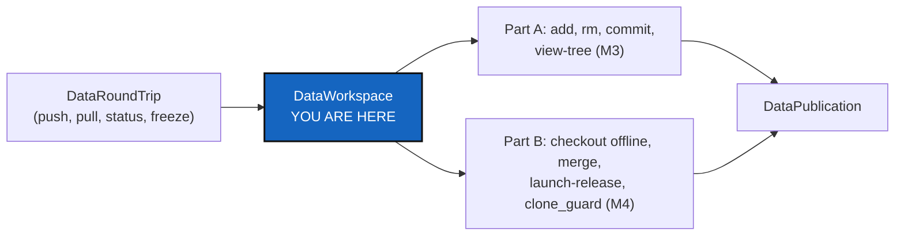
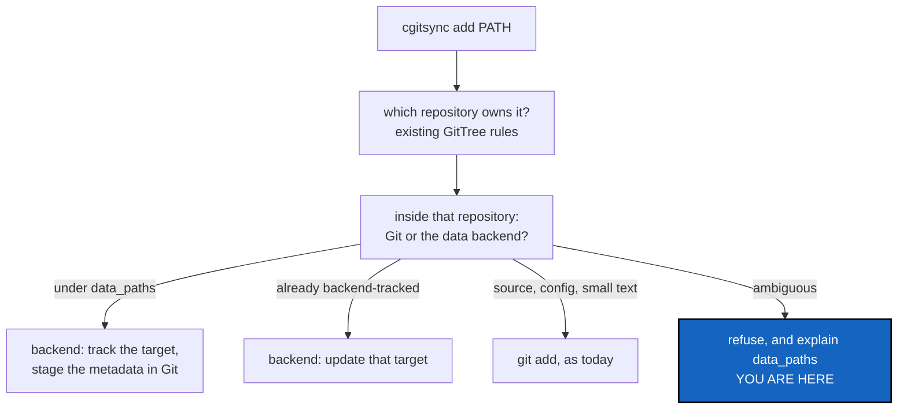
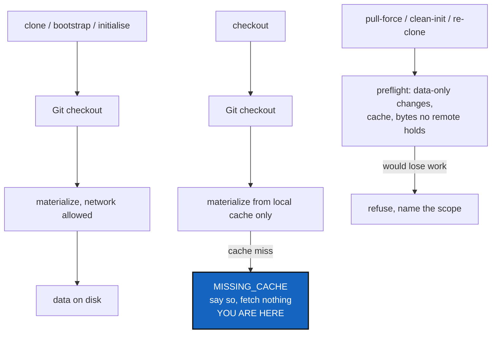

# DataWorkspace — the daily commands tell a dataset from a source file, and the commands that move a workspace bring the data or refuse

*Created: 2026-11-27*

*Branch: HT-BETA*

> **Ticket review — 2026-11-27, on the owner's request** *"shortTicket review and write DevPlanTickets in a proper
> order of execution. Merge paralell tasks in the same tickets. The goal is a CGS-HT-BETA ready for htbs."*
> DataAuthoring (M3, `data-repo_2-9`) and DataMaterialisation (M4, `data-repo_2-10`) both need only DataBackendContract,
> and not each other: DataArchitecture §3 says *"they can be taken in either order or in parallel"*. So they are one
> ticket now, Part A and Part B below, carried word for word. Their sections are renumbered A1… and B1…, and their
> decisions AD1… and MD1…. Inside each part, a bare §n or Dn means that part's own.
>
> **Moved to DataRoundTrip, which HTBS needs first:** WP-A5 (the `status` column, with AD1) from Part A. WP-M1 (Git
> first, then data, for `bootstrap`, `initialise` and `pull`), the `.gts` restore half of WP-M5, MD2 and MD4 from
> Part B. What stays here is `add` and `rm` routing, `commit`'s data check, `view-tree`'s detail, offline
> `checkout`, the destructive-command preflight, `merge` and `launch-release`. All of it lands after DataRoundTrip,
> and none of it blocks HTBS.

## Abstract — read this first

**The one-line version.** Part A: `add`, `rm` and `commit` learn to tell a dataset from a source file, and refuse
rather than guess. Part B: `checkout` stays offline and says when data is missing, `merge` and `launch-release`
bring the data, and a destructive command refuses to delete data that exists nowhere else.

**What this document is.** Two analysed milestones in one ticket, because they run in parallel. Each part keeps
its own abstract, decisions, work packages and acceptance.

**Why it exists.** Part A's *"Why it exists"* (§A0) and Part B's (§B0) are unchanged. Together they are the safety
of a data tree in everyday use, once DataRoundTrip has made its four commands right.

**Who it is for.** Whoever takes M3 and M4 after DataRoundTrip.

**What you need to do with it.** Answer AD2–AD4 and MD1 and MD3, then take Part A and Part B in any order, or
side by side.

---

# Part A — DataAuthoring — a dataset must never become a raw Git blob by accident

> **Ticket review — 2026-11-11, owner's decision.** Renumbered `data-repo_2-4` → `data-repo_2-9`: ranked behind every other ticket: the data workstream comes later (owner: everything on data will come later). Its relative order within the seven is unchanged. The owner's priorities for the week: the MOLONARI achievement (Friday 2026-11-13) and atCGS running (`LinkAtCGS`).

> **Ticket review — 2026-10-20, owner's decision.** Renumbered `data-repo_2-6` → `data-repo_2-4`: Omniscience moved to priority 1, and pile 2 was compacted to run 1..N (TICKETLIFECYCLE §2.1). Pile 1 is the Omniscience workstream, split into Omniscience and its six milestone tickets PushAnchor, OperatingSpaceId, InclusionProofs, OmniscienceRegister, OmniscienceAppend, OmniscienceQuery (owner's short ticket `update-omniscience`). Pile 2 order: the seven data-repo tickets, WorkingAreaRename, StateLocking, BranchProtection; order unchanged within each workstream.

> **Ticket review — 2026-10-08, owner's decision.** Renumbered `data-repo_2-4` → `data-repo_2-6`: each priority is one pile counted across branches (TICKETLIFECYCLE §2), which this backlog had numbered per branch. Pile 2 order: AutofixBlindSpot, PackageHygiene, the seven data-repo tickets, Omniscience, WorkingAreaRename, StateLocking; order unchanged within its workstream.

> **Milestone M3** of [DataArchitecture](HT-BETA_2-6_DEV1_DataArchitecture_DevPlanTicket.md).
> Needs [DataBackendContract](HT-BETA_2-11_ORX_DataBackendContract_DevPlanTicket.md);
> independent of [DataMaterialisation](HT-BETA_2-7_DEV1_DataWorkspace_DevPlanTicket.md).
> Analysed from §4 and §9/P3 of the owner's short ticket,
> `.dev/DevTickets/archive/.closedUserTicket/20260916_DevPlanTicket_DataManager_DVC.md`.

## A0. Abstract — read this first

**The one-line version.** `add`, `rm`, `commit`, `status` and `view-tree`
learn to tell a dataset from a source file, and to refuse rather than guess
when they cannot.

**What this document is.** The third milestone: the commands a user types
every day.

**Why it exists.** This is where the expensive mistake lives. `cgitsync
add` on a repository holding a new two-gigabyte NetCDF file either routes
it to the data backend or writes it into Git's object store forever, and
the second is not recoverable by anything short of rewriting history. The
rule has to be explicit, and the ambiguous case has to be a refusal.

**What you will find.** §1 the five routing cases for `add`. §2 `rm`, where
deleting bytes and stopping tracking are different requests. §3 `status`,
which must not report a clean Git tree as data-ready. §4 decisions. §5 work
packages. §6 acceptance.

**Who it is for.** Whoever takes M3.

**What you need to do with it.** §1 case 4 is the one to build first: the
refusal. Everything else is safe once guessing is impossible.

---

## A1. `add`: five cases, one of them a refusal

Resolve the **owning repository** first, with the existing GitTree path
rules — `resolve_repo_for_path` — and never dispatch across a nested
repository boundary. Then resolve ownership *within* that repository:

| # | The path is | CGS does |
|---|---|---|
| 1 | A new path under `data_paths` | Tracks it in the backend, and stages only the metadata that changed and belongs to that target (`.dvc`, `dvc.yaml`, `dvc.lock`, `.gitignore`) |
| 2 | Already tracked by the backend | Updates the owning target with a validated, target-aware call; stages the resulting metadata. A file *inside* a tracked directory is handled by that directory's target, not turned into a new standalone pointer |
| 3 | Source, a script, a small TOML/YAML parameter | The existing `git add` path, unchanged |
| 4 | New, and matched by no rule | **Refuses**, with a message explaining `data_paths` and naming the path |
| 5 | No argument at all | Inspects known tracked outputs for changes and updates their metadata; stages eligible Git changes. Never enrolls an unknown file on either side |

**A path owned by the backend is never also staged as raw bytes in Git.**
That invariant is worth a test of its own.

**Pipeline outputs are not fair game.** If the target is a DVC pipeline
output, `dvc add` is not universally valid: respect the stage semantics, do
not rerun `dvc repro`, and do not issue a blanket `dvc commit` that blesses
changed dependencies and misrepresents what was reproduced. Handle the
supported case or refuse with an instruction. Keep source-data tracking and
computed outputs distinguishable in whatever CGS reports.

## A2. `rm`: deleting bytes is not untracking

Two different requests, and the backend's own vocabulary blurs them: DVC's
`remove` without `--outs` stops tracking and can leave the bytes in the
workspace, which is not what `cgitsync rm` means.

- A standalone target: use the supported removal workflow, stage the
  resulting metadata, and delete the requested workspace path under CGS's
  existing remove semantics.
- A path inside a tracked directory: update the owning target safely.
  Removing the whole dataset pointer because one file inside it was named
  is a data-loss bug.
- Pipeline stages, shared outputs, ambiguous selectors: refuse safely
  unless fully specified and tested.
- **Never** delete remote objects, and never run garbage collection.

`rm` is already the one scoped operation handed its paths rather than
sweeping for them, and its scope is a filter that refuses a path owned by a
repository outside it. That behaviour stays exactly as it is; data
ownership is resolved *after* it, inside the repository the path belongs
to. `--dry-run` and the writable/private guardrails apply unchanged.

## A3. `status` and `view-tree`

`status` gains a local, offline assessment: does the data workspace differ
from what the metadata records, and is the cache materialised? It must not
be folded into the existing `LOCAL` and `SYNC` columns, which answer a Git
question, and it must not claim anything about the remote — offline, remote
availability is `UNKNOWN`, and saying so is the point.

**A clean Git tree is not evidence that data is ready.** A repository whose
metadata is committed and whose cache is empty is `NOT_MATERIALIZED`, and
reporting it as clean is exactly the lie this milestone exists to prevent.

`view-tree` annotates a data-backed repository — `[DVC]` — and never walks
individual data files to do it.

## A4. Decisions — your call

### AD1. How does the data state reach the status table?

A column of its own, a suffix on `LOCAL`, or a second line? Recommendation:
**a column**, printed only when the tree holds at least one data-backed
repository, with a legend the way `SCOPE` has one. `status_render.py` owns
the wording, as it already does for every other column, and the `--json`
shape that [CliContract](../archive/20260916_CliContract_DevPlanTicket.md) defines
gains a field rather than a reinterpretation of an existing one.

### AD2. Does `commit --no-stage` ever touch the backend?

Recommendation: **no writes, but a refusal is allowed.** It commits
pre-staged Git state only; it must not stage metadata or update the cache.
It may still refuse when the staged metadata refers to data that is not
prepared, because committing a pointer to bytes nobody has is how an
unrecoverable release is built.

### AD3. What does a no-argument `add` do in a mixed repository?

Recommendation: update known tracked outputs and stage eligible Git
changes, and enroll nothing new on either side. A bare `add` that silently
enrolls a new dataset is the same accident as case 4, arrived at by a
different route.

### AD4. Is `add` allowed to be slow?

Hashing a large dataset takes minutes. Recommendation: visible progress,
cancellation that leaves a consistent state, and no silent background work.
Decide whether a preflight warns before starting something long.

## A5. Work packages

| WP | Depends on | Touches | Deliverable |
|---|---|---|---|
| **WP-A1** | M2 | the path-ownership resolver | §1's five cases as one function, with case 4 as its first test |
| **WP-A2** | WP-A1 | `operations.py`, `orchestre.py` | `add_tree` routes through it; metadata staging is per target, never blanket |
| **WP-A3** | WP-A1, D2 | `operations.py` | `commit_tree` verifies prepared data before committing metadata; `--no-stage` stays read-only |
| **WP-A4** | WP-A1 | `operations.py` | `remove_paths` gains §2, including the refusals |
| **WP-A5** | D1 | `status_render.py`, `orchestre.py` | **Moved to DataRoundTrip R1 (2026-11-27).** The data column and its legend; `view-tree`'s annotation |
| **WP-A6** | all | `tests/` | §6, against the fake backend, plus DVC-marked tests in the `dvc` environment |
| **WP-A7** | all | `docs/Text/user_guide.tex` | What a user must know: `data_paths`, why a path can be refused, and what the new column means |

## A6. Acceptance

- A new NetCDF file under a configured data path becomes a backend pointer.
  **A test asserts the bytes are not in Git's object store.**
- An edit to an already-tracked dataset updates its metadata, and does not
  create a second pointer.
- A Git-owned YAML file in the same repository goes through `git add`
  unchanged.
- An ambiguous new path is refused, and the message names the path and
  explains `data_paths`.
- A no-argument `add` enrolls nothing new.
- `rm` of a tracked target removes the intended workspace bytes and the
  metadata, and touches no remote object; `rm` of a file inside a tracked
  directory does not remove the directory's pointer.
- `commit --no-stage` mutates no backend state, proven by comparing the
  cache before and after.
- Data modified with Git clean is reported as dirty data, not as a clean
  repository.
- A pipeline output is never silently blessed.
- Every case above passes against the fake backend as well as against DVC.
- `pixi run lint`, `pixi run test` and `pixi run check-ceilings` pass.

## A7. What this milestone does not cover

* **Fetching or publishing anything.** `pull`, `checkout` and `push` are
  M4 and M5.
* **Release readiness.** M5 decides what a tag may advertise.
* **DVC pipelines.** Detected and respected; never run.

---

# Part B — DataMaterialisation — cloning a tree must bring the data, and checkout must stay offline

> **Ticket review — 2026-11-11, owner's decision.** Renumbered `data-repo_2-5` → `data-repo_2-10`: ranked behind every other ticket: the data workstream comes later (owner: everything on data will come later). Its relative order within the seven is unchanged. The owner's priorities for the week: the MOLONARI achievement (Friday 2026-11-13) and atCGS running (`LinkAtCGS`).

> **Ticket review — 2026-10-20, owner's decision.** Renumbered `data-repo_2-7` → `data-repo_2-5`: Omniscience moved to priority 1, and pile 2 was compacted to run 1..N (TICKETLIFECYCLE §2.1). Pile 1 is the Omniscience workstream, split into Omniscience and its six milestone tickets PushAnchor, OperatingSpaceId, InclusionProofs, OmniscienceRegister, OmniscienceAppend, OmniscienceQuery (owner's short ticket `update-omniscience`). Pile 2 order: the seven data-repo tickets, WorkingAreaRename, StateLocking, BranchProtection; order unchanged within each workstream.

> **Ticket review — 2026-10-08, owner's decision.** Renumbered `data-repo_2-5` → `data-repo_2-7`: each priority is one pile counted across branches (TICKETLIFECYCLE §2), which this backlog had numbered per branch. Pile 2 order: AutofixBlindSpot, PackageHygiene, the seven data-repo tickets, Omniscience, WorkingAreaRename, StateLocking; order unchanged within its workstream.

> **Milestone M4** of [DataArchitecture](HT-BETA_2-6_DEV1_DataArchitecture_DevPlanTicket.md).
> Needs [DataBackendContract](HT-BETA_2-11_ORX_DataBackendContract_DevPlanTicket.md);
> independent of [DataAuthoring](HT-BETA_2-7_DEV1_DataWorkspace_DevPlanTicket.md).
> Analysed from §5, §7 and §9/P4 of the owner's short ticket,
> `.dev/DevTickets/archive/.closedUserTicket/20260916_DevPlanTicket_DataManager_DVC.md`.

## B0. Abstract — read this first

**The one-line version.** The commands that move a workspace between
revisions — clone, pull, checkout, merge, restore, and the destructive
ones — learn to bring the data with them, and to refuse when they would
destroy data that exists nowhere else.

**What this document is.** The fourth milestone: getting bytes onto disk,
and knowing when they are not there.

**Why it exists.** Two guarantees are in tension and both must survive.
`checkout` is offline today, and users rely on that — it reads what the
last `pull` brought and works on a train. Data materialisation wants the
network. The answer is not to compromise either: `checkout` stays offline
and reports `MISSING_CACHE` honestly, and the network-enabled commands do
the fetching. Alongside that, `clone_guard.py` currently asks whether a
directory holds work no remote has, and it asks that question about Git
only — so a destructive re-clone can today delete a dataset that was never
pushed, and report success.

**What you will find.** §1 the ordering rule. §2 offline `checkout` and
what it must say. §3 the destructive commands. §4 decisions. §5 work
packages. §6 acceptance.

**Who it is for.** Whoever takes M4.

**What you need to do with it.** §3 first. It is the one where being wrong
loses a user's work.

---

## B1. Git first, then data — every time

| Command | What happens |
|---|---|
| `clone`, `bootstrap`, `initialise` | Git clone or checkout; validate the data repository; materialise the selected data with the network allowed. Preflight data **before** deleting or re-cloning an existing workspace |
| `pull` | Preflight local data changes; Git sync; materialise for the **final** selected revision — never for the revision the workspace held on the way through |
| `merge` | Preflight per repository; Git merges the metadata with the existing conflict handling; then reconcile and materialise. A metadata conflict stays an explicit conflict — it is never auto-resolved |
| `launch-release`, `.gts` restoration | Restore the exact recorded Git revision, then fetch what that revision needs, then verify materialisation before reporting success |
| `branch` | No data transfer at all. Creating a branch moves no bytes |

The ordering is not stylistic. Materialising before the Git revision is
final fetches the wrong objects, and after a merge changes the metadata,
whatever was fetched earlier is stale.

**Private repositories keep their rules.** A `private/distant` repository
is read-only: it may be materialised where existing read semantics allow,
and no data operation on it may write Git, metadata, cache or remote.

## B2. `checkout` stays offline

`checkout` is offline today and stays offline. It materialises from the
local cache and nothing else. When the cache does not hold what the
revision needs, it says `MISSING_CACHE`, names the repository, and tells
the user which network-enabled command would fetch it.

The temptation is a "small" fetch when the cache misses. That would turn
the one command users trust on a plane into one that hangs, and it would
do it exactly when they are least able to wait for it.

## B3. The destructive commands

`pull-force`, `clean-init`, and `initialise --force-reclone` delete and
rebuild. Today `clone_guard.py` answers one question — does this directory
hold commits no remote has, or a dirty worktree? — and it answers it about
Git.

This milestone extends the same question to data, and the extension is not
optional: a dataset added but never published, or a cache holding the only
copy of an object, is work that exists nowhere else, and clean Git is no
evidence at all. So:

- Preflight tracked and untracked data, data-only changes, the cache, and
  bytes no remote holds — **before** deleting anything, for every pending
  repository, so a refusal leaves the whole tree on disk.
- Report the exact data-loss scope. A `--force` uses the existing CGS force
  semantics and discloses what more it will destroy; it never silently
  passes a backend `--force`.
- Keep a repository's data directory and cache outside unsafe deletion
  scope unless the removal is explicit and safe.
- Generated backend ignore files must not let a repository slip past the
  existing unpushed-work guard.

## B4. Decisions — your call

### MD1. Does `clone_guard.py` grow, or does a second guard appear beside it?

Recommendation: **grow it.** Its value is that it is read-only and
worktree-free, so the orchestrator can ask about every pending repository
before deleting any. A second guard asked at a different moment loses that
all-or-nothing property, which is the whole point of the module.

### MD2. What does `pull` do when materialisation fails after a successful Git sync?

Recommendation: report partial readiness explicitly — the Git side moved,
the data did not, and the repository is `NOT_MATERIALIZED`. Do not roll
back the Git sync, and do not report success. An interrupted transfer must
say which repositories are ready and which are not.

### MD3. Does `merge` ever resolve a metadata conflict?

Recommendation: **never.** A conflict in backend metadata is a conflict
between two datasets; the existing merge behaviour — refuse the whole tree,
or stop at the first conflict under `--resolve` — applies unchanged, and
the user resolves it with the tooling they already use.

### MD4. Which command does the user get told to run on a cache miss?

`pull` is the obvious answer; `launch-release` is the answer during a
restore. Recommendation: name the command that fits the situation, not a
generic "run pull" — the message is the only help the user gets at that
moment.

## B5. Work packages

| WP | Depends on | Touches | Deliverable |
|---|---|---|---|
| **WP-M1** | M2 | `operations.py`, `orchestre.py` | **Moved to DataRoundTrip R3 (2026-11-27).** The ordering rule of §1 for `clone`/`bootstrap`/`initialise` and `pull` |
| **WP-M2** | M2 | `operations.py` | Offline `checkout`: local cache only, `MISSING_CACHE` reported, no network call — a test asserts the runner is never asked to fetch |
| **WP-M3** | D1 | `clone_guard.py`, `orchestre.py` | The destructive preflight extended to data, still read-only and worktree-free |
| **WP-M4** | D3 | `operations.py` | `merge`: preflight, Git metadata merge, then reconcile; conflicts stay explicit |
| **WP-M5** | M2 | `orchestre.py` | `launch-release` here; **`.gts` restoration moved to DataRoundTrip R3 (2026-11-27)**; both end in a verification that the data is actually there |
| **WP-M6** | all | `tests/` | §6, against the fake backend and, marked, against real DVC in the `dvc` environment |
| **WP-M7** | all | `docs/Text/user_guide.tex` | The offline guarantee, what `MISSING_CACHE` means, and what a destructive command now refuses |

## B6. Acceptance

- Git checkout always precedes materialisation, proven by call order in a
  test.
- Offline `checkout` with a warm cache succeeds; with a cold cache it
  reports `MISSING_CACHE` and **makes no network call**.
- A network-enabled restore fetches the missing objects and verifies them.
- Round trip: release A, move to B, restore A from its `.gts` alone, and
  the bytes are A's.
- A repository holding altered or unpublished data blocks every destructive
  command, and the refusal names what would have been lost.
- An interrupted `pull` reports exactly which repositories are ready.
- A `private/distant` repository is never pushed to, and never has its
  metadata or cache written.
- A metadata conflict during `merge` is reported as a conflict.
- `pixi run lint`, `pixi run test` and `pixi run check-ceilings` pass.

## B7. What this milestone does not cover

* **Publishing.** Uploading objects and the ordering against Git refs is
  M5.
* **Authoring.** `add`, `rm` and `commit` are M3.
* **Cache management.** No garbage collection, no retention policy, no
  cache sharing between workspaces.
