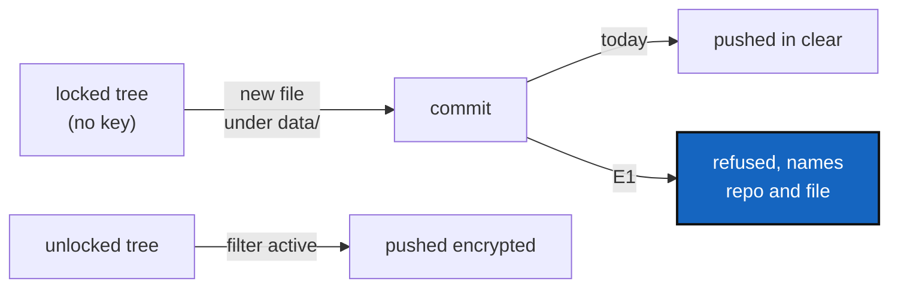

# EncryptedRepos — a tree that holds git-crypt repositories can never push a secret in clear

*Created: 2026-11-21*

*Branch: data-encrypt*

> **From the owner's short ticket** [git-crypt-encryption](../archive/.closedUserTicket/20261121_git-crypt-encryption.md)
> (2026-11-21): use encryption if ComplexGitSync is compatible, say whether
> cgitsync must evolve, write the evolutions as tickets, work on
> `data-encrypt`, and add `.config/` with the test topology. Ranked 2-13 at
> filing, after every open ticket; the owner re-ranks at the next review.

## Abstract — read this first

**The one-line version.** cgitsync already works with git-crypt. This ticket
closes the one hole a probe found: in a locked tree, a new file under an
encrypted path is committed **in clear**. It also makes the locked or unlocked
state visible, and settles how `merge` treats encrypted files.

**What this document is.** A three-step plan: E1 a refusal, E2 a status
column, E3 a merge investigation. It comes with a test tree at two levels:
`.config/cgitsync-encrypt.cgs` (USER) and `.config/cgitsync-encrypt-devel.cgs`
(DEV), unlocked with the unsafe keys in `.keys/`.

**Why it exists.** A project can keep its data in repositories encrypted with
git-crypt (`filter=git-crypt` in `.gitattributes`). The data is in clear on
the disk of an unlocked tree and encrypted on the provider. Git applies the
filter only after `git-crypt unlock`, so a tree that is never unlocked (a
second workspace, a CI runner, an agent kept away from the data) writes any
new file to the provider as it is. A git hook would catch it, but hooks are
not cloned: every `bootstrap` drops them. cgitsync is the one thing present
in every tree.

**Who it is for.** The worker and orchestrator who implement it, and the owner
who answers §5.

**What you need to do with it.** Answer §5, then follow §3, step 0 first.

---

## 1. What the probe of 2026-11-21 established

The probe used cgitsync 8.9.4 and git-crypt 0.8.0. The tree was a root plus
one encrypted child with its own `.cgs` declaring itself at `"."`, on local
bare remotes, with `ComplexGitSyncClient._build_remote_url` patched as in
`tests/integration/test_behind_gate.py`. The data was synthetic only.

| Case | Result |
|---|---|
| `bootstrap` with no key | OK. Files under `data/` are ciphertext (`\0GITCRYPT` header) on disk |
| `status`, locked | READY, `clean`, `synced` |
| `git-crypt unlock` | Plaintext on disk; `git status --porcelain` stays empty |
| `status`, unlocked | READY, `clean`, `synced`: **indistinguishable from locked** (E2) |
| `add` / `commit` / `push` through the client, unlocked | OK; the remote blob is encrypted |
| `freeze_release` | OK |
| a second tree, never unlocked: code commit in the root | OK; data untouched |
| nested self entry `"."` of the child `.cgs` | skipped by the discovery guard; the tree holds 2 repositories, not 3 |
| **locked tree: new `data/new.csv`, `git add` + `commit`** | **the blob is plaintext** (E1) |
| `merge` of a conflicting encrypted file | not tried (E3) |

## 2. Scope

What is **in scope** is detection from `.gitattributes`, through `git
check-attr filter`, with no new `.cgs` key. A repository is "encrypted" when
at least one tracked path has `filter=git-crypt`.

What is **out of scope**:

- unlocking;
- keys;
- any call to `git-crypt` itself.

cgitsync never handles a key. Unlocking stays the consuming project's
business; PATRIMOINE does it with `pixi run decrypt`, a name chosen so as not
to collide with `cgitsync unlock`.

## 3. Steps

0. **Test tree.** On the owner's word:
   - create `github:flipoyo/CGSenc`, `CGSenc-data`, `CGSenc-space` and
     `CGSenc-memory` (private, synthetic data, on `main`);
   - give `CGSenc-data` the key `.keys/unsafe-key-1` and `CGSenc-space` the key
     `.keys/unsafe-key-2` (`git-crypt unlock <key>` before the first encrypted
     file; `.keys/README.md`);
   - copy `.config/CGSenc-space.cgs` to the root of `CGSenc-space`;
   - check that both `.config/cgitsync-encrypt.cgs` (USER: the three CGSenc
     repositories, driven by the bootstrapping checkout) and
     `.config/cgitsync-encrypt-devel.cgs` (DEV: plus ComplexGitSync on
     `data-encrypt` as `environment_root`, and `CGSenc-memory`) bootstrap READY.

   The integration tests do **not** depend on these repositories. They build
   the same shape on local bare remotes and skip when `git-crypt` is not on
   `PATH`. The live tree is for the owner's acceptance run.
1. **E1: refuse plaintext under an encrypted path.**
   - **Where:** a new diagnostic in
     `tree/operations/preflight.py`, `_collect_encryption_diagnostics`,
     `BLOCKING_ERROR`, and new `GitRunner` probes (`check-attr`, `cat-file`).
   - **`commit`:** the check runs *after* staging, on the index. For every
     staged path whose `filter` attribute is `git-crypt`, it reads the staged
     blob (`git cat-file blob :<path>`, first 10 bytes). It refuses unless the
     blob starts with `\0GITCRYPT`.
   - **`push`:** the same check runs on every blob that `@{upstream}..HEAD`
     adds or changes under such a path. This catches a commit made outside
     cgitsync.
   - **The message** names the repository, the path, and the two ways out:
     unlock the tree, or unstage the file.
   - **No bypass flag in this ticket** (§5 Q1).
   - Ring placement follows `AdditionalSpecs.md`: probes in `git_repo/`,
     decision in `tree/operations/`.
2. **E2: show the state.**
   - **`status`:** new column `CRYPT` in `status_render.py`, with the value
     `-`, `locked` or `unlocked`. `unlocked` means a git-crypt filter is
     configured in the repository's `.git/config`. `locked` means
     `.gitattributes` asks for the filter but none is configured.
   - **JSON:** the same field in `status --json`.
   - **`bootstrap` / `initialise`:** one summary line,
     `N repositories are encrypted and locked: <names>`.
3. **E3: merge, investigate first.**
   - **Test:** reproduce a conflict on an encrypted file, unlocked and
     locked, through `cgitsync merge --dry-run` and `merge`.
   - **Expected today:** a binary conflict.
   - **Decide with the owner:** either refuse `--resolve` on encrypted paths
     with a message, or document the `git-crypt` merge driver setup. Do not
     implement before the investigation is written into this ticket.
4. **Docs.** Add a section to the user guide (`docs/`) and a paragraph to
   tutorial 05, *private repos*, saying what cgitsync does and does not do
   with encrypted repositories. Add a CHANGELOG entry.

## 4. Acceptance

- `tests/integration/test_encrypted_repos.py` (skip without `git-crypt`):
  - every row of §1 becomes a test;
  - the plaintext row now expects the `commit` refusal;
  - a push test covers a commit made with plain `git commit` in a locked tree.
- Unit tests for the diagnostic, with a fake `GitRunner`, and for the `CRYPT`
  column.
- `pixi run lint` and `pixi run test` are green, and module ceilings hold.
- Owner run: the live tree from step 0, bootstrapped twice. In the tree left
  locked, `status` shows `locked` and a new file under `data/` is refused. In
  the unlocked tree, `status` shows `unlocked` and the same file is pushed
  encrypted.
- The branch merges into `CGS-ALPHA` when E1 and E2 are done. E3 may stay
  open as its own ticket.

## 5. Decisions for the owner

- **Q1: a bypass?** Should E1 have an override, for example
  `--allow-plaintext <path>`, or none at all? Recommended: none. A file that
  should be in clear belongs outside the encrypted pattern in
  `.gitattributes`.
- **Q2: other tools?** Should E1 recognise only `filter=git-crypt`, or also
  `transcrypt` and `git-secret`? Recommended: git-crypt only, with the filter
  name read from one constant so another tool can be added later.
- **Q3: test repositories.** Create the three `CGSenc` repositories on
  GitHub, as written in `.config/cgitsync-encrypt.cgs`, or on GitLab next to
  the `CGS_test` group?
  **Answered by the owner, 2026-11-21: GitHub.** `.config/cgitsync-encrypt.cgs`
  and `.config/CGSenc-space.cgs` already say `github:flipoyo/…`, so nothing
  changes there.
- **Q4: test tree level and keys.** **Answered by the owner, 2026-11-21:**
  both levels, two `.cgs` (USER `.config/cgitsync-encrypt.cgs`, DEV
  `.config/cgitsync-encrypt-devel.cgs`). Keys: *"for the prototyping phase, i
  don't want to use bw and real keys, they should be living in the branch
  under .keys/unsafe-key-i. Once demonstrated, we'll use real keys, this is
  the equivalent of a --dry-run"*. `.keys/unsafe-key-1` and `-2` are made with
  `git-crypt keygen` and serve the prototype only, on the synthetic CGSenc
  repositories. Real keys are the owner's, made when the feature is used for
  real, in a real project and outside this repository (§2: cgitsync never
  handles a key). The DEV memory is a test repository of its own,
  `CGSenc-memory`, so no test writes into `github:flipoyo/.memory`.
