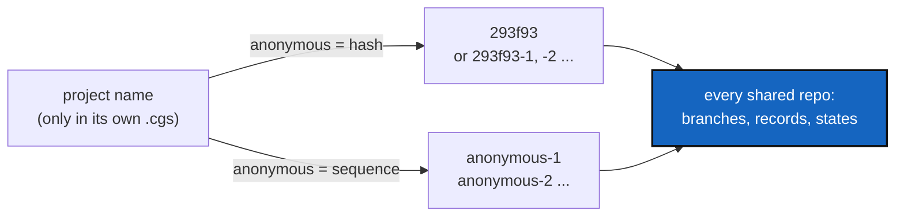

# AnonymousProject — a project can mount the shared repositories without writing its name into them

*Created: 2026-11-21*

*Branch: data-encrypt*

> **From the owner's short ticket** [anonymous-project](../shortTickets/anonymous-project.md)
> (2026-11-21). Filed on `data-encrypt` at the owner's request: it serves the
> same purpose as EncryptedRepos, a private project that reveals nothing
> through the repositories it shares. Ranked 2-14 at filing; the owner
> re-ranks at the next review.

## Abstract — read this first

**The one-line version.** A new `.cgs` option, `anonymous`, makes cgitsync
file a project under an **alias** in every repository it shares with other
projects. The alias is either the first 6 hex digits of `sha256(name)`
(`"hash"`), or `anonymous-<i>` (`"sequence"`), with `-<i>` added on a
collision. The real name stays in the project's own `.cgs`.

**What this document is.** The design of the option, where the name leaks
today (§1), the steps (§3), and the decisions left to the owner (§5).

**Why it exists.** `private_local_branch` (`git_repo/git_branch.py`) names
every private/local branch after the project: `<project>` on `main`,
`<project>_<branch>` otherwise, and `ComplexGitSync_<project>_<branch>` for a
twin's memory. Those repositories (`.dev`, `.localSpec`, `.claude`,
`.memory`, `omniscience`) are shared by all the owner's projects. A project
whose very name is private (here a personal-wealth project) shows that name
to anyone who can list the branches of the shared repositories.

**Who it is for.** The worker and orchestrator who implement it, and the owner
who answers §5.

**What you need to do with it.** Answer §5, then do §3 step 1, the audit,
before any code.



---

## 1. Where the project's name reaches a shared repository today

| Channel | Where it is written | Example for project `P` on branch `x` |
|---|---|---|
| private/local branch names | `private_local_branch` (`git_repo/git_branch.py`, "the one place the naming rule lives") | `.dev`, `.localSpec`, `.claude`, `omniscience`: `P_x` |
| memory branch | `MemoryRepository.branch` (`tree/memory/repository.py`), via the same function | `.memory`: `P_x`, twin `ComplexGitSync_P_x` |
| self-history branch | `self-history adopt`, on the memory's branch | `.self-history`: same as memory |
| omniscience records | `omniscience_record.py`, field `project` (lines 81, 114, 174) | the record header carries `project = "P"` |
| memory content | the `.gts` States and the ledger committed into `.memory` | the project name, and every repository URL of the tree |
| commit messages and tags | commit messages written by cgitsync into private repos; tags `cgitsync tag` creates | to be measured by the audit (§3 step 1) |

The first three rows are the owner's request. The last three are the same
leak through content rather than names, and are why step 1 is an audit.

## 2. The option

```toml
project = { name = "PATRIMOINE", default_branch = "security-space", anonymous = "hash" }   # or "sequence"
```

- **An option of the project field, never a name (owner).** The user declares
  the real name, then `anonymous`. The alias is computed and is what every
  shared register receives: branches, omniscience records, memory. It is
  never typed. A `project.name` that has the shape of an alias
  (`anonymous-<i>`, or 6 hex digits with an optional `-<i>`) is refused by
  `validate`, so nobody can sit on another project's alias by hand.
- **Off by default.** Without `anonymous`, nothing changes, byte for byte.
- **The alias is computed by a pure Ring 0 function**, next to
  `private_local_branch`, and replaces `project_name` wherever a shared
  repository is named or written. The suffix rule is unchanged: `<alias>` on
  `main`, `<alias>_<branch>` otherwise, and the twin keeps its
  `ComplexGitSync_` owner.
- **`"hash"` mode.** The candidates are `t`, then `t-1`, `t-2`, …, where
  `t = sha256(name.encode()).hexdigest()[:6]`. For `PATRIMOINE`, `t` is
  `293f93`.
- **`"sequence"` mode.** The candidates are `anonymous-1`, `anonymous-2`, …
- **Choosing a candidate (shared by both modes).** A candidate is *ours* when
  the shared repository's branch exists and carries the project's **claim**.
  It is *free* when no such branch exists. It is *taken* when the branch
  exists with another project's claim. The first candidate that is ours or
  free wins, so the choice is deterministic on every machine, with no local
  state.
- **The claim.** A one-line file, `.cgitsync-alias`, at the root of the alias
  branch, holding `sha256(name)` in full. It reveals no more than the alias
  already does in `"hash"` mode. It reveals more than nothing in `"sequence"`
  mode, hence §5 Q2.
- **Where the alias is resolved.** It is resolved once per tree, at
  `bootstrap`, `initialise` and `branch create`, then recorded in the tree's
  State. Every later command reads it from there and never searches again.
- **Coherence check.** The same alias must be used in every shared repository
  of the tree. If one repository's claim disagrees with the others, that is a
  refusal, not a new suffix.
- **Validation.** `validate` refuses an `anonymous` value other than `"hash"`
  or `"sequence"`. `named_cgs.py` is unaffected: the level-file rule reads
  the file name against `project.name`, which keeps the real name.

## 3. Steps

1. **Audit, before any code.** List every place a project name or a
   repository URL is written into a repository other than the project's own:
   the rows of §1, commit message templates, tags, the ledger, `.gts`
   headers, omniscience. Write the list into this ticket, row by row, each
   marked *alias* (replaced), *omit* (dropped under `anonymous`) or *keep*
   (with a reason). The owner validates the list.
2. **Ring 0.** `ProjectAlias` (its own file, `__all__`) has two methods:
   `candidates(name, mode)`, a generator, and `claim(name)`. It comes with
   unit tests: the `PATRIMOINE` → `293f93` vector, `-1` after a taken
   candidate, and the `sequence` order.
3. **Resolution.** A `GitRunner` probe reads a remote branch's
   `.cgitsync-alias` (`git ls-remote` + `git show`). Resolution runs in
   `bootstrap`, `initialise` and `branch create`, and the State records the
   alias.
4. **Naming.** `private_local_branch` and `MemoryRepository.branch` take the
   alias when the tree is anonymous. One call site decides, so no module
   composes the strings itself, as the docstring already requires.
5. **Content.** Apply the audit's *alias* and *omit* rows. In omniscience,
   `project` becomes the alias.
6. **Migration of an existing tree.** `cgitsync anonymise --dry-run` lists the
   branches `P_*` of the shared repositories and the alias branches that
   would replace them. Without `--dry-run`, it creates the alias branches at
   the same commits and pushes them. It deletes the `P_*` branches only with
   `--delete-old`, after a confirmation that names each one. History keeps
   the old name in commits already written: the command says so and does not
   rewrite history.
7. **Docs.** Add a paragraph to tutorial 05 (*private repos*), a section to
   the user guide, and a CHANGELOG entry.

## 4. Acceptance

- Unit tests: alias vectors, collision suffix, mode validation, and
  `private_local_branch` with and without an alias.
- `tests/integration/test_anonymous_project.py`, on local bare remotes:
  - two projects whose `"hash"` aliases collide (forced by monkeypatching the
    truncation) get `t` and `t-1`, on every machine, in either order;
  - a second bootstrap of the same project finds its own alias;
  - no shared repository's branch list, State, record or commit message
    contains the real name (a grep over every clone of the test tree);
  - a project without `anonymous` is byte for byte unchanged.
- `pixi run lint` and `pixi run test` are green, and module ceilings hold.
- Owner run: the PATRIMOINE tree (`compta/.config/compta-dev.cgs`:
  `name = "PATRIMOINE"`, `anonymous = "sequence"`) resolves to `anonymous-1`.
  No `PATRIMOINE` appears in the branches, records or States of `.dev`,
  `.localSpec`, `.claude`, `.memory` or `omniscience`.

## 4.1 The risk that holds until this lands

cgitsync 8.9.4 accepts `anonymous` in the project table **without a word and
ignores it** (probed 2026-11-21 with `validate`). A `.cgs` written for this
ticket, bootstrapped by a cgitsync that predates it, therefore writes the real
name into every shared register. That is the exact leak the option exists to
prevent.

Two consequences:

- `compta/.config/compta-dev.cgs` carries a *do not bootstrap* warning until
  this ticket lands.
- This ticket adds a guard for the versions that follow: a `.cgs` that
  declares `anonymous` is refused by any cgitsync that cannot honour it. The
  mechanism is §5 Q5.

## 5. Decisions for the owner

- **Q1: default mode.** Recommended: `"sequence"`.
  - `"hash"` is deterministic, but it can be **tested against a guess**:
    anyone who suspects the name `PATRIMOINE` can compute `293f93` and confirm
    it.
  - `"sequence"` reveals nothing about the name.
  - Alternative: a salted hash, with the salt in the owner's Bitwarden
    vault. That is stronger but needs the salt on every machine.
- **Q2: the claim in `"sequence"` mode.** With `sequence`, should the claim
  be `sha256(name)` (recommended: it is needed to tell our branch from
  another project's) or an HMAC with a salt?
- **Q3: content leaks.** Should repository URLs inside States written to
  `.memory` be aliased too, or is the project allowed to show its repository
  names while hiding its own name? This depends on the audit of step 1.
- **Q4: migration.** Is the `--delete-old` step of `anonymise` wanted, or are
  the old branches deleted by hand?
- **Q5: refusing an option the tool does not know.** How should an older
  cgitsync refuse a `.cgs` that declares `anonymous`?
  - (a) `validate` and `bootstrap` refuse **any** unknown key in the project
    table from now on. This is strict, and may break `.cgs` files that carry
    keys of their own.
  - (b) A minimum version in `environment.tools`
    (`cgitsync = "<version that ships this>"`), checked before cloning.
  - Recommended: (b) for this project, plus (a) for the `project` table
    only, after an audit of the checked-in `.cgs` files.
