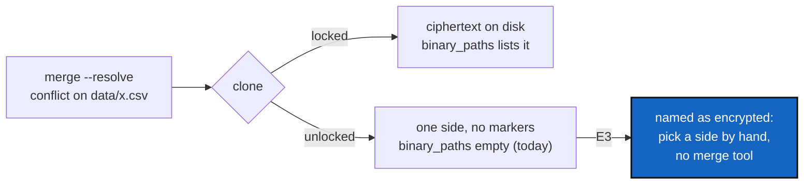

# EncryptedMerge — `merge --resolve` on a conflicting encrypted file leaves nothing to resolve

*Created: 2026-11-21*

*Branch: data-encrypt*

> **Split from** [EncryptedRepos](../archive/20261121_EncryptedRepos_DevPlanTicket.md) E3
> (owner, 2026-11-21, Q5: "leave E3 as its own ticket"). Its investigation is
> that ticket's §6 and is repeated in §1 below, so this ticket stands alone.
> Ranked 2-15 at filing, after every open ticket; the owner re-ranks at the next
> review.

## Abstract — read this first

**The one-line version.** When two branches change the same git-crypt file,
`cgitsync merge` already refuses cleanly, but `merge --resolve` stops in a state
a person cannot work from: in an unlocked clone the file reads as one side with
no conflict markers, and cgitsync does not know it is binary. This ticket makes
`--resolve` say so and name the way out.

**What this document is.** A one-step plan, E3, with its decision for the
owner. It changes no behaviour of `commit`, `push` or `status`.

**Why it exists.** Git has no way to merge the ciphertext of two edits of one
file, so the conflict is a binary one whether the clone is locked or not. Git
decides "binary" from the stored ciphertext, not from what is on disk, so
`binary_paths` is empty in an unlocked clone and no hint is printed. Nothing is
ever committed in clear by this path; the cost is a confusing stop.

**Who it is for.** The worker and orchestrator who implement it, and the owner
who answers §4.

**What you need to do with it.** Answer §4, then follow §2.

---

## 1. What the investigation of 2026-11-21 established

Run with cgitsync 8.10.0, git-crypt 0.8.0, git 2.53.0, local bare remotes. Both
sides of `data/amounts.csv` were changed on `main` and on `side`, in an unlocked
clone and in one locked again with `git-crypt lock`.

| Case | Result |
|---|---|
| plain `git merge side`, unlocked | `CONFLICT (content)`: ciphertext merged as binary; the worktree shows one side, decrypted, **no markers** |
| plain `git merge side`, locked | the same conflict; the worktree holds ciphertext |
| `cgitsync merge side`, either | refused before anything moves, naming `data/amounts.csv` and `merge --resolve`. Correct |
| `cgitsync merge --resolve side`, locked | stops at the repository, `binary_paths` lists the file, `hand_command` is `None` |
| `cgitsync merge --resolve side`, unlocked | stops at the repository, index `UU`, `binary_paths` **empty**, `hand_command` `None` |

## 2. Steps

1. **E3: name the encrypted path.**
   - **Where:** `tree/operations/merge.py`, using `GitCrypt.attributed` on the
     conflicting paths `--resolve` stops on. No new `GitRunner` method.
   - **What:** a conflicting path whose `filter` is git-crypt is added to
     `binary_paths` whether or not the clone is unlocked, no merge tool is
     opened on it, and the stop message says: choose a side by hand,
     `git checkout --ours -- <path>` or `--theirs`, then `git add <path>`,
     then run `cgitsync merge --resolve <branch>` again.
   - **No git-crypt call:** the rule of EncryptedRepos §2 holds. cgitsync runs
     no `git-crypt` and installs no merge driver.
2. **Docs.** Replace the *Merging an encrypted file* paragraph of the user
   guide (*Encrypted repositories*) with the behaviour, and add a line to
   tutorial 07, *merge*. CHANGELOG entry.

## 3. Acceptance

- `tests/integration/test_encrypted_repos.py` (skip without `git-crypt`), two
  tests: a conflict in an unlocked clone and in a locked one. Both stop with
  the path in `binary_paths`, the hand command named, no merge tool run, and
  nothing committed.
- A unit test with a fake runner for the classification of the conflicting
  paths.
- `pixi run lint` and `pixi run test` are green, and module ceilings hold.
  `tree/operations/merge.py` is near its ceiling: put the classification in a
  small class of its own and raise nothing without the owner's word.

## 4. Decisions for the owner

- **Q1: refuse, or a merge driver?** Recommended: name the path and the way out
  (§2). The alternative is to document `git-crypt`'s textual merge driver (a
  `merge` attribute and a driver that decrypts both sides). That driver lives
  in `.git/config`, is not cloned, would have to be checked by cgitsync, and
  needs cgitsync to run `git-crypt`: outside EncryptedRepos §2. If the owner
  wants it, it is a new ticket.
