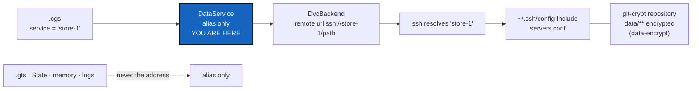

# DataServerAddress — a tree names its data server, and its address is never written in clear

*Created: 2026-11-25*

*Branch: data-repo*

> **From the owner's short ticket** [server-ip](../archive/.closedUserTicket/20261125_server-ip.md)
> (2026-11-25): `data-repo` develops the data class that couples DVC with a
> server and links it to the Git tree. The owner asks whether the server's
> addresses (IPv4, IPv4 gateway, IPv6, IPv6 gateway, reverse DNS from the
> server provider) go into the `.cgs` in clear, or into a register encrypted
> with the `data-encrypt` work. The owner prefers encrypted addresses.
> Ranked 2-16 at filing, after every open ticket on every branch: `data-encrypt`
> already uses 2-13 to 2-15. The owner re-ranks at the next review.

## Abstract — read this first

**The one-line version.** A `.cgs` names its data server by an **alias**,
`data = { backend = "dvc", service = "<alias>" }`. Nothing cgitsync writes
ever holds the address: not the `.cgs`, the `.gts`, a State, the memory or a
log. The address lives in an SSH configuration snippet kept in a git-crypt
repository. SSH turns the alias into the address, so cgitsync never reads it.

**What this document is.** The plan for the `service` key that
[DataSchema](data-repo_2-7_DataSchema_DevPlanTicket.md) reserved and
refuses today. `git_repo/data_spec.py` says that key "waits for
DataArchitecture §7 C2". No ticket holds a §7, so this ticket replaces that
reference. It holds one answer to the owner's question, four steps and five
decisions.

**Why it exists.** DVC needs a remote before
[DataMaterialisation](data-repo_2-10_DataMaterialisation_DevPlanTicket.md)
can pull anything or
[DataPublication](data-repo_2-11_DataPublication_DevPlanTicket.md) can push
anything. For the owner's ecosystem, that remote is a server of its own.
Where its address lives must be decided before it gets copied, in clear,
into every `.gts` and every memory entry that follows it. A `.gts` and a
memory are append-only and shared. An address written there once cannot be
removed.

**Who it is for.** The owner, who answers §5. After that, the worker and
orchestrator who implement it.

**What you need to do with it.** Read §1 and §2 first: they answer the
short ticket's question. Then answer §5.

---

## 1. Which of the five addresses a tree needs

A client connecting to the server needs **one** of them, never all five.

| Field from the provider | Does a client use it? | Store it? |
|---|---|---|
| IPv4 | Yes. It is the address DVC's SSH connects to. | Yes, encrypted (§2) |
| IPv6 | Only when the client's network has IPv6. | Optional, encrypted, as a second `Host` |
| IPv4 gateway | **No.** It is the server's own route out, set on the server. | Never |
| IPv6 gateway | **No.** Same reason. | Never |
| Reverse DNS | It can stand in for the IP, but it does not hide it. Providers build it from the IP. An OVH-style name like `ns3012345.ip-51-68-12.eu` spells out three of the four bytes, and resolving it gives the whole IP. | Never |

Encrypting the IP while the reverse DNS name stays in clear protects
nothing. The rule therefore covers every address and every hostname that
reveals one, not only the IP.

**What encryption buys, and what it does not.** An IP address is not a
secret the way a key is. Every router between client and server sees it,
and the whole IPv4 space gets scanned constantly. Keeping it out of the
shared repositories still has a real use: nobody who reads the trees can
link the owner's projects to one machine. That is the same goal as
AnonymousProject on `data-encrypt`. But **the server's security is its SSH
configuration, not its address**: key-only login, no password and no root
login, a firewall and a ban on repeated failures. This ticket covers the
first goal and only names the second. §6 lists the second as out of scope.

## 2. Where the address goes — the answer to the short ticket

| Option | What it means | Verdict |
|---|---|---|
| **A. In clear in the `.cgs`** | `service = { host = "51.68.12.34" }` | **Refused.** `.cgs` → `.gts` → State → memory copies it into append-only history, in shared repositories. |
| **B. An encrypted register that cgitsync reads** | A git-crypt repository holds `servers.toml`. cgitsync decrypts it to read the address. | **Refused.** cgitsync would have to read secrets, but EncryptedRepos settled that cgitsync never unlocks and never handles a key. A locked tree could not resolve anything. |
| **C. An alias in the `.cgs`, resolved by SSH, with the snippet kept in git-crypt** | The `.cgs` says `service = "store-1"`. The DVC remote is `ssh://store-1/<path>`. `~/.ssh/config` has `Include` of a `servers.conf` that lives under `data/**` in a private git-crypt repository of the tree. | **Recommended.** The owner gets the encrypted register they want, through `data-encrypt`. cgitsync and DVC only ever see the alias. SSH, which the owner already trusts with the key, is the only thing that reads the address. |

Option C gives the owner encrypted addresses, as the short ticket asks. The
encryption is git-crypt's, as built on `data-encrypt`. cgitsync adds no
cipher and no key handling of its own.

**Where the DVC remote is written.** DVC reads its remote from `.dvc/config`
(committed) and `.dvc/config.local` (never committed). With option C,
`.dvc/config` can be committed safely, because it holds `ssh://store-1/…`.
An IP literal in it is refused (§3, step 3).

## 3. Steps

0. **Dependency on `data-encrypt`.** The plaintext refusal under a
   `filter=git-crypt` path and the `CRYPT` status column (EncryptedRepos E1
   and E2, cgitsync 8.10.x) exist only on `data-encrypt`. They are not on
   `HT-BETA`, and not yet on `data-repo`. Step 3 reuses that detection. The
   owner decides the merge order (§5 D4) before step 1.
1. **`DataService`: the class that couples DVC, the server and the tree.**
   - **Where:** `git_repo/data_spec.py`, ring 0, pure, no I/O. `DataSpec`
     gains `service: str | None`.
   - **Value:** the `service` key leaves `RESERVED_KEYS`. Its value is an
     **alias**: one SSH `Host` token matching `[A-Za-z0-9][A-Za-z0-9_-]*`.
     Dots, colons, `@` and digits-only labels are refused offline. That one
     rule rejects an IPv4 or IPv6 literal, a `user@host` and an FQDN such as
     a reverse DNS name, each with its own message.
   - **Round trip:** `to_cgs` writes it back, and the `.gts` `repo_state`
     carries the alias, never anything more.
   - **Optional `path`:** a path on the server (`service = { alias =
     "store-1", path = "/srv/dvc/forcing" }`) only if D2 says the path
     belongs in the `.cgs`. Otherwise it stays in `.dvc/config`.
2. **`DvcBackend` binds the alias.**
   - **Check:** `inspect` checks that the DVC remote URL's host is the
     declared alias.
   - **Probe:** `inspect(offline=False)` asks `ssh -G <alias>`, through
     `git_runner.py`'s one subprocess boundary or the backend runner that
     DataBackendContract allows. It checks that the alias resolves to a
     `hostname` other than itself, which means a snippet is present. It
     **never keeps, prints or logs** the hostname it read: the output is
     parsed and dropped in the same call, and `DataManager._scrub` already
     scrubs backend lines.
   - **No snippet:** an unresolved alias is `REMOTE_UNAVAILABLE`, naming
     the alias and the `Include` line to add. It is never an error that
     shows an address.
   - **Locked tree:** a locked git-crypt snippet repository gives the same
     verdict, with the hint "unlock `<repo>`". That is the EncryptedRepos
     wording.
3. **Refuse an address in clear, with no override.** This is the same
   family as EncryptedRepos E1.
   - **`commit` and `push`** refuse a staged or outgoing `.cgs`, `.gts`,
     `.dvc/config` or `pixi.toml` that holds an IPv4 literal, an IPv6
     literal, or a hostname under a provider reverse-DNS pattern. D3 fixes
     the list of files.
   - **The message** names the repository, the file and the line number. It
     does not repeat the address.
   - **A file under a `filter=git-crypt` path is exempt**, because it is
     ciphertext once pushed. Its plaintext check is E1's job.
   - **Where:** the check is a preflight diagnostic in `tree/operations/`,
     and the pattern lives in one ring-0 helper, which the memory writer
     also uses (below).
   - **Memory:** the writer refuses to record an address in any field, as a
     last line of defence.
4. **Docs and the test tree.**
   - **User guide:** a section, *Naming a data server*, with the alias, the
     `Include` line and the git-crypt repository holding `servers.conf`.
   - **Test tree:** `examples/` gets a data entry with a `service` alias.
   - **CGSenc:** CGSenc-data gets a synthetic `data/servers.conf`
     (`HostName 192.0.2.10`, from the TEST-NET-1 documentation range, never
     a real address).
   - **Specs:** AdditionalSpecs (data section) and the digest get the rule
     "no server address in any file cgitsync writes".

## 4. Acceptance

- `data = { backend = "dvc", service = "store-1" }` parses, writes back
  unchanged, and reaches the `.gts` as `service = "store-1"`.
- `service` set to `"51.68.12.34"`, `"2001:db8::1"`, `"me@store-1"` or
  `"ns3012345.ip-51-68-12.eu"` is refused offline, each with its own reason.
- A `.cgs`, `.gts` or `.dvc/config` holding an IP literal is refused by
  `commit` and by `push` (for a commit made outside cgitsync). The same
  file under a git-crypt path in an unlocked tree passes.
- With no `Include`, `status` shows the data repository as
  `REMOTE_UNAVAILABLE` naming the alias. With the snippet present, it is
  available. Neither output holds `192.0.2.10`: a test greps stdout, stderr,
  the `.gts`, the State and the ledger for it.
- A Git-only tree is unchanged, byte for byte. `pixi run lint`,
  `pixi run test` and `pixi run check-ceilings` pass.

## 5. Decisions — your call

### D1. Option C: an alias resolved by SSH, with the snippet in git-crypt?

Recommendation: **yes**. It is the only option that gives encrypted
addresses (as asked) and keeps cgitsync away from secrets (as EncryptedRepos
settled). The alternative that keeps encryption is option B. It makes
cgitsync read decrypted files and fail in every locked tree.

### D2. Does the path on the server belong in the `.cgs`?

Recommendation: **no**. Keep `service` a bare alias, and leave the path in
`.dvc/config` (`ssh://store-1/srv/dvc/forcing`). A path like `/srv/dvc/…` is
less sensitive than an address. Still, it describes the server, and DVC
already owns the remote, as DataArchitecture §2 says.

### D3. Which files does step 3 scan, and which patterns count as an address?

Recommendation:
- **Files:** `.cgs`, `.gts`, `.dvc/config` and `pixi.toml`.
- **Patterns:** an IPv4 or IPv6 literal, and any hostname matching
  `ip-\d+-\d+-\d+`. The TEST-NET and `2001:db8::/32` documentation ranges
  are allowed, so docs and tests can show an example.

Scanning every tracked file would refuse legitimate data.

### D4. Branch and merge order with `data-encrypt`?

Recommendation:
- **Branch:** `data-repo`, because the work is DataManager/DVC.
- **Order:** merge `data-encrypt` into `data-repo` first, so step 3 reuses
  E1's git-crypt detection instead of writing a second one.

The other way is to land steps 1 and 2 now, and step 3 after the merge.

### D5. SSH only?

Recommendation: **yes, for now**. DVC also speaks S3, WebDAV and HTTP, but
the owner's server is reached over SSH, and only SSH has an alias mechanism
that keeps the address outside every file. Any other transport is refused
by name, as `git-lfs` is.

## 6. Out of scope

- Hardening the server itself (SSH keys only, firewall, bans). It matters
  more than hiding the address, and it is the owner's machine, not
  cgitsync's.
- Generating, holding or unlocking any key. Unlocking stays the consuming
  project's job (PATRIMOINE's `pixi run decrypt`).
- Credentials of any kind in any file cgitsync writes (DataArchitecture §5,
  unchanged).
- Provisioning the DVC remote on the server.
