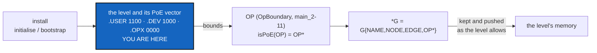

# MemoryMount — the install protocol by Proof-of-Existence level, and what each level's memory exposes

*Created: 2026-10-29*

*Branch: gx4g-main*

> **From the owner's short ticket `ExplDistantLocal` (2026-10-29), unchanged:**
>
> ```text
> Graph (G) Mounting Ergonomy - PoE
> G{NAME,NODE,EDGE,OP} - CORR OP not OP*. G->*G is automatically synchronised with the results of OP.isPoE. OP* is OP.poe if and only if OP.isPoE is TRUE
> System protocol
>
> .PUBLIC, PoE {1,1,1,1} Sigma=4
> VOID
>
> .USER=.USER-PUBLIC, PoE {1,1,0,0} Sigma=2
> > git clone GitRepo-G
> > cd $G-NAME
> > git clone GitRepo-ComplexGitSync
> > cd ComplexGitSync
> > pixi run cgitsync initialise install.cgs
>
> .DEV=.DEV-LOCAL, PoE {1,0,0,0} Sigma=1
> Same as .USER
> > pixi run cgitsync bootstrap $HOME/.cgs/$G-NAME/$G-NAME-dev.cgs
>
> .OPX=.OPX-DISTANT, PoE {0,0,0,0} Sigma=0
> Same as .USER
> > pixi run cgitsync bootstrap $HOME/.cgs/$G-NAME/$G-NAME-opx.cgs
>
> From this protocol DevPlanTicket for gx4g-main MemoryMount
> G.PoE-->G*
> ```
>
> **The owner's answers, 2026-10-29, through `AskUserQuestion`:**
> - The ticket is filed **here**, under a new prefix `gx4g-main_`.
> - The PoE vector is **what a level exposes**, as Proof-of-Existence, to the public.
> - The scope is **the whole install protocol, plus the explicit development of the class `OP` as a boundary
>   class in ComplexGitSync**, to test how CGS-ALPHA behaves under internal requests from G or external
>   requests from GX4G.

> **Owner's refinement, 2026-10-29:** *"isPoE(OP) returns OP\*. For gx4g \*G = G{NAME,NODE,EDGE,OP\*}.
> \*G.poe = OP\*.poe"*. `isPoE` is a function, not a test: it maps an operation to its
> Proof-of-Existence form `OP*`. What gx4g sees, `*G`, is G with `OP` replaced by `OP*`, and the
> PoE of `*G` is that of `OP*`. This supersedes the reading "`OP* = OP.poe` iff `OP.isPoE` is true".

> **Owner's rule, 2026-10-29: the PoE register.** *"Seuls les Graphs typés PoE, \*G sont inscrits au
> registre PoE par Timestamp NAME SHA256(G.MerkleRoot). .omniscience enregistre la valeur Sigma de
> \*G dans le registre de manière visible."* Only a PoE-typed graph, a `*G`, is entered in the PoE
> register, as `(Timestamp, NAME, SHA256(G.MerkleRoot))`. `.omniscience` records `*G`'s Sigma in the
> register, visibly. G itself is never registered.

> **`OP` extracted, 2026-10-29 (owner: *"extrait l'implementation de OP comme ticket ComplexGitSync"*).**
> The boundary class, its routing, `isPoE(OP) → OP*`, `*G`'s derivation and the CGS-ALPHA tests are now
> `main_2-11_OpBoundary_DevPlanTicket.md`. This ticket keeps the install protocol, the PoE vector recorded at
> install, where `*G` lives and what each level's memory pushes, and depends on OpBoundary.

## Abstract — read this first

**The one-line version.** A project G is a graph `G{NAME, NODE, EDGE, OP}`. Each of its four install levels
exposes a fixed part of it as Proof-of-Existence (PoE), from everything (`.PUBLIC`) to nothing (`.OPX`).
This ticket installs each level and records its vector. OpBoundary (`main_2-11`) builds `OP`, the class
every operation passes through, and derives `*G = G{NAME, NODE, EDGE, OP*}`. This ticket says where `*G` lives and what
each level's memory pushes.

**What this document is.** The model, in the owner's terms (§1). The protocol, level by level (§2). What
exists today (§3). What it takes from OpBoundary (§4). The steps (§5), the decisions (§6) and acceptance (§7).

**Why it exists.** Today the three installs (`initialise install.cgs`, the developer `bootstrap`, gx4g's DEV
tree) each decide for themselves what their memory publishes. Nothing in `cgitsync` says which part of G a
level may expose, and nothing lets a test ask "what does `cgitsync` do when G asks this, and when GX4G does?".

**Who it is for.** The worker who writes the `.cgs` files of the protocol and records the levels, the orchestrator who
quotes them, and the owner, for §6.

**What you need to do with it.** Owner: answer §6 at `implement`. Worker: §5 in order.



---

## 1. The model, as read with the owner

- **G is a graph with four parts:** `NAME` (the project's name), `NODE` (its repositories), `EDGE` (how they
  mount each other) and `OP` (the operations run on it).
- **PoE, the Proof-of-Existence vector,** is one bit per part, in that order: 1 means the level exposes that
  part so that the public can prove it exists. `Σ` is the number of parts exposed.
- **`OP`, not `OP*`.** `cgitsync` operates on `OP`, the real operation; `isPoE(OP)` returns `OP*`, its
  Proof-of-Existence form (OpBoundary).
- **`G → *G`, automatically.** For gx4g, `*G = G{NAME, NODE, EDGE, OP*}`, and `*G.poe = OP*.poe`. Nobody
  writes `*G`; it is synchronised from the results of `isPoE`, bounded by the level's PoE vector.

## 2. The protocol, level by level

| Level | Also named | PoE `{NAME,NODE,EDGE,OP}` | Σ | Install |
|---|---|---|---|---|
| `.PUBLIC` | — | `{1,1,1,1}` | 4 | none: `VOID`. It is what the others expose. |
| `.USER` | `.USER-PUBLIC` | `{1,1,0,0}` | 2 | `git clone` G; `cd $G-NAME`; `git clone` ComplexGitSync; `cd ComplexGitSync`; `pixi run cgitsync initialise install.cgs` |
| `.DEV` | `.DEV-LOCAL` | `{1,0,0,0}` | 1 | as `.USER`, then `pixi run cgitsync bootstrap $HOME/.cgs/$G-NAME/$G-NAME-dev.cgs` |
| `.OPX` | `.OPX-DISTANT` | `{0,0,0,0}` | 0 | as `.USER`, then `pixi run cgitsync bootstrap $HOME/.cgs/$G-NAME/$G-NAME-opx.cgs` |

So a `.USER` tree exposes G's name and repositories, a `.DEV` tree only G's name, and an `.OPX` tree nothing.
The more a level operates, the less it exposes.

## 3. What exists today

- **`.USER`.** `initialise install.cgs` is BeforeBeta's S11. The tree is USER, and its memory is local and never pushed.
- **`.DEV`.** Opened today with `bootstrap examples/complexgitsync4dev.cgs` for ComplexGitSync, and with
  `examples/gx4g4dev.cgs` for gx4g. The protocol moves the spec to `$HOME/.cgs/$G-NAME/$G-NAME-dev.cgs`, outside both clones.
- **`.OPX`.** No `-opx.cgs` exists. `OperatingSpace` is "the API of OPX, the operating system" (Minimalism D5),
  and the Omniscience register is gx4g's (Minimalism D7).
- **What a level exposes** is decided today by each command: whether it pushes a memory, whether it writes to
  the register. No single class says it.
- **CGS-ALPHA is ComplexGitSync** (owner, 2026-10-29). No test today drives `cgitsync` through a
  request from G and the same request from GX4G and compares the two.

## 4. What this ticket takes from OpBoundary

`OP` is built in `main_2-11_OpBoundary_DevPlanTicket.md`: it carries the operation, its origin (G or GX4G) and
the level, and answers `run()` and `isPoE(OP) → OP*`. `*G` is derived there from those answers. This ticket only
supplies the level and its vector (M2), and decides where `*G` is kept and pushed (M4).

## 5. Steps

- **M1. The protocol's `.cgs` files.**
  - Write the `$G-NAME-dev.cgs` and `$G-NAME-opx.cgs` shapes, and say where `$HOME/.cgs/$G-NAME/` comes from
    (`initialise --output-path`, CGSPATH).
  - For ComplexGitSync itself, `examples/complexgitsync4dev.cgs` maps onto `$G-NAME-dev.cgs`; §6 Q1 says whether it moves.
- **M2. The PoE vector in code.** One value per level, read from how the tree was installed. Like the twin's
  memory and IntegrityMount's relation, it is decided at install and never re-derived from the copy that runs.
- **M3. Depends on OpBoundary.** `OP`, its routing, `isPoE(OP) → OP*` and the CGS-ALPHA tests land there first.
- **M4. Where `G*` lives.** Keep the `*G` OpBoundary derives where §6 Q4 says, and make each level's memory push
  exactly what its vector allows: `.OPX` nothing, `.DEV` `NAME`, `.USER` `NAME` and `NODE`.
- **M4b. Sigma in the register.** A level's Sigma is the `sigma` `.omniscience` writes, visibly, in a `*G`'s
  `OmniscienceRecord` (OpBoundary O6): `.USER` 2, `.DEV` 1, `.OPX` 0.
- **M5. The level tests.** Install each level with §2's commands on a real tree, and assert its recorded vector
  and what its memory pushes.
- **M6. Documentation.**
  - The install protocol in the user guide and the README's install lines.
  - `AdditionalSpecs.md`: the PoE levels beside *The install frontier*.
  - `digest.md`.

## 6. Decisions for the owner

Asked through `AskUserQuestion` at `implement`, before the first edit.

| Q | Question |
|---|---|
| **Q1** | Does the developer spec move from `examples/<project>4dev.cgs` to `$HOME/.cgs/$G-NAME/$G-NAME-dev.cgs` for every project, ComplexGitSync included? And who writes that file, the owner or `initialise`? |
| **Q2** | What is an `.OPX` tree concretely: which repositories does `$G-NAME-opx.cgs` mount, and what does it run that `.DEV` does not? |
| **Q3** | Where does this ticket, and OpBoundary with it, rank against BeforeBeta: before beta (pile 1), or after it? |
| **Q4** | Where the `*G` OpBoundary derives lives: computed on demand (`status --json`), written to the memory and pushed when the level allows, or handed to gx4g? |

Moved to OpBoundary §5: which results are exposable and one door or only writes. CGS-ALPHA is ComplexGitSync (owner, 2026-10-29).

## 7. Acceptance

- Each of the four levels installs with the commands of §2, and its PoE vector is recorded at install.
- Each level's memory pushes exactly what its vector allows: `.USER` `NAME` and `NODE`, `.DEV` `NAME`, `.OPX` nothing.
- `*G` lives where §6 Q4 says, and is OpBoundary's derivation, never written by hand.
- `pixi run lint`, `pixi run test`, `bump-build`, `check-ceilings`, `check-oo` and `check-spectree` pass, and
  `cgitsync status` shows `errors=0`.

Related:
- `main_2-11_OpBoundary_DevPlanTicket.md`: `OP`, `isPoE(OP) → OP*`, `*G`, the CGS-ALPHA tests; this ticket depends on it.
- `archive/20261027_EnvConnect_DevPlanTicket.md`: the install frontier, the twin, PoE in the Operating Space.
- `archive/20260705_CGS.POC.md`: `PoE.state`, `PoE.PUBLIC`.
- `archive/20261029_IntegrityMount_DevPlanTicket.md`: the `.gts` may refuse.
- BeforeBeta §3c and `main_2-10_ProviderMigration_DevPlanTicket.md`: what is gx4g's.
