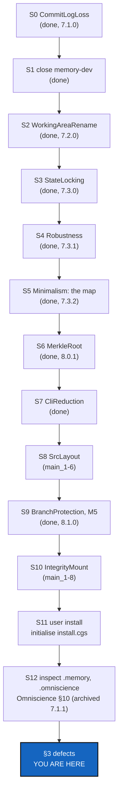

# BeforeBeta — everything mandatory before beta, landed on main and checked by a user install

*Created: 2026-10-27*

*Branch: main*

> **Ticket review — 2026-10-27, owner's decision.** Filed at `main_1-1`.
> The owner wants it run before the frontier between cgitsync and gx4g is
> finalised (EnvConnect's deferred C1 and C6, and GX4G's E5). The owner's
> order: *"test checkout memory-dev, merge main. Implement WorkingAreRename.
> checkout main, merge memory-dev. main holds install.cgs --> cgitsync
> initialise $CGSHOME install.cgs. Check with the utmost attention .memory, and
> reports defects as well as .omniscience."* WorkingAreaRename's D1 (rename,
> or prose only) **closes on the orchestrator's demand**.
>
> **Second pass, the same day:** *"concentrate main-openTickets as much as
> mandatory in BeforeBeta. Evaluate if shortTickets should be integrated
> too."* Pile 1 is now exactly what is mandatory before beta, and this ticket
> runs all of it:
> - **Omniscience** is closed by checking its §10 on the real trees.
> - **StateLocking** is mandatory because its trigger has fired: gx4g runs
>   `cgitsync` in a developer's tree.
> - **Robustness** (Phase 0 and D1–D5) comes from the short ticket
>   `robustness`, split on the owner's word. D6–D9 are RobustnessCrash, in
>   pile 2.
> - **BranchProtection** is mandatory on the owner's word: no random user
>   deletes a branch in the beta.
>
> `pixi-global-install` stays on stand-by (owner): the beta's user route is
> clone + `pixi run`. `deletion4devOnly` closes with BranchProtection.
>
> **Correction, the same day (owner):** *"Le DevPlan Before Beta est
> incoherent il faut mettre à niveau la branch memory-dev de main en
> premier."* `memory-dev` is brought up to `main` **before** the tree is put
> on it. Checking it out first would install its 5.0.0 build, and the merge
> would then run under that build in a tree whose memory 7.0.0 wrote. S1 is
> now `cgitsync merge main --into memory-dev`. It runs under 7.0.0, and the
> merge is a fast-forward, so the tree lands on `memory-dev` already at
> `main`. S3 follows the same rule the other way: `main` is brought up to
> `memory-dev` with `cgitsync merge memory-dev --into main`, run from
> `memory-dev`, under its newer build.
>
> **Third pass, the same day (owner):** *"à ce niveau d'écart on rapatrie le
> ticket sur main, et on close la branch memory-dev."* `memory-dev` was 30
> commits behind `main` and none ahead. WorkingAreaRename moves to `main_1-3`,
> and `memory-dev` is closed. **The `memory-dev` cycle is gone from this
> ticket:** every step lands on `main`, and the two corrections above apply to
> nothing any more. They are kept as history. Closing the branch is now S1.
> On 2026-10-27, `branch check memory-dev` found only `.memory` holding commits
> of its own: 2 ledger entries and 2 States, which `branch close` keeps on
> `ancestors`. `branch close` itself was **refused, and nothing was renamed**,
> because the memory's ledger does not verify (§3, defect 3). S1 waits on
> D4.
>
> **Fourth pass, the same day (owner):** D4 answered (b), *"b option ticket
> de code verify"*. CommitLogLoss is filed at `main_1-2` and runs as **S0**,
> before S1. The rest of pile 1 moves down one rank: Omniscience `1-3`,
> WorkingAreaRename `1-4`, StateLocking `1-5`, Robustness `1-6`,
> BranchProtection `1-7`.
>
> **Fifth pass, the same day (owner):** *"Ticket review integrates
> shortTicket minimalism and modify DevPlanTickets subsequently. It adds
> constraints to the overall BeforeBeta requirements."* S0–S3 have landed
> (7.1.0, 7.1.1 for Omniscience, 7.2.0, 7.3.0), so pile 1 is compacted:
> Robustness `1-2`, then three new tickets from `minimalism`. The owner's
> answers through `AskUserQuestion`:
> - **Provider APIs.** Every call to a provider's API, read or write, is
>   gx4g's. Before beta no new one enters `cgitsync`, and the existing ones
>   wait for gx4g (ProviderMigration, `2-10`).
> - **BranchProtection is split.** That answers D3 below.
> - **The whole short ticket is before beta,** except the migration.
> - **"Disclosed" means withdrawn from the CLI.**
>
> The new order is S4 Robustness, S5 Minimalism (the map), S6 MerkleRoot,
> S7 CliReduction and S8 BranchProtection (its M5 only), then S9 the user
> install and S10 the inspection, which were S6 and S7. §2.5 is the
> constraint the short ticket puts on every step.
>
> **Sixth pass, the same day (owner):** *"adapt DevPlan to new shortTicket
> gitRepo."* The owner's answers through `AskUserQuestion`:
> - **GitRepo** (Graph and GitRepo) is a subfolder first, the dependency
>   that imports nothing back, and later a repository of its own.
> - **The Omniscience register is gx4g's:** gx4g writes, and `cgitsync`
>   produces what is written. ProviderMigration now covers the register
>   writes too.
> - **`src/` is split before beta** into `GitRepo/`, `Merkle/`, `Tree/` and
>   `OperatingSpace/`. The other packages go where Minimalism's map
>   proposes, and the owner decides.
>
> SrcLayout is filed at `main_1-6` and runs as **S8**, after CliReduction.
> BranchProtection moves to `main_1-7` and S9: its M5 hands the dead-branch
> findings to gx4g instead of writing them. The user install is now S10 and
> the inspection S11. §2.5 gains constraints 6 and 7.
>
> **Eighth pass, the same day (owner):** Minimalism's map exists, and the owner
> answered its D1–D7: the **autonomous rule** (`cgitsync` keeps whatever it needs to run
> with no gx4g, so `memory *` and `branch create` stay; only `repo create` and the 12
> `omniscience *` commands leave, executed by ProviderMigration), **one-way mirror**
> (every command has a client method, a method may have no command), **an audit path is
> a Merkle node and is never shown**, **MerkleRoot owns every hash** under the test
> LEFT = RIGHT bit for bit, **OPX is the operating system**, **Omniscience is gx4g's**
> and its modules sit apart in SrcLayout. CliReduction therefore withdraws nothing before
> gx4g offers it. §2.5 rule 6 holds as written.

> **Seventh pass, the same day (owner):** *"merge tickets AgenticControl and
> NestedAgentMaster."* The owner filed NestedAgentMaster from a real failure
> of gx4g's DEV bootstrap. AgenticControl, filed from the short ticket
> `mount`, is merged into it as its §7, at `main_1-8`. It runs as **S10**.
> The user install moves to S11 and the inspection to S12.

## Abstract — read this first

**The one-line version.** This ticket is a beta rehearsal on the real
developer tree. It closes `memory-dev`, lands the mandatory work on `main` (a
memory-format change among it), and makes a fresh user install from `main`. Then it hunts for defects in `.memory` and `.omniscience`. It
reports what it finds; the only code it changes is through the tickets it
runs.

**What this document is.** The order of thirteen steps, S0 to S12 (§1), what
to watch in each and the constraints that bind them all (§2), the defects
found (§3), the decisions (§4) and when it is done (§5). Each ticket it runs keeps its own plan and its own worker/orchestrator
pair: this ticket is the order, not the content.

**Why now.** gx4g drives `cgitsync` from another process and builds on rules
that have never run end to end on a real tree:
- the tree-wide merge that keeps the target's memory whole;
- the private branch rule (`ComplexGitSync_memory-dev`);
- the 7.0.0 install frontier and twin memories;
- the USER tree's local-only memory;
- the Omniscience register.

It also relies on things being built here. The workspace lock landed in
7.3.0 (S3). Still to come are an honest partial-failure report (S4), and a
minimal CLI that sits at the ring interfaces, with every State hash behind
one class that never hands its tree out (S5–S7). Then a source tree that
shows the dependency, the hashes and the operator apart (S8). Last, a branch
a USER tree cannot remove through `cgitsync`, and a dying branch found and
handed to gx4g, which holds the register (S9). And one `.agent` per tree, so
that a project nesting ComplexGitSync's developer spec, gx4g first, can open
its DEV tree at all (S10). The provider's lock and roles are gx4g's (§3c). All of these must hold before gx4g's frontier is closed, and the
frontier is drawn on Minimalism's map.

**What you need to do with it.** Answer D2 (§4). D3 was answered on
2026-10-27. Then run §1 in order, filling §3 as you go, under §2.5.

---

## 1. The script

Run it in the developer tree (`examples/complexgitsync4dev.cgs`, NESTED,
DEV), from its root, unless a step says otherwise. Each `implement` is the
ordinary worker/orchestrator pair, with its own release and its own record.
Facts as of 2026-10-27:

| Step | What | Facts going in |
|---|---|---|
| **S0** | `implement CommitLogLoss`, on `main` | **Done 2026-10-27, 7.1.0**, archived. Defect 3's cause, answered by D4 (b). |
| **S1** | `cgitsync branch close memory-dev`, after S0. **Done by the owner, 2026-10-27 03:01, under 7.1.0**: `closed/memory-dev` or `closed/ComplexGitSync_memory-dev` in all seven repositories, `.memory`'s two own commits on `ComplexGitSync_ancestors`. | `branch check` finds every repository `safe` except `.memory`, whose `ComplexGitSync_memory-dev` alone holds 2 ledger entries and 2 States; the close keeps them on `ancestors`. Refused on 2026-10-27 because the ledger does not verify (defect 3). It runs once S0 has landed. |
| **S2** | `implement WorkingAreaRename`, on `main` | **Done 2026-10-27, 7.2.0**, archived. D1: prose only, nothing renamed; `memory status` prints `folded=` and `pending=`. |
| **S3** | `implement StateLocking`, on `main` | **Done 2026-10-27, 7.3.0**, archived. `.cgitsync/.lock`, taken by every writing client method; `cgitsync unlock`. |
| **S4** | `implement Robustness`, on `main`: Phase 0 first, then D1–D5 | **Done 2026-10-27, 7.3.1**, archived. `push`, `tag` and `release freeze` raise `TreePartialFailure` and converge on retry; the matrix is in `AdditionalSpecs.md`. Two edges are its follow-ups (its banner). Phase 0's deviations are for §3. Adds no command (§2.5). |
| **S5** | `implement Minimalism`, on `main`: the map. **Done 2026-10-27, 7.3.2**, D1–D7 answered | No change to `src/` beyond a map script. It covers 27 commands, 66 leaf commands, 115 public client methods, the provider calls, the Merkle surface and the ring-interface checks. It ends with the verdict per command (its D1) and D2–D5. |
| **S6** | `implement MerkleRoot`, on `main`. **Done 2026-10-27, 8.0.1** | Scope was fixed by Minimalism D3 and D4. Every golden vector, State name, `os_id` and `H_GLOBAL` stays byte for byte. |
| **S7** | `implement CliReduction`, on `main`. **Done 2026-10-27** | Carried out Minimalism D1. The tutorials and the user guide shrink with the CLI. Provider commands wait for ProviderMigration. |
| **S8** | `implement SrcLayout`, on `main`. **Done 2026-10-28, 8.0.4** | It applies Minimalism D6's folder column, `GitRepo/` first with its no-import test. `Merkle/` already holds MerkleRoot. Behaviour, public names and ceilings are unchanged. |
| **S9** | `implement BranchProtection`, on `main`: M5 only, after its D7 and D9. **Done 2026-10-28, 8.1.0**, archived | Split on 2026-10-27. M5 landed as `tree/branch_findings.py`: `status` and `branch list`, and their `--json`, report `vanished`, `half-closed`, `split`, `orphaned-private` and `closed`; nothing is recorded. The rest is §3c. `require_dev` is kept. M5 finds a dead GitTree-branch and hands it to gx4g, writing nothing to the register. M0–M4 (provider protection and roles) are §9, handed to gx4g. No provider call. |
| **S10** | `implement IntegrityMount`, on `main`; D1–D6 answered at filing | **Reopened 2026-10-28.** NestedAgentMaster shipped as 8.2.0 (archived) and the owner rejected its approach: *"La seule mission de cgitsync est de garantir l'intégrité du GitTree […] Je préfère un DENIAL de mount plutôt qu'une structure de type 2."* IntegrityMount undoes 8.2.0's schema 2, aliases and symlinks, and makes the `.gts` deny a requested mount that would break the GitTree, before anything is cloned for it. The State stays schema 1. |
| **S11** | The user install from `main`: `git clone github:flipoyo/ComplexGitSync $CGSPATH/ComplexGitSync`, then in it `pixi run cgitsync initialise install.cgs --output-path $CGSPATH` | `initialise` takes one source, plus `--output-path`, which is CGSPATH. CGSHOME is `CGSPATH/ComplexGitSync`, so the owner's `initialise $CGSHOME install.cgs` is spelled this way. `install.cgs` mounts the tool and `docs` only, so the tree is USER: its memory is local and never pushed. |
| **S12** | The inspection in §2, in three trees: this developer tree, the user tree (S11) and gx4g's DEV tree (S10). It uses the CLI that S7 left and the layout that S8 left | — |

## 2. What to watch, with the utmost attention

### 2.1 One branch, one build

With `memory-dev` closed, every step runs on `main` under the build it has
just landed; no step changes the tree's branch. Record `cgitsync --version`
for every command anyway. A ticket's release that changes behaviour shows up
as a new version between two steps, not as an older build left in the tree.

### 2.2 `.memory`, in the developer tree

- **Baseline, before S1.** `verify check` already says `corrupt`, with 27
  `COMMIT_LOG_MISMATCH` findings (§3, defect 1).
  - S12 checks that no new finding appears.
  - It also checks whether the rows 6.8.1 recorded as lost explain all 27.
- **The close (S1).**
  - `.memory`'s 2 own commits are on `ancestors`, recorded in the ledger,
    before any rename.
  - `closed/memory-dev` exists in every repository that had the branch,
    the private ones included, and nothing else moves.
  - The memory stays on `ComplexGitSync`: the tree is NESTED, so not a twin,
    and no `ComplexGitSync_ComplexGitSync` appears.
  - `.self-history` follows its memory's branch.
- **Integrity.**
  - The ledger chain gains no break.
  - Every State written before S2 still opens under its own name and still
    verifies.
  - `release load <State hash>` finds a State that only the memory holds.
- **Rename: none.** WorkingAreaRename's D1 said prose only. `memory status`
  splits the chain into `folded` and `pending`, and their sum is `entries`.
- **C8 ambiguity.** `ComplexGitSync_memory-dev`, and its closed name, is
  read as "ComplexGitSync, branch `memory-dev`", never as "twin of a
  project called `memory-dev`".
- **StateLocking, live.** Start two write commands at once in the developer
  tree.
  - One refuses before touching anything, and the read-only commands still
    run.
  - No ledger append is lost quietly.
  - The lock file is never folded into, committed to or pushed with the
    memory.
- **Robustness, live.** Make one repository's push fail mid-tree.
  - The report names what completed, what failed and what was not
    attempted.
  - Neither the memory nor the ledger claims the push.
  - The retry converges.
- **Status.** `cgitsync status` shows `errors=0` after every step.

### 2.3 `.memory` and branches, in the user tree (S11)

- The tree is USER, and its memory is created locally, never declared.
- Nothing is pushed, even when a remote is added by hand.
- No DEV prompt appears: neither `memory setup` nor EnvConnect C7's report.
- `initialise <a .gts>` is refused by name.
- **BranchProtection, as split:**
  - the user cannot close or delete a branch through `cgitsync`, and the
    refusal says why (`require_dev`);
  - through plain Git, the branch is protected only once gx4g has locked it
    on the provider (§3c). Until then, a deletion is
    found as `vanished` (M5) and handed to gx4g. S12 records which of the
    two it found.
- `status` shows `errors=0`.

### 2.4 `.omniscience`, and Omniscience §10

Neither tree mounts it today: the developer `.cgs` has no `.omniscience`
entry. Mount the register in a disposable DEV workspace, as tutorial 8 does.
Then:

- **USER tree.** `omniscience mount`, `register` and `observe` are refused
  by name before anything is touched.
- **DEV tree.** Every query (`get`, `branches`, `history`, `state`, `proof`,
  `verify`, `status`, `report`, `memory`) answers with one of the five
  statuses. None writes anything, and none turns a failed read into
  "deleted".
- **Omniscience §10.** Each of its eleven items gets a row in §3, either a
  defect or "holds". Omniscience itself was proved and archived on
  2026-10-27 against 7.1.0 (its §11); S12 reruns the same checks, after
  MerkleRoot (S6) moved every hash, so they also prove nothing moved.
- **MerkleRoot (S6).** A State's name and `os_id` are unchanged, so every
  registered record still verifies, and `omniscience proof` answers as
  Minimalism D3 decided.
- **BranchProtection.** Protecting the register's branch on the provider is
  gx4g's (§9). OmniscienceQuery keeps reporting that protection as "not
  checked", and that is not a defect. M5's findings appear in `status`,
  `branch list` and their `--json`, ready for gx4g. Until gx4g holds the
  register, `cgitsync`'s existing writer still serves tutorial 8, and §2.5
  rule 6 keeps it from growing.

### 2.5 The constraints `minimalism` puts on every step

They bind from the ticket review of 2026-10-27 on (owner). Each step's
orchestrator quotes against them, and a breach is a defect in §3.

1. **No new command or public client method** lands without a row and a
   verdict in Minimalism's map. Before S5 exists, no step adds one: S4 adds
   none by its own §6.
2. **No new call to a provider's API**, read or write. The existing calls
   (`repo create`, `memory setup`'s create step, the sign-in probe of
   `env show` and of every Environment record) are listed for
   ProviderMigration and stay until gx4g offers each one.
3. **The Merkle tree is never materialised.** No step adds code that walks,
   stores or hands out inner nodes outside the hashing modules. From S6 on,
   that means outside `MerkleRoot`.
4. **The CLI the beta ships is the reduced one.** S11 and S12, the tutorials
   and the user guide all run against the CLI that S7 left, in the layout
   that S8 left.
5. **The frontier with gx4g is drawn on the map.** What `cgitsync` hands to
   gx4g is listed in two places, ProviderMigration (the provider calls and
   the register writes) and §3c. Nothing else crosses
   without a row in the map.
6. **No new write to the Omniscience register** *(short ticket `gitRepo`)*.
   gx4g holds the register. `cgitsync` produces records and findings, and its
   existing writer (`mount`, `register`, `observe`) stays only until
   ProviderMigration.
7. **`GitRepo/` is the dependency** *(`gitRepo`)*. From S8 on, a test fails
   when it imports anything else from `ComplexGitSync`. Before S8, no step
   adds a dependency from the repository and graph code back to the rest.

## 3. Defects found

One row per defect, filled in during the run. A defect is reported, not
fixed here, unless the ticket a step runs owns it (§5).

| # | Step | Command and build | Observed | Expected | Severity |
|---|---|---|---|---|---|
| 1 | before S1 | `cgitsync verify check`, 7.0.0 | `status=corrupt`: 27 `COMMIT_LOG_MISMATCH` (seq 3–55, odd entries), "entry records a commit log whose rows are gone" | `ok`, or every finding explained as the loss recorded in 6.8.1 | fixed by S0: a recorded loss, `incomplete` |
| 2 | known | Robustness P2 and P3 | A failed `push` reports one error and loses what completed; a `tag` retry can never converge | §3 of Robustness | fixed by S4 |
| 3 | S1 | `cgitsync branch close memory-dev`, 7.0.0 | Refused, nothing renamed: "the ledger does not verify (seq=3 COMMIT_LOG_MISMATCH; …)". `verify repair` heals only a stale HEAD, never a chain, and 6.8.1 said the lost rows are not recovered. So this memory can never verify again, and every `branch close` and `branch delete` in this tree is refused for good. | A loss already recorded as unrecoverable does not refuse forever; a documented way through exists | fixed by S0 (CommitLogLoss, 7.1.0): `verify check` now says `incomplete`, 27 `COMMIT_LOG_LOST` |
| 4 | S1 | `cgitsync branch close memory-dev`, 7.0.0, refused at 01:35 | Before refusing, it had already kept `ComplexGitSync_memory-dev` on `ComplexGitSync_ancestors` and pushed it (`99c6515`), written a State and ledger entry 69 (`branch_close_keep`). Only then did `_assert_history_holds` run. Its message, "nothing was renamed or deleted", is true but says nothing of the push and the record. | A history already corrupt before the command is refused before anything moves; a refusal after a step says which steps ran | to report (D2); the S1 close itself was then run by the owner at 03:01, under 7.1.0, and succeeded |

## 3b. Corrections that will need a MAJOR release

Recorded 2026-10-28, after SrcLayout. A release is MAJOR when it removes or changes
something a user can rely on (`Versioning.md`). Three corrections are already planned
that do, and each must be released as its own MAJOR, not folded into a patch:

| Correction | Where it is owed | Why it is a MAJOR | Waits for |
|---|---|---|---|
| **Remove `legacy_paths.py`** and the line in `src/ComplexGitSync/__init__.py` that installs it | SrcLayout §8, the release after 8.0.4 (D3: the old import paths last **one** release) | `import ComplexGitSync.memory.store`, `ComplexGitSync.git_runner` and the 40 other old module paths stop working. SrcLayout shipped as a PATCH on the reading that module paths are not public (`Versioning.md`: `src/` is not a public interface). **If the owner counts the paths `api_python.tex` documents as public, this removal is a MAJOR.** | The owner's word on whether module paths are public. The user guide's *What changed* already tells users to move to the new paths now. |
| **Withdraw `repo create` and the 12 `omniscience *` commands** | ProviderMigration (pile 2), by Minimalism D1 | A command disappears from the CLI. CliReduction was released as a MAJOR for the same reason (`submodules report`). | gx4g offering each provider call and the register. |
| **Drop the SrcLayout leftovers that touch a documented name** | Not owed today | None is: the stale `GitSyncError` docstring in `git_repo/git_runner.py`, the bare file names in the `.tex` files and the missing private `_SSH_REMOTE_RE` change no exported name. They ride in any later patch. | Nothing. |

Until then the release is 8.0.x, a MAJOR against the last committed 7.3.2 as a whole. Any
step that removes a command, a flag, an exported name or a documented module path says so in
its own record, so the orchestrator decides the level with this table in front of it.

## 3c. What BranchProtection hands to gx4g

Recorded 2026-10-28, when BranchProtection was archived (its M5 shipped as 8.1.0; its
analysis, §2–§7 of the archived ticket `archive/20261028_BranchProtection_DevPlanTicket.md`,
is what gx4g starts from). The short ticket `deletion4devOnly` closed with it. Every provider
API call is gx4g's privilege, so the lock and the two tiers the owner asked for are built there.
This is a requirement, not work for this ticket, and S12 checks only what `cgitsync` keeps.

**gx4g builds:**
- **A lock on a branch, and on the other strategic assets** (tags, `ancestors`, the memory
  branch, the default branch). It is the provider's own branch protection, set on the repositories
  an Operating Space names; a repository is addressed by its MerkleRoot hash (ProviderMigration §3).
  A lock `cgitsync` kept itself would protect nothing against `git` or the provider.
- **Recognising who may act.** The provider's authenticated answer for the user's role, never
  `git config`. Closing is a developer's right (GitHub push, GitLab Developer) and deleting a
  maintainer's (GitHub maintain, GitLab Maintainer, Gitea admin); the tiers are mapped onto the
  provider's roles, never invented. When the provider cannot answer (offline, CLI missing, `custom`
  host), the fallback is `require_dev`, said in the refusal.
- **Its decisions**, left open in the archived ticket's §4: where the role is read from (D1), the
  fallback (D2), the tier mapping (D3), which assets beyond branches (D4), an advisory `protected`
  key in a `.cgs` (D5, recommended no) and whether to record who locked (D6, display-only history).
- **Recording what `cgitsync` finds.** The five kinds of dead branch (M5) are written by gx4g into
  the register it holds; `cgitsync` never appends them.

**`cgitsync` keeps, and the beta can promise:**
- `branch close` and `branch delete` refuse in a USER tree, by `require_dev`, before any repository
  is touched. It is an accident guard with no override flag, not a lock.
- M5's findings, handed over through `status`, `branch list`, their `--json` and
  `ComplexGitSync.branch_findings()`. `cgitsync` adds no hook for gx4g's roles: gx4g decides who may
  run the command.
- Through `cgitsync`, a USER tree cannot close or delete a branch. Through plain Git, only once gx4g
  has protected the branch on the provider. Until then a user with push rights can delete a branch,
  and the next listing reports it `vanished` (an error) with the ledger's silence as evidence. One
  limit: a branch deleted with a bare `client.delete_branch()` call leaves no branch name in the
  ledger's `argv`, so it can still read `vanished`.
- This tree, for S12: `branch list` reports `closed` for `memory-dev` and `alpha-tech`, and two real
  orphans, `ComplexGitSync_multi-branch` in `.claude` and `.localSpec`, for the owner to clean up.

## 4. Decisions for the owner

| D | Question | Recommendation |
|---|---|---|
| **D1** | Withdrawn on 2026-10-27, third pass: with `memory-dev` closed, no step changes the tree's branch. | — |
| **D2** | Where each defect goes once it is reported. | **One short ticket each, in `shortTickets/`**, ranked by the next ticket review, unless a ticket this one runs owns it. |
| **D3** | BranchProtection: whose job is it? EnvConnect §5 gives GitRepo rights on a host to gx4g, through the providers' APIs. | **Answered 2026-10-27, through the short ticket `minimalism` (owner): split the other way.** Every provider API call is gx4g's, so the provider's protection and the roles go to gx4g (§3c). `cgitsync` keeps `require_dev` and M5. The first recommendation, which had `cgitsync` keep the provider's protection, is overturned. |

| D | Question | Options |
|---|---|---|
| **D4** | Defect 3: how is `memory-dev` closed, given a ledger that can never verify? | **Answered (b), owner 2026-10-27:** a code ticket, CommitLogLoss, run as S0. `memory reboot` (a) and waiting (c) were not chosen. |

WorkingAreaRename's D1 is not asked here: it closes on its orchestrator's
demand (owner, 2026-10-27).

## 5. Done when, and what this refuses

**Done when:**
- S0 to S11 have run, and S12's inspection has its rows.
- CommitLogLoss, WorkingAreaRename, StateLocking, Robustness, Minimalism,
  MerkleRoot, CliReduction, SrcLayout, BranchProtection, NestedAgentMaster and IntegrityMount
  are each archived with their own orchestrator's record.
- gx4g's DEV tree (`examples/gx4g4dev.cgs`) opens with the command
  IntegrityMount leaves (its denials said by name), and S12 inspects it beside the two others.
- Every step was quoted against §2.5.
- ProviderMigration and §3c are handed to gx4g as its
  requirements. They are not done here: ProviderMigration stays in pile 2
  until gx4g offers each call.
- Every check in §2, and each of Omniscience §10's eleven items, has a row in
  §3, even if the row says "holds".
- Both trees show `cgitsync status` with `errors=0`, or the row in §3 that
  says why not.
- BeforeBeta is archived with its orchestrator's record. Omniscience was
  archived on its own record on 2026-10-27. Pile 1 is then empty, and the
  frontier with gx4g can be finalised.

**Refuses:**
- **To fix anything outside the tickets it runs.** Every other defect is
  reported (D2).
- **To rewrite history.** No reset, rebase or force-push to recover a step
  that went wrong: a failed step is a finding.
- **To push without the owner's word.**
