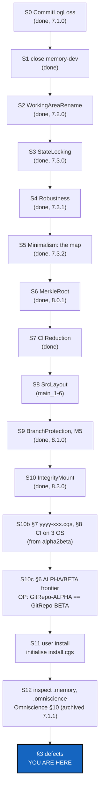

# BeforeCGS-BETA — everything mandatory before CGS-BETA, landed on main and checked by a user install

*Created: 2026-10-27*

*Branch: main*

> **Merged, 2026-10-29 (owner):** *"Merge BeforeBeta and alpha2beta integrating the shortTicket A2B-frontier.md.
> The results in a single BeforeCGS-BETA DevPlanTicket."* This ticket is BeforeBeta (`main_1-1`), renamed. alpha2beta
> (`main_1-2`) is merged in: its Part A as §7 and its Part B (FixGoldenVector) as §8. Their decisions are renamed AD1–AD5
> and BD1–BD5. The short ticket `A2B-frontier` is integrated as §6 (FD1–FD4) and runs as **S10c**. The short ticket
> `yyyy-xxx` (the levels' commands and domains) is integrated into §7 as §7.0, with N6–N8 and AD6–AD9. BeforeBeta's sections
> keep their numbers, so a citation of "BeforeBeta §n" in code, tests or specs reads as this ticket's §n. Beta is
> CGS-BETA: ComplexGitSync (CGS-ALPHA) as it leaves this ticket.
>
> **Every decision answered, 2026-10-29, before implementation** (owner, through `AskUserQuestion`): D2, D5; FD1–FD4;
> AD1–AD9; BD1–BD5. Each row says its answer. Nothing is left to ask before S10b and S10c.

> **Ticket review — 2026-10-27, owner's decision.** Filed at `main_1-1`.
> The owner wants it run before the frontier between cgitsync and gx4g is
> finalised (EnvConnect's deferred C1 and C6, and GX4G's E5). The owner's
> order: *"test checkout memory-dev, merge main. Implement WorkingAreRename.
> checkout main, merge memory-dev. main holds install.cgs --> cgitsync
> initialise $CGSHOME install.cgs. Check with the utmost attention .memory, and
> reports defects as well as .omniscience."* WorkingAreaRename's D1 (rename,
> or prose only) **closes on the orchestrator's demand**.
>
> **Second pass, the same day:** *"concentrate main-openTickets as much as
> mandatory in BeforeBeta. Evaluate if shortTickets should be integrated
> too."* Pile 1 is now exactly what is mandatory before beta, and this ticket
> runs all of it:
> - **Omniscience** is closed by checking its §10 on the real trees.
> - **StateLocking** is mandatory because its trigger has fired: gx4g runs
>   `cgitsync` in a developer's tree.
> - **Robustness** (Phase 0 and D1–D5) comes from the short ticket
>   `robustness`, split on the owner's word. D6–D9 are RobustnessCrash, in
>   pile 2.
> - **BranchProtection** is mandatory on the owner's word: no random user
>   deletes a branch in the beta.
>
> `pixi-global-install` stays on stand-by (owner): the beta's user route is
> clone + `pixi run`. `deletion4devOnly` closes with BranchProtection.
>
> **Correction, the same day (owner):** *"Le DevPlan Before Beta est
> incoherent il faut mettre à niveau la branch memory-dev de main en
> premier."* `memory-dev` is brought up to `main` **before** the tree is put
> on it. Checking it out first would install its 5.0.0 build, and the merge
> would then run under that build in a tree whose memory 7.0.0 wrote. S1 is
> now `cgitsync merge main --into memory-dev`. It runs under 7.0.0, and the
> merge is a fast-forward, so the tree lands on `memory-dev` already at
> `main`. S3 follows the same rule the other way: `main` is brought up to
> `memory-dev` with `cgitsync merge memory-dev --into main`, run from
> `memory-dev`, under its newer build.
>
> **Third pass, the same day (owner):** *"à ce niveau d'écart on rapatrie le
> ticket sur main, et on close la branch memory-dev."* `memory-dev` was 30
> commits behind `main` and none ahead. WorkingAreaRename moves to `main_1-3`,
> and `memory-dev` is closed. **The `memory-dev` cycle is gone from this
> ticket:** every step lands on `main`, and the two corrections above apply to
> nothing any more. They are kept as history. Closing the branch is now S1.
> On 2026-10-27, `branch check memory-dev` found only `.memory` holding commits
> of its own: 2 ledger entries and 2 States, which `branch close` keeps on
> `ancestors`. `branch close` itself was **refused, and nothing was renamed**,
> because the memory's ledger does not verify (§3, defect 3). S1 waits on
> D4.
>
> **Fourth pass, the same day (owner):** D4 answered (b), *"b option ticket
> de code verify"*. CommitLogLoss is filed at `main_1-2` and runs as **S0**,
> before S1. The rest of pile 1 moves down one rank: Omniscience `1-3`,
> WorkingAreaRename `1-4`, StateLocking `1-5`, Robustness `1-6`,
> BranchProtection `1-7`.
>
> **Fifth pass, the same day (owner):** *"Ticket review integrates
> shortTicket minimalism and modify DevPlanTickets subsequently. It adds
> constraints to the overall BeforeBeta requirements."* S0–S3 have landed
> (7.1.0, 7.1.1 for Omniscience, 7.2.0, 7.3.0), so pile 1 is compacted:
> Robustness `1-2`, then three new tickets from `minimalism`. The owner's
> answers through `AskUserQuestion`:
> - **Provider APIs.** Every call to a provider's API, read or write, is
>   gx4g's. Before beta no new one enters `cgitsync`, and the existing ones
>   wait for gx4g (ProviderMigration, `2-10`).
> - **BranchProtection is split.** That answers D3 below.
> - **The whole short ticket is before beta,** except the migration.
> - **"Disclosed" means withdrawn from the CLI.**
>
> The new order is S4 Robustness, S5 Minimalism (the map), S6 MerkleRoot,
> S7 CliReduction and S8 BranchProtection (its M5 only), then S9 the user
> install and S10 the inspection, which were S6 and S7. §2.5 is the
> constraint the short ticket puts on every step.
>
> **Sixth pass, the same day (owner):** *"adapt DevPlan to new shortTicket
> gitRepo."* The owner's answers through `AskUserQuestion`:
> - **GitRepo** (Graph and GitRepo) is a subfolder first, the dependency
>   that imports nothing back, and later a repository of its own.
> - **The Omniscience register is gx4g's:** gx4g writes, and `cgitsync`
>   produces what is written. ProviderMigration now covers the register
>   writes too.
> - **`src/` is split before beta** into `GitRepo/`, `Merkle/`, `Tree/` and
>   `OperatingSpace/`. The other packages go where Minimalism's map
>   proposes, and the owner decides.
>
> SrcLayout is filed at `main_1-6` and runs as **S8**, after CliReduction.
> BranchProtection moves to `main_1-7` and S9: its M5 hands the dead-branch
> findings to gx4g instead of writing them. The user install is now S10 and
> the inspection S11. §2.5 gains constraints 6 and 7.
>
> **Eighth pass, the same day (owner):** Minimalism's map exists, and the owner
> answered its D1–D7: the **autonomous rule** (`cgitsync` keeps whatever it needs to run
> with no gx4g, so `memory *` and `branch create` stay; only `repo create` and the 12
> `omniscience *` commands leave, executed by ProviderMigration), **one-way mirror**
> (every command has a client method, a method may have no command), **an audit path is
> a Merkle node and is never shown**, **MerkleRoot owns every hash** under the test
> LEFT = RIGHT bit for bit, **OPX is the operating system**, **Omniscience is gx4g's**
> and its modules sit apart in SrcLayout. CliReduction therefore withdraws nothing before
> gx4g offers it. §2.5 rule 6 holds as written.

> **Seventh pass, the same day (owner):** *"merge tickets AgenticControl and
> NestedAgentMaster."* The owner filed NestedAgentMaster from a real failure
> of gx4g's DEV bootstrap. AgenticControl, filed from the short ticket
> `mount`, is merged into it as its §7, at `main_1-8`. It runs as **S10**.
> The user install moves to S11 and the inspection to S12.

## Abstract — read this first

**The one-line version.** This ticket is a beta rehearsal on the real
developer tree. It closes `memory-dev`, lands the mandatory work on `main` (a
memory-format change among it), and makes a fresh user install from `main`. Then it hunts for defects in `.memory` and `.omniscience`. It
reports what it finds; the only code it changes is through the tickets it
runs.

**What this document is.** The order of the steps, S0 to S12 with S10b and S10c (§1), what
to watch in each and the constraints that bind them all (§2), the defects
found (§3), the decisions (§4) and when it is done (§5). Since the merge of 2026-10-29 it also holds the
ALPHA/BETA frontier (§6), the `yyyy-xxx.cgs` compatibility rule (§7) and the CI on three systems (§8). Each ticket it runs keeps its own plan and its own worker/orchestrator
pair: this ticket is the order, not the content.

**Why now.** gx4g drives `cgitsync` from another process and builds on rules
that have never run end to end on a real tree:
- the tree-wide merge that keeps the target's memory whole;
- the private branch rule (`ComplexGitSync_memory-dev`);
- the 7.0.0 install frontier and twin memories;
- the USER tree's local-only memory;
- the Omniscience register.

It also relies on things being built here. The workspace lock landed in
7.3.0 (S3). Still to come are an honest partial-failure report (S4), and a
minimal CLI that sits at the ring interfaces, with every State hash behind
one class that never hands its tree out (S5–S7). Then a source tree that
shows the dependency, the hashes and the operator apart (S8). Last, a branch
a USER tree cannot remove through `cgitsync`, and a dying branch found and
handed to gx4g, which holds the register (S9). And one `.agent` per tree, so
that a project nesting ComplexGitSync's developer spec, gx4g first, can open
its DEV tree at all (S10). The provider's lock and roles are gx4g's (§3c). All of these must hold before gx4g's frontier is closed, and the
frontier is drawn on Minimalism's map.

**What you need to do with it.** Every decision is answered (banner). Run §1 in order, filling §3 as you go,
under §2.5: S10b (§7, §8), then S10c (§6).



---

## 1. The script

Run it in the developer tree (`examples/complexgitsync4dev.cgs`, NESTED,
DEV), from its root, unless a step says otherwise. Each `implement` is the
ordinary worker/orchestrator pair, with its own release and its own record.
Facts as of 2026-10-27:

| Step | What | Facts going in |
|---|---|---|
| **S0** | `implement CommitLogLoss`, on `main` | **Done 2026-10-27, 7.1.0**, archived. Defect 3's cause, answered by D4 (b). |
| **S1** | `cgitsync branch close memory-dev`, after S0. **Done by the owner, 2026-10-27 03:01, under 7.1.0**: `closed/memory-dev` or `closed/ComplexGitSync_memory-dev` in all seven repositories, `.memory`'s two own commits on `ComplexGitSync_ancestors`. | `branch check` finds every repository `safe` except `.memory`, whose `ComplexGitSync_memory-dev` alone holds 2 ledger entries and 2 States; the close keeps them on `ancestors`. Refused on 2026-10-27 because the ledger does not verify (defect 3). It runs once S0 has landed. |
| **S2** | `implement WorkingAreaRename`, on `main` | **Done 2026-10-27, 7.2.0**, archived. D1: prose only, nothing renamed; `memory status` prints `folded=` and `pending=`. |
| **S3** | `implement StateLocking`, on `main` | **Done 2026-10-27, 7.3.0**, archived. `.cgitsync/.lock`, taken by every writing client method; `cgitsync unlock`. |
| **S4** | `implement Robustness`, on `main`: Phase 0 first, then D1–D5 | **Done 2026-10-27, 7.3.1**, archived. `push`, `tag` and `release freeze` raise `TreePartialFailure` and converge on retry; the matrix is in `AdditionalSpecs.md`. Two edges are its follow-ups (its banner). Phase 0's deviations are for §3. Adds no command (§2.5). |
| **S5** | `implement Minimalism`, on `main`: the map. **Done 2026-10-27, 7.3.2**, D1–D7 answered | No change to `src/` beyond a map script. It covers 27 commands, 66 leaf commands, 115 public client methods, the provider calls, the Merkle surface and the ring-interface checks. It ends with the verdict per command (its D1) and D2–D5. |
| **S6** | `implement MerkleRoot`, on `main`. **Done 2026-10-27, 8.0.1** | Scope was fixed by Minimalism D3 and D4. Every golden vector, State name, `os_id` and `H_GLOBAL` stays byte for byte. |
| **S7** | `implement CliReduction`, on `main`. **Done 2026-10-27** | Carried out Minimalism D1. The tutorials and the user guide shrink with the CLI. Provider commands wait for ProviderMigration. |
| **S8** | `implement SrcLayout`, on `main`. **Done 2026-10-28, 8.0.4** | It applies Minimalism D6's folder column, `GitRepo/` first with its no-import test. `Merkle/` already holds MerkleRoot. Behaviour, public names and ceilings are unchanged. |
| **S9** | `implement BranchProtection`, on `main`: M5 only, after its D7 and D9. **Done 2026-10-28, 8.1.0**, archived | Split on 2026-10-27. M5 landed as `tree/branch_findings.py`: `status` and `branch list`, and their `--json`, report `vanished`, `half-closed`, `split`, `orphaned-private` and `closed`; nothing is recorded. The rest is §3c. `require_dev` is kept. M5 finds a dead GitTree-branch and hands it to gx4g, writing nothing to the register. M0–M4 (provider protection and roles) are §9, handed to gx4g. No provider call. |
| **S10** | `implement IntegrityMount`, on `main`. **Done 2026-10-29, 8.3.0**, archived | **Reopened 2026-10-28.** NestedAgentMaster shipped as 8.2.0 (archived) and the owner rejected its approach: *"La seule mission de cgitsync est de garantir l'intégrité du GitTree […] Je préfère un DENIAL de mount plutôt qu'une structure de type 2."* IntegrityMount undoes 8.2.0's schema 2, aliases and symlinks, and makes the `.gts` deny a requested mount that would break the GitTree, before anything is cloned for it. The State stays schema 1. |
| **S10b** | `implement BeforeCGS-BETA` §7 and §8 (formerly alpha2beta), on `main`, after AD1–AD5 and BD1, BD3–BD5 | From CGS-ALPHA to CGS-BETA: the `yyyy-xxx.cgs` compatibility rule (`project = { name = "yyyy", default_branch = "xxx", fallback_branch = "CGS-BETA" }`), and FixGoldenVector merged in: *"cgitsync must be multi-os before beta."* §3 defect 5. CI's `golden-vectors` has run no test since 8.0.1 and `test` fails since 8.3.0. S11 and S12 start from a green CI. |
| **S10c** | `implement BeforeCGS-BETA` §6, the ALPHA/BETA frontier, after FD1–FD4 | From the short ticket `A2B-frontier`. `OP` (8.4.0) becomes the operator ALPHA → BETA: it exposes only the GitTree's leaves and verifies `GitRepo-ALPHA == GitRepo-BETA`, a leaf in `.cgitsync` (OPX, DEV) against the same leaf in `.omniscience` (USER, PUB). |
| **S11** | The user install from `main`: `git clone github:flipoyo/ComplexGitSync $CGSPATH/ComplexGitSync`, then in it `pixi run cgitsync initialise install.cgs --output-path $CGSPATH` | `initialise` takes one source, plus `--output-path`, which is CGSPATH. CGSHOME is `CGSPATH/ComplexGitSync`, so the owner's `initialise $CGSHOME install.cgs` is spelled this way. `install.cgs` mounts the tool and `docs` only, so the tree is USER: its memory is local and never pushed. |
| **S12** | The inspection in §2, in three trees: this developer tree, the user tree (S11) and gx4g's DEV tree (S10). It uses the CLI that S7 left and the layout that S8 left | — |

## 2. What to watch, with the utmost attention

### 2.1 One branch, one build

With `memory-dev` closed, every step runs on `main` under the build it has
just landed; no step changes the tree's branch. Record `cgitsync --version`
for every command anyway. A ticket's release that changes behaviour shows up
as a new version between two steps, not as an older build left in the tree.

### 2.2 `.memory`, in the developer tree

- **Baseline, before S1.** `verify check` already says `corrupt`, with 27
  `COMMIT_LOG_MISMATCH` findings (§3, defect 1).
  - S12 checks that no new finding appears.
  - It also checks whether the rows 6.8.1 recorded as lost explain all 27.
- **The close (S1).**
  - `.memory`'s 2 own commits are on `ancestors`, recorded in the ledger,
    before any rename.
  - `closed/memory-dev` exists in every repository that had the branch,
    the private ones included, and nothing else moves.
  - The memory stays on `ComplexGitSync`: the tree is NESTED, so not a twin,
    and no `ComplexGitSync_ComplexGitSync` appears.
  - `.self-history` follows its memory's branch.
- **Integrity.**
  - The ledger chain gains no break.
  - Every State written before S2 still opens under its own name and still
    verifies.
  - `release load <State hash>` finds a State that only the memory holds.
- **Rename: none.** WorkingAreaRename's D1 said prose only. `memory status`
  splits the chain into `folded` and `pending`, and their sum is `entries`.
- **C8 ambiguity.** `ComplexGitSync_memory-dev`, and its closed name, is
  read as "ComplexGitSync, branch `memory-dev`", never as "twin of a
  project called `memory-dev`".
- **StateLocking, live.** Start two write commands at once in the developer
  tree.
  - One refuses before touching anything, and the read-only commands still
    run.
  - No ledger append is lost quietly.
  - The lock file is never folded into, committed to or pushed with the
    memory.
- **Robustness, live.** Make one repository's push fail mid-tree.
  - The report names what completed, what failed and what was not
    attempted.
  - Neither the memory nor the ledger claims the push.
  - The retry converges.
- **Status.** `cgitsync status` shows `errors=0` after every step.

### 2.3 `.memory` and branches, in the user tree (S11)

- The tree is USER, and its memory is created locally, never declared.
- Nothing is pushed, even when a remote is added by hand.
- No DEV prompt appears: neither `memory setup` nor EnvConnect C7's report.
- `initialise <a .gts>` is refused by name.
- **BranchProtection, as split:**
  - the user cannot close or delete a branch through `cgitsync`, and the
    refusal says why (`require_dev`);
  - through plain Git, the branch is protected only once gx4g has locked it
    on the provider (§3c). Until then, a deletion is
    found as `vanished` (M5) and handed to gx4g. S12 records which of the
    two it found.
- `status` shows `errors=0`.

### 2.4 `.omniscience`, and Omniscience §10

Neither tree mounts it today: the developer `.cgs` has no `.omniscience`
entry. Mount the register in a disposable DEV workspace, as tutorial 8 does.
Then:

- **USER tree.** `omniscience mount`, `register` and `observe` are refused
  by name before anything is touched.
- **DEV tree.** Every query (`get`, `branches`, `history`, `state`, `proof`,
  `verify`, `status`, `report`, `memory`) answers with one of the five
  statuses. None writes anything, and none turns a failed read into
  "deleted".
- **Omniscience §10.** Each of its eleven items gets a row in §3, either a
  defect or "holds". Omniscience itself was proved and archived on
  2026-10-27 against 7.1.0 (its §11); S12 reruns the same checks, after
  MerkleRoot (S6) moved every hash, so they also prove nothing moved.
- **MerkleRoot (S6).** A State's name and `os_id` are unchanged, so every
  registered record still verifies, and `omniscience proof` answers as
  Minimalism D3 decided.
- **BranchProtection.** Protecting the register's branch on the provider is
  gx4g's (§9). OmniscienceQuery keeps reporting that protection as "not
  checked", and that is not a defect. M5's findings appear in `status`,
  `branch list` and their `--json`, ready for gx4g. Until gx4g holds the
  register, `cgitsync`'s existing writer still serves tutorial 8, and §2.5
  rule 6 keeps it from growing.

### 2.5 The constraints `minimalism` puts on every step

They bind from the ticket review of 2026-10-27 on (owner). Each step's
orchestrator quotes against them, and a breach is a defect in §3.

1. **No new command or public client method** lands without a row and a
   verdict in Minimalism's map. Before S5 exists, no step adds one: S4 adds
   none by its own §6.
2. **No new call to a provider's API**, read or write. The existing calls
   (`repo create`, `memory setup`'s create step, the sign-in probe of
   `env show` and of every Environment record) are listed for
   ProviderMigration and stay until gx4g offers each one.
3. **The Merkle tree is never materialised.** No step adds code that walks,
   stores or hands out inner nodes outside the hashing modules. From S6 on,
   that means outside `MerkleRoot`.
4. **The CLI the beta ships is the reduced one.** S11 and S12, the tutorials
   and the user guide all run against the CLI that S7 left, in the layout
   that S8 left.
5. **The frontier with gx4g is drawn on the map.** What `cgitsync` hands to
   gx4g is listed in two places, ProviderMigration (the provider calls and
   the register writes) and §3c. Nothing else crosses
   without a row in the map.
6. **No new write to the Omniscience register** *(short ticket `gitRepo`)*.
   gx4g holds the register. `cgitsync` produces records and findings, and its
   existing writer (`mount`, `register`, `observe`) stays only until
   ProviderMigration.
7. **`GitRepo/` is the dependency** *(`gitRepo`)*. From S8 on, a test fails
   when it imports anything else from `ComplexGitSync`. Before S8, no step
   adds a dependency from the repository and graph code back to the rest.

## 3. Defects found

One row per defect, filled in during the run. A defect is reported, not
fixed here, unless the ticket a step runs owns it (§5).

| # | Step | Command and build | Observed | Expected | Severity |
|---|---|---|---|---|---|
| 1 | before S1 | `cgitsync verify check`, 7.0.0 | `status=corrupt`: 27 `COMMIT_LOG_MISMATCH` (seq 3–55, odd entries), "entry records a commit log whose rows are gone" | `ok`, or every finding explained as the loss recorded in 6.8.1 | fixed by S0: a recorded loss, `incomplete` |
| 2 | known | Robustness P2 and P3 | A failed `push` reports one error and loses what completed; a `tag` retry can never converge | §3 of Robustness | fixed by S4 |
| 3 | S1 | `cgitsync branch close memory-dev`, 7.0.0 | Refused, nothing renamed: "the ledger does not verify (seq=3 COMMIT_LOG_MISMATCH; …)". `verify repair` heals only a stale HEAD, never a chain, and 6.8.1 said the lost rows are not recovered. So this memory can never verify again, and every `branch close` and `branch delete` in this tree is refused for good. | A loss already recorded as unrecoverable does not refuse forever; a documented way through exists | fixed by S0 (CommitLogLoss, 7.1.0): `verify check` now says `incomplete`, 27 `COMMIT_LOG_LOST` |
| 4 | S1 | `cgitsync branch close memory-dev`, 7.0.0, refused at 01:35 | Before refusing, it had already kept `ComplexGitSync_memory-dev` on `ComplexGitSync_ancestors` and pushed it (`99c6515`), written a State and ledger entry 69 (`branch_close_keep`). Only then did `_assert_history_holds` run. Its message, "nothing was renamed or deleted", is true but says nothing of the push and the record. | A history already corrupt before the command is refused before anything moves; a refusal after a step says which steps ran | to report (D2); the S1 close itself was then run by the owner at 03:01, under 7.1.0, and succeeded |
| 5 | after S10 | GitHub CI, 8.0.1 → 8.4.0 (runs `40577139142` … `40886166452`) | `golden-vectors` runs no test on any system since 8.0.1: it names `tests/unit/test_gts_integrity.py`, deleted by MerkleRoot. `test` has 3 failures since 8.3.0, on `examples/gx4g-dev.cgs` and `gx4g-opx.cgs`, which open with notes that are not TOML. | The golden vectors run, and agree, on Ubuntu, macOS and Windows; `test` green | blocks beta: §8 (S10b) |

## 3b. Corrections that will need a MAJOR release

Recorded 2026-10-28, after SrcLayout. A release is MAJOR when it removes or changes
something a user can rely on (`Versioning.md`). Three corrections are already planned
that do, and each must be released as its own MAJOR, not folded into a patch:

| Correction | Where it is owed | Why it is a MAJOR | Waits for |
|---|---|---|---|
| **Remove `legacy_paths.py`** and the line in `src/ComplexGitSync/__init__.py` that installs it | SrcLayout §8, the release after 8.0.4 (D3: the old import paths last **one** release) | `import ComplexGitSync.memory.store`, `ComplexGitSync.git_runner` and the 40 other old module paths stop working. SrcLayout shipped as a PATCH on the reading that module paths are not public (`Versioning.md`: `src/` is not a public interface). **If the owner counts the paths `api_python.tex` documents as public, this removal is a MAJOR.** | The owner's word on whether module paths are public. The user guide's *What changed* already tells users to move to the new paths now. |
| **Withdraw `repo create` and the 12 `omniscience *` commands** | ProviderMigration (pile 2), by Minimalism D1 | A command disappears from the CLI. CliReduction was released as a MAJOR for the same reason (`submodules report`). | gx4g offering each provider call and the register. |
| **Refuse to register a graph that is not PoE-typed** | OpBoundary (`main_2-11`), O6 | `omniscience register` registers any tree today. Refusing a non-PoE graph removes that. | Unless it lands with ProviderMigration, which takes `register` out of `cgitsync` anyway, as part of the same MAJOR. |
| **Drop the SrcLayout leftovers that touch a documented name** | Not owed today | None is: the stale `GitSyncError` docstring in `git_repo/git_runner.py`, the bare file names in the `.tex` files and the missing private `_SSH_REMOTE_RE` change no exported name. They ride in any later patch. | Nothing. |

Until then the release is 8.0.x, a MAJOR against the last committed 7.3.2 as a whole. Any
step that removes a command, a flag, an exported name or a documented module path says so in
its own record, so the orchestrator decides the level with this table in front of it.

## 3c. What BranchProtection hands to gx4g

Recorded 2026-10-28, when BranchProtection was archived (its M5 shipped as 8.1.0; its
analysis, §2–§7 of the archived ticket `archive/20261028_BranchProtection_DevPlanTicket.md`,
is what gx4g starts from). The short ticket `deletion4devOnly` closed with it. Every provider
API call is gx4g's privilege, so the lock and the two tiers the owner asked for are built there.
This is a requirement, not work for this ticket, and S12 checks only what `cgitsync` keeps.

**gx4g builds:**
- **A lock on a branch, and on the other strategic assets** (tags, `ancestors`, the memory
  branch, the default branch). It is the provider's own branch protection, set on the repositories
  an Operating Space names; a repository is addressed by its MerkleRoot hash (ProviderMigration §3).
  A lock `cgitsync` kept itself would protect nothing against `git` or the provider.
- **Recognising who may act.** The provider's authenticated answer for the user's role, never
  `git config`. Closing is a developer's right (GitHub push, GitLab Developer) and deleting a
  maintainer's (GitHub maintain, GitLab Maintainer, Gitea admin); the tiers are mapped onto the
  provider's roles, never invented. When the provider cannot answer (offline, CLI missing, `custom`
  host), the fallback is `require_dev`, said in the refusal.
- **Its decisions**, left open in the archived ticket's §4: where the role is read from (D1), the
  fallback (D2), the tier mapping (D3), which assets beyond branches (D4), an advisory `protected`
  key in a `.cgs` (D5, recommended no) and whether to record who locked (D6, display-only history).
- **Recording what `cgitsync` finds.** The five kinds of dead branch (M5) are written by gx4g into
  the register it holds; `cgitsync` never appends them.

**`cgitsync` keeps, and the beta can promise:**
- `branch close` and `branch delete` refuse in a USER tree, by `require_dev`, before any repository
  is touched. It is an accident guard with no override flag, not a lock.
- M5's findings, handed over through `status`, `branch list`, their `--json` and
  `ComplexGitSync.branch_findings()`. `cgitsync` adds no hook for gx4g's roles: gx4g decides who may
  run the command.
- Through `cgitsync`, a USER tree cannot close or delete a branch. Through plain Git, only once gx4g
  has protected the branch on the provider. Until then a user with push rights can delete a branch,
  and the next listing reports it `vanished` (an error) with the ledger's silence as evidence. One
  limit: a branch deleted with a bare `client.delete_branch()` call leaves no branch name in the
  ledger's `argv`, so it can still read `vanished`.
- This tree, for S12: `branch list` reports `closed` for `memory-dev` and `alpha-tech`, and two real
  orphans, `ComplexGitSync_multi-branch` in `.claude` and `.localSpec`, for the owner to clean up.

## 3d. The PoE model, re-evaluated (2026-10-29)

The owner's short ticket `ExplDistantLocal` and its final cut, *"\*NAME{NODE,EDGE\*} = G{NAME,NODE,EDGE,OP\*}"*,
add a model this ticket was written without: a project is a graph G; each install level exposes a fixed part of it
as Proof-of-Existence (`.USER` name and nodes, `.DEV` the name, `.OPX` nothing); every operation passes through one
boundary class `OP`, whose `isPoE(OP)` is `OP*`; and only the PoE graph `*NAME{NODE, EDGE*}` is registered, with its
Sigma in `OmniscienceRecord`. OpBoundary landed as 8.4.0 (archived); it is planned in **MemoryMount** (`gx4g-main_1-1`).
Where it touches this ticket:

| BeforeBeta item | What the PoE model changes | Re-evaluated |
|---|---|---|
| **S11, the user install** | MemoryMount's `.USER` protocol clones G first, then ComplexGitSync **inside** G, then `initialise install.cgs`. S11 clones ComplexGitSync alone into `$CGSPATH` and runs `initialise install.cgs --output-path $CGSPATH`. | S11 tests the install as it stands. Whether it follows the `.USER` protocol before beta is D5. |
| **S12, the developer tree** | `.DEV` is opened with `bootstrap $HOME/.cgs/$G-NAME/$G-NAME-dev.cgs`. This tree uses `examples/complexgitsync4dev.cgs`. | Unchanged until MemoryMount Q1 moves the spec. S12 inspects the tree as it is. |
| **S10/S12, gx4g's DEV tree** | Opened today from `examples/gx4g4dev.cgs`. Under the protocol, from `$HOME/.cgs/gx4g/gx4g-dev.cgs`. IntegrityMount's denials apply either way. | S12 inspects it as it is, denials included. The spec's location is gx4g's to move (below). |
| **§2.4, `.omniscience`** | Only `*NAME{NODE, EDGE*}` is registered, with `sigma` in the record, committed when present. Today `omniscience register` registers any tree, with no PoE type and no Sigma. | Still holds for S12: records without `sigma` keep verifying byte for byte, and `GLOBAL_SCHEMA` stays 1. That `register` refuses a graph that is not PoE-typed is OpBoundary's, not S12's. |
| **§2.5 rule 6** (the writer does not grow) | OpBoundary O6 adds one field to the record the existing writer appends. | One field, committed when present, is not a new write path. OpBoundary's orchestrator quotes it against rule 6. |
| **§3b, MAJOR releases** | Refusing to register a graph that is not PoE-typed takes away something `omniscience register` does today. | A new §3b row: that refusal is a MAJOR unless it waits for ProviderMigration, which removes `register` from `cgitsync` anyway. |
| **§3c, what gx4g gets** | gx4g reads `*NAME{NODE, EDGE*}`, never G. It sends its requests through `OP` as an external origin. The register it holds keeps `sigma`. | Added to §3c (below). |
| **Minimalism** | `OP` adds no command: it wraps the client's methods. | Holds by construction. OpBoundary's acceptance says so. |

**What gx4g must take from it.** These are added to the requirements §3c hands over.

- **Read only the PoE graph.** gx4g reads a project as `*NAME{NODE, EDGE*}`, through `OP`'s results, never G's
  operations themselves.
- **Request as an external origin.** gx4g's requests to `cgitsync` enter through `OP` as `external`, and are
  never exposed more than the same internal request (OpBoundary O5). The transport is OpBoundary Q5.
- **Keep `sigma` in the register.** When the register moves to gx4g (ProviderMigration), only PoE graphs are
  registered, under `*NAME`, a name of their own; the PoE is never written, the `*` signals it, and their
  `OmniscienceRecord` keeps `sigma`, visible and committed when present.
- **Use its own install levels.** gx4g's `.DEV` and `.OPX` trees open from `$HOME/.cgs/gx4g/gx4g-dev.cgs` and
  `gx4g-opx.cgs` (MemoryMount). gx4g writes those files. Its `examples/gx4g4dev.cgs` is the interim.

## 4. Decisions for the owner

| D | Question | Recommendation |
|---|---|---|
| **D1** | Withdrawn on 2026-10-27, third pass: with `memory-dev` closed, no step changes the tree's branch. | — |
| **D2** | Where each defect goes once it is reported. | **Answered 2026-10-29: a row in §3 only**, dealt with at the end of this ticket. No short ticket is filed per defect. |
| **D3** | BranchProtection: whose job is it? EnvConnect §5 gives GitRepo rights on a host to gx4g, through the providers' APIs. | **Answered 2026-10-27, through the short ticket `minimalism` (owner): split the other way.** Every provider API call is gx4g's, so the provider's protection and the roles go to gx4g (§3c). `cgitsync` keeps `require_dev` and M5. The first recommendation, which had `cgitsync` keep the provider's protection, is overturned. |

| D | Question | Options |
|---|---|---|
| **D4** | Defect 3: how is `memory-dev` closed, given a ledger that can never verify? | **Answered (b), owner 2026-10-27:** a code ticket, CommitLogLoss, run as S0. `memory reboot` (a) and waiting (c) were not chosen. |

WorkingAreaRename's D1 is not asked here: it closes on its orchestrator's
demand (owner, 2026-10-27).

| D | Question | Options |
|---|---|---|
| **D5** | Does MemoryMount (`gx4g-main_1-1`) land before CGS-BETA? | **Answered 2026-10-29: after CGS-BETA.** S11 keeps the install as it stands; §3d's rows stay requirements, and §7.0 already holds the levels' commands. |

## 5. Done when, and what this refuses

**Done when:**
- S0 to S11, S10b and S10c included, have run, and S12's inspection has its rows.
- §6.3, §7.4 and §8.4 are answered, and §6, §7 and §8 are implemented, each with its orchestrator's record.
- The CI is green on Linux, macOS and Windows (§8.5).
- CommitLogLoss, WorkingAreaRename, StateLocking, Robustness, Minimalism,
  MerkleRoot, CliReduction, SrcLayout, BranchProtection, NestedAgentMaster and IntegrityMount
  are each archived with their own orchestrator's record.
- gx4g's DEV tree (`examples/gx4g-dev.cgs`) opens with the command
  IntegrityMount leaves (its denials said by name), and S12 inspects it beside the two others.
- Every step was quoted against §2.5.
- ProviderMigration and §3c are handed to gx4g as its
  requirements. They are not done here: ProviderMigration stays in pile 2
  until gx4g offers each call.
- Every check in §2, and each of Omniscience §10's eleven items, has a row in
  §3, even if the row says "holds".
- Both trees show `cgitsync status` with `errors=0`, or the row in §3 that
  says why not.
- BeforeCGS-BETA is archived with its orchestrator's record. Omniscience was
  archived on its own record on 2026-10-27. Pile 1 is then empty, and the
  frontier with gx4g can be finalised.

**Refuses:**
- **To fix anything outside the tickets it runs.** Every other defect is
  reported (D2).
- **To rewrite history.** No reset, rebase or force-push to recover a step
  that went wrong: a failed step is a finding.
- **To push without the owner's word.**

---

## 6. The ALPHA/BETA frontier (short ticket `A2B-frontier`)

> **The owner's short ticket `A2B-frontier` (2026-10-29), unchanged:**
>
> ```text
> GitRepo are the Frontier between ALPHA and BETA administration spaces.
>
> OP Class in ComplexGitSync is the Operator ALPHA --> BETA. It is une UNIVERSAL API .cgs that expose GitTree leaves only in both ComplexGrapSync and ComplexGitSync. A leaf is a GitRepo. OP verify if GitRepo-ALPHA == GitRepo-BETA
>
> GitRepo-ALPHA belongs to .cgitsync - OPX, DEV
>
> GitRepo-BETA belongs to .omniscience - USER, PUB
> ```

### 6.1 The model, as read

- **Two administration spaces, one frontier.** ALPHA is administered through `.cgitsync`, the memory: its States,
  ledger and commit logs. Its levels are `.OPX` and `.DEV`. BETA is administered through `.omniscience`, the
  register. Its levels are `.USER` and `.PUBLIC`. What crosses between them is a GitRepo, a leaf of the GitTree,
  and nothing else.
- **OP is the operator ALPHA → BETA.** The class built in 8.4.0 (`orchestre/op_boundary.py`) becomes a universal
  API, in the `.cgs` vocabulary, that exposes only the GitTree's leaves. It holds on both sides: in ComplexGitSync,
  and in "ComplexGrapSync" (§6.3 FD1).
- **OP verifies `GitRepo-ALPHA == GitRepo-BETA`.** A leaf as ALPHA holds it (a repository's leaf in a State of
  `.cgitsync`) must be the same leaf as BETA holds it (the leaf a record of `.omniscience` commits to, through its
  `gittree_root`). The inclusion proof MerkleRoot hands out (`omniscience proof`) is the existing way to show one
  leaf is in a registered tree.

- **What each side holds** (owner, 2026-10-29, AD6): ALPHA is `OPX`, which holds `.cgitsync`, and `DEV`, which holds
  `.memory`. BETA is `USR`, which holds the `.gts`, and `PUB`, which holds `.omniscience`. So `GitRepo-ALPHA` is a leaf as
  `.cgitsync` and `.memory` hold it, and `GitRepo-BETA` the same leaf as the `.gts` and `.omniscience` hold it.

### 6.2 Steps

- **N6.1. Leaves only.** `OP` exposes the GitTree's leaves and nothing else: no ledger entry, no commit message, no
  register internals. `OP*` already keeps no branch, message or path (OpBoundary). §6.3 FD2 decides whether a leaf is
  the schema-1 leaf hash, or the leaf's fields.
- **N6.2. The verification.** `OP` compares a leaf on the ALPHA side with the same leaf on the BETA side:
  - ALPHA: the State in `.cgitsync` (`OPX`) and `.memory` (`DEV`) that the tree produced;
  - BETA: the `.gts` (`USR`) and the record in `.omniscience` (`PUB`), through its inclusion proof.

  The answer is equal, different, or absent on one side. It is read-only, and refuses nothing by itself
  (IntegrityMount refuses mounts).
- **N6.3. Which side a level is on.** `.OPX` and `.DEV` trees are ALPHA, `.USER` and `.PUBLIC` are BETA, read from
  the PoE level OpBoundary already reads (the tree's profile, until MemoryMount records it at install).
- **N6.4. Documentation.** `AdditionalSpecs.md` (§OP, the boundary of G: the frontier and the verification), and
  `digest.md`.

### 6.3 Decisions for the owner (§6)

| D | Question | Recommendation |
|---|---|---|
| **FD1** | "ComplexGrapSync". | **Answered 2026-10-29: a tool still to come.** `OP` is built on the ComplexGitSync side only for now. |
| **FD2** | What is compared. | **Answered 2026-10-29: the leaf hash** (`repo_hash`, schema 1), what both sides already commit to; no field is exposed. |
| **FD3** | A new method, or a field of `OP*`? | **Answered 2026-10-29: a field of `OP*`.** `OP.is_poe()` says, per leaf, whether ALPHA and BETA agree; no command and no client method are added. |
| **FD4** | Does a `USR` tree verify? | **Answered 2026-10-29: yes, because `USR` inherits from `PUB`, which mounts `.omniscience`.** A `USR` tree verifies its leaves against `.omniscience` through that inheritance, wherever `PUB` mounts it. |

---

## 7. The `yyyy-xxx.cgs` compatibility rule (from alpha2beta, Part A)

### 7.0 The short ticket `yyyy-xxx` (2026-10-29), integrated

> **The owner's specs, unchanged:**
>
> ```text
> yyyy = NAME.letter
> xxx = OP.letter
>
> ComplexGitSync OP emits a cgitsync CMD on YYYY.node
>
> node is a NODE that stangs at the frontier requested by CGS-BETA
>
> CGS-BETA calls GX4G-NODE to calculates XXX. It is either OPX,DEV,USR,PUB
>
> OPX --> cgitsync bootstrap yyyy-opx.gts | CGS-ALPHA standalone
> DEV --> cgitsync bootstrap yyyy-dev.cgs | CGS-ALPHA standalone
> USR --> cgitsync initialise ../install.cgs | CGS-ALPHA nested
>
> YYYY Domains are HW - HardWare, DATA - .omniscience, COMPUTO - .cgitsync, TWIN - OperatingSpace = YYYY.NODEi
>
> TWIN belongs to USR
> COMPUTO belongs to DEV
> DATA belongs to OPX
> HW belongs to PUB
> ```

> **Owner's answer, 2026-10-29:** *"for now cgitsync bootstrap yyyy-opx.cgs. It is easier because .cgs is the only
> outer \*EDGE of cgitsync OP Class. OPX inherits from DEV that inherits from USR that inherits from PUB.
> G{NAME,CONFIG,3-CaseSensitive-Letter,OP)-->NODE (GitRepo). G{ROLE,EXT,3-noCaseSensitive-Letter,OP\*}->EDGE(.ext in FS)."*

Read as one table (`yyyy` spelled with `NAME`'s letters, `xxx` with `OP`'s):

| `XXX` | Command `OP` emits on `YYYY.node` | ComplexGitSync (CGS-ALPHA) | What the level holds (AD6) |
|---|---|---|---|
| `OPX` | `cgitsync bootstrap yyyy-opx.cgs` (owner: *"for now"*; the short ticket wrote `.gts`) | standalone | `.cgitsync` (AD6) |
| `DEV` | `cgitsync bootstrap yyyy-dev.cgs` | standalone | `.memory` (AD6) |
| `USR` | `cgitsync initialise ../install.cgs` | nested | `.gts` (AD6) |
| `PUB` | none (`.PUBLIC` is `VOID`, ExplDistantLocal) | — | `.omniscience` (AD6) |

- **Who decides `XXX`.** CGS-BETA asks a GX4G node (`GX4G-NODE`) to compute it. `cgitsync` never chooses its own
  level: it receives `XXX` and runs the command that level calls for.
- **What `OP` does with it.** `OP` emits that one `cgitsync` command on `YYYY.node`. A node is a NODE of G that stands
  at the frontier CGS-BETA asked for (§6: a GitRepo is the frontier). `OP` was built (8.4.0) as the door operations
  enter through. Here it also sends the install command out, from the BETA request to the ALPHA execution.
- **The files the levels open** follow §7.1's rule, and are all `.cgs`: `yyyy-opx.cgs`, `yyyy-dev.cgs`, and for `USR`
  the project's `install.cgs`, one directory up, with ComplexGitSync nested in it. **`.cgs` is the only outer
  `*EDGE` of `OP`** (owner): every request crosses into `cgitsync` as a `.cgs`, and the `.gts` stays its result.
- **The levels inherit: `OPX` ⊃ `DEV` ⊃ `USR` ⊃ `PUB`.** Each level holds everything the one below it holds, and more,
  while exposing less (PoE `0000`, `1000`, `1100`, `1111`).
- **Two kinds of thing in G** (owner):
  - `G{NAME, CONFIG, 3-CaseSensitive-Letter, OP} → NODE`, a GitRepo: a name, its configuration, a three-letter code
    where case matters (`OPX`, `DEV`, `USR`, `PUB` read as such), and the operations on it;
  - `G{ROLE, EXT, 3-noCaseSensitive-Letter, OP*} → EDGE`, an extension in the file system: a role, an extension, a
    three-letter code where case does not matter (`.cgs`, `.gts`, `.lgr`), and the `OP*` it carries.

  So a node is a repository and an edge is a file type. `.cgs` is the edge `OP` takes in, and its `OP*` is what the
  edge carries out.
- **What each level holds** (owner, 2026-10-29, AD6): *".omniscience belongs to PUB | .cgitsync belongs to OPX |
  .memory belongs to DEV. \*NAME{CGS,ALPHA,.gts} belongs to USR."*, then *"USR holds .gts is simpler. It is now
  obvious that . denotes EDGE which are OP-NODE. \*EDGE is OP\*-NODE. The system analysis holds as is."* The register
  is public. The state area and the memory are the two ALPHA levels. `USR` holds the `.gts`. The short ticket's first
  reading (HW, DATA, COMPUTO, TWIN) is superseded where it differs.
- **A leading `.` names an EDGE** (owner): `.cgs`, `.gts`, `.cgitsync`, `.memory`, `.omniscience` are EDGEs, and an EDGE
  is an `OP-NODE`, the node an operation lands on. A starred edge, `*EDGE`, is an `OP*-NODE`: what of that node can be
  proved to exist.

### 7.1 The rule, as read

- **A file's name is a contract.** `yyyy-xxx.cgs` is `$G.NAME-$G.OP.NAME.cgs` (G.EDGE.NAME): `yyyy` is the project's
  name, `xxx` the operation's name, one of `opx`, `dev`, `usr`, `pub` (§7.0), computed by a GX4G node for CGS-BETA.
- **When `cgitsync initialise $exe-path/yyyy-xxx.cgs` writes or reads it,** its project line is
  `project = { name = "yyyy", default_branch = "xxx", fallback_branch = "CGS-BETA" }`: the project is the one the name
  says, the tree opens on the branch the name says, and a repository with no such branch falls back to `CGS-BETA`.
- **`CGS-BETA` is a branch name** here, the fallback every repository of such a tree takes. With ExplDistantLocal's
  notes, CGS-ALPHA is ComplexGitSync and CGS-BETA what it becomes at beta (MemoryMount Q5).
- **"Compatibility"**: a file that follows the rule opens the same tree under every build from CGS-ALPHA to CGS-BETA.
  One that does not is either rewritten by `initialise` or refused by name (AD1).

### 7.2 What exists

- **`project`** takes `name` and `default_branch` (`cgs_format.py`, `_REQUIRED_PROJECT_KEYS`). There is no
  project-level `fallback_branch`: each repository declares its own, and the chain's default is `main`
  (`git_branch.py`, FallbackMain).
- **`initialise`** takes one `.cgs` and `--output-path` (7.0.0). It never reads the file's name.
- **The examples.** `examples/gx4g-dev.cgs` and `gx4g-opx.cgs` say `project = { name = "gx4g", default_branch = "main" }`.
  Under the rule they would say `default_branch = "dev"` (or `"opx"`) and `fallback_branch = "CGS-BETA"`.
  `examples/complexgitsync4dev.cgs`, `install.cgs` and the other examples do not have the `yyyy-xxx` shape, or have it
  by accident (`molonari-light.cgs`). §7.1 says which are concerned.
- **No branch named `CGS-BETA`** exists in any repository of this tree.

### 7.3 Steps

- **N1. The name.** Parse `yyyy-xxx` from a `.cgs` file name, as AD2 decides for a name holding more than one `-`. A
  name without the shape is not concerned.
- **N2. The project-level `fallback_branch`.** Add it to `project`, as the default every repository's fallback chain
  takes when it declares none, before `main`. `git_branch.py` stays the chain's one owner. A document without it reads
  as today.
- **N3. The rule in `initialise`.** For a concerned file, check the project line against the name, and write or refuse
  as AD1 decides. It runs before anything is cloned, like IntegrityMount's denials.
- **N4. The examples.** Bring `gx4g-dev.cgs` and `gx4g-opx.cgs` under the rule, and every other concerned example.
  Each must stay valid, keeping the golden vectors and the example tests green.
- **N6. The levels' commands (§7.0).** Given `XXX`, `OP` builds the one `cgitsync` command the table names, for
  `YYYY.node`: `bootstrap yyyy-opx.cgs`, `bootstrap yyyy-dev.cgs`, or `initialise ../install.cgs`. Every one takes a `.cgs`. Whether it
  runs the command or hands it to the caller is AD7.
- **N7. `XXX` comes from outside.** `OP` accepts `XXX` from the caller, which is CGS-BETA through a GX4G node, and
  never computes it. Until GX4G answers, the level stays the tree's profile (OpBoundary).
- **N8. `USR` for `.USER`.** The short ticket names the level `USR`. One spelling is kept everywhere: `OP`'s levels,
  file names and PoE (AD8).
- **N5. Documentation.** The `.cgs` grammar in the user guide, `AdditionalSpecs.md` (*Format ownership*, the branch
  chain), `digest.md`.

### 7.4 Decisions for the owner (§7)

Asked through `AskUserQuestion` at `implement`, before the first edit.

| D | Question | Recommendation |
|---|---|---|
| **AD1** | A concerned file whose project line disagrees with its name. | **Answered 2026-10-29: refused by name**, before anything is cloned, saying the line it expects. cgitsync writes the line itself when it creates such a file. |
| **AD2** | A name holding several `-`. | **Answered 2026-10-29: cut at the last `-`, opt-in, with `yyyy` of any length and `xxx` always exactly three characters.** A file is concerned when its stem ends in `-` and three characters, and its `yyyy` equals its `project.name`. `molonari-light.cgs` (five characters after the dash) is not concerned. |
| **AD3** | `CGS-BETA` as a branch. | **Answered 2026-10-29: nobody creates it for now.** It is a fallback: without it the chain falls to `main`. Creating it is the release step that turns CGS-ALPHA into CGS-BETA. |
| **AD4** | `$exe-path`. | **Answered 2026-10-29: any path.** The rule reads the file's name wherever it is. |
| **AD5** | Does the rule bind `bootstrap`? | **Answered 2026-10-29: yes.** |
| **AD6** | ~~The domains contradict §6.~~ **Answered 2026-10-29:** `.omniscience` belongs to `PUB`, `.cgitsync` to `OPX`, `.memory` to `DEV`, and `USR` holds the `.gts` (simplified from `*NAME{CGS,ALPHA,.gts}`). ALPHA is `OPX` and `DEV`, BETA is `USR` and `PUB`. A leading `.` names an EDGE, an `OP-NODE`; `*EDGE` is an `OP*-NODE`. The system analysis holds as is. |
| **AD7** | Does `OP` run the level's command, or emit it? | **Answered 2026-10-29: emit it only.** `OP` returns the command and runs nothing: a node may be another machine. |
| **AD8** | `USR` or `USER`. | **Answered 2026-10-29: `USR` is the level's three-letter, case-sensitive code** (like `OPX`, `DEV`, `PUB`), and `USER` the long name the code keeps (`TreeProfile.USER`). |
| **AD9** | ~~`OPX` opens a `.gts`?~~ **Answered 2026-10-29: for now `cgitsync bootstrap yyyy-opx.cgs`**, because `.cgs` is the only outer `*EDGE` of `OP`. |

### 7.5 Acceptance

- `initialise` (and `bootstrap`, per AD5) of a concerned `yyyy-xxx.cgs` opens project `yyyy` on branch `xxx`, falls back
  to `CGS-BETA` and then to `main`, and refuses a mismatching file by name (per AD1) before anything is cloned.
- A file without the shape behaves exactly as today, and every golden vector is unchanged.
- The concerned examples follow the rule, and every example test is green.
- Given `XXX`, `OP` yields the command §7.0 names for `YYYY.node`, and computes no level of its own.

---

## 8. CI green on three systems (FixGoldenVector, from alpha2beta, Part B)

### 8.1 What the CI says (read with `gh`, 2026-10-29)

| Release | Run | `golden-vectors` (3 OS) | `test` (ubuntu) |
|---|---|---|---|
| 7.3.2 and every release before it back to 6.4.0 | `40563307219` … | success | success |
| 8.0.1 (MerkleRoot, S6) | `40577139142` | **failure × 3** | success |
| 8.0.2 → 8.2.0 | `40618970436` … `40735863313` | failure × 3 | success |
| 8.3.0 (IntegrityMount) | `40795035804` | failure × 3 | **failure** |
| 8.4.0 (OpBoundary) | `40886166452` | failure × 3 | failure |

- **`golden-vectors`.** The job runs `pixi run python -m pytest tests/unit/test_gts_integrity.py tests/unit/test_gts_document.py`.
  MerkleRoot (8.0.1) deleted `test_gts_integrity.py`, with `gts_integrity.py`, and moved its golden vectors to
  `tests/unit/test_merkle_state.py` (and `test_merkle_global.py`, `test_merkle_proofs.py`, `test_merkle_root.py`).
  The log shows `ERROR: file or directory not found: tests/unit/test_gts_integrity.py` and `no tests ran`, exit code 4,
  on Ubuntu, macOS and Windows alike. So "since the start of BeforeBeta" is exact from S6 on. The three systems never
  disagreed: they were never asked.
- **`test`.** It is green through 8.2.0 and has 3 failures since 8.3.0 (`2615 passed, 4 skipped, 3 failed` in run
  `40795035804`):
  - `test_cgsi_topology::TestExampleFiles::test_every_example_has_a_semantic_tree_and_toml_round_trip`;
  - `test_documents::TestCgsDocumentValid::test_all_cgs_examples_use_shorthand_authoring_shape`;
  - `test_root_repo_identity::test_every_checked_in_example_cgs_resolves_a_root_with_a_declared_owner`.

  All three fail with `tomllib.TOMLDecodeError` on `examples/gx4g-dev.cgs` and `examples/gx4g-opx.cgs`, committed in
  8.3.0. Both files open with the owner's notes (`CORR: … @dev-agent: …`), which are not TOML.
- **Not a failure, seen in every job.** `fatal: No url found for submodule path '.agent/.distant/dev-sync' in
  .gitmodules`, a warning at checkout cleanup. The root repository tracks four gitlinks under `.agent/`
  (`.agent/.distant/{dev-sync,documentation,ticket}` and `.agent/.local/.dev`), committed on 2026-10-08 (`f12dafe`,
  "before merge"), although `.gitignore` excludes them and there is no `.gitmodules`. `.agent/` is a plain directory,
  never a repository (CLAUDE.md).
- **What "multi-OS" covers today.** Only the golden vectors run on the three systems. The full suite runs on Ubuntu
  only, and the developer tree is reconstituted on Ubuntu only.

### 8.2 Why nobody saw it

- The eight steps gate a change on **local** lint, tests and `status`. None of them reads the CI, and the owner
  pushes after the commit, when the worker and the orchestrator are done.
- MerkleRoot's orchestrator re-ran the golden-vector tests by their new names, locally, on Linux. Nothing checks that
  the paths `ci.yml` names still exist.
- A pytest run with no test to run exits 4, which CI shows as a failure like any other, with nothing to tell
  "no test was found" from "a hash differs".

### 8.3 Steps

- **F1. Run the golden vectors again.** Point the job at the Merkle golden-vector tests and `test_gts_document.py`,
  as BD1 decides: by file names, or by a pytest marker (`golden`) that the tests carry, so that a rename cannot
  silence the job again.
- **F2. A guard.** A unit test that reads `.github/workflows/ci.yml` and fails when a test path it names does not
  exist, or when the marker it selects collects nothing.
- **F3. The example files.** `examples/gx4g-dev.cgs` and `examples/gx4g-opx.cgs`, as BD2 decides. They hold the owner's
  notes for MemoryMount (`.DEV` is `gx4g4dev`, PoE `{1,0,0,0}`; `.OPX` is `gx4g4opx`, PoE `{0,0,0,0}`; G's credentials
  per CGS-ALPHA and CGS-BETA), which are not the worker's to rewrite without the owner's word.
- **F4. Run on the three systems, and fix what they say.** Push nothing: the owner pushes (or runs
  `workflow_dispatch`) and the worker reads the runs with `gh run view`. A real difference between systems (a path
  separator, a line ending, a locale, a file mode in a leaf) is fixed in `src/`, with a golden vector that names it.
  If the full suite is to run on macOS and Windows too (BD3), that is where its failures appear.
- **F5. The gitlinks,** as BD4 decides.
- **F6. Seeing CI.** As BD5 decides: whether reading the CI after the owner's push becomes part of the eight steps, or
  a check of BeforeBeta's S12.
- **F7. Documentation.** `cgitsync-dev.md` (what CI runs and how to read it), `AdditionalSpecs.md` (the cross-platform
  contract and which tests hold it), `digest.md` if a rule is added.

### 8.4 Decisions for the owner (§8)

Asked through `AskUserQuestion` at `implement`, before the first edit.

| D | Question | Recommendation |
|---|---|---|
| **BD1** | How does `golden-vectors` choose its tests? | **Answered 2026-10-29: a `golden` pytest marker** on the golden-vector and snapshot-document tests, run with `-m golden`, plus F2's guard (a path `ci.yml` names is missing, or the marker collects nothing). |
| **BD2** | ~~The two example files with notes.~~ **Resolved 2026-10-29 by `implement "CORR: @agent-dev"`:** each note was applied in its file and removed, and the comments were compressed to 10 lines. The DEV and OPX levels, the PoE, Sigma and G's credentials now stand in the header. Both files are valid `.cgs` again, and the three `test` failures are gone. |
| **BD3** | Multi-OS: the golden vectors, or the full suite? | **Answered 2026-10-29: the full suite on Linux, macOS and Windows**, as a matrix like `golden-vectors`. |
| **BD4** | The four gitlinks under `.agent/`. | **Answered 2026-10-29: removed from the index** (`git rm --cached`); the mounts on disk are untouched. |
| **BD5** | Seeing CI. | **Answered 2026-10-29: no new rule.** Reading the CI stays outside the eight steps. |

### 8.5 Acceptance

- `golden-vectors` runs the golden vectors on Ubuntu, macOS and Windows, and every digest is the same on all three.
- F2's guard fails when a path `ci.yml` names is missing, or when the selected marker collects nothing.
- `test` is green, with the example files as BD2 decided.
- With BD3's matrix, the full suite is green on the three systems, or each red test is a defect fixed in `src/`, never skipped by system.
- The gitlinks are handled as BD4 decided, and checkout no longer warns.
- `pixi run lint`, `pixi run test`, `check-ceilings`, `check-oo` and `check-spectree` pass; `bump-build` if `src/` changed; `cgitsync status` shows `errors=0`.
