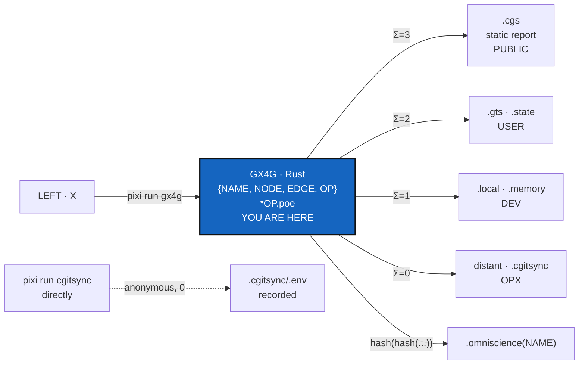

# EnvConnect — `pixi run gx4g`, the Rust API `{NAME, NODE, EDGE, OP}`, and `*OP.poe`

*Created: 2026-10-26*

*Branch: main*

> **Ticket review — 2026-10-27, agentic set-up.** Rank unchanged. E1's DEV
> half is blocked: bootstrapping `examples/gx4g4dev.cgs` clones the whole
> tree, then refuses its own State, because gx4g's `.agent/` and the nested
> ComplexGitSync's `.agent/` meet at the same paths. That is ComplexGitSync's
> NestedAgentMaster (its pile 1), not a fault of the spec. Meanwhile
> its `.agent/` entries are mounted by hand, and
> ComplexGitSync's upstream has reached 7.3.0. EnvConnect's ComplexGitSync
> half is archived there (C8, the twin's memory, is built), and its
> ProviderMigration hands host-API calls and register writes to gx4g.
> E0 also owns the bump commands that `.dev/Versioning.md` waits for.
>
> **Ticket review — 2026-10-28, BeforeCgitsyncMerge implemented.** E6 no longer
> starts from nothing: the sealed `GitProvider` interface, `GitRepo`, `Owner`,
> `RepoName`, `Secret`, `G` and a scripted fake host exist, offline, with a
> contract suite (`tests/provider_contract.rs`) that a real provider must pass
> against a mock server. E6 adds the Codeberg, GitHub and GitLab clients behind
> that trait, and reading and writing content. E2's `Ring` already exists in
> `src/ring.rs`, with `Access`; E2 adds `Poe` and `OpStar`. The one path to a
> proof is `Gateway::execute`; the phase functions are private. Hash domain
> `V2`.
>
> **Ticket review — 2026-10-28, TypedPipeline implemented.** The proof is no
> longer `Gateway::execute`: it is `G::execute`, with a moment from L0, an owned
> record, a hash-chained log in a `Store`, and `HASH(@)` at domain `V3`
> (`G<Edge, L0, Mem>`; `Gateway` is private). E0's `pixi run gx4g` calls that
> path, and E4's relay of `H_project` and E6's rights check start from `G`.
> `Offline` is the EDGE of a `G` that only makes proofs; `GitProvider::host` is an
> `Option`. E2's `Poe` and `OpStar` still join `G`.

> **Owner direction — 2026-10-26, in conversation, condensed in order.**
>
> 1. *"pixi run gx4g est le seul environnement d'exécution de gx4g comme
>    pixi run cgitsync pour github.com:flipoyo/ComplexGitSync. gx4g
>    contains a .computo in the form of a nested cgitsync […] gx4g
>    install.cgs is the PUBLIC Tree."*
> 2. *"The frontier is X-OP. ComplexGitSync .memory only knows X. GX4G and
>    .omniscience not. .omniscience knows only the executable environment
>    of cgitsync."*
> 3. *"gx4g id is cgitsync-SemVer.Trunk-\*NAME. Trunk is state =
>    {hash(\*NAME.NODE.root)|'> cgitsync release load \*NAME.NODE.root'}"*
> 4. *"ComplexGitSync is SemVer, the cgitsync build version is accessible
>    to DEV not USER not PUBLIC."*
> 5. *"In GX4G mount .omniscience, the same way .cgitsync is mounted in
>    ComplexGitSync. At the G level .distant is .omniscience(NAME), .local
>    is .cgitsync. .cgitsync holds .env(USER) and .memory(DEV)."*
> 6. *"initialise API .cgs. bootstrap inherits initialise (.cgs) and add
>    'release load' API-method for .gts."* *"bootstrap is tag based
>    (MerkleRoot) while initialise is branch based (GitRepo)."*
> 7. **Supersedes the decorator:** *"i think we can forget the
>    decorator idea. GX4G is in Rust API {NAME,NODE,EDGE,OP} simply
>    defines OP\* via \*OP.poe{OP.poe,NAME.poe,NODE.poe,0}, 0 indicates
>    anonymous execution but recorded .env. In fine X access Public
>    Artefact .cgs (static report), USER -> .gts (.state), DEV -> .local
>    (.memory), OPX -> distant (.cgitsync)."*
> 8. *"PoE == 0 → true."* *"1:1 means true = 0, 1:0 means false = 1."*
> 9. *"GX4G devrait gérer les droits des GitRepo avec les API
>    GitRepoProvider."* `install.cgs` for USER, `gx4g4dev.cgs` mounting
>    `complexgitsync4dev.cgs` for DEV, and *".omniscience is held by gx4g
>    not cgitsync"* (§2.6, §4.4).

## Abstract — read this first

**The one-line version.** GX4G is a Rust API over four types, `NAME`,
`NODE`, `EDGE` and `OP`. It defines `OP*` as an `OP` carrying a proof
vector `*OP.poe = {OP.poe, NAME.poe, NODE.poe, 0}`. The vector decides
what X may access: the `.cgs` report, the `.gts` state, the `.memory`, or
the whole `.cgitsync`. It runs only as `pixi run gx4g`, and owns one
directory, `.omniscience/`.

**What changed with direction 7.** There is no decorator inside
ComplexGitSync and no method-by-method gate. GX4G decides, and then calls
`pixi run cgitsync` itself. A run that does not go through GX4G is not a
hole in the gate. It is the **anonymous** case, and cgitsync's own ledger
still records it in `.env`. `PoE == 0` is true: a coordinate holds once
`.env` records it.

**What this document is.** The GX4G half of EnvConnect. It designs the
environment, the Rust API, the vector, the access table, the root hash and
the gx4g id. It builds nothing yet.

**The other half.** What GX4G needs ComplexGitSync to provide: `release
load`, the frontier answer, the SemVer split and a MerkleRoot. That is its
own ticket, `main_2-11_EnvConnect`, bound for ComplexGitSync's
`.dev/DevTickets/openTickets/` (branch `ComplexGitSync`). It is still parked
in the stale workspace's
`cgs286/.localSpec/DevTickets/openTickets/main_2-5_EnvConnect_DevPlanTicket.md`
until that `.dev` checkout is brought up to date.
Neither ticket edits the other's code.

**What you will find.** §1 the frontier. §2 the environment and the tree.
§3 the Rust API and `*OP.poe`. §4 what X may access. §5 the root hash, the
id and versioning. §6 kernel changes. §7 what is inconsistent. §8
decisions. §9 milestones. §10 refusals.

**What you need to do with it.** Read §3.2 (`PoE == 0` is true) and
§4.2. D2 asks you to confirm which coordinate becomes true at each ring.

> **Re-based on ComplexGitSync 6.10.0, 2026-10-26.** Earlier drafts of
> this ticket measured ComplexGitSync in a stale workspace (`0002.88`,
> `~/.cgs/CGS20260919131353/cgs286`). The current release, the one
> `install.cgs` clones, is **6.10.0** (`github:flipoyo/ComplexGitSync`
> `main`). It already has much of what this ticket asked the other side
> for:
>
> | Asked for | In 6.10.0 | Consequence here |
> |---|---|---|
> | public SemVer, build counter for DEV | `__version__ = "6.10.0"`, `__build__ = "0004.01"` | D6 needs nothing more |
> | a real MerkleRoot | `gts_integrity.py`: `repo_hash` → `merkle_root` (RFC 9162) → `snapshot_hash`, with inclusion proofs | D9 answered |
> | `release load` | `release load <version\|tag> [--workspace NAME]`. `bootstrap` takes a `.cgs` or a `.gts`. | D7 answered, except loading by State hash, which goes through `omniscience state … --out` then `bootstrap` |
> | a register | `cgitsync omniscience mount/record/register/get/proof/verify/state/observe/report`, default `github:flipoyo/omniscience`. Refused on a USER tree, and every query reads the mount. | **Owner decision, 2026-10-26:** one register, cgitsync's mechanism, which gx4g drives and holds on the DEV tree (§2.2). D4 answered. |
> | the record | `H_OS_STATE`: os_id, branch, State, root, ledger tip, memory commit | the owner then set the gate's record to `(time, loc, hash(PROJECT/NAME/NODE/EDGE.root))`, with no X (§5.1) |
>
> 6.10.0 also moved ComplexGitSync's planning to
> `ComplexGitSync/.agent/.local/.localSpec`. The other half of this
> ticket still sits in the stale workspace's `.localSpec` checkout of that
> same repository.
>
> The theory and the mechanics are now written up in `doc/MASTER.pdf`
> (LaTeX) and `tutorials/`.



---

## 1. The frontier is X–OP

**X** is the root of the tree a LEFT client gets through GX4G. Only
`.memory` knows it.

| Holder | Knows | Never knows |
|---|---|---|
| `.omniscience(NAME)` | the executable environment of cgitsync, one outer hash (§5) | X |
| GX4G | `NAME`, `NODE`, `EDGE`, `OP`, `*OP.poe` | X |
| `.cgitsync/.env` | States, `.gts`, the local ledger, every run including anonymous ones | X |
| `.cgitsync/.memory` | X, the `OP.root → OP*` chain | — |

GX4G receives no X-bearing value and stores none, not even hashed: its
`.omniscience` record holds no X (§5.1). Any GX4G type that could carry X
is a bug.

## 2. The execution environment

### 2.1 `pixi run gx4g` is the only entry point

The same rule as `pixi run cgitsync`: no `cargo run`, no binary on
`PATH`.

| Today | After E0 |
|---|---|
| `Cargo.toml` only, a library and two examples, no binary | `pixi.toml`, Rust from conda-forge, task `gx4g` |
| `cargo test` | `pixi run test` (cargo underneath) |
| no `fn main` | `src/main.rs`, a thin CLI over the kernel |

```toml
# pixi.toml — draft
[workspace]
name = "gx4g"
channels = ["conda-forge"]
platforms = ["linux-64", "win-64", "osx-arm64"]

[tasks]
gx4g = "cargo run --quiet --release --bin gx4g --"
test = "cargo test"
lint = "cargo clippy -- -D warnings"

[dependencies]
rust = "*"
```

### 2.2 Two tool-owned directories

```text
gx4g/                       NAME · CGSHOME · the root repository
├── install.cgs             the PUBLIC Tree, USER's .cgs
├── pixi.toml               pixi run gx4g
├── src/ tests/ doc/        the Rust kernel
├── ComplexGitSync/         nested cgitsync · pixi run cgitsync
├── .omniscience/           the register, held by gx4g on the DEV tree, branch NAME
└── .cgitsync/              owned by cgitsync
    ├── env/ state/ lgr/    .env    · USER
    └── .memory/            .memory · DEV · mounted only by a DEV spec
```

> **Owner direction — 2026-10-26:** *"C'est GX4G qui monte .omniscience au
> même niveau que .cgitsync. Cgitsync peut y accéder en écriture par le
> mécanisme du repo private local."*

**GX4G mounts `.omniscience`, beside `.cgitsync`, in its own spec.**
`examples/gx4g4dev.cgs` declares it:

```toml
{ repository = "codeberg:gx4g/.omniscience", relative_path = ".omniscience", default_branch = "gx4g", fallback_branch = "main", private = true, writable = true, nested_config = "disabled" },
```

| | `.cgitsync/` | `.omniscience/` |
|---|---|---|
| Owned by | cgitsync | gx4g |
| At | the tree's root | the tree's root, beside `.cgitsync` |
| Is | a directory, gitignored | a clone of the register on branch `gx4g` (falls back to `main` until the first registration) |
| Created by | cgitsync, on `initialise` / `bootstrap` | `bootstrap` of `gx4g4dev.cgs`, because the gate's spec declares it |
| Scope | — | private + writable = **private/local**, so cgitsync writes to it by the ordinary mechanism |
| Never in | — | `install.cgs`: a USER tree cannot hold the register |

It has the shape `cgitsync omniscience mount --contribute` would write,
with the gate's own register (the owner set `codeberg:gx4g/.omniscience`
on 2026-10-26, a new and still empty repository: one initial commit on
`main`, no `_global`). It is
declared by the gate's spec instead. Checked in 6.10.0
(`omniscience_control.py`, `mounted`): `register` accepts any writable
`.omniscience` entry of a developer tree whose clone exists, so nothing
more needs to run. Which register is a configuration choice: change
`repository`. One register, cgitsync's mechanism, and only the gate
invokes it.

With no decorator, there is no credential file for ComplexGitSync to read.
The earlier `gate/` directory is gone. `*OP.poe` lives inside the GX4G
process and in what it records (§5).

### 2.3 Two levels of `.distant` / `.local`

Direction 5 sets them at the **G level**. Direction 7 sets them as seen
from **X**. They are the same nesting, one step further in:

| Level | `.distant` | `.local` |
|---|---|---|
| G (the gx4g tree) | `.omniscience(NAME)` | `.cgitsync` |
| X (inside cgitsync) | `.cgitsync` | `.memory` |

That is `.PUBLIC[.PRIVATE{.distant[.local]}]` applied twice. What is
local to the gate is distant to X.

### 2.4 USER and DEV setup

| Method | API | Based on | Who |
|---|---|---|---|
| `initialise` | `.cgs` | branch (GitRepo) | USER, and DEV by inheritance |
| `bootstrap` | `.cgs` or `.gts` (6.10.0), into an isolated CGSHOME | inherits `initialise` | DEV |
| `release load` | a release's version or tag (6.10.0) | tag | DEV only |

**USER, nested, on the GATE hardware:**

```bash
git clone git@codeberg.org:gx4g/gx4g && cd gx4g
git clone git@github.com:flipoyo/ComplexGitSync
cd ComplexGitSync && pixi install
pixi run cgitsync initialise ../install.cgs   # creates ../.cgitsync/  (.env)
```

A USER tree gets no `.omniscience`: cgitsync refuses the mount there.

`initialise` defaults `output_path` to `../..`. So run from
`gx4g/ComplexGitSync`, it makes CGSHOME `<parent>/gx4g`, which **is** this
repository, "treated as already existing and never recloned".

**DEV, isolated, on the COMPUTO hardware:**

```bash
pixi run cgitsync bootstrap <gx4g>/examples/gx4g4dev.cgs gx4g   # → $HOME/.cgs/gx4g-<ts>/gx4g
cd $HOME/.cgs/gx4g-<ts>/gx4g/ComplexGitSync
pixi run cgitsync release load <version|tag>  # exists in 6.10.0
```

`bootstrap` clones into `$HOME/.cgs/<name>-<timestamp>/` and never into
the checkout it runs from. A State by hash is rebuilt with
`omniscience state gx4g <State> --out s.gts`, then `bootstrap s.gts`.

### 2.5 Branch-based and tag-based

| | `.cgs` | `.gts` |
|---|---|---|
| Is | a compressed TOML of a GitTree at a branch | a TOML of GitTree.trunk, the **Tree** |
| Pins | repositories and branches, no commit | every ref and commit |
| Moves? | yes | no |
| Named by | GitRepo + branch | the MerkleRoot of `NAME.state` |

Two notes against the code:

- **The MerkleRoot exists in 6.10.0.** A State is named by a three-level
  hash: `repo_hash` per repository, `merkle_root` over them (RFC 9162,
  with inclusion proofs), and `snapshot_hash` on top. Trunk is the
  `merkle_root`. (The stale `0002.88` workspace had a flat hash, which
  earlier drafts reported.)
- **`cgitsync branch` writes a `.gts`.** A `.cgs` is hand-written or
  produced by `configure`.

### 2.6 The two specs: `install.cgs` (USER) and `examples/gx4g4dev.cgs` (DEV)

> **Owner direction — 2026-10-26:** *"créer le Projet GX4G dans
> ComplexGitSync via un .cgs qui installe dans le projet
> codeberg.org:gx4g/gx4g and github.com:flipoyo/ComplexGitSync as a
> leaf. This is install.cgs native in gx4g dedicated to USER. DEV access
> to gx4g4dev.cgs that mounts complexgitsync4dev.cgs. .omniscience is
> held by gx4g not cgitsync."*

**Both files now exist**, and both pass `pixi run cgitsync validate`
(`status: ok`, `DECLARED`):

| File | For | Root | ComplexGitSync entry |
|---|---|---|---|
| [`install.cgs`](../../../../../install.cgs) | USER, `initialise` | `codeberg:gx4g/gx4g` | `relative_path = "ComplexGitSync"`, `nested_config = "disabled"`: a **leaf** |
| [`examples/gx4g4dev.cgs`](../../../../../examples/gx4g4dev.cgs) | DEV, `bootstrap` | `codeberg:gx4g/gx4g` | `nested_config = "examples/complexgitsync4dev.cgs"`: mounts ComplexGitSync's DEV tree under `ComplexGitSync/` |

Three things the code decided:

- **The leaf must be `"disabled"`, not `"auto"`.** `auto` loads the one
  `.cgs` at a repository's root, and ComplexGitSync's root holds its own
  `install.cgs`, which would mount its documentation.
- **`gx4g4dev.cgs` lives in `examples/`.** `auto` *refuses* a repository
  root holding two `.cgs` files (`discovery.py`: *"needs exactly one .cgs
  at a repository root"*). That is the same reason ComplexGitSync keeps its
  DEV spec in `examples/`.
- **`.omniscience` is in the DEV spec only**, declared by the gate,
  private/local. `install.cgs` never mounts it.
- **The DEV spec also mounts** `.versioning` at
  `.agent/.distant/versioning` (read-only) and `.dev` at
  `.agent/.local/.dev` (branch `gx4g`), where this ticket lives. Both specs
  pass `validate` against 6.10.0.

**`validate` is not side-effect free.** It wrote a `.cgitsync/` beside
each spec, with a State, a ledger entry and a log. Those were removed
after the check. Do not run `validate` on a spec inside a checkout you
mean to keep clean.

**Checks before E1 ships:**

- `initialise` "deletes and clones again" every dependency below the
  root, which includes the `ComplexGitSync/` clone it runs from. The
  documented nested layout suggests this is handled, but it has never
  been run on this tree.
- Codeberg accepts a repository named `.omniscience`.

`ComplexGitSync/`, `.cgitsync/` and `.omniscience/` must go into
`.gitignore`.

### 2.7 The first DEV bootstrap, 2026-10-26, and why it stopped

`pixi run cgitsync bootstrap ../gx4g/examples/gx4g4dev.cgs` (6.10.0)
cloned the whole tree into `~/.cgs/gx4g-20261026185235`, then stopped:
*"Nested configuration for .memory is not resolved: MISSING"*.

| Step | Fact |
|---|---|
| 1 | `private_local_branch` (`git_branch.py`) names **every** private/local repository's branch after the **root** project. Nested under gx4g, ComplexGitSync's `.memory`, `.claude`, `.localSpec` and `.dev` all target branch `gx4g`, not the `ComplexGitSync` their entries declare. That is by design: one project's settings, on that project's branch. |
| 2 | None of them has a `gx4g` branch, so all four fell back to `main` (`FALLBACK_READY`). So did gx4g's own `.dev` and `.omniscience`. |
| 3 | `.memory`'s `main` holds only a README. Its entry names `nested_config = "config-memory.cgs"`, which exists on branch `ComplexGitSync` and not on `main`. |
| 4 | `_assert_nested_discovery_complete` (`orchestre/client.py`) raises on any unresolved nested config. The tree itself had reached `READY`. |

**What it means for GX4G.** Step 1 already answers half of D11: in this
tree GX4G gets its own memory in `github:flipoyo/.memory`, mounted at
`ComplexGitSync/.cgitsync/.memory`. Which branch is the next frontier.

> **Owner direction, 2026-10-26, "very important frontier":**
> *"Initialise --> nested .memory belongs to Project. The branch follows
> cgitsync standards. bootstrap --> standalone .memory belongs to
> ComplexGitSync ie Branch is ComplexGitSync_Project. It would make sense
> for distinguishing twin from their Project."*

| Built by | Use case | `.memory` belongs to | Branch |
|---|---|---|---|
| `initialise` (USER, GATE hardware) | `NESTED` | the Project | `<Project>`, `<Project>_<branch>` (cgitsync standard) |
| `bootstrap` (DEV, COMPUTO hardware) | `STANDALONE` | ComplexGitSync: the Project's **twin** | `ComplexGitSync_<Project>`. `_` prevails over `-`: it is the only separator, and names use `-`, never `_`. Uniqueness is controlled when the branch is created. A collision-proof name ("branch-name++") is deferred to industrialisation (ComplexGitSync D7). |

For GX4G: the DEV bootstrap's memory is the twin's,
`ComplexGitSync_gx4g`, never the branch `gx4g` that
cgitsync looks for today. A USER `initialise` mounts no memory. So a
GX4G Project memory on branch `gx4g` exists only if a DEV ever works
nested. This is ComplexGitSync's C8, which C7's offer then follows.

**Two risks seen on the way:**

- **Writable repositories on a fallback `main`.** `.claude`, `.localSpec`
  and both `.dev` clones are writable and checked out on `main`, not on
  `gx4g`. A commit and push from them would land on those repositories'
  `main`. Do not commit in them until their `gx4g` branches exist.
- **`.dev` is mounted twice.** It is at `.agent/.local/.dev` (gx4g's
  entry) and at `ComplexGitSync/.agent/.local/.dev` (the nested entry).
  Same repository, same target branch `gx4g`, two clones. Keep one (D15).

**Owner direction, 2026-10-26:** *"At worst cgitsync should offer to mount
.memory as I am DEV."* That is ComplexGitSync's C7: a DEV bootstrap whose
memory branch does not exist should offer `memory setup`, not fail.

### D15. What to do before the next DEV bootstrap

| Option | Does |
|---|---|
| **Create the twin's branch by hand** | In `.memory`, the branch C8 names for a standalone gx4g (`ComplexGitSync_gx4g`), with its `config-memory.cgs` and `.self-history`. **Not before C8 lands**: today's cgitsync would still look for `gx4g`. |
| **Wait for C8 and C7** | cgitsync names the twin's branch itself, and offers `memory setup` to create it. |

**And:** drop gx4g's own `.dev` entry, since the nested one already
mounts `.dev` on branch `gx4g`, or keep it and make the nested one a leaf.
**Recommendation:** wait for C8 and C7, since a branch created by hand
now would carry the wrong name, and drop gx4g's own `.dev` entry. Then move this ticket to
`ComplexGitSync/.agent/.local/.dev/DevTickets/openTickets/`. **Owner's
call.**

## 3. The Rust API and `*OP.poe`

### 3.1 Four types, one starred operation

```rust
// the API: four types
pub trait Name { … }
pub trait Node { … }
pub trait Edge { … }      // exists today as ClientGraph::Edge
pub trait Op   { … }

// OP* is an OP with its proof vector
pub struct OpStar<O: Op> {
    op:  O,
    poe: Poe,
}

pub struct Poe {
    op:   bool,
    name: bool,
    node: bool,
    // the fourth coordinate is the constant 0. It is not a field, so it
    // cannot be set.
}
```

```text
*OP.poe = { OP.poe , NAME.poe , NODE.poe , 0 }
Σ       = OP.poe + NAME.poe + NODE.poe          ∈ {0, 1, 2, 3}
```

The kernel today has `ClientGraph::edge` and `ServerGraph::node`, and no
`NAME` or `OP` (`src/gateway.rs`). E2 adds them without changing the
six-phase pipeline.

### 3.2 `PoE == 0` is true — read this first

> *"0 indicates anonymous execution but recorded .env."* · *"PoE == 0 →
> true."*

**`poe_i = 0` is true.** Coordinate i holds: its execution is recorded in
`.env`, and it needs no name attached to it. **`poe_i = 1` is false.**
Coordinate i is still open, with nothing in this `.env` that witnesses it.

```text
*OP.poe true  ⇔  Σ = 0  ⇔  OPX  ⇔  OP may change the addressed Tree's .state
```

This is the first direction's rule, *"only G.poe == True allows OP to
change the addressed Tree .state"*, made exact.

**Truth here is a record, not an identity.** A coordinate becomes true
when `.env` holds it, not when someone signs for it. That is why true and
anonymous coincide. The constant fourth slot is true by construction:
every execution is recorded, whoever ran it.

**It also makes the old "Known limit" a definition.** A direct
`pixi run cgitsync` that changes the tree is anonymous and recorded in
`.env`, so it is true at the slots it records. Nothing is bypassed. What
GX4G adds is the **reading** of those records, and the refusal to grant
`.memory` or `.cgitsync` access while a coordinate is still 1.

**The release notes' verdict is the same value, written differently.**

| Verdict | Means | `poe` |
|---|---|---|
| `1:1` | true | `0` |
| `1:0` | false | `1` |

`poe` is the API value. The verdict is how it is displayed. Code
computes `poe`, and only display code prints `1:1` / `1:0`.

**"Recorded" means "wrote a snapshot".** Checked in ComplexGitSync, and
observed when validating this ticket's own specs:

| A direct run that… | What lands in `.cgitsync/` |
|---|---|
| calls `write_gts_snapshot`: `commit`, `branch`, `checkout`, `pull`, `merge-into`, `clone`, `load`, `expand`, and also `validate` | the State in `state/`, a hash-chained entry in `lgr/`, and the run log in `logs/`, written together |
| does not (`status` and `view-tree` were not found among them) | nothing durable. The run log is only printed to the console. |

So the dividing line is not read versus write, it is *snapshot versus no
snapshot*. Every mutation is on the recorded side, which is what OPX
needs. Whether the remaining reads must be recorded too is the
ComplexGitSync ticket's D3.

## 4. What X may access

### 4.1 The access table

| Ring | `Σ *OP.poe` | X accesses | Is |
|---|---|---|---|
| PUBLIC | 3 | the Public Artefact, `.cgs` | a static report |
| USER | 2 | `.gts` | `.state`, the Tree |
| DEV | 1 | `.local` | `.memory` |
| OPX | 0 | distant | `.cgitsync` |

Read with §3.2: **the more of a request is already true (recorded in
`.env`), the deeper it reaches.** A request with nothing recorded (Σ=3,
all false) gets the static report and nothing that could change. A
request true on every coordinate (Σ=0) works inside `.cgitsync` itself,
and may mutate.

### 4.2 Which coordinate is true at each ring

Direction 7 gives the sums, not which coordinate becomes true at each
step. **Proposal** (D2): coordinates become true in the vector's own
order.

| Ring | `{OP, NAME, NODE, 0}` | Reading |
|---|---|---|
| PUBLIC | `{1, 1, 1, 0}` | only the constant slot is true. Nothing of this request is in `.env`. |
| USER | `{0, 1, 1, 0}` | OP is true: the USER's `initialise` is recorded, and wrote the `.gts` |
| DEV | `{0, 0, 1, 0}` | NAME is true too: `.memory` holds the project's history under its name |
| OPX | `{0, 0, 0, 0}` | NODE is true as well. Every coordinate is true, so mutation is allowed. |

### 4.3 How GX4G enforces it, without a decorator

GX4G computes `*OP.poe`, picks the ring, and then either hands back the
artefact or calls `pixi run cgitsync` itself for that ring:

| Ring | GX4G does |
|---|---|
| PUBLIC | returns the `.cgs` report. No cgitsync call. |
| USER | `initialise <.cgs>` or a read of the `.gts` |
| DEV | `bootstrap` / `release load`, or the `.memory` frontier answer |
| OPX | runs `OP` against `.cgitsync` |

ComplexGitSync is not asked to know any of this, and it gets no new
access-control code.

### 4.4 GitRepo rights belong to GX4G, through the provider APIs

> **Owner direction — 2026-10-26:** *"Afin de développer correctement GX4G
> et de bien séparer la frontière avec ComplexGitSync, GX4G devrait gérer
> les droits des GitRepo avec les API GitRepoProvider."*

**ComplexGitSync already refuses this job, in writing.** `provider.py`:
*"This project stores no credential and implements no provider's API."*
It only shells out to `gh` / `glab` / `tea`, to create a repository. So
who may read or push a GitRepo on its host is not on cgitsync's side of
the frontier at all. It is GX4G's.

That makes §4.1's rings **enforced by the host**, not only by GX4G's
dispatch. A Σ=3 caller is refused a push because the provider refuses it,
whichever tool asks.

| Ring | Host right GX4G grants or checks, per GitRepo |
|---|---|
| PUBLIC | none needed. Public repositories, and the `.cgs` report. |
| USER | read on every repository `install.cgs` mounts |
| DEV | read on `gx4g4dev.cgs`'s private repositories, write where they are `writable` |
| OPX | push on the repositories `OP` changes, with branch protection checked |

| Provider | API | Covers |
|---|---|---|
| Codeberg (Forgejo) | REST `/api/v1` | collaborators and permission level, branch protection, deploy keys |
| GitHub | REST v3 | collaborators and permission level, branch protection, deploy keys |
| GitLab | REST v4 | members and access level, protected branches |

`GitProvider` (`git_repo.py`) already names the three. GX4G reads a
repository's provider from its `.cgs` entry (`codeberg:` / `github:` /
`gitlab:`) and needs nothing else from ComplexGitSync to do this (D10).

## 5. Records, the id, and versioning

### 5.1 The `.omniscience` record

> **Owner direction — 2026-10-26:** *"GX4G interacts only with
> .omniscience that register time, loc, hash(PROJECT.root),
> hash(NAME.root), hash(NODE.root), hash(EDGE.root). I think this is
> enough. .root is .state and corresponds to the MerkleRoot that belongs
> to .cgitsync only. .omniscience references only their hash and the
> entry-point. EDGE.root links towards .env (It is a SpaceTree
> MerkleRoot), NODE.root links towards .memory (It is a StateTree).
> NAME.root links towards GitTree trunk=NAME (ie cgitsync checkout NAME
> once Project GitTree is READY)."*

This **replaces** the earlier `R = hash(NAME.root, .env.root,
.memory.root, X.root)` and its double hash. X is no longer in the record
at all, so the frontier holds by construction, and D12 is answered.

> **Refined by the owner, same day:** *"omniscience records time loc,
> H_project (MerkleRoot of the Project) that is calculated if i am right as
> hash(hash(hash(PROJECT.root), hash(NAME.root)), hash(hash(NODE.root),
> hash(EDGE.root)))."*
>
> **Checked: yes.** It is the Merkle root of a four-leaf binary tree, and
> exactly the tree ComplexGitSync's `GtsIntegrity._subtree` builds
> (RFC 9162 split: for four leaves, `node(node(L0,L1), node(L2,L3))`). The
> one refinement is ComplexGitSync's own: domain-separate leaves from
> inner nodes, as it does with `CGS:REPO:v1` / `CGS:NODE:v1`. Otherwise
> an inner node's bytes could be presented as a leaf.

```text
record    = ( time , loc , H_project )
H_project = node( node(L_PROJECT, L_NAME) , node(L_NODE, L_EDGE) )
L_x       = sha256( "GX4G:ROOT:v1\0" ‖ x.root )        x.root as 32 raw bytes
node(a,b) = sha256( "GX4G:NODE:v1\0" ‖ a ‖ b )
```

> **Owner direction, same day:** *"H_project.root is provided by
> cgitsync, never calculated by GX4G."* So the formula above is
> **cgitsync's** to compute. GX4G receives `H_project`, and each root's
> two-sibling proof, from cgitsync and registers them as they are.

The leaf order is fixed: PROJECT, NAME, NODE, EDGE. **Each part has its
own proof**: one root is proven against `H_project` with two sibling
hashes (for NODE, `L_EDGE` and `node(L_PROJECT, L_NAME)`), which
`.cgitsync` supplies through the entry-point. The gate relays the proof,
and computes none of it. That is the release notes'
*"Give each of the four parts its own proof"*, done.

| Field | Links towards | Is |
|---|---|---|
| `time` | — | when it was registered. A claim, not hashed. |
| `loc` | the entry-point | where to resolve the roots. Addressing, not hashed. |
| `H_project` | the four roots below | the project's Merkle root, the only hash registered |
| leaf `PROJECT.root` | the Operating Space | the project as a whole |
| leaf `NAME.root` | the GitTree trunk = `NAME` | the tree `cgitsync checkout NAME` gives once the project's GitTree is `READY` |
| leaf `NODE.root` | `.memory` | the StateTree |
| leaf `EDGE.root` | `.env` | the SpaceTree Merkle root |

Every `.root` is a `.state`: a Merkle root owned by `.cgitsync` alone.
The gate never computes one. It reads them, hashes them, and registers
the hashes.

**Against 6.10.0's record** (`omniscience_record.py`, `GLOBAL_SCHEMA = 1`),
which already separates hashed commitments from claims and addressing:

| Gate's field | 6.10.0 field (reading, to confirm) |
|---|---|
| `time` | `recorded_at`, not committed |
| `loc` | `remote_locator`, and `memory_repository` / `memory_ref`, not committed |
| leaf PROJECT | `os_id` |
| leaf NAME | `gittree_root` at `project_branch` = NAME |
| leaf NODE | `local_ledger_tip`, `memory_commit` |
| leaf EDGE | `state_id` |
| `H_project` | **absent**. `H_OS_STATE` is a hash of canonical JSON, not this Merkle root. |

ComplexGitSync has no *SpaceTree* or *StateTree* by those names. If the
four leaf rows hold, `H_project` can be computed from ComplexGitSync's
record. Whether it is then stored or derived is D14.

### 5.2 The gx4g id

```text
id    = "cgitsync-" SemVer "." Trunk "-" NAME
Trunk = merkle_root(NAME.state)
      ≡ cgitsync omniscience state gx4g <State> --out t.gts && cgitsync bootstrap t.gts
      ≡ cgitsync release load <tag>          when the State was released
```

An id is valid only if the State it names can be rebuilt on a fresh DEV
machine with that root. In 6.10.0 `release load` takes a version or a tag,
not a hash. So a Trunk is rebuilt by tag when released, and through the
register otherwise. The id holds no X.

```text
^cgitsync-(?P<semver>[0-9]+\.[0-9]+\.[0-9]+(?:-[0-9A-Za-z.-]+?)?)\.(?P<trunk>[0-9a-f]{64})-(?P<name>.+)$
```

Pre-release SemVer is allowed (`3.1.0-rc.1`), and `+build` metadata is
refused. The pattern is tested against a plain id, a pre-release id with
a dashed NAME, a `+0002.88` id (refused) and a bare `0002.88` (refused).

### 5.3 Versioning by ring

| Number | Example | Seen by |
|---|---|---|
| SemVer, `__version__` | `6.10.0` | PUBLIC, USER, and the id |
| Build counter, `__build__` | `0004.01` | DEV only, through the ledger in `.memory` |

> **Owner direction — 2026-10-26:** *"Il faut aussi une version de build
> Rust et un SemVer de GX4G comme monté dans .distant/versioning in
> complexgitsync4dev."*

GX4G follows the same versioning skill, now mounted at
`.agent/.distant/versioning` by `gx4g4dev.cgs`. (6.10.0's own
`complexgitsync4dev.cgs` does not mount `.versioning`. An older workspace
had it at `.agent/.local/.versioning`. This ticket follows the owner's
`.distant` placement.)

| Number | Where | Moves when | Seen by |
|---|---|---|---|
| SemVer `0.1.0` | `Cargo.toml` `[package].version`, read as `gx4g::VERSION` (`env!("CARGO_PKG_VERSION")`) | a release is made, by `bump-version` | PUBLIC, USER |
| Build counter `0001.01` | `gx4g::BUILD` in `src/version.rs` | every change to `src/`, by the worker (`bump-build`) | DEV |

**Built:** `src/version.rs`, re-exported from `lib.rs`. `tests/version_tests.rs`
checks that the SemVer is `MAJOR.MINOR.PATCH[-pre]` with no `+build`, that
the build counter has the `NNNN.NN` form, that the README title and
`\gxversion` carry the SemVer, and that the build counter is in no public
text. All pass, with fmt, clippy `-D warnings` and a release build.

**`bump-version` targets** (all or none, as the skill requires):
`Cargo.toml`, `pixi.toml` once E0 adds it, the README title, and
`doc/Setup/Shortcuts.tex` `\gxversion`, then a rebuild of the PDFs.
`bump-version` is orchestrator tooling and stays private. A GX4G variant
belongs with the versioning skill, not in this public repository.
`bump-build` is the worker's and may live in the repository.

## 6. What changes in the Rust kernel

| Where | Adds |
|---|---|
| `src/graph.rs` (new) | the `Name`, `Node`, `Edge`, `Op` traits. `Edge` and `Node` absorb today's `ClientGraph` / `ServerGraph`. |
| `src/poe.rs` (new) | `Poe` with three fields and no fourth, `OpStar`, and `Ring::from(&Poe)` |
| `emit.rs` | emits `H_project` and a root's proof **as received from cgitsync**, through `ExecutionHash` only. It computes neither (D14). Registration goes through `cgitsync omniscience register`. |
| `src/provider.rs` (new) | Codeberg, GitHub and GitLab REST clients for §4.4: read permissions and branch protection, and grant only on request |
| `src/main.rs` | `gx4g poe <request>`, `gx4g run <request>` (dispatch per §4.3), `gx4g rights check\|grant`, `gx4g emit`, `gx4g id` |

The six-phase pipeline stays as it is. No module learns Python or pixi,
except `main.rs`, which shells out to `pixi run cgitsync`.

## 7. What is already inconsistent

| Claim | Where | What the repository says |
|---|---|---|
| GX4G 0.2.0 on ComplexGitSync 6.10.0, 24 checks pass | release notes | `Cargo.toml` is 0.1.0. No integration test against ComplexGitSync exists here. The kernel's own 34 tests and 4 compile-fail doctests pass (re-run 2026-10-26). |
| `@gx4g` / `@cgs` decorators over the client's public functions | release notes | **Dropped (direction 7).** The release notes should say so. |
| *Known limit: direct cgitsync goes around the gate* | release notes | Superseded by §3.2: a direct run is the anonymous, recorded case. It is recorded for state-changing runs only, today. |
| `release load *NAME.NODE.root` | direction 3 | `release load` takes a version or a tag, not a root (§5.2) |
| `.omniscience` on `codeberg:gx4g/.omniscience`, in no `.cgs` | direction 5 | 6.10.0's mount writes the register into a `.cgs`, by default `github:flipoyo/omniscience`. Settled by the 2026-10-26 decision (§2.2, D4). |

## 8. Decisions, your call

### D1. `PoE == 0` is true. Answered

**Answered by the owner, 2026-10-26:** *"PoE == 0 → true."* and *"1:1
means true = 0, 1:0 means false = 1."* A 0 means recorded in `.env`. A 1
means still open. Σ=0 is the only true vector. The verdict `1:1` / `1:0`
is the display form of `poe` 0 / 1 (§3.2). Nothing is renamed.

### D2. Which coordinate becomes true first

§4.2 proposes the vector's order: OP, then NAME, then NODE. The
alternative orders give the same sums with different meanings.
**Owner's call.**

### D3. Is the constant slot EDGE's?

The API has four types, and the vector has three named coordinates plus
a 0. `EDGE` is the one with no named slot. **Reading:** the 0 is EDGE's.
A transition is always executed anonymously and always recorded, which is
what §3.2 says of execution. If so, `Poe`'s doc comment says it. If not,
EDGE needs a coordinate.

### D4. One register. Answered

**Answered by the owner, 2026-10-26:** one register. cgitsync's
`omniscience` commands are its mechanism. In a GX4G Operating Space only
gx4g invokes them, and it holds the mount on the DEV tree. Which
repository is a configuration choice (`--repository`). ComplexGitSync's
Tutorial 8 §10 says so from its side.

### D5. GX4G calls ComplexGitSync only through `pixi run cgitsync`

**Recommendation:** yes, and only for §4.3's dispatch plus §5.1's inputs.

### D6. SemVer. Answered

Public SemVer in the id, the build counter for DEV only, no `+build`.

### D7. `release load`. Answered, and built

It exists in 6.10.0: `release load <version|tag> [--workspace NAME]`.
`bootstrap` takes a `.gts` as well. Loading by State hash goes through the
register (§5.2). A `release load <State hash>` would be a small addition
on ComplexGitSync's side, if wanted.

### D8. How X is built

X was defined with `initialise .memory.root.cgs`, which is branch-based,
so X could differ between runs. **Recommendation:** `release load
<.memory.root>`, which is tag-based, so X is a fixed tree.

### D9. A real MerkleRoot. Answered, and built

6.10.0 names a State with `repo_hash` → `merkle_root` (RFC 9162) →
`snapshot_hash`, with inclusion proofs. Trunk is the `merkle_root`.

### D12. How `X.root` joins the record. Answered: it does not

**Answered by the owner, 2026-10-26:** the record is `(time, loc,
hash(PROJECT.root), hash(NAME.root), hash(NODE.root), hash(EDGE.root))`,
*"I think this is enough"*. X stays behind the frontier and never enters
the register (§5.1).

### D13. "GX4G interacts only with `.omniscience`": how strictly?

Read strictly, this removes two earlier designs: §4.3's dispatch, where
GX4G runs `pixi run cgitsync` for a ring, and §4.4's provider rights,
where GX4G calls the Codeberg, GitHub and GitLab APIs. **Two readings:**

| Reading | Then |
|---|---|
| **Strict:** the gate's only I/O is `.omniscience` | GX4G reads the roots from `.omniscience`'s entry-points and answers by ring from them. cgitsync and the hosts are reached by whoever holds the ring, not by the gate. E3 (dispatch) and E6 (rights) are dropped or move out of GX4G. |
| **Registration:** the gate's only *record* is in `.omniscience` | §4.3 and §4.4 stand. The sentence says where the gate writes, not everything it talks to. |

**Owner's call.** The documentation currently states the axiom (*the
gate meets the world only at `.omniscience`*) and keeps §4.3 and §4.4 as
designed. One of them changes with the answer.

### D14. Where `H_project` lives. Answered: in cgitsync

**Answered by the owner, 2026-10-26:** *"H_project.root is provided by
cgitsync, never calculated by GX4G."* Of the two options (stored by
ComplexGitSync, or derived by the gate), only **stored** survives.
ComplexGitSync computes `H_project` and adds it to its record in a
`GLOBAL_SCHEMA = 2`, keeping schema 1 verifying. It also provides each
root's two-sibling proof. That is now ComplexGitSync work (its C6). What
remains here is to confirm §5.1's leaf rows against
`omniscience_record.py`.

### D10. Where GX4G keeps provider credentials

§4.4 means GX4G holds what ComplexGitSync refuses to: a token per
provider. **Recommendation:** read it from the environment
(`GX4G_CODEBERG_TOKEN`, …) or the OS keyring, never from a file in any
tree, and never log it. Ask the provider for the narrowest scope a ring
needs. Default to **check** (read the rights and refuse if they are
wider than the ring), and **grant** only on an explicit
`gx4g rights grant`. Changing who may push is an outward-facing act.

### D11. Whose `.memory` does DEV get? Partly answered

`gx4g4dev.cgs` mounts ComplexGitSync's DEV tree, and with it
`ComplexGitSync/.cgitsync/.memory` and
`ComplexGitSync/.agent/.local/.localSpec` (6.10.0 layout), both on branch
`ComplexGitSync`. That is **ComplexGitSync's** memory and
planning, not GX4G's.

**Planning: answered, 2026-10-26.** *"DevTickets atterrissent dans
.dev/DevTickets/OpenTickets."* `gx4g4dev.cgs` now mounts `github:flipoyo/.dev`
at `.agent/.local/.dev` on branch `gx4g`. This ticket lives at
`.agent/.local/.dev/DevTickets/openTickets/`. That is the existing
directory's casing, `openTickets`. `.agent/` is gitignored in the gx4g
repository. **To land it:** create branch `gx4g` in `.dev`, commit this
file there, and push. Until then `bootstrap` falls back to `.dev`'s
`main`, and the ticket exists only in this checkout.

**Memory: still open.** GX4G's own `.memory` (`.cgitsync/.memory`, branch
`gx4g`) is mounted nowhere, and `omniscience register` needs it: a record
names a commit of the project's memory. **Recommendation:**
`{ repository = "github:flipoyo/.memory", relative_path = ".cgitsync/.memory", default_branch = "gx4g", fallback_branch = "main", private = true, writable = true }`.

## 9. Milestones

| # | Milestone | Done when |
|---|---|---|
| **E0** | `pixi run gx4g`, and the version tasks | `pixi run gx4g --version` prints `gx4g::VERSION` (and `BUILD` for DEV). `pixi run test` passes on a fresh clone. `pixi run bump-build` writes `src/version.rs` only. `pixi.toml`'s `[workspace].version` joins the version tests. |
| **E1** | USER tree and DEV tree | `install.cgs` and `examples/gx4g4dev.cgs` validate against 6.10.0 (**done**). §2.4's USER commands leave a tree without `.memory` or `.omniscience`. `bootstrap` of `gx4g4dev.cgs` leaves `.omniscience` beside `.cgitsync`, writable, and `.agent/.local/.dev` on branch `gx4g`. |
| **E2** | `{NAME, NODE, EDGE, OP}`, `Poe`, `OpStar`, `Ring` | A `Poe` with a fourth field does not compile. §4.1 and §4.2 are unit tests. |
| **E3** | §4.3 dispatch | Σ=3 returns the `.cgs` report and makes no cgitsync call. Each other ring makes exactly the call in §4.3 and no other. |
| **E4** | Relaying `H_project`, and the id | For one READY tree, the `H_project` GX4G registers is byte-identical to the one cgitsync provides. No GX4G module contains a Merkle or `node` function, which a test greps for. A proof handed on by the gate verifies with an independent RFC 9162 check. `time` and `loc` change nothing. Needs ComplexGitSync's C6. `GxId` passes §5.2's cases. No record, fixture or log contains `X.root`. |
| **E6** | Provider rights (§4.4, D10) | `gx4g rights check <spec>` reports, per GitRepo, the host's permission against the ring's. A repository whose rights are wider than its ring is flagged. No token appears in any output. |
| **E5** | End to end, with ComplexGitSync's C1 | A DEV rebuilds an id's Trunk on separate hardware, with `omniscience state … --out` + `bootstrap`, or `release load <tag>`, and gets that root. A direct `pixi run cgitsync commit` appears in `.env`'s ledger, and GX4G reads it as a true (0) OP coordinate. A direct read is reported too, if ComplexGitSync's D3 says reads are recorded. |

## 10. What this refuses

- **To edit ComplexGitSync, or to add access control to it.** Direction 7.
- **To see X.** Hashes only, as E4 tests.
- **To write `.cgitsync`.** GX4G writes `.omniscience/` only.
- **To call an anonymous run a breach.** It is recorded in `.env`, and
  GX4G reads that record like any other.
- **To grant host rights silently.** Checking is the default. Granting
  is an explicit command (D10).
- **To prove who a caller is.** `*OP.poe` says what is recorded about the
  execution, not who asked. Signatures (Ed25519) are a separate ticket.
