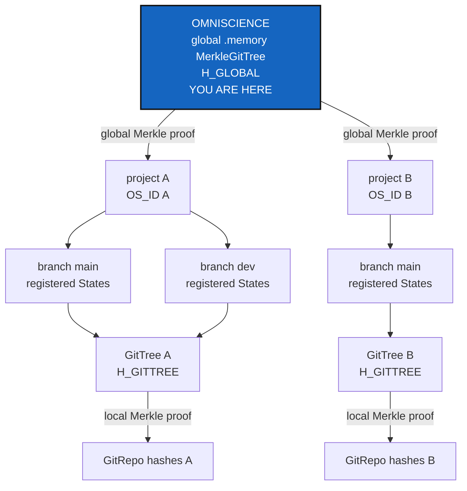
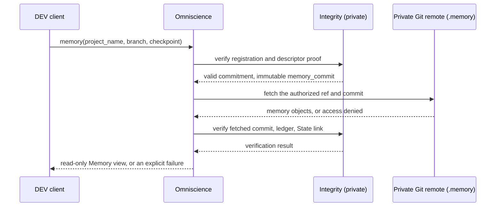
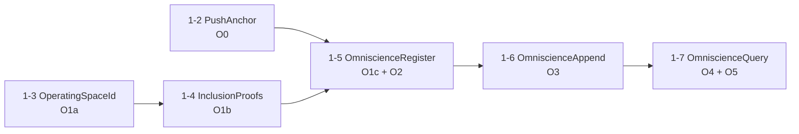

# Omniscience — the global `.memory` MerkleGitTree of every registered project

*Created: 2026-09-16*

*Branch: main*

> **Ticket review — 2026-10-20, owner's decision, from the short ticket
> [update-omniscience](../archive/.closedUserTicket/20261020_update-omniscience.md).**
> Moved `memory-dev_2-10` → `main_1-1`, at the top of priority 1: the owner
> calls the work mandatory now. The short ticket is merged into this one
> and supersedes its old reading as a per-project announcement journal: §1–§6
> below are rewritten from it, and the earlier decisions it keeps are carried
> in §7 with their status. **Split** into this architecture ticket and six
> milestone tickets, one release each (§8): PushAnchor (`main_1-2`, O0),
> OperatingSpaceId (`1-3`, O1a), InclusionProofs (`1-4`, O1b),
> OmniscienceRegister (`1-5`, O1c and O2), OmniscienceAppend (`1-6`, O3)
> and OmniscienceQuery (`1-7`, O4 and O5). BranchProtection moved to the end
> of pile 2 to make room. **Branch `memory-dev` → `main`:** no milestone
> migrates a stored memory format. Each adds: a new repository, a new
> schema next to schema 1, and fields older entries lack. That is the
> README's test (`DevTickets/README.md` §2), the one the 2026-09-18 review
> applied to MemoryArchitecture. A milestone that turns out to migrate a
> format goes back to `memory-dev`. **Version:** the owner first expected
> 7.0.0, then left the level to each milestone's orchestrator, since nothing
> planned breaks the public interface (owner, 2026-10-20). The plan is a run
> of 6.x minor and patch releases (§8); a milestone that does break the
> interface is quoted MAJOR when it lands.

> **Ticket review — 2026-10-08, owner's decision.** Renumbered `memory-dev_2-1` → `memory-dev_2-10`: each priority is one pile counted across branches (TICKETLIFECYCLE §2), which this backlog had numbered per branch. Pile 2 order: AutofixBlindSpot, PackageHygiene, the seven data-repo tickets, Omniscience, WorkingAreaRename, StateLocking; order unchanged within its workstream.

> **Ticket review — 2026-09-30, MemoryArchitecture closed.** [MemoryArchitecture](../archive/20260930_MemoryArchitecture_DevPlanTicket.md) was archived on the owner's word before M6 landed, and M6 moved here: this ticket is now the only place the shared journal and the multi-developer question are tracked. The architecture it fits into is `AdditionalSpecs.md`'s *Memory architecture* section.

> **Ticket review — 2026-09-30, from the owner's short ticket `archive/.closedUserTicket/20260930_ReorderPriority-mem-multiUser.md`.** Scope narrowed, rank unchanged. The owner's rule — a USER tree holds no private repository and its memory is never synced; only a DEV tree's is ([UserDevProfile](../archive/20260930_UserDevProfile_DevPlanTicket.md)) — means the "several people" this journal serves are **developers only**. Users never contribute to it. Whether two developers on one project branch keep sharing one `.memory` branch, or each get their own for this journal to merge, is UserDevProfile's D3, handed to this ticket.

> **Ticket review — 2026-09-22.** Rank unchanged — `memory-dev`'s
> priority-2 pile is numbered independently of `main`'s and `data-repo`'s —
> but confirmed last in reading order across the whole backlog, on the
> owner's request to reorganise it as: finalize the agentic, then what's
> important before data-repo, then
> [data-repo](data-repo_2-1_DataArchitecture_DevPlanTicket.md), then
> Omniscience. It stays behind data-repo because that workstream is
> further along (seven analysed tickets against an owner-approved
> architecture) and because Omniscience's own §1.1 already ties its first
> milestone to a universal clock this project only finished landing this
> month — there is less here yet to start against.

> **Ticket review — 2026-09-18.** Renumbered from `2-10` to `2-1`: it is
> now the only open ticket left on `memory-dev`, the rest of that pile
> (`MemoryArchitecture`, `StateLocking`) having moved to `main` in the
> same pass because the memory system they designed has substantially
> landed. This one stays on `memory-dev` because the global register it
> describes has not been built yet.

> **The architecture of the global project register.** It replaces
> MemorySyncDistant, which was designed as an index of where each project's
> memory lived — a question the shared `.memory` repository answered by
> making every memory a branch. What was left is this: several people, each
> with their own memory of one project, and one register that says what the
> project as a whole did.
>
> **Owner direction — 2026-09-16, in conversation:** *"it could be
> structured around a repo called omniscience that will behave in branch and
> P_branch as private writable does but the register that lies in it can be
> append-only by both cgitsync and direct git command, even by the owner"*.
> That sentence sets the whole shape, and one word in it — *even by the
> owner* — is the part Git cannot give for free. §6.1 is about that word
> (it was §3 before the 2026-10-20 rewrite).


## Abstract — read this first

**The one-line version.** Omniscience is one private Git repository holding
a Merkle tree over the `.memory` of every registered ComplexGitSync
project. From one root hash, `H_GLOBAL`, anyone with access can prove that a
project's branch recorded a given State, find that project's `.memory` and
read it, and see when a repository it relied on has disappeared. Nobody,
the owner included, can rewrite it without the rewrite being visible.

**What this document is.** The architecture of the Omniscience workstream,
and the map of its six milestone tickets. It designs; the milestone tickets
build. It replaces the 2026-09-16 design of a per-project announcement
journal, which it keeps only where the owner's 2026-10-20 update does.

**Why it exists.** A local `.memory` answers "what did *I* do to this
project". Several developers, several projects and several machines need
one answer that none of them can quietly edit. Each `.memory` holds a true
history, but none is complete, and a hash chain cannot merge with another
chain. The global register is where those histories meet without being
merged.

**What you will find.** §1 what Omniscience is, in the owner's words. §2 the
identity of a project. §3 where everything is stored and who may write it.
§4 the hash contract. §5 reading a registered `.memory`, and a repository
that disappears. §6 what append-only can and cannot mean, concurrency and
time. §7 the decisions so far. §8 the milestones and the release each one
is. §9 what this refuses. §10 when the workstream is done.

**Who it is for.** Whoever picks up a milestone ticket, and the orchestrator
who quotes it. Read this first: the milestone tickets refer to its sections
and do not restate them.

**What you need to do with it.** Pick up the lowest-ranked open milestone
(§8). Each one's *Decisions for the owner* is asked before its first edit.
This ticket is archived when OmniscienceQuery lands.



---

## 1. What Omniscience is

> **Owner, 2026-10-20 (`update-omniscience` §0):** *"OMNISCIENCE is the
> global `.memory` MerkleGitTree of all registered ComplexGitSync Operating
> Spaces, addressable by canonical `project_name`. It owns the Git-backed
> global ledger and exposes an authorized, read-only interrogation API."*

Its logical tree is:

```text
project_name / OS_ID → CGS branch → historical State → GitTree → GitRepo
```

It records **cryptographic commitments and resolvable descriptors of each
registered `.memory` repository**. It does not record clones or copies of
private project repositories or their snapshots. An authorized reader
locates and reads a registered `.memory` through the ordinary Git transport
and the provider's own access control.

**The existing `GitTree` is the Operating Space.** No `OperatingSpace` class
is added and no GitTree machinery is reimplemented. The only new primitive is
`os_id`, derived from the root's `project_name` (§2).

**Three roles, one physical code base:**

| Role | Visibility | Does |
|---|---|---|
| `Integrity` | Private implementation | Pure Merkle proofs. Extends `gts_integrity.py`, with no second hashing implementation, no Git and no network |
| `IntegrityControl` | Private implementation | Validates and registers contributions, builds global checkpoints, checks append-only ancestry, records repository lifecycle and availability observations, diagnoses divergence |
| `Omniscience` | Public, read-only software API | Answers authorized queries; exposed on the command line as `cgitsync omniscience ...` |

"Private" is logical, at the API level. The owner rejected splitting
`Integrity`'s sources into separate OWNER and DEVELOPER repositories as
needless complexity. `Omniscience` is a software API, not a public Git
remote.

## 2. Identity — `os_id`

```text
OS_ID := SHA256(UTF8(canonical(project_name)))
```

- Taken from the **root** project's name, never from a child repository's
  `project_name` or a path on a workstation.
- It is not a State hash and not a Merkle root. Branch switches,
  relocation, `memory reboot`, `bootstrap` and `release load` keep it, as
  long as `project_name` is unchanged. A rename is a new identity unless a
  later migration contract relates the two.
- Canonicalisation is frozen once and never folds two distinct accepted
  names into one. Within Omniscience the name is globally unique: a
  conflicting claim by someone unauthorized is refused.
- Schema-1 `.gts` hashes are untouched: `os_id` is not added to the
  `H_STATE` preimage. It is resolved from metadata `.cgs` and `.gts` already
  hold, and old releases are tested.
- A branch ref is a location, not an identity. `MemoryRepository.branch()`,
  the `P_branch` convention and the `ancestors` keeping after `branch close`
  and `branch delete` are reused. Concurrent heads stay distinct.

Built by OperatingSpaceId.

## 3. Repositories and who may write them

| Object | CGS scope | Repository | Authority |
|---|---|---|---|
| A workspace's `.cgitsync/.memory` | private/local | The shared `.memory` repository, one branch per project | Local writer; replication approved by its owner |
| Omniscience, mounted to inspect | private/distant | **Private** `github:flipoyo/omniscience`, at `.omniscience` | Authorized, read-only |
| Omniscience, mounted to contribute | private/local (`private = true, writable = true`) | **The same** repository | Push right granted by the provider |
| The universal-time reference, if configured | private/distant | Private, read-only | Managed apart (§6.3) |

Private/distant does not mean public: a public `Omniscience` method never
exposes a record its caller may not read. The USER/DEV rule stands: a USER
tree has no private repository and contributes nothing; an authorized DEV
tree contributes. No new source repository, and no credential inside
`cgitsync`.

**One physical `omniscience` repository**, shared by every project, keeping
its per-project branches. A distinguished global index (a branch or an
equivalent authenticated aggregate, chosen in OmniscienceRegister) derives
**one `H_GLOBAL` over every registered project branch**. The index points to
immutable State commitments and authenticated `.memory` descriptors. It
never clones project repositories and never folds ledger files. A reference
in it resolves to an authorized, read-only Git operation; no access is
reported as no access, never as corruption. A checkpoint never hashes
itself while it is being built.

## 4. The hash contract

Schema 1 is reused unchanged:

```text
H_REPO → H_GITTREE → H_STATE
```

On top of it, a new, versioned and domain-separated schema:

```text
OS_ID      = SHA256(UTF8(canonical(project_name)))
H_OS_STATE = hash_v1(OS_ID, branch reference, H_STATE, H_GITTREE,
                     local memory tip, immutable State and commit references)
H_GLOBAL   = MerkleRoot_v1(ordered, unique global registration leaves)
```

- A global leaf identifies **one registered branch head and one immutable
  State commitment**. Keying by `OS_ID` alone would let one branch or one
  moment overwrite another.
- Ordering, duplicates, leaf preimage, domain tags, the empty tree and the
  proof encoding are a **new global schema**. `integrity_schema = 1` is
  never reinterpreted.
- Inclusion proofs (RFC 6962 style, with the current CGS domain tags) are
  generated and verified for the existing GitTree decomposition first.
  Schema-1 roots and golden vectors stay byte for byte identical. A proof
  binds the leaf index, the tree size, the ordered siblings, the
  schema/domain and one trusted root.
- **An inclusion proof shows membership in one committed root. It does not
  show that the repository checked out today matches it.** Divergence is
  located by comparing trusted and observed hashes, global → project, branch
  and State → repository. When the private evidence cannot be read, the
  answer is "diagnosis unavailable", never "corrupt".

Built by InclusionProofs (local proofs) and OmniscienceRegister (`H_OS_STATE`,
`H_GLOBAL`).

## 5. Reading a registered `.memory`, and a repository that disappears

**A `.memory` is a repository, not a hash.** For each registered branch,
Omniscience keeps a versioned **MemoryRepoDescriptor**, built from the
existing CGS repository model rather than a competing one. It holds the
lookup key (`os_id`, `project_name`, `project_branch`), the canonical
`memory_repository` identifier (with no credential), the logical
`memory_mount`, the `memory_ref` from `MemoryRepository.branch()`, the
**immutable `memory_commit`** that defines the historical read, the
commitments that link it (`local_ledger_tip`, `state_id`, `gittree_root`),
and optionally a `remote_locator`. Addressing fields are kept apart from the
frozen registration preimage, so that a URL alias, a credential or an access
status never changes a historical hash.



The read never changes the source `.memory` or Omniscience. It goes through
`git_runner.py`, `MemoryRepository`, `MemoryStates` and `LedgerStore`; no Git
internals are parsed. A cache clone is allowed as an implementation detail.
The outcomes are distinct: `not_registered`, `unauthorized`,
`remote_unavailable`, `commit_unreachable`, `invalid_proof`,
`ledger_corrupt`, `verified`.

**A registered repository may later be closed, deleted, destroyed, made
private or unreachable.** Its registration stays, and three things are kept
apart:

1. **The recorded State and its proof** are immutable. A valid proof stays
   valid for its commitment, even when the repository is gone.
2. **The declared lifecycle** comes from the existing branch-close records
   and `ancestors` relocations. `CLOSED` is an authenticated transition,
   never inferred from a failed fetch, and closing a branch is not deleting a
   repository.
3. **The observed availability** is probed separately and recorded as
   `AVAILABLE`, `ACCESS_DENIED`, `UNREACHABLE`, `NOT_FOUND`,
   `COMMIT_MISSING` or `UNKNOWN`, with time, method and evidence. A 404 from
   a private forge proves nothing; `DELETION_CONFIRMED` needs authenticated
   evidence, and `DESTROYED` is kept for a documented loss of the
   authoritative objects.

The typed findings (`REPO_CLOSED`, `REPO_NOT_FOUND`, `REPO_DELETION_CONFIRMED`,
`REPO_UNREACHABLE`, `REPO_ACCESS_DENIED`, `REPO_COMMIT_MISSING`,
`MEMORY_REPO_UNAVAILABLE`, `REPO_CONTENT_MISMATCH`) are aligned with the
existing `Finding` taxonomy (`memory/integrity.py`) when they are built.
Historical integrity and current availability are separate fields, and a
verified global proof is never reported as an available repository. A
missing repository raises a completeness warning or failure under an explicit
policy. A confirmed disappearance is a **new event** linked to the old
registration, never a rewrite, a tombstone or a removed leaf.

> **Canonical (owner):** *Historical inclusion does not imply present
> availability. An inaccessible, closed or lost GitRepo remains recorded and
> must be visibly flagged.*

Recorded by OmniscienceAppend; reported by OmniscienceQuery.

## 6. Append-only, concurrency and time

### 6.1 What Git can promise — kept from the 2026-09-16 design

The owner's requirement was *"append-only by both cgitsync and direct git
command, even by the owner"*, and D1 settled what it means: **a rewrite
cannot be hidden, not that it cannot happen.**

- **The chain is Git's own commit DAG.** One record is one file, one append
  is one commit, so a person can append with `git add` and `git commit`. No
  `prev` field is invented.
- **Records are content-addressed** (`register/<sha256>.toml`): changing one
  means deleting a file and adding another.
- **Signed commits** say who appended. A `contributor` field is a claim; the
  signature is the evidence.
- **Prevention is the host's**, by branch protection or a server hook.
  `cgitsync` checks and says which protections exist, and never claims to
  enforce them (BranchProtection, pile 2, is how it may later set them).

A record appended by hand is a **proposed** record. It enters the global
index only after `IntegrityControl` validates it; a malformed or unauthorized
file stays visible as unaccepted evidence and never gets an inclusion proof.

### 6.2 Two contributors at once

Each works against their own `.memory`. Registration pulls the register,
writes one file, commits and pushes. A non-fast-forward is retried against
the newest checkpoint: never force, never rebase. Two records are two files,
so Git merges them without a rule of ours. Races and interrupted pushes are
idempotent.

### 6.3 Time and causality — kept from the 2026-09-20 design

Two layers: the machine's own clock (`universal_clock.py`, built) and an
optional shared reference (`time_reference.py`, the name D9 reserved). A
registration time is recorded apart from the local event time. A measured lag
keeps its local time, offset, uncertainty and source. **Causal parent edges
always win over timestamps**, and two events inside each other's
uncertainty stay unordered. O0, the push anchor, does not depend on
Omniscience.

## 7. Decisions so far

| | Question | Status |
|---|---|---|
| D1 | What append-only means | **Answered 2026-09-16:** a rewrite is detectable, not impossible; the host enforces (§6.1) |
| D2 | One Omniscience for all projects, or one each | **Answered 2026-10-20:** one physical repository, a branch per project, one global index (§3) |
| D3 | Who may append | **Answered 2026-10-20:** authorized DEV trees, with push right from the provider; whether signed commits are *required* is OmniscienceAppend's D-question |
| D4 | A record's published state from `ls-remote` or from `.gts` | **Answered 2026-10-20:** both — the `ls-remote` attestation is kept and tied to the immutable `.gts` and Memory commitments; historical publication is kept apart from today's ref |
| D5 | A diverged register | **Answered 2026-09-16 and kept:** retry, never force, never rebase |
| D6 | States in the register, or records about them | **Answered 2026-10-20:** commitments and `.memory` descriptors only; no copy of a State or a private repository |
| D7 | One repository for time and register, or two | Open; OmniscienceRegister asks it |
| D8 | What the universal clock is | Open; OmniscienceRegister asks it (NTP recommended) |
| D9 | The shared-time module's name | **Answered 2026-10-20:** `time_reference.py` |
| D10 | Does O0 wait for anything | **Answered 2026-10-20:** no; PushAnchor is independent |
| — | An `OperatingSpace` class | **Refused 2026-10-20:** `GitTree` is the Operating Space |
| — | `Integrity` split into OWNER and DEVELOPER repositories | **Refused 2026-10-20** |
| — | A forced 7.0.0 | **Not forced, 2026-10-20:** each milestone's orchestrator decides its level |

## 8. Milestones — one ticket and one release each

The old O1–O5 labels are remapped, and each row keeps them for traceability.
The release level is the orchestrator's call when the work lands; the
column says what the plan expects. Nothing planned breaks the public
interface, so the run stays inside 6.x unless a milestone proves otherwise.

| Rank | Ticket | Milestone | Delivers | Expected level |
|---|---|---|---|---|
| `1-2` | [PushAnchor](main_1-2_PushAnchor_DevPlanTicket.md) | O0 (was O0; UniversalClock WP7) | A local, checkable witness of which push carried which State | minor |
| `1-3` | [OperatingSpaceId](main_1-3_OperatingSpaceId_DevPlanTicket.md) | O1a | `os_id` and the frozen naming contract | minor |
| `1-4` | [InclusionProofs](main_1-4_InclusionProofs_DevPlanTicket.md) | O1b | Private Merkle inclusion proofs over schema 1 | patch |
| `1-5` | [OmniscienceRegister](main_1-5_OmniscienceRegister_DevPlanTicket.md) | O1c + O2 (was O1, O2) | The registration record, the MemoryRepoDescriptor, the mount, the global index and `H_GLOBAL` | minor |
| `1-6` | [OmniscienceAppend](main_1-6_OmniscienceAppend_DevPlanTicket.md) | O3 (was O3) | `IntegrityControl`: registering, concurrency, accepting hand appends, lifecycle and availability observations | minor |
| `1-7` | [OmniscienceQuery](main_1-7_OmniscienceQuery_DevPlanTicket.md) | O4 + O5 (was O4, O5) | The public `Omniscience` API and `cgitsync omniscience ...`, and the two-developer, two-project end-to-end test | minor |



PushAnchor and OperatingSpaceId do not depend on each other. Before coding,
each milestone checks itself against the current backlog and release, and
reopens no archived decision.

## 9. What this refuses

- Merging local hash chains file by file; `MemoryMergeOperation` and Git
  ancestry stay.
- A central copy of `.gts` files, private project repositories, diffs or
  credentials. An authorized, temporary fetch of a registered `.memory` for
  a read-only query is allowed.
- Claiming that Git alone makes history owner-proof. It reports what branch
  protection, trusted anchors and signed commits are present.
- Networking or registering on its own, or anything in a USER tree.
  Registration is an explicit, authorized command.
- Resolving contradictory observations by replacing evidence; they are
  reported.
- A second hashing implementation, a parallel `OperatingSpace` class, a
  change to an existing hash preimage, or an application-specific
  dependency.

## 10. When the workstream is done

1. `GitTree` is the Operating Space, and `os_id` comes from its root
   `project_name` and survives every supported way of materialising it.
2. `.memory`, branch naming, the ledger and schema-1 integrity work as
   before; every schema-1 golden vector passes.
3. The private `omniscience` repository holds append-only, content-addressed
   registrations and one verifiable global checkpoint over several projects'
   branches.
4. Only authorized DEV contributors register, and private data stays
   unreadable to anyone else.
5. The read-only API finds registered projects, branches and States, returns
   a proof with its checkpoint, and reads the actual `.memory` at its
   registered commit when authorized.
6. `Integrity` verifies membership locally and globally; `IntegrityControl`
   locates an inconsistent Operating Space, then repository, when the
   evidence is readable.
7. Two machines restore one named Operating Space and continue its history;
   concurrent branch heads are kept, with no destructive ledger merge.
8. Non-fast-forward retries, crash recovery, content-address collisions, an
   unauthorized append, a missing memory and a forced rewrite of the remote
   are tested, with precise outcomes.
9. Hand appends stay possible as proposals; only valid, authorized records
   enter the index.
10. No OWNER/DEV source split, no `OperatingSpace` class, no changed hash
    preimage, no application-specific dependency.
11. Closed, inaccessible, unreachable, missing and confirmed-deleted
    repositories give separate, evidenced findings; completeness is flagged
    and no historical registration or proof is erased.

> **Canonical (owner):** *GitTree materializes an Operating Space.
> `OS_ID = SHA256(project_name)` identifies it. Local Memory preserves its
> history. OMNISCIENCE is the global `.memory` MerkleGitTree of registered
> histories. Integrity proves privately; IntegrityControl maintains
> privately; Omniscience answers through an authorized public API.*
