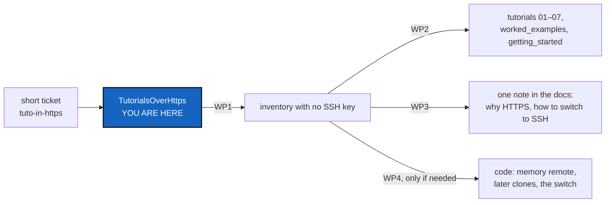

# TutorialsOverHttps — the tutorials assume an SSH key their reader does not have

*Created: 2026-10-20*

*Branch: main*

> From the owner's short ticket
> [tuto-in-https](../archive/.closedUserTicket/20261020_tuto-in-https.md),
> closed in the change that wrote this plan. The owner's words, quoted
> there: *"tutos must follow https protocole because the user doing them do
> not have any ssh privilege. I keep ComplexGitSync by default in ssh, but
> user will probably follow https before switching to ssh once convinced
> this is worth it. Check all the tutos, and make a note in docs"*.

## Abstract — read this first

**The one-line version.** A new user has no SSH key on GitLab or GitHub, but
every tutorial clones the tree over SSH unless the user remembers a one-line
aside in Tutorial 1. The tutorials must work over HTTPS as written; the
default `access_protocol` stays `ssh`; the docs say once, in one place, why
the tutorials use HTTPS and how to switch to SSH later.

**What this document is.** A plan, written against the code and docs as of
2026-10-20 (6.3.4). Nothing is built. §2 is what each tutorial does today,
§3 what the code already does, §4 the questions for the owner, §5 the work.

**Why it exists.** A tutorial is the first thing a user runs. A first command
that fails with `Permission denied (publickey)` loses the user before
`cgitsync` has shown anything, and the fix (`--force-protocol https`) is
printed in a hint the user has no reason to trust yet.

**Who it is for.** The worker and the orchestrator who implement it, and
the owner, who answers §4 first.

**What you need to do with it.** Ask §4 with `AskUserQuestion` before the
first edit. Run WP1 before writing any tutorial text: it turns §3's open
premises into facts.

---

## 1. The request

Three parts, each a work package:

1. **The tutorials follow HTTPS.** A reader with no SSH key finishes every
   tutorial by copying its commands.
2. **The default stays SSH.** No `.cgs` default, no example `.cgs` and no
   code default changes (owner, in the short ticket).
3. **A note in the docs**: the tutorials use HTTPS because a new user has
   no SSH key; SSH is the default for those who do; how to switch a tree to
   SSH "once convinced".

## 2. What the tutorials do today

Read on 2026-10-20. Line numbers are as of 6.3.4.

| Where | Today | Gap for an HTTPS-only reader |
|---|---|---|
| `tutorials/README.md` | Says which shell; nothing on the protocol | No word that the tutorials need `--force-protocol https` |
| `01_first_multi_repo_workspace.md` | Line 59: "SSH access" is a default. Lines 94–96: an aside, "add `--force-protocol https` to `bootstrap` or `initialise`". The tool and the root are cloned over HTTPS (105, 157, 159) | The commands at 123 (`bootstrap`) and 162 (`initialise`) carry no flag: copied as written, they clone `CGSil2`, `CGSih1` and `CGSih2` over SSH and fail |
| `02_working_with_a_tree.md` | Line 50: push needs a fork and write access. Line 248: a second `bootstrap` into `CGSil1-latest` | Line 248 has no flag. Nothing says how to push over HTTPS (a credential helper or the provider's CLI) |
| `03_onboarding_a_real_build_tree.md` | `bootstrap examples/cawaqs.cgs` at 151 and in the recap at 189 | No flag: nineteen SSH clones |
| `04_adopting_a_real_project.md` | The root is cloned over HTTPS (95). The submodule note (114–121) offers SSH first, a token second. `initialise` at 210 has no flag. The push note (337–354) tells the user to switch to SSH | The order is the reverse of the request: HTTPS credentials should come first, the switch to SSH second |
| `05_private_repos.md` | Runs against ComplexGitSync's own developer tree (`examples/complexgitsync4dev.cgs`); `initialise` at 316 | It needs a developer's credentials over either protocol. It stays on SSH, with HTTPS as an optional mode for the tutorial only (§4, Q5, answered) |
| `06_memory.md` | `repo create` prints `remote_url=git@github.com:...` (174); `memory adopt` prints `remote=git@github.com:...` (224) | Not only text: the code builds every memory remote over SSH (§3, F6), so an HTTPS-only reader's `memory push` fails whatever the tutorial says |
| `07_merge.md` | `push --private && push` at 164, on the tree of the earlier tutorials | To check in WP1: it follows whichever protocol that tree was cloned with |
| `docs/Text/worked_examples.tex`, `getting_started.tex` | `git clone https://...` for the tool and the roots | To check in WP1: the `cgitsync` lines after them |

## 3. What the code already does

**Facts, read from the source:**

- **F1.** `access_protocol` defaults to `ssh` in normalisation
  (`cgs_format.py`, `DEFAULT_ACCESS_PROTOCOL`; user guide, *Local Authoring
  Spec*). It stays.
- **F2.** `bootstrap` and `initialise --force-protocol https` override the
  protocol in memory for every repository the run clones, nested `.cgs`
  included, and never write it to a `.cgs` (`ComplexGitSyncClient`, the
  clone path around `client.py:1309`). The remote a clone gets is HTTPS, so
  `push` and `pull` on that repository use HTTPS afterwards.
- **F3.** `pull --force` and `push --force-protocol {ssh,https}` rewrite the
  remotes with `git remote set-url`, persistently (user guide, `pull
  --force` and `push`).
- **F4.** An SSH clone that fails authentication prints a hint naming
  `--force-protocol https` (`client.py:1319`); an HTTPS push that fails
  prints one naming `--force-protocol ssh` (`AuthFailureHints`).
- **F5.** A State's hash ignores `access_protocol`
  (`gts_document.py:453`): switching a tree's protocol never changes a State
  or a release.
- **F6.** `MemoryFacts.remote_url_for_identifier` builds every memory
  remote with `AccessProtocol.SSH`, hard-coded (`orchestre/memory_facts.py:293`).
  `repo create`, `memory mount`, `memory adopt` and `memory setup` all go
  through it.

**Premises WP1 must settle, before any tutorial text is written:**

- **P1.** After an HTTPS `bootstrap`, does every later command that clones a
  repository the tree did not have yet — `pull` picking up a new `.cgs`
  entry, `checkout` of a branch whose nested `.cgs` adds one, `release
  load` — clone it over HTTPS, or fall back to the `.cgs` default, SSH?
  If SSH, that is a defect for this ticket (WP4).
- **P2.** `push` over HTTPS works on GitLab and GitHub with no `cgitsync`
  change once the user's credentials are in Git's credential helper
  (`gh auth setup-git`, `glab auth login` with its Git credential option,
  or a personal access token stored by the helper).
- **P3.** Is there a non-destructive way to switch a whole tree to SSH?
  `pull --force` is destructive by name. Does `push --force-protocol ssh`
  rewrite every remote even when nothing is ahead, and does it reach the
  private repositories (`--private`)?

## 4. Decisions for the owner — Q5 answered, the others open

The open ones are asked with `AskUserQuestion` before the first edit. A
recommendation is not the answer.

- **Q1 — Where the note in the docs goes.** (a) One new section, *SSH or
  HTTPS*, in the user guide (`docs/Text/user_guide.tex`), linked from
  `tutorials/README.md` and from Tutorial 1, which do not restate it; (b) in
  `getting_started.tex`; (c) both. One authoritative file per purpose
  (DOCSTYLE §7) argues for (a).
- **Q2 — How the tutorials carry HTTPS.** (a) Every `bootstrap` and
  `initialise` line in the tutorials is written with `--force-protocol
  https`, so a copied line works; (b) the tutorial `.cgs` files declare
  `access_protocol = "https"` — `CGSil1.cgs` lives in the external
  `CGS_test` sandbox, and this changes what the owner's own runs use;
  (c) a new setting or environment variable for the default protocol — new
  code, and a second way to say what `--force-protocol` says.
- **Q3 — How a tutorial reader writes over HTTPS** (push in Tutorials 2 and
  4, `memory push` in 6). (a) Through the provider's CLI as Git's credential
  helper (`gh auth setup-git`, `glab auth login`), the same tools Tutorial 6
  already relies on, and in line with "`cgitsync` never reads a token";
  (b) a personal access token typed as the password and kept by Git's
  credential helper; (c) both, (a) first.
- **Q4 — The memory over HTTPS (F6).** (a) Code: a memory's remote follows
  the protocol of the tree root's own remote, so an HTTPS tree gets an
  HTTPS memory with no flag; (b) code: `memory setup`, `mount` and `adopt`
  take `--force-protocol`; (c) docs only: Tutorial 6 says the memory needs
  SSH, and is where the reader switches.
- **Q5 — Tutorial 5. Answered by the owner, 2026-10-20; not asked again:**
  *"Tuto 5 requires dev credential, so https is there an optionnal mode for
  the tuto only not for a real experience that is better in ssh"*. Tutorial
  5 needs a developer's credentials whatever the protocol. Its commands stay
  on SSH, the default. HTTPS is an optional mode for working through the
  tutorial only, shown beside the SSH line (`--force-protocol https`, with
  HTTPS credentials that reach the private repositories). The tutorial says
  that real developer work is better done over SSH.
- **Q6 — "Switching to SSH once convinced".** Depending on P3: (a) document
  the command that already does it (`push --force-protocol ssh`, and
  `--private` for the configuration repositories); (b) add a tree-wide,
  non-destructive command that only rewrites the remotes — a new CLI
  command and client method, documented in the user guide and the API docs
  (step 7).

## 5. Work packages

- **WP1 — Inventory with no SSH key (no change).** In a scratch workspace,
  with SSH disabled for Git (`GIT_SSH_COMMAND=false`) and HTTPS credentials
  for a fork of the sandbox, run every `cgitsync` line of Tutorials 1–7,
  `worked_examples.tex` and `getting_started.tex`, first as written, then
  with `--force-protocol https`. Record each failure in §2 of this ticket,
  and answer P1–P3 in §3, before WP2 starts.
- **WP2 — The tutorials.** Per Q2, Q3 and Q5: every command a reader copies
  works over HTTPS. Tutorial 1's aside becomes one sentence and a link to
  the note (WP3). Tutorial 2 says how to push over HTTPS. Tutorial 4's two
  notes put HTTPS credentials first and SSH second. Tutorial 5 keeps its SSH
  commands, adds the HTTPS line as an optional mode for the tutorial only,
  and says that a developer works better over SSH (Q5). Tutorial 6's example
  outputs show the remote Q4 produces. `tutorials/README.md` says, next to
  *Which shell*, that the tutorials use HTTPS and links to the note.
  `worked_examples.tex` and `getting_started.tex` follow.
- **WP3 — The note in the docs.** In the place Q1 names: why the tutorials
  use HTTPS, that SSH stays the default for a `.cgs`, how to check for an
  SSH key (`ssh -T git@gitlab.com`, `ssh -T git@github.com`), the hints
  `cgitsync` prints on an authentication failure (F4), that switching
  changes no State (F5), and the switch itself (Q6).
- **WP4 — Code, only if needed.** When Q4 is (a) or (b), Q6 is (b), or P1
  shows an SSH fallback: the change goes in the module that owns it
  (`MemoryFacts` for the memory remote, the client's clone path for P1),
  with unit tests, the CLI mirroring the client method, and
  `pixi run bump-build`.
- **WP5 — A test that keeps the tutorials honest.** When Q2 is (a): a unit
  test that fails when a `cgitsync bootstrap` or `cgitsync initialise` line
  in `tutorials/*.md` lacks `--force-protocol https` (Tutorial 5 exempt:
  its SSH lines stay, Q5), so a later edit cannot quietly bring SSH back.
- **WP6 — Close.** PDFs rebuilt; the orchestrator decides the version
  level and writes the record.

## 6. Acceptance

1. With Git's SSH disabled and HTTPS credentials only, a reader copying
   Tutorials 1–4, 6 and 7 line by line reaches each tutorial's end state
   (Tutorial 5 over SSH, or over HTTPS with a developer's HTTPS
   credentials, Q5). WP1's run, repeated after WP2–WP4, shows it.
2. No tutorial shows an SSH URL as the reader's own remote, except in the
   note on switching to SSH.
3. The note exists in one place; the tutorials link to it and do not
   restate it.
4. `access_protocol` still defaults to `ssh`: no default and no `.cgs` under
   `examples/` changes its protocol.
5. `pixi run lint` and `pixi run test` pass, `cgitsync status` shows
   `errors=0`, and the PDFs are rebuilt.

## 7. Out of scope

- Changing the default protocol (the owner keeps SSH).
- A guide to creating an SSH key: the note points to the provider's own page.
- `cgitsync` reading, storing or prompting for a token: it never does.
- The developer install: CI already initialises it with
  `--force-protocol https`, and a developer has SSH.
