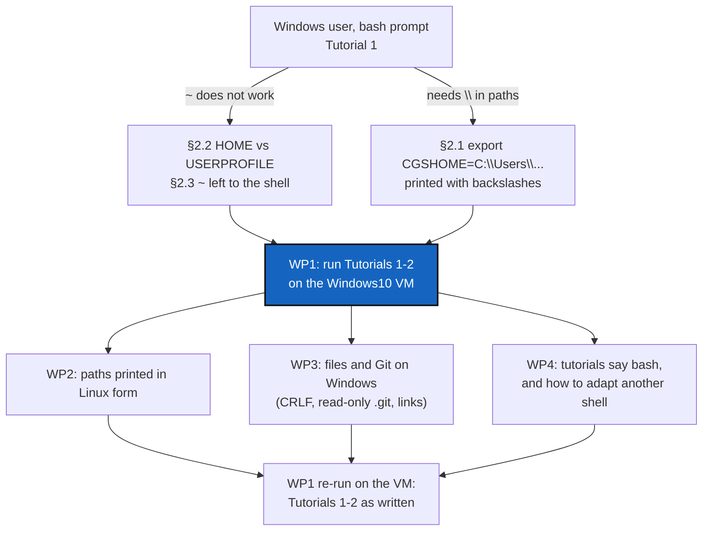

# WindowsCompatibility — a Windows user cannot follow Tutorial 1 as written

*Created: 2026-10-16*

*Branch: main*

> From the owner's short ticket
> [windows-compatibility](../archive/.closedUserTicket/20261016_windows-compatibility.md),
> closed in the change that wrote this plan. The user's own words, quoted
> there: *"les ~ ne fonctionnent pas, il faut mettre les chemins en entier"*
> and *"pour certaines commandes il faut aussi mettre des \\ sinon le
> terminal comprend \ comme un espace"*.

## Abstract — read this first

**The one-line version.** A Windows user working from a bash prompt could
not use `~`, and had to double the backslashes in a path to follow
Tutorial 1. The owner's line: the CLI stays Linux-like, **as long as the
`export CGSHOME=...` line it prints works, in Linux form, at a Windows
prompt.** This ticket finds every place where that fails, fixes what is
ComplexGitSync's, and proves it on Windows.

**What this document is.** A plan, written against the code as of
2026-10-16 (6.3.3). Nothing is built. §2 lists what reading the code already
shows; §3 lists what only a Windows machine can confirm.

**Why it exists.** `pixi.toml` declares `win-64`, so Windows is a supported
platform. Yet only two test files run on Windows in CI (the golden-vectors
job), and no tutorial has ever been run there. The first real Windows user
hit two failures in Tutorial 1.

**What you will find.** §1 the report. §2 the causes found by reading the
code. §3 what to verify on Windows. §4 decisions for the owner. §5 work
packages. §6 acceptance. §7 what is out of scope.

**Who it is for.** Whoever implements it. The owner answered §4 on
2026-10-16.

**What you need to do with it.** Run WP1 before changing any code: the
inventory decides how large WP2–WP4 are.



---

## 1. The report

A Windows user followed Tutorial 1 from a bash prompt (most likely Git
Bash, since `export` worked; to be confirmed, §4 D1). Two failures:

1. **`~` did not work**, so they typed full paths instead. The short ticket
   adds that `~/.cgs` was not reachable from their bash prompt.
2. **Some paths needed `\\`.** A single `\` was swallowed by the shell.

## 2. What the code already shows

### 2.1 The `export CGSHOME=` line is printed with backslashes

`bootstrap` and `release load --workspace` end with:

```text
To use this workspace, run:
  export CGSHOME=<root_path>
```

`_print_workspace_instructions` in
[cli/_shared.py](../../../../../src/ComplexGitSync/cli/_shared.py) formats a
`Path` with `str()`. The same applies to the "other workspaces" listing in
that file, and to the one in
[cli/expert.py](../../../../../src/ComplexGitSync/cli/expert.py). On Windows,
`str(Path)` gives `C:\Users\you\.cgs\CGSil1-<timestamp>`. Pasted into bash,
every `\` escapes the next character, so the result is
`C:Usersyou.cgsCGSil1-<timestamp>`. **This matches the user's second
symptom exactly.** `C:/Users/you/.cgs/...` (`Path.as_posix()`) works in Git
Bash and in Python alike.

### 2.2 `~/.cgs` in bash is not always ComplexGitSync's `~/.cgs`

The default workspace root is `Path.home() / ".cgs"` (in
[settings.py](../../../../../src/ComplexGitSync/settings.py) and
[paths.py](../../../../../src/ComplexGitSync/paths.py)). On Windows, Python
3.8 and later compute `Path.home()` from `USERPROFILE` and **ignore
`HOME`**, but Git Bash's `~` is `$HOME`. The two differ wherever `HOME` is
set to something else, which is common on managed machines (a network
drive, `H:\`). There, `cd ~/.cgs` in bash and the workspace cgitsync
builds are two different directories. **This is a likely reading of "`~/.cgs`
is not accessible from bash".** The `settings.py` docstring's claim, "a test
that moves `HOME` moves this with it", is false on Windows.

### 2.3 Most `~` in the tutorials are expanded by the shell, not by cgitsync

cgitsync expands `~` itself in every path it receives (`expanduser` in
`paths.py`, `settings.py` and `snapshot_resolver.py`). The tutorials,
however, also run shell commands that cgitsync never sees:

- `curl -L -o ~/CGSil1.cgs ...`
- `cat "$CGSHOME/..."`
- `echo ... >> "$CGSHOME/..."`
- `export ...`

In `cmd` none of these work, and in PowerShell `curl` is an alias that
rejects `-L -o`. The tutorials never say which shell they assume. There are
29 such lines across Tutorials 1–7.

### 2.4 Files cgitsync writes, and Git on Windows

- **Line endings.** The root `.gitignore` is appended in text mode
  (`git_tree.py`, `sync_gitignore`), so on Windows it is written with CRLF.
  With Git for Windows' default `core.autocrlf=true`, the committed blob
  holds LF. The untracked-twin check added on 2026-10-16 (improve-tuto) in
  [git_runner.py](../../../../../src/ComplexGitSync/git_runner.py) compares
  worktree bytes with `git show <ref>:<path>`, so **on Windows the twin
  will not match**, and `checkout` and `release load` will refuse again in
  exactly the case that fix was written for.
- **Deleting a clone.** `_clone_registry_entry` in
  [orchestre/client.py](../../../../../src/ComplexGitSync/orchestre/client.py)
  calls a bare `shutil.rmtree`. Git for Windows writes `.git/objects` files
  read-only, so `rmtree` fails with `PermissionError` unless an `onexc`
  handler clears the flag. `default_memory.py` passes `ignore_errors=True`,
  which on Windows can leave a half-deleted `.git` in place without saying
  so.
- **Renames and links.** `memory_commands.py` renames a `.git` directory,
  which fails while any process holds a file in it open: an editor, the
  indexer, an antivirus. The ledger publishes with `os.link`, which
  NTFS supports and FAT/exFAT does not. Its `chmod` is already best-effort.
- **Paths split on `/`.** `git_probes.py` splits `relative_path` on `"/"`.
  This is correct only if every `relative_path` reaching it was built with
  `as_posix()`. WP1 verifies that.

### 2.5 What CI covers on Windows today

The `golden-vectors` job runs `test_gts_integrity.py` and
`test_gts_document.py` on `windows-latest`. Nothing else runs there: not a
CLI command, a clone, or a tutorial replay.

## 3. What only a Windows machine can confirm

The VirtualBox VM `Windows10` on the owner's machine. No CI job is added
(D4). To check:

1. Which shell the user had, and what `~`, `$HOME` and `USERPROFILE` hold
   there (§2.2).
2. Tutorial 1, both install modes, and Tutorial 2, in Git Bash, as written
   (HTTPS; see §7).
3. The same in PowerShell, only to write WP4's "if your shell is not bash"
   lines correctly (D1).
4. Git's message locale pin (`_non_interactive_git_env`) under a French
   Windows: the hint matching depends on it.
5. Path length: a workspace under `C:\Users\<name>\.cgs\<project>-<timestamp>\`
   with nested repositories, against the 260-character limit and Git's
   `core.longpaths`.
6. Case-insensitive names: two repositories or branches differing only in
   case.

## 4. Decisions for the owner — answered 2026-10-16

The owner's answers. They are not asked again when the ticket is
implemented.

- **D1 — Supported shell: bash only.** The CLI stays Linux-like, and on
  Windows bash means Git Bash. The docs say so, and say **how to adapt when
  the local shell is different**: the PowerShell and `cmd` equivalents of
  the lines a user must type or paste (`export CGSHOME=...`, `$CGSHOME`,
  `~`). cgitsync itself prints only the bash form.
- **D2 — Printed paths: `C:/Users/you/.cgs/...`** (`as_posix()`), which
  Python and Git Bash both read. Not the MSYS form `/c/Users/...`.
- **D3 — `$HOME` first.** The default workspace root is `$HOME/.cgs` when
  `HOME` is set, on every platform, and only then `Path.home()`
  (`USERPROFILE` on Windows). Bash's `~/.cgs` and cgitsync's are then the
  same directory. The owner prefers `$HOME` in any case.
- **D4 — No Windows CI job for now.** CI is not loaded with Windows runs until
  concrete bug reports from Windows users ask for them. The `golden-vectors`
  job stays as it is. The Windows check is the manual run on the `Windows10`
  VM (WP1).
- **D5 — The developer install on Windows is out of scope** (§7). The
  report is about the user install.

## 5. Work packages

- **WP1 — Inventory on Windows (no code change).** Run §3 on the `Windows10`
  VM: Git for Windows, Pixi, Tutorials 1 and 2 over HTTPS. Write each
  failure into §2 of this ticket, as confirmed or ruled out, before
  WP2–WP4 start. This is the "report where Windows may not work" the short
  ticket asks for. When WP2–WP4 are done, run it again: that run is the
  acceptance (§6).
- **WP2 — Paths cgitsync prints and reads.** Print every path a user is meant
  to paste (`export CGSHOME=`, the `CGSHOME=... pixi run` line, the
  other-workspaces list, `cgshome=`, `log_file=`) in the D2 form, through one
  helper in `paths.py`, not one call site at a time. Apply D3 wherever the
  default root is resolved (`settings.py` and `paths.py` both compute
  `Path.home() / ".cgs"` today), making it one place, and correct the
  `settings.py` docstring that says `HOME` moves it. Make sure a `CGSHOME`
  given in the D2 form resolves to the same directory. Unit tests run on
  Linux, so they simulate Windows by injecting the environment and
  `PureWindowsPath`, not by needing a Windows runner.
- **WP3 — Files and Git on Windows.**
  - Write generated text files (`.gitignore`, `.cgs` drafts, States, ledger
    entries) with `newline="\n"`, so their bytes do not depend on the
    platform. The golden vectors already require this of States.
  - Make the untracked-twin check compare what Git would store, not raw
    bytes: `git hash-object --path=<name> <file>` against
    `git rev-parse <ref>:<name>`, so `core.autocrlf` and `.gitattributes`
    apply.
  - Give `rmtree` a handler that clears the read-only flag, and say when a
    rename fails because a file is held open.
  - Fix whatever else WP1 confirmed.
- **WP4 — Tutorials and docs.** State the shell once, in `tutorials/README.md`
  and in each tutorial's *Before you start*: bash, which on Windows is Git
  Bash. Per D1, one short passage, in `tutorials/README.md` and the user
  guide's install section, says how to adapt when the local shell is
  different: the PowerShell and `cmd` forms of `export CGSHOME=...`,
  `$CGSHOME` and `~`, and `curl.exe` rather than PowerShell's `curl`
  alias. The tutorials themselves stay in bash. Write `$HOME` where the
  shell must expand a home path (D3), so a tutorial line and cgitsync's
  default point at the same place. No command table in `README.md`
  (step 7).

## 6. Acceptance

- On the `Windows10` VM, in Git Bash, Tutorial 1 (standalone and nested) and
  Tutorial 2 run as written, without typing a full path or a doubled
  backslash, and the printed `export CGSHOME=` line works when pasted.
- With `HOME` set to a directory other than `USERPROFILE`, the workspace is
  where D3 says, and the tutorials' `$CGSHOME` and `~` lines agree with it.
- On Windows with `core.autocrlf=true`, Tutorial 2 Step 9 works on the VM:
  a fresh install joins `feature` and loads the release made on it. A Linux
  unit test pins the same case by committing with CRLF normalisation
  (`core.autocrlf=true`, or a `.gitattributes` `text` rule).
- No CI job is added (D4).
- §2 of this ticket records each suspected failure as confirmed and fixed,
  or ruled out.
- The usual eight steps. Any ceiling raise is asked for, not assumed.

## 7. Out of scope

- **SSH vs HTTPS in the tutorials.** The owner's separate short ticket
  `tuto-in-https` asks for HTTPS in every tutorial. It is likely to hit the
  same Windows users, and §3's Windows runs use HTTPS, but it is a separate
  request and is planned on its own.
- A native Windows installer, or any installer other than Pixi (DevSpecs:
  Pixi end to end).
- WSL. There, cgitsync is a Linux program, and nothing here applies.
- A Windows CI job (D4), until Windows users report concrete bugs.
- The developer install on Windows (D5): the `CLAUDE.md`/`AGENT.md`
  symbolic links and the `.agent/` mounts.
