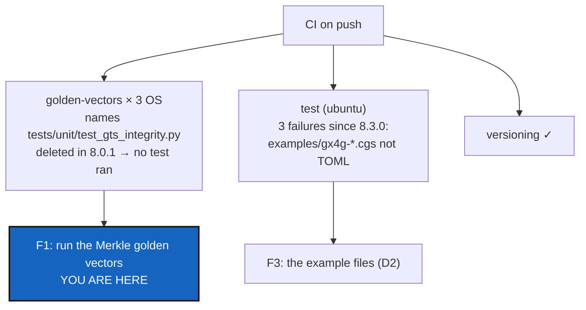

# FixGoldenVector — CI green on Linux, macOS and Windows before beta

*Created: 2026-10-29*

*Branch: main*

> **From the owner's short ticket `FixGoldenVector` (2026-10-29):** *"Since the start of BeforeBeta the
> github CI reports always failing GoldenVector tests. cgitsync must be multi-os before beta."* The
> report the owner pasted, for the latest push: `golden-vectors` failing on `macos-latest` (18 s),
> `ubuntu-latest` (13 s) and `windows-latest` (35 s); `test` failing after 6 min; `versioning` successful.
> Filed at `main_1-2`, in pile 1, because it is a condition of beta.

## Abstract — read this first

**The one-line version.** The `golden-vectors` job has run **no test** since 8.0.1: it names a test file that
MerkleRoot deleted, so pytest stops with "file or directory not found" on all three systems. The `test` job
has failed since 8.3.0 on three example `.cgs` files that start with notes that are not TOML. So whether a
State gets the same hash on macOS and Windows has not been checked for seven releases.

**What this document is.** What the CI says, with the run ids (§1). Why nobody saw it (§2). The steps (§3).
The decisions (§4). Acceptance (§5).

**Why it exists.** The State hash is a cross-platform contract: the same tree must get the same digests on
every platform `pixi.toml` declares (`linux-64`, `win-64`, `osx-arm64`). The CI job that holds that contract
has been silent since S6, and beta needs it green.

**Who it is for.** The worker, the orchestrator, and the owner, for §4.

**What you need to do with it.** Owner: answer §4 at `implement`. Worker: §3 in order. F1 alone is a
one-line fix; the rest is making sure it cannot happen again, and seeing what the three systems then say.

---

## 1. What the CI says (read with `gh`, 2026-10-29)

| Release | Run | `golden-vectors` (3 OS) | `test` (ubuntu) |
|---|---|---|---|
| 7.3.2 and every release before it back to 6.4.0 | `40563307219` … | success | success |
| 8.0.1 (MerkleRoot, S6) | `40577139142` | **failure × 3** | success |
| 8.0.2 → 8.2.0 | `40618970436` … `40735863313` | failure × 3 | success |
| 8.3.0 (IntegrityMount) | `40795035804` | failure × 3 | **failure** |
| 8.4.0 (OpBoundary) | `40886166452` | failure × 3 | failure |

- **`golden-vectors`.** The job runs `pixi run python -m pytest tests/unit/test_gts_integrity.py tests/unit/test_gts_document.py`.
  MerkleRoot (8.0.1) deleted `test_gts_integrity.py`, with `gts_integrity.py`, and moved its golden vectors to
  `tests/unit/test_merkle_state.py` (and `test_merkle_global.py`, `test_merkle_proofs.py`, `test_merkle_root.py`).
  The log shows `ERROR: file or directory not found: tests/unit/test_gts_integrity.py` and `no tests ran`, exit code 4,
  on Ubuntu, macOS and Windows alike. So "since the start of BeforeBeta" is exact from S6 on. The three systems never
  disagreed: they were never asked.
- **`test`.** It is green through 8.2.0 and has 3 failures since 8.3.0 (`2615 passed, 4 skipped, 3 failed` in run
  `40795035804`):
  - `test_cgsi_topology::TestExampleFiles::test_every_example_has_a_semantic_tree_and_toml_round_trip`;
  - `test_documents::TestCgsDocumentValid::test_all_cgs_examples_use_shorthand_authoring_shape`;
  - `test_root_repo_identity::test_every_checked_in_example_cgs_resolves_a_root_with_a_declared_owner`.

  All three fail with `tomllib.TOMLDecodeError` on `examples/gx4g-dev.cgs` and `examples/gx4g-opx.cgs`, committed in
  8.3.0. Both files open with the owner's notes (`CORR: … @dev-agent: …`), which are not TOML.
- **Not a failure, seen in every job.** `fatal: No url found for submodule path '.agent/.distant/dev-sync' in
  .gitmodules`, a warning at checkout cleanup. The root repository tracks four gitlinks under `.agent/`
  (`.agent/.distant/{dev-sync,documentation,ticket}` and `.agent/.local/.dev`), committed on 2026-10-08 (`f12dafe`,
  "before merge"), although `.gitignore` excludes them and there is no `.gitmodules`. `.agent/` is a plain directory,
  never a repository (CLAUDE.md).
- **What "multi-OS" covers today.** Only the golden vectors run on the three systems. The full suite runs on Ubuntu
  only, and the developer tree is reconstituted on Ubuntu only.

## 2. Why nobody saw it

- The eight steps gate a change on **local** lint, tests and `status`. None of them reads the CI, and the owner
  pushes after the commit, when the worker and the orchestrator are done.
- MerkleRoot's orchestrator re-ran the golden-vector tests by their new names, locally, on Linux. Nothing checks that
  the paths `ci.yml` names still exist.
- A pytest run with no test to run exits 4, which CI shows as a failure like any other, with nothing to tell
  "no test was found" from "a hash differs".

## 3. Steps

- **F1. Run the golden vectors again.** Point the job at the Merkle golden-vector tests and `test_gts_document.py`,
  as D1 decides: by file names, or by a pytest marker (`golden`) that the tests carry, so that a rename cannot
  silence the job again.
- **F2. A guard.** A unit test that reads `.github/workflows/ci.yml` and fails when a test path it names does not
  exist, or when the marker it selects collects nothing.
- **F3. The example files.** `examples/gx4g-dev.cgs` and `examples/gx4g-opx.cgs`, as D2 decides. They hold the owner's
  notes for MemoryMount (`.DEV` is `gx4g4dev`, PoE `{1,0,0,0}`; `.OPX` is `gx4g4opx`, PoE `{0,0,0,0}`; G's credentials
  per CGS-ALPHA and CGS-BETA), which are not the worker's to rewrite without the owner's word.
- **F4. Run on the three systems, and fix what they say.** Push nothing: the owner pushes (or runs
  `workflow_dispatch`) and the worker reads the runs with `gh run view`. A real difference between systems (a path
  separator, a line ending, a locale, a file mode in a leaf) is fixed in `src/`, with a golden vector that names it.
  If the full suite is to run on macOS and Windows too (D3), that is where its failures appear.
- **F5. The gitlinks,** as D4 decides.
- **F6. Seeing CI.** As D5 decides: whether reading the CI after the owner's push becomes part of the eight steps, or
  a check of BeforeBeta's S12.
- **F7. Documentation.** `cgitsync-dev.md` (what CI runs and how to read it), `AdditionalSpecs.md` (the cross-platform
  contract and which tests hold it), `digest.md` if a rule is added.

## 4. Decisions for the owner

Asked through `AskUserQuestion` at `implement`, before the first edit.

| D | Question | Recommendation |
|---|---|---|
| **D1** | How does `golden-vectors` choose its tests? | **A `golden` pytest marker** on the Merkle golden-vector tests and the snapshot-document tests, selected with `-m golden`, plus F2's guard. File names would break again at the next rename. |
| **D2** | ~~The two example files with notes.~~ **Resolved 2026-10-29 by `implement "CORR: @agent-dev"`:** each note was applied in its file and removed, and the comments were compressed to 10 lines. The DEV and OPX levels, the PoE, Sigma and G's credentials now stand in the header. Both files are valid `.cgs` again, and the three `test` failures are gone. |
| **D3** | "Multi-OS before beta": the golden vectors on three systems, or the full suite too? | **The full suite on the three systems**, as a matrix like `golden-vectors`. Beta promises `cgitsync` works on each platform `pixi.toml` declares, and only the full suite shows that. It costs CI time, and its first runs will surface whatever WindowsCompatibility (6.3.4) did not reach. |
| **D4** | The four gitlinks under `.agent/`. | **Remove them from the index** (`git rm --cached`), which leaves the mounts on disk untouched and matches `.gitignore` and "`.agent/` is never a repository". |
| **D5** | Seeing CI. | **A ninth line in step 8**: after the owner pushes, the next session starts by reading the last run (`gh run list`). A red run is the first defect of the next ticket. |

## 5. Acceptance

- `golden-vectors` runs the golden vectors on Ubuntu, macOS and Windows, and every digest is the same on all three.
- F2's guard fails when a path `ci.yml` names is missing, or when the selected marker collects nothing.
- `test` is green, with the example files as D2 decided.
- With D3's matrix, the full suite is green on the three systems, or each red test is a defect fixed in `src/`, never skipped by system.
- The gitlinks are handled as D4 decided, and checkout no longer warns.
- `pixi run lint`, `pixi run test`, `check-ceilings`, `check-oo` and `check-spectree` pass; `bump-build` if `src/` changed; `cgitsync status` shows `errors=0`.

Related:
- BeforeBeta (`main_1-1`) §3, defect 5. This ticket runs before S11.
- `archive/20261027_MerkleRoot_DevPlanTicket.md` deleted `test_gts_integrity.py`.
- `archive/20261029_IntegrityMount_DevPlanTicket.md` was the release that committed the example files.
- `gx4g-main_1-1_MemoryMount_DevPlanTicket.md` is where the notes belong.
