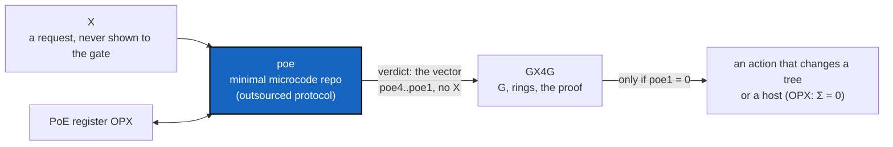

# PoeSeam — the PoE protocol leaves GX4G: its seam, and the repository behind it

*Created: 2026-10-28*

*Branch: main*

> **Owner direction — 2026-10-28, at `implement ProviderRepoSetup`, verbatim.**
> *"GX4G performs action based on the credential Vector PoE initialise to 1
> (false by default). If X request G on GX4G. PoE evaluates
> is.(G.NODE=X) ? true --> poe4=0. trigger poe3=is.(G.X.EDGE=USER), triggers
> poe2=is.(G.X.EDGE=DEV), triggers poe1=is.(G.X.EDGE=OPX). My idea is to
> outsource the poe protocol from GX4G. poe would then be a minimalist
> microcode repo connected to the PoE register OPX. A valid OP\* belongs to OPX
> without revealing who X is."*
>
> Asked whether the gate may be a typed OPX gate with the verdict plugging in
> later, a reads-only first step, or a seam specified first, the owner chose:
> **"I specify the PoE seam first."** This ticket is that specification. It
> holds what was said, what it implies for the code that exists, and the
> questions the owner answers. It changes nothing in `src/`.

## Abstract — read this first

**The one-line version.** Today GX4G computes the proof vector `*OP.poe` itself
(`Ring`, Σ) and trusts its caller to say who is asking. The owner wants the
protocol that evaluates the vector to live **outside** GX4G, in a minimal
microcode repository tied to a PoE register for OPX, so that GX4G receives a
verdict and never learns who X is. This ticket fixes the seam between the two,
so ProviderRepoSetup (which writes to hosts) has something real to ask before it
acts.

**What this document is.** The owner's design in the owner's words (§1), how it
agrees with what the book and the code already say (§2), what is not yet
defined (§3), the questions (§4), the phases (§5) and acceptance (§6).

**Why it exists.** The frontier of the gate is X–OP: X never enters the gate,
not even hashed. But the first coordinate the owner names is
`is.(G.NODE = X)`, which compares with X. Both hold only if the comparison is
made **on X's side**. That is what outsourcing the protocol does, and it needs
to be specified before any action that changes a host can be gated by it.

**Who it is for.** The owner, who specifies it, and the Dev and Orchestration
roles, who build it afterwards.

**What you need to do with it.** Answer §4. Nothing is built before it, and
ProviderRepoSetup (`main_1-3`) waits for it.

---

## 1. The design, as the owner states it

| Coordinate | Starts at | Becomes 0 (true) when | Triggers |
|---|---|---|---|
| `poe4` | 1 (false) | `G.NODE = X`: the request is about the node X | `poe3` |
| `poe3` | 1 | `G.X.EDGE = USER` | `poe2` |
| `poe2` | 1 | `G.X.EDGE = DEV` | `poe1` |
| `poe1` | 1 | `G.X.EDGE = OPX` | an action that changes a tree |

- **False by default.** Every coordinate is 1 until it is shown to be 0, so no
  proof means no right.
- **A cascade.** A coordinate is evaluated only after the one before it is 0.
- **The ring is read off the vector.** In the book, Σ is the number of
  coordinates still 1: PUBLIC Σ = 3 (only `poe4` is 0), USER Σ = 2, DEV Σ = 1,
  OPX Σ = 0 (all four are 0). The table above is the same rule written as the
  cascade that reaches it.
- **Outsourced.** The evaluation is not GX4G's code. It is a minimal microcode
  repository, connected to a **PoE register for OPX**.
- **OPX without X.** A valid `OP*` belongs to OPX, and GX4G learns that it does,
  and not who X is.

## 2. How this agrees with what exists

| Today | Under this design |
|---|---|
| `*OP.poe = {OP.poe, NAME.poe, NODE.poe, 0}` (book, `GX4G.md`), the fourth coordinate being the constant 0 | The same vector, written `poe4..poe1`, with the cascade as the rule that sets each. The constant is the coordinate already shown true. To be reconciled in the book (Q1). |
| `Ring` and `Access` in `src/ring.rs`; `G::access(ring, repo)` takes the ring from its caller | The ring becomes a **verdict** received from the seam, and not an argument the caller asserts. `Ring::ceiling` and the host's narrowing stay. |
| X–OP frontier: X never enters the gate, not even hashed (`AdditionalSpecs.md` §1) | Kept, and made possible: the comparison with X is made in `poe`, on X's side. |
| An anonymous `cgitsync` run is recorded in `.env` (book, Axiom XVII) | Unchanged. A run without the gate carries no verdict. |
| The register `.omniscience` records `(time, loc, H_project)` | The **PoE register for OPX** is a different register with a different purpose (Q3). |
| Audit F06: a CLIENT is trusted, it is an in-process value | Reopens: the verdict is what makes a CLIENT trusted, so F06 is answered here. |

## 3. What is not defined yet

The owner's text fixes the cascade and the outsourcing. It does not fix:

- what the **microcode** is: a table, a small program, a rule language;
- what a **verdict** carries and how GX4G knows it is genuine;
- what the **PoE register for OPX** holds, and who writes to it;
- how a request reaches `poe` and a verdict comes back;
- what "belongs to OPX **without revealing X**" is made of.

## 4. Questions to answer (P0)

| ID | Question | Why it changes the work | Recommended |
|---|---|---|---|
| Q1 | Is the cascade of §1 the definition of `*OP.poe`, replacing the book's `{OP.poe, NAME.poe, NODE.poe, 0}`, or only a reading of it? Which of `poe4..poe1` is which of OP, NAME, NODE? | The book, `GX4G.md`, the tutorials and `src/ring.rs` state the old form. | The same vector, the cascade as its rule; the book rewritten in one change |
| Q2 | Where does `poe` live: its own repository (name, host), a mount of the DEV tree, or part of ComplexGitSync's `.cgitsync`? | Decides what is mounted, who can write it, and what GX4G may import. | Its own small repository, mounted read-only, and never imported: GX4G calls it |
| Q3 | Is the **PoE register for OPX** the `.omniscience` register, or another one? What does it hold? | One register is already built and held by the gate. | Another: `.omniscience` records executions, this one records which OP\* belong to OPX |
| Q4 | What is a verdict, concretely: the four-coordinate vector, a ring number, a signed statement, a hash opening? | GX4G needs something it can check without trusting its caller (audit F06). | A signed vector bound to the request's hash, so it cannot be replayed on another request |
| Q5 | How is X kept hidden while `poe4` compares `G.NODE` with X? A commitment, a blind token, a zero-knowledge proof, or the comparison simply being made on X's side? | The strongest claim in the design, and the one that decides its cost. | The comparison made on X's side, and a commitment checked against the register; no cryptography beyond SHA-256 and a signature |
| Q6 | Who calls whom: GX4G calls `poe` with the request and receives a verdict, or X calls `poe` first and hands the verdict to GX4G? | Decides whether GX4G ever holds the request before it is judged. | X calls `poe` first and presents the verdict; GX4G never sees X |
| Q7 | What does GX4G do when `poe` cannot be reached, answers late, or answers wrongly? | A default of 1 (false) is the stated rule; the delay and the record are not. | No verdict, no action; a timeout; every refusal recorded without X |
| Q8 | Is a verdict single-use or valid for a time? | A reusable verdict is a credential. | Single-use, bound to one request hash |
| Q9 | What is the smallest first slice: only `poe1` (does this OP\* belong to OPX), or the whole cascade? | ProviderRepoSetup needs only "may this change a host?". | `poe1` first |

## 5. Phases

- **P0 — Specify.** The owner answers Q1 to Q9. They are written under *Owner
  decisions*, and the book's `*OP.poe` and the digest's gate rules are corrected
  in the same change as P1.
- **P1 — The seam in GX4G.** A sealed `PoeVerdict` and one sealed trait through
  which GX4G asks for one, with a scripted fake and a contract suite (a verdict
  for another request is refused, a replayed one is refused, no verdict means no
  right, nothing printed holds X). No `poe` repository yet: the fake stands in.
- **P2 — The ring from a verdict.** `G::access` and every action take a verdict,
  not a `Ring` the caller asserts. The old argument is removed, not kept beside it.
- **P3 — The `poe` repository.** A minimal first version for `poe1`, in its own
  repository, with its own tests, and the OPX register it reads.
- **P4 — Connect and document.** The book, a tutorial, the README, the guide's
  trust-boundary diagram and `audit.md` (F06) follow.

## 6. Acceptance

- Q1 to Q9 are answered and recorded here.
- GX4G changes a tree or a host only with a verdict that carries `poe1 = 0`; no
  verdict, a forged one, a replayed one or one for another request is refused.
- Nothing GX4G holds, prints, logs or records identifies X.
- `Ring` is no longer an argument a caller asserts.
- The book, the specification and the code define `*OP.poe` the same way.
- The orchestrator's record is appended below.

## 7. Relation to the other tickets

| Ticket | Relation |
|---|---|
| ProviderRepoSetup (1-3) | Waits for this: its `apply` needs a verdict to ask for. |
| EnvConnect (1-1) | §3 and §4 define `*OP.poe` and the rings; E2 builds `Poe` and `OpStar`; E3 dispatches by ring. This ticket changes where the vector is evaluated, and so what E2 and E3 receive. |
| TypedPipeline (archived) | Its `G` carries EDGE, L0 and MEM, and gains the seam; the proof pipeline is unchanged. |

## Orchestrator's record

*(Empty until the orchestrator quotes the work.)*
