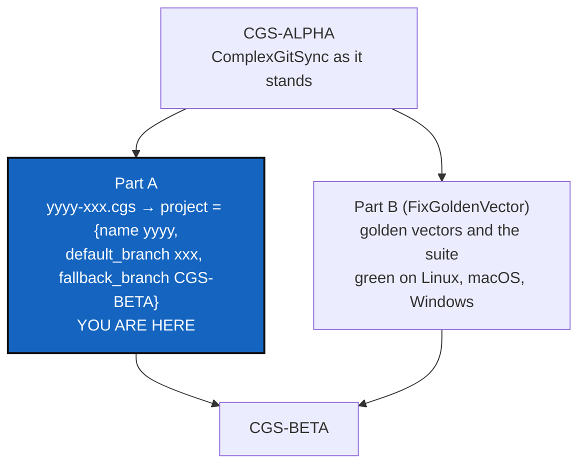

# alpha2beta — from CGS-ALPHA to CGS-BETA: the `yyyy-xxx.cgs` compatibility rule, and CI green on three systems

*Created: 2026-10-29*

*Branch: main*

> **From the owner, 2026-10-29:** *"Write DevPlanTicket alpha2beta from openTicket FixGoldenVector and shortTicket
> alpha2beta.md."* The short ticket `alpha2beta`, unchanged:
>
> ```text
> compatibility rule for yyyy-xxx.cgs writen by @cgitsync(initialise $exe-path/yyyy-xxx.cgs) --> project = { name = "yyyy" , default_branch = "xxx" , fallback_branch = "CGS-BETA" }"
> ```
>
> FixGoldenVector (filed the same day at `main_1-2`, never implemented) is merged here as **Part B**, unchanged in
> substance; its decision D2 (here BD2) was resolved by `implement "CORR: @agent-dev"`. The ticket keeps `main_1-2` and runs as
> BeforeBeta's **S10b**: beta is CGS-BETA, so the way from CGS-ALPHA (ComplexGitSync as it stands) to it is the last
> code step before the user install.

## Abstract — read this first

**The one-line version.** Two things stand between CGS-ALPHA and CGS-BETA. **Part A:** a `.cgs` named `yyyy-xxx.cgs`
says, by its name, which project and which branch it opens. When `cgitsync initialise` is given that file, the project
line it holds must be `project = { name = "yyyy", default_branch = "xxx", fallback_branch = "CGS-BETA" }`. **Part B:**
the CI has run no golden-vector test on any system since 8.0.1, so "multi-OS before beta" is unproven.

**What this document is.** Part A: the rule (§A1), what exists (§A2), the steps (§A3), the decisions (§A4), acceptance
(§A5). Part B: FixGoldenVector, as filed (§B1–§B5).

**Why it exists.** The protocol names its files after the graph: `$G.NAME-$G.OP.NAME.cgs`, the edge name
(`gx4g-dev.cgs`, `gx4g-opx.cgs`, ExplDistantLocal and the resolved corrections). A file whose name and project line
disagree opens a tree other than the one its name promises. And beta is a promise on three systems, which the CI has not
checked since S6.

**Who it is for.** The worker, the orchestrator, and the owner, for §A4 and §B4.

**What you need to do with it.** Owner: answer §A4 (D1–D5) and §B4 (BD1–BD5; BD2 is resolved) at `implement`. Worker: Part B's F1 and F2 first (they
unblock the CI), then Part A, then F4 on the three systems.



---

# Part A — the `yyyy-xxx.cgs` compatibility rule

## A1. The rule, as read

- **A file's name is a contract.** `yyyy-xxx.cgs` is `$G.NAME-$G.OP.NAME.cgs` (G.EDGE.NAME): `yyyy` is the project's
  name, `xxx` the operation's name (`dev`, `opx`, …).
- **When `cgitsync initialise $exe-path/yyyy-xxx.cgs` writes or reads it,** its project line is
  `project = { name = "yyyy", default_branch = "xxx", fallback_branch = "CGS-BETA" }`: the project is the one the name
  says, the tree opens on the branch the name says, and a repository with no such branch falls back to `CGS-BETA`.
- **`CGS-BETA` is a branch name** here, the fallback every repository of such a tree takes. With ExplDistantLocal's
  notes, CGS-ALPHA is ComplexGitSync and CGS-BETA what it becomes at beta (MemoryMount Q5).
- **"Compatibility"**: a file that follows the rule opens the same tree under every build from CGS-ALPHA to CGS-BETA.
  One that does not is either rewritten by `initialise` or refused by name (§A4 D1).

## A2. What exists

- **`project`** takes `name` and `default_branch` (`cgs_format.py`, `_REQUIRED_PROJECT_KEYS`). There is no
  project-level `fallback_branch`: each repository declares its own, and the chain's default is `main`
  (`git_branch.py`, FallbackMain).
- **`initialise`** takes one `.cgs` and `--output-path` (7.0.0). It never reads the file's name.
- **The examples.** `examples/gx4g-dev.cgs` and `gx4g-opx.cgs` say `project = { name = "gx4g", default_branch = "main" }`.
  Under the rule they would say `default_branch = "dev"` (or `"opx"`) and `fallback_branch = "CGS-BETA"`.
  `examples/complexgitsync4dev.cgs`, `install.cgs` and the other examples do not have the `yyyy-xxx` shape, or have it
  by accident (`molonari-light.cgs`). A1 says which are concerned.
- **No branch named `CGS-BETA`** exists in any repository of this tree.

## A3. Steps

- **N1. The name.** Parse `yyyy-xxx` from a `.cgs` file name, as A4 D2 decides for a name holding more than one `-`. A
  name without the shape is not concerned.
- **N2. The project-level `fallback_branch`.** Add it to `project`, as the default every repository's fallback chain
  takes when it declares none, before `main`. `git_branch.py` stays the chain's one owner. A document without it reads
  as today.
- **N3. The rule in `initialise`.** For a concerned file, check the project line against the name, and write or refuse
  as A4 D1 decides. It runs before anything is cloned, like IntegrityMount's denials.
- **N4. The examples.** Bring `gx4g-dev.cgs` and `gx4g-opx.cgs` under the rule, and every other concerned example.
  Each must stay valid, keeping the golden vectors and the example tests green.
- **N5. Documentation.** The `.cgs` grammar in the user guide, `AdditionalSpecs.md` (*Format ownership*, the branch
  chain), `digest.md`.

## A4. Decisions for the owner (Part A)

Asked through `AskUserQuestion` at `implement`, before the first edit.

| D | Question | Recommendation |
|---|---|---|
| **D1** | A concerned file whose project line disagrees with its name: does `initialise` rewrite it, or refuse by name? | **Refuse by name**, saying the line it expects. `.cgs` is the owner's request (IntegrityMount), and rewriting a request silently is what the `.gts` must never do. "Written by `@cgitsync`" would then mean that cgitsync writes the line itself when it creates such a file (`discover --write`, `initialise --cgs`). |
| **D2** | `yyyy-xxx` when the name holds several `-` (`gx4g-dev-old.cgs`, `molonari-light.cgs`). | **Split at the last `-`**: the operation is the last word. `molonari-light.cgs` is then project `molonari`, branch `light`, against its own `name = "lMOLO"`. So a name opts in only when its `yyyy` equals its `project.name`, and every other file is untouched. |
| **D3** | `CGS-BETA` as a branch: who creates it, and in which repositories? | **Nobody yet.** It is a fallback only. A repository without it falls back to `main`, after `CGS-BETA`, as the chain already does, and creating the branch is the release step that turns CGS-ALPHA into CGS-BETA. |
| **D4** | `$exe-path`: the directory the `cgitsync` that runs sits in, or any path? | **Any path.** The rule reads the file's name, wherever it is. `$exe-path` in the short ticket names where the protocol keeps the files (`$HOME/.cgs/$G-NAME/`, MemoryMount). |
| **D5** | Does the rule also bind `bootstrap`? | **Yes.** `bootstrap` opens the `.DEV` and `.OPX` trees with the same files (`bootstrap ../examples/gx4g-dev.cgs`). |

## A5. Acceptance

- `initialise` (and `bootstrap`, per D5) of a concerned `yyyy-xxx.cgs` opens project `yyyy` on branch `xxx`, falls back
  to `CGS-BETA` and then to `main`, and refuses a mismatching file by name (per D1) before anything is cloned.
- A file without the shape behaves exactly as today, and every golden vector is unchanged.
- The concerned examples follow the rule, and every example test is green.

---

# Part B — FixGoldenVector, as filed

## B1. What the CI says (read with `gh`, 2026-10-29)

| Release | Run | `golden-vectors` (3 OS) | `test` (ubuntu) |
|---|---|---|---|
| 7.3.2 and every release before it back to 6.4.0 | `40563307219` … | success | success |
| 8.0.1 (MerkleRoot, S6) | `40577139142` | **failure × 3** | success |
| 8.0.2 → 8.2.0 | `40618970436` … `40735863313` | failure × 3 | success |
| 8.3.0 (IntegrityMount) | `40795035804` | failure × 3 | **failure** |
| 8.4.0 (OpBoundary) | `40886166452` | failure × 3 | failure |

- **`golden-vectors`.** The job runs `pixi run python -m pytest tests/unit/test_gts_integrity.py tests/unit/test_gts_document.py`.
  MerkleRoot (8.0.1) deleted `test_gts_integrity.py`, with `gts_integrity.py`, and moved its golden vectors to
  `tests/unit/test_merkle_state.py` (and `test_merkle_global.py`, `test_merkle_proofs.py`, `test_merkle_root.py`).
  The log shows `ERROR: file or directory not found: tests/unit/test_gts_integrity.py` and `no tests ran`, exit code 4,
  on Ubuntu, macOS and Windows alike. So "since the start of BeforeBeta" is exact from S6 on. The three systems never
  disagreed: they were never asked.
- **`test`.** It is green through 8.2.0 and has 3 failures since 8.3.0 (`2615 passed, 4 skipped, 3 failed` in run
  `40795035804`):
  - `test_cgsi_topology::TestExampleFiles::test_every_example_has_a_semantic_tree_and_toml_round_trip`;
  - `test_documents::TestCgsDocumentValid::test_all_cgs_examples_use_shorthand_authoring_shape`;
  - `test_root_repo_identity::test_every_checked_in_example_cgs_resolves_a_root_with_a_declared_owner`.

  All three fail with `tomllib.TOMLDecodeError` on `examples/gx4g-dev.cgs` and `examples/gx4g-opx.cgs`, committed in
  8.3.0. Both files open with the owner's notes (`CORR: … @dev-agent: …`), which are not TOML.
- **Not a failure, seen in every job.** `fatal: No url found for submodule path '.agent/.distant/dev-sync' in
  .gitmodules`, a warning at checkout cleanup. The root repository tracks four gitlinks under `.agent/`
  (`.agent/.distant/{dev-sync,documentation,ticket}` and `.agent/.local/.dev`), committed on 2026-10-08 (`f12dafe`,
  "before merge"), although `.gitignore` excludes them and there is no `.gitmodules`. `.agent/` is a plain directory,
  never a repository (CLAUDE.md).
- **What "multi-OS" covers today.** Only the golden vectors run on the three systems. The full suite runs on Ubuntu
  only, and the developer tree is reconstituted on Ubuntu only.

## B2. Why nobody saw it

- The eight steps gate a change on **local** lint, tests and `status`. None of them reads the CI, and the owner
  pushes after the commit, when the worker and the orchestrator are done.
- MerkleRoot's orchestrator re-ran the golden-vector tests by their new names, locally, on Linux. Nothing checks that
  the paths `ci.yml` names still exist.
- A pytest run with no test to run exits 4, which CI shows as a failure like any other, with nothing to tell
  "no test was found" from "a hash differs".

## B3. Steps

- **F1. Run the golden vectors again.** Point the job at the Merkle golden-vector tests and `test_gts_document.py`,
  as BD1 decides: by file names, or by a pytest marker (`golden`) that the tests carry, so that a rename cannot
  silence the job again.
- **F2. A guard.** A unit test that reads `.github/workflows/ci.yml` and fails when a test path it names does not
  exist, or when the marker it selects collects nothing.
- **F3. The example files.** `examples/gx4g-dev.cgs` and `examples/gx4g-opx.cgs`, as BD2 decides. They hold the owner's
  notes for MemoryMount (`.DEV` is `gx4g4dev`, PoE `{1,0,0,0}`; `.OPX` is `gx4g4opx`, PoE `{0,0,0,0}`; G's credentials
  per CGS-ALPHA and CGS-BETA), which are not the worker's to rewrite without the owner's word.
- **F4. Run on the three systems, and fix what they say.** Push nothing: the owner pushes (or runs
  `workflow_dispatch`) and the worker reads the runs with `gh run view`. A real difference between systems (a path
  separator, a line ending, a locale, a file mode in a leaf) is fixed in `src/`, with a golden vector that names it.
  If the full suite is to run on macOS and Windows too (BD3), that is where its failures appear.
- **F5. The gitlinks,** as BD4 decides.
- **F6. Seeing CI.** As BD5 decides: whether reading the CI after the owner's push becomes part of the eight steps, or
  a check of BeforeBeta's S12.
- **F7. Documentation.** `cgitsync-dev.md` (what CI runs and how to read it), `AdditionalSpecs.md` (the cross-platform
  contract and which tests hold it), `digest.md` if a rule is added.

## B4. Decisions for the owner

Asked through `AskUserQuestion` at `implement`, before the first edit.

| D | Question | Recommendation |
|---|---|---|
| **BD1** | How does `golden-vectors` choose its tests? | **A `golden` pytest marker** on the Merkle golden-vector tests and the snapshot-document tests, selected with `-m golden`, plus F2's guard. File names would break again at the next rename. |
| **BD2** | ~~The two example files with notes.~~ **Resolved 2026-10-29 by `implement "CORR: @agent-dev"`:** each note was applied in its file and removed, and the comments were compressed to 10 lines. The DEV and OPX levels, the PoE, Sigma and G's credentials now stand in the header. Both files are valid `.cgs` again, and the three `test` failures are gone. |
| **BD3** | "Multi-OS before beta": the golden vectors on three systems, or the full suite too? | **The full suite on the three systems**, as a matrix like `golden-vectors`. Beta promises `cgitsync` works on each platform `pixi.toml` declares, and only the full suite shows that. It costs CI time, and its first runs will surface whatever WindowsCompatibility (6.3.4) did not reach. |
| **BD4** | The four gitlinks under `.agent/`. | **Remove them from the index** (`git rm --cached`), which leaves the mounts on disk untouched and matches `.gitignore` and "`.agent/` is never a repository". |
| **BD5** | Seeing CI. | **A ninth line in step 8**: after the owner pushes, the next session starts by reading the last run (`gh run list`). A red run is the first defect of the next ticket. |

## B5. Acceptance

- `golden-vectors` runs the golden vectors on Ubuntu, macOS and Windows, and every digest is the same on all three.
- F2's guard fails when a path `ci.yml` names is missing, or when the selected marker collects nothing.
- `test` is green, with the example files as BD2 decided.
- With BD3's matrix, the full suite is green on the three systems, or each red test is a defect fixed in `src/`, never skipped by system.
- The gitlinks are handled as BD4 decided, and checkout no longer warns.
- `pixi run lint`, `pixi run test`, `check-ceilings`, `check-oo` and `check-spectree` pass; `bump-build` if `src/` changed; `cgitsync status` shows `errors=0`.

Related:
- BeforeBeta (`main_1-1`): §3 defect 5, step S10b.
- `archive/20261027_MerkleRoot_DevPlanTicket.md`: it deleted `test_gts_integrity.py`.
- `gx4g-main_1-1_MemoryMount_DevPlanTicket.md`: the protocol's file names, and Q5 (CGS-BETA, G's credentials).
- The short tickets `FixGoldenVector` and `alpha2beta`, closed into `archive/.closedUserTicket/`.
