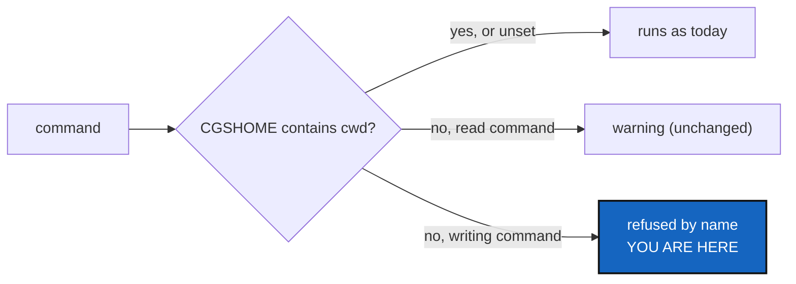

# CgshomeMismatch — a writing command refuses when `CGSHOME` does not contain the current directory

*Created: 2026-10-30*

*Branch: main*

> **From the owner's short ticket `no-upstream`**, split off from
> [NoUpstream](../archive/20261030_NoUpstream_DevPlanTicket.md) on the owner's answer
> of 2026-10-30 (its §5, Q3).

## Abstract — read this first

**The one-line version.** When `$CGSHOME` names a workspace that does not
contain the current directory, read commands keep today's warning, and
writing commands refuse by name before touching anything, naming the
two ways out: `--search-dir <here>` or `unset CGSHOME`.

**What this document is.** The plan for one refusal: the case, the rule,
the steps and acceptance.

**Why it exists.** On 2026-10-30 the owner bootstrapped
`ComplexGitSync-20261030150348` and worked there, while `CGSHOME` still named
`ComplexGitSync-20261030093858`. Every command printed two warnings and went
on. `add` and `commit` reported "nothing to stage" against the other
workspace, so the `git rm` staged in the tree the owner stood in was never
committed, and `push` pushed the other workspace. A warning above a
successful-looking result is not read. A write to the wrong workspace is
the cost.

**Who it is for.** The worker and orchestrator who implement it.

**What you need to do with it.** Follow §2. The owner already decided that
writes refuse and reads warn. Two smaller points are still open (§3).

---

## 1. The rule

- The test is the one `cli/_shared.py` already makes for its warning: the
  resolved `CGSHOME` (from `$CGSHOME`, not from `--search-dir`) does not
  contain the current directory.
- A **writing** command is one whose client method is in `WRITING_METHODS`
  (the set `Op` already uses), plus `fetch`. It is refused before any lock,
  log or Git call, with a message that names both directories and the two
  ways out. The set is not listed again in `cli/`.
- An explicit `--search-dir` always wins and is never refused: it is the
  user saying which workspace they mean.
- Read commands (`status`, `branch list`, `view-tree`, `validate`, …) keep the
  current two-line warning unchanged.

## 2. Steps

1. Tests: a writing command from outside `$CGSHOME` is refused and touches
   nothing (no log file, no lock); the same command with `--search-dir`
   runs; a read command still warns and runs.
2. Implementation: in the client, not in `cli/`, so the Python API and
   the CLI refuse the same way (`DevSpecs.md`, Monolithic Canonical API).
   The CLI only prints.
3. Docs: `docs/Text/user_guide.tex`, where `CGSHOME` resolution is
   described; rebuild the PDFs.
4. `pixi run lint`, `pixi run test`, `pixi run bump-build`; the orchestrator
   decides the level (a new refusal: at least `minor`, its call).

## 3. Decisions for the owner

- **Q1 — `fetch`.** It writes only remote-tracking refs. Refuse it with the
  writing commands (the rule above), or let it warn like a read? Not
  decided.
- **Q2 — an override.** Is `--search-dir` the only way past the refusal
  (as written), or is an environment opt-out wanted for scripts? Not
  decided.

## 4. Acceptance

- The 2026-10-30 session replayed: `add`, `commit` and `push` from
  `…150348` with `CGSHOME=…093858` are each refused, and `…093858` is
  unchanged.
- `status` in the same situation warns and runs, as today.
- `pixi run lint`, `pixi run test` pass; `cgitsync status` from the tree's
  own root shows `errors=0`.
