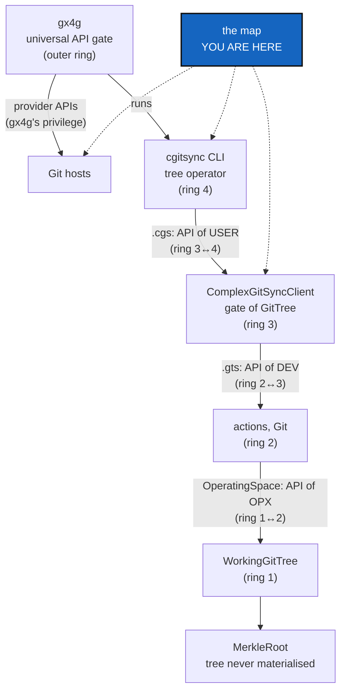

# Minimalism — map every class and method by ring, and what the CLI exposes, before the CLI is cut down

*Created: 2026-10-27*

*Branch: main*

> **Ticket review — 2026-10-27, seventh pass (short ticket `gitRepo`).**
> Rank unchanged. The map gains three things. A **folder column** (D6):
> SrcLayout moves every module into `GitRepo/`, `Merkle/`, `Tree/` or
> `OperatingSpace/`, and the owner decides the moves from this column. The
> **`GitRepo` boundary**: GitRepo is the dependency gx4g will share, and it
> imports nothing back. And **Omniscience's split**: gx4g holds the register
> and writes to it, and `cgitsync` produces what is written
> (ProviderMigration §1a). BranchProtection is now `main_1-7`.

> **From the owner's short ticket `minimalism` (2026-10-27).** Filed at
> `main_1-3` by the ticket review of the same day, as BeforeBeta's step S5.
> The owner's words: *"The CLI is very rich. It would be wise to reduce it to
> the minimal. Security comes from there because it reduces the attack
> surface. […] map class and methods by ring and see which ones are exposed
> through the CLI, with the objective that the CLI lands mostly at ring
> interfaces. This is a mapping ticket for further decisions."* The short
> ticket's other parts went to MerkleRoot (`main_1-4`), CliReduction
> (`main_1-5`), BranchProtection and ProviderMigration (`main_2-10`). The owner's answers in that review, asked through
> `AskUserQuestion`:
> - **Provider APIs.** Every call to a provider's API migrates to gx4g, the
>   reads as well as the writes. Before beta, `cgitsync` gains no new call,
>   and the existing ones are listed here for ProviderMigration.
> - **BranchProtection is split.** `cgitsync` keeps its USER-tree guard and
>   the dead-branch report. Protection and roles on the provider become a
>   requirement for gx4g.
> - **Everything in the short ticket is before beta,** except the migration
>   itself, which waits for gx4g.
> - **"Disclosed" means withdrawn from the CLI.** A command is kept,
>   reinforced, adapted, or withdrawn.

## Abstract — read this first

**The one-line version.** Before anything is cut, draw the map. Every class
and public method, by ring. Every CLI command, with the method it reaches and
the ring boundary it crosses. Every call to a provider's API. Then every
command gets one verdict: keep, reinforce, adapt or withdraw.

**What this document is.** The owner's model (§1), what the code holds today
(§2), what the map must contain (§3), the checks it runs (§4), the decisions
it raises (§5), and when it is done (§6). It changes no line of `src/`.

**Why it exists.** The CLI has 27 commands and 66 leaf commands, over 115
public client methods and about 1 480 functions. Each one is attack surface,
and some of it may be unused or deprecated. The owner wants the CLI to sit at
the interfaces between rings, the Merkle tree to stay behind one class that
never hands its inner nodes out, and every write on a Git host to become
gx4g's. Nobody can cut that surface safely without a map.

**Who it is for.** The worker who draws the map and the orchestrator who
checks it. The owner reads its verdicts (§5) before CliReduction cuts
anything.

**What you need to do with it.** Draw §3 as a new §7 of this ticket, run §4,
then ask §5. MerkleRoot and CliReduction start from that table.

---

## 1. The owner's model, as the short ticket states it

| Name | Role in the owner's words | Ring interface it is |
|---|---|---|
| gx4g | "the UNIVERSAL API-GATE"; the only one that writes to a Git host through its API | the outer ring |
| `cgitsync` | "the Tree Operator of the infrastructure", "only an executor" | — |
| `ComplexGitSync` (the client) | "the Gate of GitTree" | — |
| `.cgs` | "the API of USER" | ring 3 ↔ 4 |
| `.gts` | "the API of DEV" | ring 2 ↔ 3 |
| `OperatingSpace` | "the API of OPX" | ring 1 ↔ 2 |
| `WorkingGitTree` | "the Operating Space" | — |
| `MerkleRoot` | its own class, computing the State hashes; later its own repository. "The Merkle Tree of MerkleRoot must never be accessible by cgitsync nor gx4g. It is the interface never materialised." | — |
| `GitRepo` | *(short ticket `gitRepo`)* "a specific Graph for GX4G"; the dependency that provides Graph and GitRepo, and that `cgitsync` mounts as GitTree | below everything; imports nothing back |
| Omniscience | *(`gitRepo`)* synthesises the GitTree "with hash256(MerkleRoot)"; held by gx4g, which "manages access privileges to GitRepo" | gx4g's |

"OPX" is the owner's term and is not defined anywhere in the spec tree (D5).

## 2. What the code holds today

Checked on 2026-10-27 against `HEAD` (`cgitsync-7.3.0`).

- **The CLI** has 27 top-level commands and 66 leaf commands:
  - `initialise`, `bootstrap`, `release` (3), `status`, `view-tree`,
    `validate`, `pull`, `fetch`, `autofix`, `checkout`;
  - `branch` (5), `add`, `rm`, `commit`, `merge`, `push`, `tag`;
  - `submodules` (3), `verify` (2), `memory` (16), `self-history` (3),
    `omniscience` (13);
  - `discover`, `repo` (1), `env` (2), `unlock`, `help`.

  `ComplexGitSyncClient` has 115 public methods.
- **The ring table** (`AdditionalSpecs.md`, *The ring table*) places modules,
  not documents. `cgs_format.py` and `gts_document.py` are ring 0,
  `git_tree.py` (`WorkingGitTree`) is ring 1, `operating_space.py` is ring 2,
  `orchestre/` is ring 3 and `cli/` is ring 4. The owner's model (§1) places
  each *document* on the boundary it crosses, so the two are not in conflict
  yet. §4 checks whether each document really crosses only that boundary.
- **Provider API calls.** Each one runs the provider's own CLI through
  `GitRunner.run_tool`, and `provider.py` builds every argv:

  | Call | Kind | Who reaches it |
  |---|---|---|
  | `gh`/`glab`/`tea` `repo create` (`provider.creation_plan`, `DiscoveryCommands.repo_create`) | write | `cgitsync repo create`; `cgitsync memory setup` through `MemorySetup`, and the terminal offer that runs it |
  | `gh auth status` and its peers (`TreeObserver._provider_auth`, `tree_env.py`) | read | `cgitsync env show` and `env check`, and every command that writes a State, through its Environment record |
  | `memory init` and `memory setup`'s proposal | none (they print the command) | — |

  BranchProtection's M0–M4 planned three more (`gh api` for the role, the
  protection and the login). They now go to gx4g instead (BranchProtection).
- **State hashes** are computed in five modules:
  - `gts_integrity.py` (`GtsIntegrity`: leaf, node, `H_GITTREE`);
  - `global_integrity.py` (`GlobalIntegrity`: `H_GLOBAL`, observation names);
  - `gts_document.py` (`compute_gittree_root`, `_state_payload`: `H_STATE`);
  - `operating_space.py` (`os_id`; the only place `H_GITTREE` is computed
    from the tree);
  - `inclusion_proof.py` (audit paths, which carry inner nodes) and
    `global_index.py` (`H_GLOBAL` over the index).

  `omniscience proof` prints an audit path. Ledger, commit-log, Environment,
  self-history and register-record hashes are content hashes over one record,
  not over a tree.
- **One mirror break.** `cgitsync unlock` (StateLocking, 7.3.0) calls
  `WorkspaceLock` directly. It has no client method, against
  `AdditionalSpecs.md`'s rule *The CLI mirrors the Python API*.

## 3. The map: what §7 must contain

One table per layer, generated where it can be (an AST walk, a parser walk),
and written by hand only where a judgement is needed.

1. **Classes and public methods by ring.** Module, ring, class, public method,
   its callers in `src/`, and whether any CLI path reaches it. A method that
   nothing in `src/`, the tests excepted, calls is marked *unused*; one
   documented as kept only for compatibility is marked *deprecated*.
2. **The CLI, command by command.** Leaf command, the client method it calls
   (or "none", as for `unlock`), the ring that method sits in, the document it
   reads or writes (`.cgs`, `.gts`, an Operating Space, none), the ring
   interface it therefore lands on (§1), whether it writes, and whether it
   reaches a provider's API or the network.
3. **Provider API calls.** Every `run_tool` call site and every planned one,
   read or write, the command that reaches it, and what gx4g must offer
   instead (ProviderMigration).
4. **The Merkle surface.** Every function that computes a State hash or walks a
   Merkle tree, and every API, CLI or file that hands out an inner node. An
   audit path counts, and so does a leaf list.
5. **The folder column** (short ticket `gitRepo`). For each module, the
   SrcLayout folder it moves to: `GitRepo/`, `Merkle/`, `Tree/` or
   `OperatingSpace/`, or a place of its own with a reason. `cli/`,
   `orchestre/`, `memory/`, `operations/` and `autofix/` are proposed here,
   and the owner decides (D6).
6. **The verdict column.** Each leaf command is marked keep, reinforce, adapt
   or withdraw, with one line of reason. A withdrawn command names what
   replaces it, or "nothing; the method is removed" (D1).

## 4. The checks the map runs

- **The ring interfaces (the owner's model).** Each check confirms one
  boundary, or lists what crosses it from elsewhere:
  - `.cgs` is produced and consumed only across ring 3 ↔ 4;
  - `.gts` only across ring 2 ↔ 3;
  - `OperatingSpace` only across ring 1 ↔ 2;
  - nothing in `cgitsync` stands where gx4g should: no provider call, and no
    register write beyond those ProviderMigration §1a lists;
  - the modules proposed for `GitRepo/` import nothing else from
    `ComplexGitSync`, or the map lists each import that would have to go.
- **The CLI lands at ring interfaces.** It lists every command that reaches
  deeper than the interface it should land on, or that has logic of its own.
- **Unused and deprecated methods.** Each one is listed with its callers and
  its test-only callers. Nothing is removed here.
- **Provider calls.** Each call is listed and none is added. A check, kept in
  `tests/` once CliReduction lands, fails when a new `run_tool` call site
  appears.
- **The Merkle tree is never materialised.** It lists every place an inner
  node leaves the hashing modules.

## 5. Decisions for the owner

Each is asked through `AskUserQuestion` once §7 exists, because each answer
needs the map's numbers.

| D | Question | Recommendation |
|---|---|---|
| **D1** | The verdict per command, from §7's column, as a list the owner edits: keep, reinforce, adapt or withdraw. | The map's column, with every withdrawal named. |
| **D2** | *The CLI mirrors the Python API* says every capability exists in both layers. Does a minimal CLI keep that rule, or keep it only one way (every CLI command has a client method, but not every method has a command)? | **One way.** A client method may exist for gx4g and Python callers with no command. Every command still has its method, so `unlock` gains one. |
| **D3** | Does an audit path (`omniscience proof`, `InclusionProof`) count as "the Merkle tree accessible"? | **No,** as long as only MerkleRoot computes it and hands it out as a proof object to be verified, never as a tree to walk. If yes, `omniscience proof` is withdrawn and the proof is verified inside MerkleRoot only. |
| **D4** | Which hashes MerkleRoot owns: the State hashes only (`H_GITTREE`, `H_STATE`, `H_GLOBAL`, `os_id`), or every content hash too (ledger, commit log, Environment, record)? | **The State hashes only.** The others hash one record, not a tree. |
| **D5** | What "OPX" names, so that the map can say what the `OperatingSpace` interface serves. | Asked, not guessed. |
| **D6** | The folder per module and package, from §3's folder column, as a list the owner edits. SrcLayout carries it out. | The map's column. |
| **D7** | Omniscience's reads (`get`, `branches`, `history`, `state`, `proof`, `verify`, `status`, `report`, `memory`): kept in `cgitsync`, or gx4g's with the register? Its writes are gx4g's already (ProviderMigration §1a). | The map's verdict per command. The default is to keep the reads that verify, since checking a proof is not holding the register. |

## 6. Done when

- §7 holds the six tables of §3, generated by a script kept under
  `scripts/` so that it can be run again after CliReduction.
- Every check in §4 has its result in §7.
- D1–D7 are answered and written into MerkleRoot, CliReduction and
  SrcLayout.
- `src/` is unchanged. `pixi run lint` and `pixi run test` pass. The script is
  the only new code, and it has a test.
- The orchestrator's record is written. Its version level is `patch`, for a
  script and no behaviour change.
