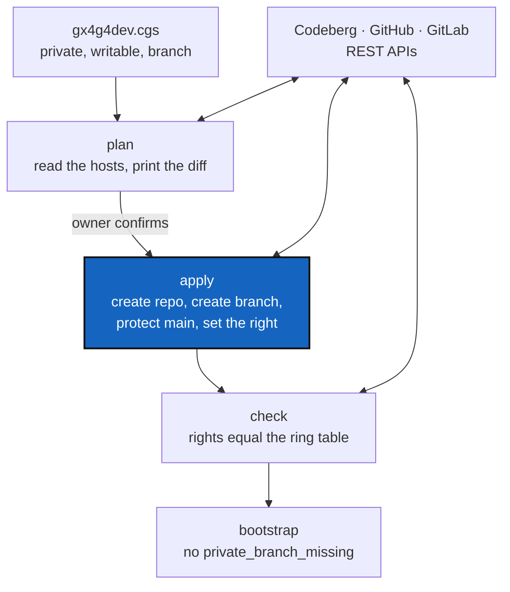

# ProviderRepoSetup — create the GitRepos and set up their branches through the GitProvider APIs, so DEV can work in repositories OPX owns

*Created: 2026-10-28*

*Branch: main*

> **Blocked — 2026-10-28, by PoeSeam.** At `implement`, the owner answered
> D2 to D9 (below) and chose to **specify the PoE seam first**: what authorises
> an `apply` is the outsourced PoE protocol, which does not exist yet. Nothing in
> `src/` was changed for this ticket. It starts after PoeSeam (`main_1-2`), and
> re-reads §2 to §5 against it before P1.

> **Owner request — 2026-10-28.** *"écrire un DevTicket sur les opérations à
> réaliser avec GitProvider API pour créer les GitRepos et configurer
> correctement les branches de la partie PRIVATE/.local dans un premier temps,
> pour gérer des DEV dans les gitRepo détenus par OPX et qui sont
> PRIVATE/.distant pour DEV."*
>
> **Reading (to confirm, D1).** "OPX" is the ring Σ = 0 whose `.cgitsync` may
> change a tree (EnvConnect §4.1). OPX *owns* the repositories on their hosts and
> has admin rights on them. A DEV works in the private repositories that are
> **writable** for DEV (`PRIVATE/.local`), and sees the shared private
> repositories that are **read-only** for DEV (`PRIVATE/.distant`). "First" means
> `PRIVATE/.local` before `PRIVATE/.distant`. (An earlier draft of this ticket
> spelled the ring "ORX": that was a typo, corrected by the owner on 2026-10-28.)

## Abstract — read this first

**The one-line version.** A DEV's tree has private repositories that must exist
on their host, with the right branch, and with the right to push to that branch
and nowhere else. Today a person does that by hand, and when they do not, every
writable repository falls back to `main`. This ticket plans the operations GX4G
runs through the Codeberg, GitHub and GitLab APIs so that the repositories and
their branches are created and checked, and the rights match the ring.

**What this document is.** What happens today (§1), the operations (§2), the
rule that sets each repository's branch and rights (§3), the decisions to ask
(§4), the phases (§5), how it is tested (§6) and acceptance (§7).

**Why it exists.** The DEV bootstrap of 2026-10-27 cloned `.dev`,
`.localSpec`, `.claude`, `.omniscience` and `.memory` on their fallback `main`
(`private_branch_missing`, six times in its log) because the `gx4g` branch does
not exist on any of them. A writable repository sitting on `main` is one
accidental commit away from changing what every project that mounts it sees.
ComplexGitSync hands host-API calls to GX4G (its ProviderMigration), and
EnvConnect §4.4 and E6 already plan the rights side. This ticket is the first
thing GX4G does *to* a host, and not only reads from it.

**Who it is for.** The Dev role, and the owner, who decides D1 to D8 and holds
the credentials.

**What you need to do with it.** Answer §4 with `AskUserQuestion` before the
first edit. Nothing here may start before D2, which lifts the rule that this
crate has no network code until E6.

---

## 1. What happens today

From the bootstrap log of `examples/gx4g4dev.cgs` (2026-10-27) and the
branches the hosts list:

| Repository | Mount | Side | Branch wanted | On its remote |
|---|---|---|---|---|
| `github:flipoyo/.dev` | `.agent/.local/.dev` | local, writable | `gx4g` | `ComplexGitSync`, `main`, one closed branch: **no `gx4g`** |
| `github:flipoyo/.localSpec` | `.agent/.local/.localSpec` | local, writable | `gx4g` | same: **no `gx4g`** |
| `github:flipoyo/.claude` | `.agent/.local/.claude` | local, writable | `gx4g` | same: **no `gx4g`** |
| `codeberg:gx4g/.omniscience` | `.omniscience` | local, writable | `gx4g` | empty register: **no `gx4g`** |
| `github:flipoyo/.ticketing` | `.agent/.distant/ticket` | distant, read-only | `main` | `main` |
| `github:flipoyo/DevSpec` | `.agent/.distant/dev-sync` | distant, read-only | `main` | `main` |
| `github:flipoyo/DocSpec` | `.agent/.distant/documentation` | distant, read-only | `main` | `main` |

- ComplexGitSync creates a missing private/local branch **lazily**, by the first
  private commit. Until then it clones `fallback_branch = "main"`, reports
  `private_branch_missing`, and writes land on `main`.
- A project's `.local` branch is named after the project: `gx4g`, and
  `gx4g_<branch>` for any other project branch (`private_local_branch`). A name
  holds `-` and never `_`.
- `.localSpec`'s and `.claude`'s `main` carry nothing project-specific, or
  another project's leftovers (a `settings.json` allowlist with ComplexGitSync
  paths; a `cgitsync-dev.md` in `.dev`). A new `gx4g` branch cut from `main`
  inherits them (`audit.md`).
- GX4G has no network code. It builds host **rights** offline, behind a sealed
  `GitProvider` with a scripted fake; the digest forbids network code before
  EnvConnect E6.

## 2. The operations

Each is one function of the sealed `GitProvider`, implemented once per host, and
each is exercised by the contract suite against a mock server before it runs
against a real host. The three REST families are the ones EnvConnect §4.4 names:
Forgejo `/api/v1` (Codeberg), GitHub REST v3, GitLab REST v4.

| # | Operation | Reads or writes | Needed for |
|---|---|---|---|
| O1 | **Inspect** a repository: exists, private, default branch, the branches, the token's own permission | reads | every other step, and the plan |
| O2 | **Create** a private repository under an owner, with `main` as its default branch | writes | a repository that does not exist yet |
| O3 | **Create a branch** from a named base (`gx4g` from `main`), refused when it exists | writes | the `PRIVATE/.local` branch |
| O4 | **Protect a branch**: `main` accepts no direct push from a DEV; OPX may push | writes | keep DEV on `gx4g`, and keep `.distant` read-only in practice |
| O5 | **Grant or revoke a right** to a person or team: read, write | writes | DEV in `.local` (write), DEV in `.distant` (read) |
| O6 | **List** who holds which right | reads | the check |
| O7 | **Check**: the rights found equal the ring table, branch by branch | reads | acceptance, and every later run |

Not in this ticket, and each its own: deleting a repository or a branch,
changing visibility, deploy keys, webhooks, secrets, issues, pull requests, and
reading or writing a repository's **content** (EnvConnect §4.4: its own ring,
D4 of BeforeCgitsyncMerge).

**Rules every operation keeps** (BeforeCgitsyncMerge §4 A3, now with a real
network behind them):

- **Plan, then apply.** Nothing writes until a plan, built from reads only, was
  shown and confirmed. A change of who may push is an outward-facing act.
- **Idempotent.** Running it twice changes nothing the second time. A branch that
  exists is left alone; a right that is already granted is not granted again.
- **Never force, never delete, never rewrite.** No operation here removes a
  branch or a repository, or moves a branch that exists.
- **Bounded and timed.** Every answer is bounded in size and time. A rate limit
  is `RateLimited`, never `Denied`, and a write is never retried by itself.
- **No secret out.** A token is a `Secret`, read from the environment or the OS
  keyring, never from a file in a tree (EnvConnect D10), and never in an error, a
  log, a record or a fixture.
- **The host is the provider's, never the input's.** The address comes from the
  provider type; an identifier from a `.cgs` entry is parsed, never used as a
  URL.
- **A right is never cached.** Every apply asks again, and an apply re-checks the
  right inside the same call.

## 3. What each repository gets

The rule is read from the DEV spec's own flags, so there is no second list to
keep true:

| The entry says | Side | Branch | Right for DEV | `main` |
|---|---|---|---|---|
| `private = true, writable = true` | `PRIVATE/.local` | `private_local_branch(<project>, <branch>)`: `gx4g` | **write** on that branch | protected: no direct push by DEV |
| `private = true`, not writable | `PRIVATE/.distant` | its own `default_branch` (`main`) | **read** only | protected: pushed by OPX only |
| neither | `PROJECT` | its own | read, public | not this ticket |

For a `PRIVATE/.local` repository, in this order:

1. **O1.** Does it exist, and is it private? If not, **O2** creates it (D3).
2. **O3** creates `gx4g` from the base the owner names (D4). It does not exist
   yet on `.dev`, `.localSpec`, `.claude` and `.omniscience`.
3. **O4** protects `main`.
4. **O5** gives DEV write, and nothing wider than the ring allows.
5. **O7** checks the result, so the next bootstrap finds the branch and reports no
   `private_branch_missing` for it.

`.omniscience` follows the same steps for its project branch. Its `_global`
checkpoint chain and the rule that nothing is rewritten or forced are
ProviderMigration's and BranchProtection's, upstream in ComplexGitSync, and are
not decided here.

`PRIVATE/.distant` (`.ticketing`, `DevSpec`, `DocSpec`) is the second step: the
same plan and check, but **O4 and O5 only narrow**: DEV is given read and `main`
is protected. Nothing is created, because they exist and are the same for every
project that mounts them.

## 4. Decisions to ask the owner (P0)

| ID | Question | Why it changes the work | Recommended |
|---|---|---|---|
| D1 | Is OPX, as in the note under the title, the ring that owns the repositories and may apply? | Fixes who owns the repositories and who may apply. | As read |
| D2 | May this crate gain network code now, lifting "no network code before E6"? And is this ticket the first part of E6, so E6's providers (read, rights) are built here for the operations O1 to O7 only? | The digest, AdditionalSpecs §2.1 and the audit all say no network yet. | Yes: this is E6's first slice, and the rule is reworded, not dropped |
| D3 | Does GX4G **create** missing repositories (O2), or only check and report them? | Creation needs an owner or organisation to create under, and a name policy. | Create, private, under the owner's account or organisation, with a confirmed plan |
| D4 | What is `gx4g` cut from? `main` of the same repository inherits another project's leftovers (`audit.md`). Or an empty orphan branch, or a template branch the owner names. | The new branch is what every DEV starts from. | An orphan branch holding only the files the owner commits next, so nothing is inherited |
| D5 | How is a branch created: through the host API (O3), or by a `git push` that ComplexGitSync's `cgitsync` runs? | The frontier says Git stays cgitsync's and host API calls are GX4G's. An empty branch needs a commit, which only Git makes. | The API for a branch from an existing ref; a Git push through `pixi run cgitsync` for an orphan |
| D6 | What does protecting `main` mean on a `.local` repository: no direct push by anyone but OPX, or no push at all? | Decides whether OPX can still correct `main` without lifting the rule. | No direct push except OPX |
| D7 | Who is granted: a named person, a team or organisation role? | Forgejo and GitHub have teams, GitLab has groups and members, with different levels. | A named person to start, a team later |
| D8 | Where does the token come from, and is one per host enough? | EnvConnect D10 left it open: environment variable, OS keyring, or a CLI prompt. | Environment variable per host first, keyring later |
| D9 | Does the first run go against a real host, and which? Codeberg holds `.omniscience`, GitHub the rest. | A real write is outward-facing and can be neither undone nor cached away. | Codeberg first, on a repository created for the test, then the rest |

## 5. Phases

Each ends with the checks of `gx4g-dev.md` and a bump of the build counter.

- **P0 — Decisions.** Ask D1 to D9. Record them here. Reword the digest's "no
  network" lines and AdditionalSpecs §2.1 in the same change as P1.
- **P1 — The HTTP client and the mock host.** Choose the client (D2 gives the
  word for a new dependency; `std` alone has no TLS), put it behind the sealed
  trait, and write a **local mock server** per API family. No test calls a real
  host.
- **P2 — Inspect and plan (O1, O6).** Read-only. `plan` builds, from the
  `gx4g4dev.cgs` flags (§3) and the hosts, the list of what would change, and
  prints it with no token and no content. Contract cases: bounded, timed, rate
  limit is not denial, no secret in any output, a host that cannot be asked gives
  no plan.
- **P3 — Create a repository and a branch (O2, O3).** Only after a confirmed plan.
  Idempotent, never forced, a second run changes nothing.
- **P4 — Protect and grant (O4, O5).** Check-then-act inside one call, a right
  revoked between the plan and the apply makes the apply fail, a failed apply
  changes nothing it did not report.
- **P5 — Check (O7).** The rights found equal the ring table, per repository and
  branch. It is the acceptance test of every earlier phase and runs on its own.
- **P6 — Apply to the real repositories**, the `.local` set first (D9), then
  `PRIVATE/.distant`. After it, a DEV bootstrap of `gx4g4dev.cgs` reports no
  `private_branch_missing` for `.dev`, `.localSpec`, `.claude` and `.omniscience`.
- **P7 — Documentation.** The book, a tutorial, the README's *What works today*,
  `AdditionalSpecs.md`, the digest and the guide's trust-boundary diagram follow.

## 6. Tests

| Layer | Holds |
|---|---|
| Contract suite, per provider, on a mock server | size and time bounds; `RateLimited` is not `Denied`; a denial changes nothing; no retry of a write; a right revoked in between makes the apply fail; no token in any error, `Debug` or `Display`; idempotence |
| Unit | the plan: every flag combination of §3 gives the one row of the table; a repository already right gives an empty plan |
| Compile-fail | no operation callable without a confirmed plan, and no way to build one by hand |
| Property | a plan never contains a delete, a force or a widening |
| Mutation | each rule of §2 broken once, to show a test fails |

## 7. Acceptance

- D1 to D9 are answered and recorded here.
- No test calls a real host; the contract suite passes on a mock server for all
  three API families.
- `plan` is read-only and idempotent; `apply` refuses without a confirmed plan.
- The seven `.local` and `.distant` repositories of §1 end in the state of §3,
  and `check` reports it.
- A DEV bootstrap of `gx4g4dev.cgs` reports no `private_branch_missing` for the
  four `PRIVATE/.local` repositories.
- No secret appears in any output, log, record or fixture.
- The digest, `AdditionalSpecs.md`, `audit.md`, the book and the guide say what is
  now built, and what is still designed.
- The orchestrator's record is appended below.

## 8. Relation to the other tickets

| Ticket | Relation |
|---|---|
| EnvConnect (1-1) | §4.4 and E6 plan host rights and name D10 (credentials). This ticket is E6's first slice, with writes. E0's `pixi run gx4g` is where `plan`, `apply` and `check` will be called. |
| ComplexGitSync, ProviderMigration and BranchProtection | They hand host-API calls, and dead-branch findings, to GX4G. `repo create` and its sign-in probe leave `cgitsync` once GX4G offers O2. |
| ComplexGitSync, NestedAgentMaster | Independent. It is about opening the whole DEV tree; this is about the repositories it clones. |
| `audit.md` | Loses "a real provider's bounds are a promise, not a test" and "content write has no contract cases" for what this builds. |

## Owner decisions

*Answered 2026-10-28, in conversation, at `implement`.*

| ID | Answer |
|---|---|
| D1 | OPX is the ring Σ = 0. The owner corrected the spelling ("ORX is a typo, it is OPX") and did not change the reading. |
| D2 | **`ureq` with `rustls`.** The first network code, a new dependency tree, `cargo deny` and `cargo audit` kept clean. The digest's "no network" rules are reworded, not dropped: no test ever calls a real host. |
| D3 | **Answered by a design, not by a choice between the options.** *"GX4G performs action based on the credential Vector PoE initialise to 1 (false by default). If X request G on GX4G. PoE evaluates is.(G.NODE=X) ? true → poe4=0. trigger poe3=is.(G.X.EDGE=USER), triggers poe2=is.(G.X.EDGE=DEV), triggers poe1=is.(G.X.EDGE=OPX). My idea is to outsource the poe protocol from GX4G. poe would then be a minimalist microcode repo connected to the PoE register OPX. A valid OP\* belongs to OPX without revealing who X is."* Read: creating a repository (O2) is an action only a valid OP\* with `poe1 = 0` may run. Whether O2 exists at all is therefore decided with the seam: see PoeSeam. |
| D4/D5 | **The branch is made through the host API, from the repository's `main`**, and the leftovers it inherits (a `settings.json` in `.claude`, a `cgitsync-dev.md` in `.dev`) are removed by the owner's first commit on `gx4g`. No orphan branch, no Git push from GX4G. |
| D6 | **No direct push to `main` except OPX**, on every `PRIVATE/.local` repository. |
| D7 | **A named person per host**, given in the plan. Teams later. |
| D8 | **An environment variable per host** (`GX4G_TOKEN_CODEBERG`, `GX4G_TOKEN_GITHUB`, `GX4G_TOKEN_GITLAB`), read once into a `Secret`. A keyring can be added later behind the same seam. |
| D9 | **A scratch repository first**, on Codeberg, which the owner creates and confirms; then the four `PRIVATE/.local` repositories; then `PRIVATE/.distant`. |
| Gate | **"I specify the PoE seam first."** What authorises `apply` is a PoE verdict from the outsourced protocol. This ticket waits for PoeSeam. |

## Orchestrator's record

*(Empty until the orchestrator quotes the work.)*
