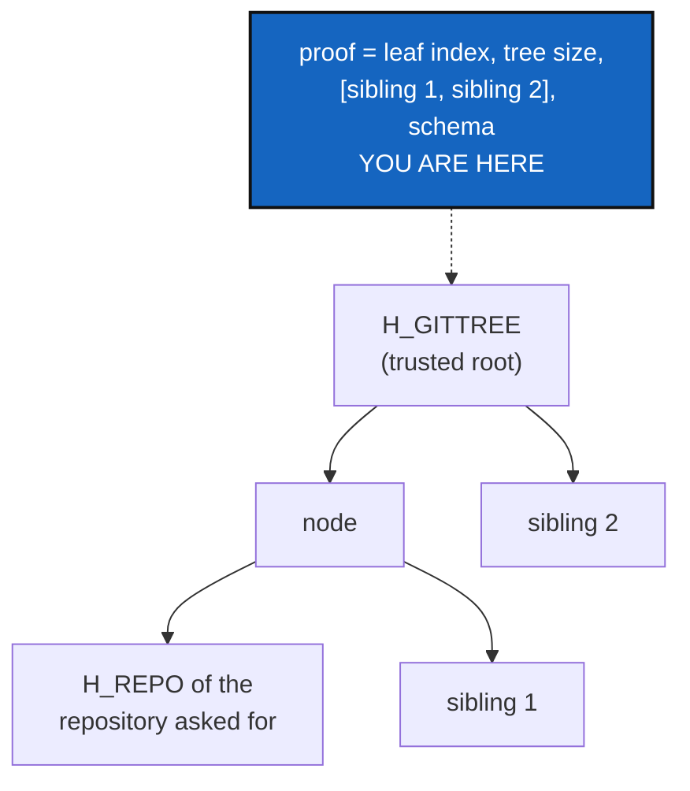

# InclusionProofs — prove one repository is in a State without showing the others

*Created: 2026-10-20*

*Branch: main*

> **Split from [Omniscience](main_1-1_Omniscience_DevPlanTicket.md) on
> 2026-10-20 (owner's short ticket `update-omniscience`), as milestone O1b.**
> The owner: *"Implement Merkle inclusion proof generation and verification
> for the existing `GtsIntegrity` tree decomposition (RFC 6962-style,
> current CGS domain tags). Schema-1 roots and golden vectors must remain
> byte-for-byte identical."* `Integrity` is **private only**.

| | |
|---|---|
| Part of | [Omniscience](main_1-1_Omniscience_DevPlanTicket.md) §1, §4, §8 — milestone O1b |
| Needs | Nothing; OperatingSpaceId is not required |
| Expected release | patch (internal capability, no interface added) |

## Abstract — read this first

**The one-line version.** From a State's GitTree, produce for one
repository the list of sibling hashes that leads from its leaf to
`H_GITTREE`, and check such a list against a trusted root, with the hash
functions schema 1 already uses.

**What this document is.** The plan for O1b, the private proof engine every
later Omniscience query relies on.

**Why it exists.** `gts_integrity.py` already builds an RFC 6962 tree and
says in its docstring that *"an inclusion proof could be added later without
changing any digest"*. Omniscience needs that later now: a reader must check
that one repository belongs to a registered State without reading the other
repositories, which may be private.

**Who it is for.** The worker and the orchestrator, and the owner, for §3.

**What you need to do with it.** Owner: answer §3. Worker: build §2 against
§5, changing no existing digest.

---

## 1. What is true today

Read on 2026-10-20 (6.4.0). `GtsIntegrity` (`gts_integrity.py`, ring 0) has
`repo_leaf_hash`, `node_hash`, `ordered_leaves`, `merkle_root` with
`_subtree`, and `state_hash`. Each level is domain-separated SHA-256. The tree
follows RFC 6962 §2.1, and no leaf is duplicated. The golden vectors in
`tests/unit/test_gts_integrity.py` are the cross-platform contract.
`INTEGRITY_SCHEMA = 1` is immutable.

## 2. What it delivers

1. **A typed proof.** A frozen dataclass: `schema`, `leaf_index`,
   `tree_size`, ordered `siblings` (hex), and the `root` it was made
   against.
2. **Generation.** `inclusion_proof(leaves, repo_id) -> InclusionProof`,
   using `ordered_leaves` and the same split rule as `_subtree`, so the
   proof's root is `merkle_root(leaves)` by construction.
3. **Verification.** `verify_inclusion(leaf_hash, proof, trusted_root) ->
   bool`, dispatched on `schema` so a later schema adds a branch and never
   reinterprets this one.
4. **The same hash functions, no second implementation.** It goes in
   `GtsIntegrity` or a thin private module that calls it.
5. **No public surface.** No CLI command and no client method; the existing
   `verify` keeps its behaviour. OmniscienceQuery is where a proof reaches a
   user.

## 3. Decisions for the owner

- **D1 — The proof's serialised form** (OmniscienceRegister stores it).
  (a) Recommended: a TOML table with hex siblings, matching `.gts`. (b)
  RFC 6962's binary audit path. (c) JSON.
- **D2 — State-level proofs now or later.** (a) Recommended: GitTree level
  only now (repository → `H_GITTREE`); the step `H_GITTREE` → `H_STATE` is a
  single hash, carried by OmniscienceRegister's record. (b) Both levels in
  this ticket.

## 4. Where the code goes

| Module | Change |
|---|---|
| `gts_integrity.py`, or a private `merkle_proof.py` that imports it | The dataclass, generation, verification |
| `tests/unit/test_gts_integrity.py` | Existing vectors untouched; new proof vectors |

Docs: `AdditionalSpecs.md`, *What a State's name is computed from*: one
paragraph on proofs. No user-guide change (private).

## 5. Acceptance

- For trees of 1 to 33 leaves, every leaf's proof verifies against
  `merkle_root`; every schema-1 golden vector is unchanged.
- A flipped sibling, a wrong index, a wrong tree size, a wrong schema or a
  different root each fail verification.
- A one-leaf tree has an empty sibling list and its root is the leaf hash.
- No new import of `hashlib` outside the integrity module; `check-oo` and
  `check-ceilings` pass, or a raise is asked of the owner by name.
- `pixi run lint` and `pixi run test` pass, `bump-build` has run, and
  `cgitsync status` shows `errors=0`.
