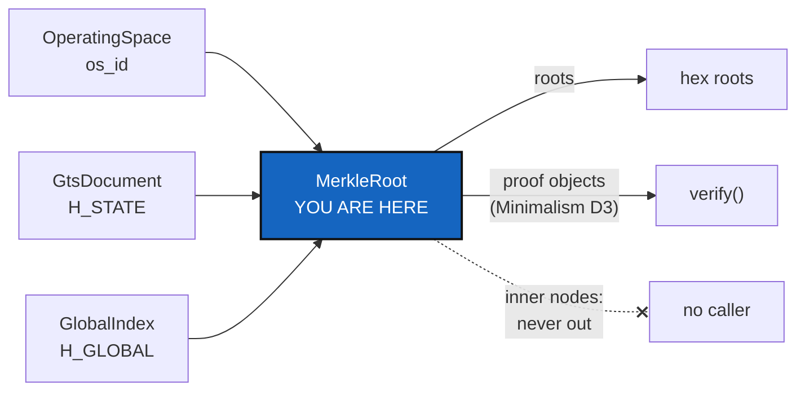

# MerkleRoot — one class computes every State hash, and never hands its tree out

*Created: 2026-10-27*

*Branch: main*

> **Ticket review — 2026-10-27, seventh pass (short ticket `gitRepo`).**
> Rank unchanged. Two changes. First, `MerkleRoot` is the first resident of
> SrcLayout's `Merkle/` folder, the *"never revealed interface"*, so it is
> created there and not as a top-level module. Second, Omniscience
> *"synthesises with hash256(MerkleRoot)"* and gx4g holds the register. The
> roots and record names this class computes are therefore exactly what gx4g
> writes (ProviderMigration §1a), and they must stay byte for byte (§4).
> `Merkle/` may import from `GitRepo/` and from nothing else.

> **From the owner's short ticket `minimalism` (2026-10-27).** Filed at
> `main_1-4` by the ticket review of the same day, as BeforeBeta's step S6,
> after Minimalism draws the map. The owner's words: *"The Merkle Tree of
> MerkleRoot must never be accessible by cgitsync nor gx4g. It is the
> interface never materialised. […] Reorganise Class around this MerkleTree.
> […] MerkleRoot doit ainsi devenir une classe à part entière et les méthodes
> de calcul des hash d'état doivent lui être déléguées. À terme cette classe
> deviendra certainement un repo à part entière."* Before beta (owner, the
> same review).

## Abstract — read this first

**The one-line version.** The State hashes are computed today in five
modules. This ticket moves them behind one class, `MerkleRoot`, which takes
leaves and gives back roots and proofs, and from which no code can read an
inner node. Every hash stays byte for byte what it is.

**What this document is.** What exists (§1), what the class is (§2), how the
roles the owner named are checked (§3), what must not change (§4), the
decisions (§5), the work (§6) and acceptance (§7).

**Why it exists.** A State's name and the Omniscience register's `H_GLOBAL`
are the two facts the whole project rests on, and gx4g will move a host's
repositories by them (ProviderMigration). One class, with one door, is the
part that can later become a repository of its own. Five modules that each
know a little of the tree cannot.

**Who it is for.** The worker, the orchestrator, and the owner for §5.

**What you need to do with it.** Wait for Minimalism's §7 (the Merkle surface
table) and its D3 and D4, which fix this ticket's scope. Then follow §6.

---

## 1. What exists, as of 2026-10-27 (`cgitsync-7.3.0`)

| Module (ring) | Computes |
|---|---|
| `gts_integrity.py` (0) | `GtsIntegrity`: the leaf of one repository, `node_hash`, `merkle_root` (`H_GITTREE`), `integrity_schema = 1`'s golden vectors |
| `global_integrity.py` (0) | `GlobalIntegrity(GtsIntegrity)`: `leaf_digest`, `global_root` (`H_GLOBAL`), an observation's and a checkpoint's name |
| `gts_document.py` (0) | `compute_gittree_root`, `_state_payload`: `H_STATE`, a State's name |
| `operating_space.py` (2) | `os_id`; by rule the *only* place `H_GITTREE` is computed from the tree (`AdditionalSpecs.md`, *Architecture rules*) |
| `inclusion_proof.py` (0) | `InclusionProof`, `GlobalInclusionProof`: audit paths, which carry inner nodes, and their `verify` |
| `global_index.py` (0) | `GlobalIndex.root`: `H_GLOBAL` over the accepted records |

## 2. The class

- **`MerkleRoot`** owns the hashes Minimalism D4 names, the State hashes at
  least (`H_GITTREE`, `H_STATE`, `H_GLOBAL`), and `os_id` if D4 says so. It
  owns them under each schema (`integrity_schema = 1`, `GLOBAL_SCHEMA = 1`).
- **Its door.**
  - In: leaves, canonical payloads.
  - Out: hex roots, names, and proof objects with a `verify`.
  - No method returns a node list, a level, or a sibling by index.
- **One module.** It is ring 0: pure, no I/O, and importing only the
  canonical-JSON helpers it already uses. That is the shape that can later
  leave for its own repository (§5, D2).
- **The callers keep their names.**
  - `OperatingSpace`, `GtsDocument`, `GlobalIndex` and the proofs delegate to
    it; their public methods stay, so nothing outside changes.
  - The rule "`OperatingSpace` is the only place `H_GITTREE` is computed from
    the tree" becomes "`OperatingSpace` is the only place it is asked for;
    `MerkleRoot` computes it".

## 3. The roles the owner named, checked in the code

Minimalism's §4 checks the ring interfaces. This ticket writes the outcome
into the class docstrings and into `AdditionalSpecs.md`, in the owner's
words:

- `ComplexGitSyncClient` is the gate of GitTree;
- `WorkingGitTree` is the Operating Space;
- `.cgs` is the API of USER;
- `.gts` is the API of DEV;
- `OperatingSpace` is the API of OPX;
- gx4g is the universal API gate.

A role the map found violated is either fixed here, when the fix is a
delegation, or filed as a defect in BeforeBeta §3.

## 4. What must not change

- Every golden vector in `tests/` (`integrity_schema = 1`, `GLOBAL_SCHEMA = 1`,
  the RFC 6962 vectors) passes unchanged.
- Every State on disk keeps its name.
- Every `os_id`, every `H_GLOBAL` and every proof in a register is
  byte-identical.
- No schema number moves here. A change to anything hashed is a new schema,
  never an edit (digest). Integrity schema 2, which keys a leaf by its
  `tree_path`, is NestedAgentMaster's N1 (BeforeBeta S10). It lands after
  this ticket, inside `MerkleRoot`, beside schema 1, which keeps verifying
  under its own rule. So the class takes the schema as an argument from the
  start, with schema 1 its only value for now.

## 5. Decisions for the owner

Asked through `AskUserQuestion` before the first edit.

| D | Question | Recommendation |
|---|---|---|
| **D1** | The class name and module: `MerkleRoot` in the `Merkle/` folder (spelled as SrcLayout D1 decides), or another name. | `MerkleRoot`, in `Merkle/merkle_root.py`, ring 0, as the owner wrote it. |
| **D2** | "Later its own repository": prepare now (no import from the rest of the package, a test that asserts it), or only keep the door small? | **Prepare now:** a test that `Merkle/` imports nothing from `ComplexGitSync` except `GitRepo/`. It costs one test and keeps the move possible. |
| **D3** | `GtsIntegrity` and `GlobalIntegrity`: kept as thin aliases for one release, or removed in this change? | **Removed,** with every caller moved. They are not public API in `api_python.tex`; Minimalism's map confirms it. |

## 6. The work

1. Minimalism's §7 Merkle table is the starting list.
2. `merkle_root.py`, with the existing tests moved onto it first, so that each
   golden vector is green before any caller moves.
3. Each caller moves to `MerkleRoot`, one per commit-sized step, with the full
   suite after each.
4. Every inner node that §7 found leaving the hashing modules goes behind the
   door, or is reported if Minimalism D3 kept it.
5. Docs: `AdditionalSpecs.md` (*What a State's name is computed from*, the
   module table, *Architecture rules*), `digest.md` (the `OperatingSpace`
   line), `api_python.tex` where a public name moves. The ceilings are
   expected to fall. A raise is asked by name.

## 7. Acceptance

- One module computes every hash D4 names. A test walks `src/` and finds no
  `hashlib` call building a Merkle node or root outside it.
- No public method of `MerkleRoot` returns an inner node, and a test lists
  its public surface.
- §4 holds: golden vectors, State names, `os_id`, `H_GLOBAL` and the proofs.
- `pixi run lint`, `pixi run test`, `bump-build`, and `cgitsync status` with
  `errors=0`.
