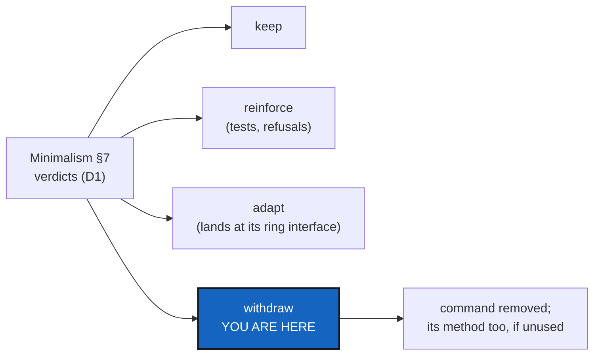

# CliReduction — apply the map: each command kept, reinforced, adapted or withdrawn

*Created: 2026-10-27*

*Branch: main*

> **Ticket review — 2026-10-27, seventh pass (short ticket `gitRepo`).**
> Rank unchanged. It runs before SrcLayout, so that what is withdrawn is
> never moved first. The register-writing commands (`omniscience mount`,
> `register` and `observe`) are gx4g's now. Like the provider commands, they
> are withdrawn by ProviderMigration once gx4g writes, not here. Minimalism
> D7 gives the verdict on the register reads.

> **From the owner's short ticket `minimalism` (2026-10-27).** Filed at
> `main_1-5` by the ticket review of the same day, as BeforeBeta's step S7,
> after Minimalism and MerkleRoot. The owner's words: *"From this map CLI cmd
> may be kept, reinforce, adapted or disclosed."* "Disclosed" means
> **withdrawn from the CLI** (owner, the same review). Before beta.

## Abstract — read this first

**The one-line version.** Minimalism's map gives every command a verdict.
This ticket carries them out: the withdrawn commands leave the CLI, the
methods nothing else calls leave `src/`, and the kept commands land at the
ring interface the map names.

**What this document is.** The input (§1), what each verdict means in code
(§2), what must not break (§3), the decisions (§4) and acceptance (§5).

**Why it exists.** Every command removed is surface nobody can misuse. That
is the security the owner asked for. It is also fewer pages in the user guide
for a beta user to get wrong.

**Who it is for.** The worker, the orchestrator, and the owner, who answered
Minimalism D1 and answers §4 here.

**What you need to do with it.** Nothing until Minimalism's D1 is answered.
Then follow §2.

---

## 1. The input

Minimalism's §7, verdict column, as the owner answered it in its D1. Its D2
fixes the mirror rule this ticket applies. Nothing is withdrawn on a guess.

## 2. What each verdict means

- **Keep.** No change. The command is listed in the user guide's command
  table as it is.
- **Reinforce.** The command gains whatever the map found missing: a refusal
  before anything is touched, a test of its failure path, or a lock it did
  not take (StateLocking's `WRITING_METHODS`).
- **Adapt.** The command is moved to land at the ring interface the map names.
  That means one client method, the CLI only collecting and printing, and the
  document it crosses being the one §1 of Minimalism gives. `unlock`, which
  has no client method, is adapted if Minimalism D2 says every command keeps
  one.
- **Withdraw.**
  - The command leaves the parser, `help_text.py`, the user guide, the
    tutorials and `test_cli_grammar.py`'s expectations.
  - Its client method stays if anything in `src/` other than the CLI still
    calls it, and goes otherwise.
  - The map's *unused* and *deprecated* methods go in the same change, each
    with its tests.
  - A withdrawn command that a tutorial runs is the tutorial's change too, in
    the same commit.
- **A provider command (`repo create`, `memory setup`'s create step), or a
  register-writing one (`omniscience mount`, `register`, `observe`).** It is
  not withdrawn before gx4g can do it (ProviderMigration). Its verdict is
  carried out there.

## 3. What must not break

- Every tutorial still runs end to end with the commands it keeps
  (`tests/integration/test_tuto_*`).
- `cgitsync help`, `help --all` and the "did you mean" hint list exactly the
  commands that remain. Withdrawing a command never leaves a dangling
  example.
- No State, ledger entry or register file changes meaning. Reading a memory
  written by a withdrawn command still works.
- The provider-call check that Minimalism leaves in `tests/` still passes,
  with no new call.

## 4. Decisions for the owner

| D | Question | Recommendation |
|---|---|---|
| **D1** | Does a withdrawn command print a one-line "withdrawn in <version>; use <x>" for one release, or vanish? | **Vanish,** with the user guide's *What changed* paragraph naming it. A beta has no installed base to warn. |
| **D2** | The version level: is a withdrawal `major`? | The orchestrator's call under `Versioning.md`. A removed public command is a breaking change. |

## 5. Acceptance

- Every verdict in Minimalism D1 is carried out, one line per command in a new
  §6 of this ticket with the commit that did it.
- The CLI's leaf count and `ComplexGitSyncClient`'s public method count are
  recorded before and after.
- Minimalism's map script, rerun, shows no command off its ring interface,
  and no method marked unused or deprecated that this ticket kept without a
  reason.
- `pixi run lint`, `pixi run test`, `bump-build`, and `cgitsync status` with
  `errors=0`. The user guide, `api_python.tex` and the tutorials match the
  CLI that remains.
