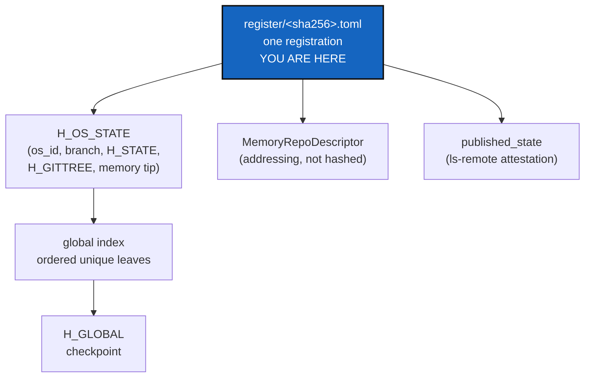

# OmniscienceRegister — the record, the mount and the one global root

*Created: 2026-10-20*

*Branch: main*

> **Split from [Omniscience](main_1-1_Omniscience_DevPlanTicket.md) on
> 2026-10-20 (owner's short ticket `update-omniscience`), as milestones O1c
> and O2** (the old O1, the register format, and O2, the mount). It freezes
> what one registration is and builds the repository it goes into. It
> carries the open decisions D7 and D8 from the 2026-09-20 design.

| | |
|---|---|
| Part of | [Omniscience](main_1-1_Omniscience_DevPlanTicket.md) §3, §4, §5, §6.3, §8 |
| Needs | [OperatingSpaceId](main_1-3_OperatingSpaceId_DevPlanTicket.md) (the key), [InclusionProofs](main_1-4_InclusionProofs_DevPlanTicket.md) (the proof form); reads [PushAnchor](../archive/20261021_PushAnchor_DevPlanTicket.md)'s witness when present |
| Expected release | minor (a new format, a new mount, new commands) |

## Abstract — read this first

**The one-line version.** Fix the canonical form of one registration
record, with its `H_OS_STATE`, its MemoryRepoDescriptor and its published
state. Mount the private `omniscience` repository. Define the global index
whose Merkle root is `H_GLOBAL`. Nothing is registered by a user command
yet; that is OmniscienceAppend.

**What this document is.** The plan for O1c and O2: every format and
location the later milestones write to and read from.

**Why it exists.** Whatever this ticket freezes is hashed forever. Getting
the preimage, the ordering and the separation between hashed and
addressing fields right before the first record exists is far cheaper than
a schema 2.

**Who it is for.** The worker, the orchestrator, and the owner, for §3,
which holds the most consequential questions of the workstream.

**What you need to do with it.** Owner: answer §3. Worker: write the format
specification into `AdditionalSpecs.md` first, then the code against it.

---

## 1. What is true today

Read on 2026-10-20 (6.4.0). No `omniscience` repository is declared in
`examples/complexgitsync4dev.cgs`, and no code mentions it. Mounting a
private repository, `P_branch` naming and `memory setup`'s provider-tool
creation (`provider.py`) all exist and are reused. Schema 1 and the
publication rows are described in `AdditionalSpecs.md`.

## 2. What it delivers

1. **The record schema, version 1.** Following the owner's illustrative
   delta (`update-omniscience` §5): `[record]` (project, `recorded_at`,
   contributor claim), `[operating_space]` (`os_id`, `project_branch`,
   `state_id`, `gittree_root`, `local_ledger_tip`, `local_memory_git_commit`),
   `[memory_repo]` (repository, mount, ref, immutable commit),
   `[published_state]` with its `[[published_state.repo]]` rows, `[local]`,
   and the lag fields of §6.3 when measured. Frozen as a specification
   section, with golden vectors.
2. **What is hashed and what is not.** The canonical preimage holds the
   commitments only. Addressing (`remote_locator`, URL aliases) and anything
   that can change after the fact (access status, credentials) are outside
   it. The file is named by the hash of its preimage.
3. **`H_OS_STATE` and `H_GLOBAL`**, as `update-omniscience` §3 defines them,
   in a new, domain-separated global schema. A leaf is one registered branch
   head plus one State commitment, never `os_id` alone. Ordering, duplicates,
   the empty tree and the proof encoding (InclusionProofs' D1) are fixed
   here.
4. **The mount.** `omniscience` is declared like `.memory`: private, at
   `.omniscience`, writable for a contributor and read-only for an
   inspector, one branch per project, `P_branch` per project branch. It is
   created with the provider's own tool, as `memory setup` does.
5. **The global index.** Its location is D1; it is derived only from
   accepted records, and never hashes a checkpoint that is still being
   built.
6. **Commands, read-only or setup only:** `cgitsync omniscience mount`
   (declare and clone) and `cgitsync omniscience record <state>` (print the
   record that *would* be registered, `--json`). Registration itself is
   OmniscienceAppend.

## 3. Decisions for the owner

- **D1 — Where the global index lives.** (a) Recommended: a distinguished
  branch, `_global`, holding content-addressed checkpoint files, each naming
  its parent checkpoint and the accepted record hashes it covers. (b) A
  `checkpoints/` directory on every project branch. (c) Tags.
- **D2 — The record's serialised form.** (a) Recommended: canonical TOML for
  the file, hashed over canonical JSON of the same fields, as `.gts` does.
  (b) Canonical JSON files.
- **D3 — The time reference (old D7).** (a) Recommended: a separate
  private/distant, read-only repository for the reference, with the lag
  measurements appended to Omniscience. (b) One repository carrying both,
  which makes the reference writable by every contributor.
- **D4 — The universal clock (old D8).** (a) Recommended: NTP (an offset
  and an uncertainty). (b) An RFC 3161 timestamp authority. (c) The forge's
  push time. (d) None in this milestone; the lag fields stay empty until
  decided.
- **D5 — Is a project name claimed, and how.** The owner wants conflicting
  claims to a name refused. (a) Recommended: the first accepted registration
  of an `os_id` records its contributor, and a later one from a contributor
  without push right on that project's branch is refused by
  OmniscienceAppend. (b) A separate claim record, signed.

## 4. Where the code goes

| Module | Change |
|---|---|
| A ring-0 `omniscience_record.py` (or under `memory/`) | Record dataclass, canonical preimage, `H_OS_STATE`, leaf, `H_GLOBAL` |
| `gts_integrity.py` | Reused for every hash; nothing reimplemented |
| `orchestre/` | The two commands, through `git_runner.py` and `provider.py` |
| `examples/complexgitsync4dev.cgs` | The `omniscience` entry, once the owner creates the repository |

Docs: `AdditionalSpecs.md` (the format, first), the user guide
(`omniscience mount`, `omniscience record`), `api_python.tex`.

## 5. Acceptance

- Golden vectors for one record, `H_OS_STATE`, a three-leaf `H_GLOBAL`, and
  the empty index.
- Changing an addressing field leaves the record's hash unchanged; changing
  any committed field changes it.
- Two branches of one project give two leaves; the same registration twice
  gives one.
- `omniscience mount` on a DEV tree clones the private repository; on a
  USER tree it is refused by name.
- Schema-1 golden vectors are unchanged.
- `pixi run lint` and `pixi run test` pass, `bump-build` has run, and
  `cgitsync status` shows `errors=0`.
