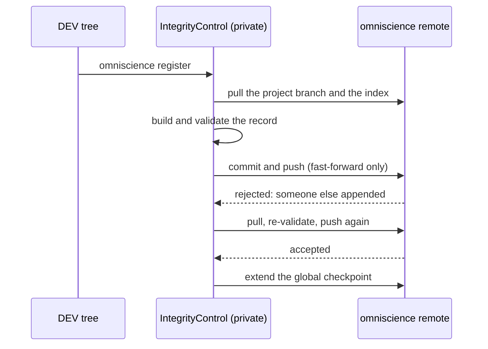

# OmniscienceAppend — registering, by several people at once, and watching what disappears

*Created: 2026-10-20*

*Branch: main*

> **Split from [Omniscience](main_1-1_Omniscience_DevPlanTicket.md) on
> 2026-10-20 (owner's short ticket `update-omniscience`), as milestone O3.**
> It builds the private `IntegrityControl`: *"validate/register
> contributions, maintain global checkpoints, check append-only ancestry,
> compare trusted/observed commitments, diagnose divergence, track GitRepo
> lifecycle/accessibility findings and rebuild derived indexes only from
> verified history."*

| | |
|---|---|
| Part of | [Omniscience](main_1-1_Omniscience_DevPlanTicket.md) §1, §5, §6, §8 — milestone O3 |
| Needs | [OmniscienceRegister](main_1-5_OmniscienceRegister_DevPlanTicket.md) |
| Expected release | minor (a new command) |

## Abstract — read this first

**The one-line version.** `cgitsync omniscience register` writes one
record, validates it, extends the global checkpoint, commits and pushes,
retrying on a non-fast-forward and never forcing. A separate observation
step records, as new events, whether each registered repository is still
there.

**What this document is.** The plan for O3: everything that writes to
Omniscience.

**Why it exists.** A register several people append to must survive their
appending at the same moment, a crash halfway through, a record somebody
wrote by hand, and a repository that vanishes after it was registered,
without ever dropping or rewriting a record.

**Who it is for.** The worker, the orchestrator, and the owner, for §3.

**What you need to do with it.** Owner: answer §3. Worker: build §2 against
§5.

---

## 1. What is true today

Nothing of Omniscience is built (Omniscience §8). Pieces to reuse:
`git_runner.py` for every Git call; the non-fast-forward handling `memory
push` already has; `autofix`'s rule of never repairing evidence; the
lifecycle facts of `branch close` and `ancestors` relocations recorded in the
ledger (`LedgerEntry.relocations`).

## 2. What it delivers

1. **`cgitsync omniscience register [--state S]`**, DEV trees only. It
   builds the record of OmniscienceRegister, refuses one that does not
   validate, commits it, and pushes. A non-fast-forward pulls,
   re-validates and pushes again; it never forces or rebases (D5 of
   2026-09-16). Re-running after a crash finds the same content hash and
   does nothing twice.
2. **Validation.** The record's hash matches its name; `os_id`, `H_STATE`
   and `H_GITTREE` match the State on disk; `memory_commit` exists in the
   `.memory` remote; the contributor may push to that project branch (the
   provider answers by refusing the push).
3. **Hand appends.** A file added with plain `git` is a *proposed* record.
   The checkpoint step accepts it only if it validates; otherwise it stays
   visible and listed as unaccepted, and never enters `H_GLOBAL`.
4. **Checkpoints.** Each accepted batch extends the global index of D1 in
   OmniscienceRegister. The new checkpoint names its parent; a checkpoint
   whose parent is not an ancestor of the remote's is reported as
   `rewritten`.
5. **Observations.** `cgitsync omniscience observe [project]` probes each
   registered repository and `.memory` (descriptor and immutable commit) and
   appends one observation record per finding: `AVAILABLE`,
   `ACCESS_DENIED`, `UNREACHABLE`, `NOT_FOUND`, `COMMIT_MISSING`,
   `UNKNOWN`, with time, method and evidence. `DELETION_CONFIRMED` only on
   authenticated evidence (D2). A declared close comes from the ledger,
   never from a failed fetch. Nothing is removed or rewritten.

## 3. Decisions for the owner

- **D1 — Signed commits (old D3).** (a) Recommended: recommended to every
  contributor and reported by `omniscience verify`, but not required by
  `cgitsync`. Requiring them is the host's branch protection
  (BranchProtection, pile 2). (b) `register` refuses to commit unsigned.
- **D2 — What counts as authenticated deletion evidence.** (a)
  Recommended: an observation the owner records by hand with a reason,
  signed, until providers' audit events are reachable. (b) Never confirmed;
  only `NOT_FOUND`.
- **D3 — When observations run.** (a) Recommended: only when `omniscience
  observe` is typed, never as a side effect. (b) Also at each `register`.
- **D4 — The completeness policy.** A registered repository that is
  `NOT_FOUND` makes the project's report a (a) warning (recommended) or (b)
  failure.

## 4. Where the code goes

| Module | Change |
|---|---|
| `orchestre/omniscience_control.py` (private) | Register, validate, checkpoint, observe |
| `memory/integrity.py` | The typed findings, aligned with the existing `Finding` taxonomy |
| `git_runner.py` | Nothing new expected |
| `cli/` and the client | `omniscience register`, `omniscience observe` |

Docs: the user guide (both commands, what a refusal and a retry look like),
`api_python.tex`, `AdditionalSpecs.md` (*Responsibility boundaries*:
`IntegrityControl`).

## 5. Acceptance

- Two workspaces register concurrently into one bare remote: both records
  land, nothing is forced, and the second's retry is logged.
- A crash between commit and push, then a re-run: one record, not two.
- A malformed hand-appended file is listed as unaccepted and is absent from
  `H_GLOBAL`.
- A forced rewrite of the remote's index is reported as `rewritten` and not
  repaired.
- Observations, each against a fixture: a closed branch, an authenticated
  deletion, a private remote's 404, a network outage, revoked access, a
  deleted ref with the commit still reachable, a commit lost to garbage
  collection, a missing `.memory`, and a repository that reappears. Each
  gives a distinct finding, and no leaf is removed.
- A USER tree is refused by name.
- `pixi run lint` and `pixi run test` pass, `bump-build` has run, and
  `cgitsync status` shows `errors=0`.
