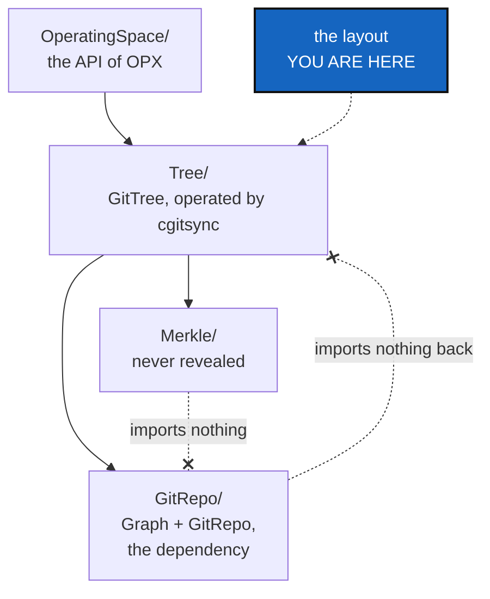

# SrcLayout — src split into GitRepo, Merkle, Tree and OperatingSpace, with GitRepo a dependency that imports nothing back

*Created: 2026-10-27*

*Branch: main*

> **Landed early by MerkleRoot, 2026-10-27:** `src/ComplexGitSync/merkle/` exists, lowercase
> (SrcLayout D1, answered for this folder: Python packages are lowercase, and the other
> three folders follow). It holds `MerkleRoot` and its proofs and imports nothing.
> `global_index.py` is **not** in it (it imports `OmniscienceRecord`): it goes to
> `omniscience/` with the register. Minimalism §7.7 listed it under `Merkle`; that column
> is corrected here.

> **Owner's answers, 2026-10-27 (Minimalism D5, D6).** Asked once the map existed.
> **D6, the folders:** the map's column, with **Omniscience apart**. The 14
> Omniscience modules (`omniscience_*` and `orchestre/omniscience*`) go to a folder of
> their own, `omniscience/`, which leaves `cgitsync` when gx4g takes the register
> (ProviderMigration). `cli/` and `orchestre/` stay above the four folders, and
> `memory/`, `operations/` and `autofix/` go under `Tree/`. **D5, OPX:** the operating
> system. `OperatingSpace/` is the interface between the file tree (ring 1) and the Git
> actions (ring 2); the ring 3 modules that consume it today (9 of them, Minimalism
> §7.6) are a deviation this layout makes visible and CliReduction corrects. §3's table
> and §5's D2 are read with these answers; D1 (the spelling) and D3 (the old paths)
> are still to ask.

> **From the owner's short ticket `gitRepo` (2026-10-27).** Filed at
> `main_1-6` by the ticket review of the same day, as BeforeBeta's step S8.
> The owner's words: *"GitRepo is a specific Graph for GX4G. cgitsync should
> depend on it. I think I need a GitRepo G that will provide the
> implementation of Graph and GitRepo. […] A nice way to restructure the src
> for better visibility would be to split src in subfolders: GitRepo
> (dependency), Merkle (never revealed interface), Tree, OperatingSpace."*
> The owner's answers through `AskUserQuestion`:
> - **GitRepo is a subfolder first.** It imports nothing from the rest of the
>   package, and a test holds it to that. It becomes a repository of its own
>   when gx4g needs it, as MerkleRoot will.
> - **The split is before beta.**
> - **The other packages** (`cli/`, `orchestre/`, `memory/`, `operations/`,
>   `autofix/`) go where Minimalism's map proposes. The owner decides once the
>   map exists.

## Abstract — read this first

**The one-line version.** 121 modules sit today in one flat package and five
sub-packages. This ticket moves them into four folders that say what they
are:
- **`GitRepo`:** a repository and the graph it belongs to, the dependency
  gx4g will share;
- **`Merkle`:** the hashes, never revealed;
- **`Tree`:** the GitTree `cgitsync` mounts and operates;
- **`OperatingSpace`:** the Operating Space and its API.

Behaviour does not change. Only paths and imports do.

**What this document is.** The model (§1), what exists (§2), the folders and
their rules (§3), what must not change (§4), the decisions (§5), the work
(§6) and acceptance (§7).

**Why it exists.** A reader, or gx4g, should see from the tree of files where
the dependency ends, where the hashes live and where the operator works. The
folders are also the shape the two future repositories, GitRepo and Merkle,
will leave from.

**Who it is for.** The worker, the orchestrator, and the owner for §5.

**What you need to do with it.** Wait for Minimalism's folder column (its
D6) and for MerkleRoot, whose class is `Merkle`'s first resident. Then follow
§6.

---

## 1. The model, in the owner's words

*"cgitsync mounts GitRepo as GitTree that it protects through the never
exposed interface MerkleTree (MerkleRoot Tree), that Omniscience synthesises
with hash256(MerkleRoot). Therefore GX4G manages access privileges to
GitRepo. It holds the GitProvider API and Omniscience."*

So `GitRepo` is below everything, and `Merkle` is the only thing that hashes
a tree. The Omniscience register and the provider API are gx4g's
(ProviderMigration). `cgitsync` keeps the operator: `Tree` and
`OperatingSpace`.

## 2. What exists, as of 2026-10-27 (`cgitsync-7.3.0`)

- 40 modules at the top of `src/ComplexGitSync/`, and five sub-packages:
  `orchestre/` (31), `cli/` (17), `memory/` (15), `operations/` (12) and
  `autofix/` (6).
- The repository and graph code is spread over several top-level modules:
  - `git_repo.py`: identity and `DataSpec`, which DataSchema adds;
  - `git_branch.py`: the fallback chain and the privacy rule;
  - `git_runner.py`: the only `subprocess`;
  - `git_tree.py` and `git_tree_branch.py`: the graph of repositories.
- The hashes sit in `gts_integrity.py`, `global_integrity.py`,
  `inclusion_proof.py` and `global_index.py`, and partly in `gts_document.py`
  and `operating_space.py` (MerkleRoot §1).
- `scripts/check_module_ceilings.py`, `check_oo_conformance.py`, the ring
  table in `AdditionalSpecs.md` and `ceiling_baseline.json` all name modules
  by their path.

## 3. The folders and their rules

| Folder | Holds (to be confirmed by Minimalism D6) | Rule |
|---|---|---|
| `GitRepo/` | A repository's identity, the graph of repositories (`Graph`), branches and the fallback rule, the Git runner | **Imports nothing from the rest of `ComplexGitSync`**, and a test asserts it. It is the dependency, not a part. |
| `Merkle/` | `MerkleRoot` and the proofs (MerkleRoot) | **Imports nothing**, not even `GitRepo/` (owner, 2026-10-27, MerkleRoot A): it receives plain values from the adapter in `Tree/`. No public name returns an inner node. |
| `Tree/` | The GitTree `cgitsync` mounts and operates: tree structures, actions, memory | May import `GitRepo/` and `Merkle/` |
| `OperatingSpace/` | The Operating Space, its identity, and the API that serves it | May import everything below it |

- The rings stay as they are, and a folder is not a ring. Each module keeps
  its `Ring:` header, and the ring table names it by its new path.
- `cli/` and the client sit where D6 puts them. Their rule, CLI-mirrors-API
  as Minimalism D2 left it, does not change.

## 4. What must not change

- Behaviour. The full suite passes with no test changed except its imports.
- The public names in `api_python.tex`. Whatever moves is re-exported from
  the paths users import today (`ComplexGitSync.orchestre`, `ComplexGitSync`)
  for this release. D3 decides the next one.
- Every State name, ledger entry, `os_id` and `H_GLOBAL`.
- No ceiling grows. A moved module keeps its baseline under its new path.

## 5. Decisions for the owner

Asked through `AskUserQuestion` before the first edit.

| D | Question | Recommendation |
|---|---|---|
| **D1** | The spelling: `GitRepo/` as the owner wrote it, or Python's lowercase `git_repo/`, `merkle/`, `tree/`, `operating_space/`? | **Lowercase.** Python packages are lowercase, and a test or linter would flag `GitRepo`. The prose and the docs keep the owner's names. |
| **D2** | Minimalism D6's folder for each package and module, as a list the owner edits. | **Answered 2026-10-27:** the map's column, with Omniscience apart (banner above). |
| **D3** | The old import paths: kept as re-exports for one release, or for good? | **One release,** named in the user guide's *What changed*. |

## 6. The work

1. Minimalism D6's column is the list of moves.
2. `GitRepo/` first, with its no-import test, so the dependency boundary is
   green before anything else moves.
3. Then `Merkle/`, which MerkleRoot already filled, then `Tree/`, then
   `OperatingSpace/`. Each folder is one step, with the full suite after it.
4. The scripts, ceilings, ring table, module table and `api_python.tex` move
   with the paths, in the same step.

## 7. Acceptance

- Every module sits in one of the four folders, or where D2 put it.
- A test fails when `GitRepo/` imports anything else from `ComplexGitSync`.
- §4 holds: the suite and the golden vectors, the old import paths, and the
  ceilings.
- `pixi run lint`, `pixi run test`, `bump-build`, `check-ceilings`,
  `check-oo` and `check-spectree` pass, and `cgitsync status` shows
  `errors=0`.
