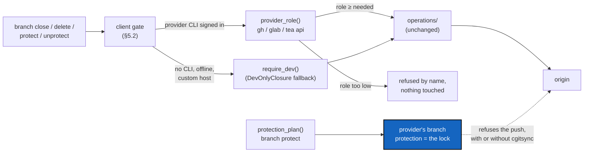

# BranchProtection — the provider locks the branch, and the provider says who may close and delete

*Created: 2026-10-20*

*Branch: main*

> **Ticket review — 2026-10-27, fourth pass.** Renumbered `main_1-6` → `main_1-7`: CommitLogLoss is filed at `main_1-2`. BeforeBeta runs this ticket as step S5, after its D3.

> **Ticket review — 2026-10-27, owner's decision.** Renumbered `main_2-10` → `main_1-6`: **mandatory before beta.** A random user must not be able to delete a branch in the beta (the owner's short ticket `deletion4devOnly`). BeforeBeta runs this ticket as step S6. Whose job it is remains a frontier question: EnvConnect §5 says GX4G manages GitRepo rights through the providers' APIs, and this ticket has `cgitsync` read the provider's role. BeforeBeta's D3 asks it before S6 starts, and this ticket is rewritten on the answer. The short ticket `deletion4devOnly` still closes when M3 lands.

> **Ticket review — 2026-10-20, owner's decision.** Moved `main_1-2` → `main_2-10`, the end of the priority-2 pile, to leave priority 1 to the Omniscience workstream (owner's short ticket `update-omniscience`). Omniscience's register is a branch that should be protected on the provider; until this ticket lands, OmniscienceQuery reports that protection as not checked rather than assuming it.

> **From the owner's short ticket `deletion4devOnly` (2026-10-13).** The owner
> asked for a branch that can be locked against deletion, a way to tell who
> may lock it, and two tiers: closing is a developer's right, deleting a
> maintainer's. [DevOnlyClosure](../archive/20261013_DevOnlyClosure_DevPlanTicket.md)
> took only the last sentence, the accident guard in a USER tree. The six
> questions its note left open are what this ticket answers (§2), on the
> owner's word of 2026-10-20.

| | |
|---|---|
| Predecessors | [DevOnlyClosure](../archive/20261013_DevOnlyClosure_DevPlanTicket.md): `WorkingGitTree.require_dev`, the USER-tree refusal; the `provider.py` rule "store no credential, implement no provider's API, run the provider's own CLI" |
| Closes | The short ticket `deletion4devOnly`, once M3 lands (§7) |
| Touches | `branch close`, `branch delete`, `status`; Tutorial 7 §7 |

## Abstract — read this first

**The one-line version.** `cgitsync` never makes a lock of its own. It asks
the hosting service (the "provider": GitHub, GitLab, Codeberg/Gitea) to
protect a branch, through the CLI the user has already signed in to (`gh`,
`glab`, `tea`). It also asks the provider what role the signed-in user has
on the project, and gates `branch close` on a developer role and
`branch delete` on a maintainer role. When no provider can answer, the
DevOnlyClosure profile test stays as the offline fallback.

**What this document is.** The plan: what is true today (§1), one answer to
each of the six open questions (§2), a spike that checks the provider facts
before any code is written (§3), the decisions (§4), the behaviour (§5),
where the code goes (§6), and the milestones and acceptance (§7).

**Why it exists.** Anything `cgitsync` records, `git push origin --delete`
ignores. Only the provider refuses a push, so only the provider can hold a
lock. A role the provider enforces is also the only identity a user cannot
edit in their own `.cgs`.

**Who it is for.** The worker who runs the spike and builds the milestones,
the orchestrator who quotes them, and the owner, for §4.

**What you need to do with it.** Owner: answer §4 (D1 and D2 before the
spike, the rest after it). Worker: run §3 first. Its findings table replaces
every *(spike)* mark below before any line goes into `src/`.



---

## 1. What is true today

Checked on 2026-10-20 against `HEAD` (`cgitsync-6.3.4`).

1. **`provider.py` already holds the pattern.** It is ring 0: it decides
   *what* to run (`creation_plan` → `CreationPlan(tool, argv, sign_in)`) and
   runs nothing. `GitRunner.run_tool` runs it, because `git_runner.py` is the
   only module that imports `subprocess`. `PROVIDER_TOOLS` maps `github` →
   `gh`, `gitlab` → `glab`, `codeberg` → `tea`; `custom` has no tool.
   `looks_like_not_signed_in` already tells "not installed" from "not signed
   in". Its only caller today is `orchestre/memory_setup.py`.
2. **The gate exists, in one place.** `WorkingGitTree.require_dev(command)`
   (`git_tree.py`) refuses in a USER tree. `TreeCommands.close_branch` and
   `delete_branch` call it first. Its own docstring says it is an accident
   guard, and "only the provider's branch protection stops a determined
   user".
3. **Nothing in `src/` reads or sets a provider protection or role.** A
   search for `protect` finds only comments.
4. **The repository identifier is already parsed once.** `parse_repo_id()`
   gives `gitprovider`, `project_owner_name` and `repo_name`, which is all
   that a provider API path needs.

## 2. The six questions, answered

Each answer depends on provider facts listed in §3. Where the spike may
overturn an answer, the answer says so.

**Q1 — Locking a branch.** *A lock is the provider's branch protection, and
nothing else.* `cgitsync branch protect <b>` and `branch unprotect <b>` build
one provider call each in `provider.py` (`protection_plan`) and run it through
`run_tool`. The provider's API, reached through each CLI's generic `api`
subcommand, so that `cgitsync` implements no client of its own:

| Provider | Protect (forbid deletion and force-push) | Who may set it |
|---|---|---|
| GitLab | `glab api -X POST projects/<id>/protected_branches -f name=<b> -f push_access_level=30 -f merge_access_level=30 -f allow_force_push=false`. A protected branch cannot be deleted by a push, by anyone | Maintainer |
| GitHub | A repository ruleset with `deletion` and `non_fast_forward` rules on `refs/heads/<b>` (`gh api -X POST repos/<o>/<r>/rulesets --input -`), or classic `PUT …/branches/<b>/protection` with `allow_deletions=false` | Admin |
| Codeberg / Gitea / Forgejo | `POST /repos/<o>/<r>/branch_protections` with `branch_name=<b>`. Deletion of a protected branch is refused *(spike: does `tea` have a generic `api` subcommand in the version we can require, or must we print the call?)* | Repository admin |
| `custom`, bare server | No call. Printed as "cannot be locked here" (Q5) | — |

GitHub only offers protection and rulesets on a private repository on a paid
plan *(spike: confirm on the current plan matrix)*. On a free plan the call
fails, and `cgitsync` reports the provider's own message rather than
pretending.

**Q2 — Who may lock, and how they are recognised.** *By the provider's
authenticated answer, never by `git config`.* `provider.py` gains
`role_plan(identity)`, and the orchestre layer runs it and normalises the
result to one `ProviderRole`:

| Provider | Call | Field read |
|---|---|---|
| GitHub | `gh api repos/<o>/<r>` | `permissions.{admin, maintain, push, triage, pull}`, the highest one that is true |
| GitLab | `glab api projects/<url-encoded path>` | `permissions.project_access.access_level` and `group_access.access_level`, the larger (10, 20, 30, 40, 50) |
| Gitea | `GET /repos/<o>/<r>` | `permissions.{admin, push, pull}` |

```text
ProviderRole:  NONE < READ < TRIAGE < WRITE < MAINTAIN < ADMIN
GitHub         -      pull   triage   push    maintain   admin
GitLab         -      10/20  20       30      40         50
Gitea          -      pull   -        push    admin      admin
```

Gitea has no tier between `push` and `admin`, so maintain and admin fold
together there. The provider's own lock is the real check, so who may lock
is "whoever the provider lets set a protection". `cgitsync` reads the role
only to refuse early, with a clear sentence, instead of passing on a 403.

**Q3 — The dev and maintainer tiers.** *Do not invent them. Map them onto
the provider's roles.*

| Command | Needs | Why |
|---|---|---|
| `branch close` | `WRITE` (GitHub push, GitLab Developer) | Closing pushes `closed/<b>` and removes `<b>`. Its work is kept on `ancestors` |
| `branch delete` | `MAINTAIN` (GitHub maintain, GitLab Maintainer, Gitea admin) | Deletion is the step that cannot be undone |
| `branch protect` / `unprotect` | `MAINTAIN` (GitHub: `ADMIN`) | The provider asks for it anyway |

*Offline, a CLI not installed or signed in, or `custom`:* fall back to
`require_dev`, exactly as today (D2). *Self-hosted GitLab or Gitea:* the
same numeric levels and fields. The spike checks one self-hosted GitLab if
one is at hand, otherwise the risk is recorded.

**Q4 — "Other strategic assets".** *Ask the owner (D4).* The candidates the
code shows: **tags** (GitLab protected tags; GitHub tag rulesets; Gitea tag
protection), so that a release tag cannot be moved or deleted by hand; the
**`ancestors` branch**, which `branch close` and `branch delete` rely on to
lose nothing; the **memory repository's branch** in a DEV tree, which
`memory reboot` deletes on its remote; and the project's **default branch**.
Whatever the owner picks, `branch protect` gains `--tag` and `--ancestors`
spellings, or `cgitsync protect` becomes the command, rather than a new
command per asset.

**Q5 — A lock `cgitsync` can see without the provider.** *Recommended: do not
build one.* On a bare server, `cgitsync` cannot stop a push. A list in a
private repository would be a convention between developers that a user
never reads. If the owner wants a "please do not" all the same (D5), the
cheapest honest version is a `protected = ["main", "ancestors"]` key per
repository in the `.cgs`. The client refuses `branch close` and
`branch delete` on those names, and the refusal says plainly that it is
advice the provider does not enforce.

**Q6 — Who can remove a lock.** *Whoever the provider lets.* Neither GitHub
nor GitLab nor Gitea records who created a protection in the field the API
returns *(spike: confirm; GitLab Premium and GitHub organisations have audit
logs, which are out of reach on a free plan)*. So the lock has no owner to
recognise, only a role that may change it, and Q2 already reads that role.
If the owner wants the "who locked it" fact (D6), `branch protect` appends a
ledger entry with the provider login it read (`gh api user`,
`glab api user`). It is a history record to display, never a check.

## 3. The spike (M0): no code in `src/`

On one throwaway project per provider (GitHub with `gh`, which is installed;
GitLab with `glab`; Codeberg with `tea`), signed in as two accounts, one
with a maintainer role and one with only a developer or write role:

1. Protect a branch with the §2 Q1 call. Then try, as each account:
   `git push origin --delete <b>`, `git push --force`, and the provider's
   web delete. Record each outcome.
2. Run the §2 Q2 call as each account. Record the exact JSON fields and
   values.
3. Record which role may create and remove a protection, and what error text
   the call gives otherwise (so that `looks_like_*` can recognise it).
4. Record whether any API field names who made a protection (Q6).
5. GitHub: try it on a free private repository and record the error.
6. `tea`: the oldest version that has a generic `api` subcommand, or none.
7. Tags: the same three calls for a tag, for D4.

The worker writes the findings as one table in a new §3.1 of this ticket,
replaces every *(spike)* mark, and only then asks D3–D6. The spike's throwaway
projects are deleted afterwards. Their names go in the table.

## 4. Decisions for the owner

The worker asks each with `AskUserQuestion`: D1 and D2 before the spike, the
others after §3.1 exists.

**D1 — Where the role is read from.**
- **(a) Recommended: the provider, at run time, through the user's own
  signed-in CLI** (§2 Q2). No credential is stored, which is the
  `provider.py` rule.
- (b) A role list in a private configuration repository. It works offline,
  but it is self-declared, so it is the same weakness as DevOnlyClosure.

**D2 — When the provider cannot answer** (offline, CLI missing or signed out,
`custom` host).
- **(a) Recommended: fall back to `require_dev`**, and say in the refusal or
  in a note line which check was used.
- (b) Refuse `branch close` and `branch delete` outright until a provider
  answers. Stricter, but it breaks a DEV tree on a train.

**D3 — The tier mapping.** §2 Q3's table as is, or `branch close` at
`MAINTAIN` too.

**D4 — Which assets beyond branches** (§2 Q4): tags, `ancestors`, the memory
branch, the default branch. Multiple choice.

**D5 — The advisory `protected` key in `.cgs`** (§2 Q5): no (recommended), or
yes, documented as advice.

**D6 — Record who locked, in the ledger** (§2 Q6): no, or yes as display-only
history.

The version level is the orchestrator's. A new command and a new refusal are
`minor` at least.

## 5. The behaviour

1. **`branch protect <b> [--repo R]` / `branch unprotect <b>`.** For each
   repository in scope, build `protection_plan(...)`, run it, and report it
   per repository: `protected`, `already protected`, `refused by provider:
   <its message>`, or `cannot be locked here (<provider>)`. With `--print`,
   or when the CLI is missing, print the command instead of running it, as
   `creation_plan` does.
2. **The gate.** `TreeCommands.close_branch` and `delete_branch` call one
   method, `require_role(command, needed)`, in place of `require_dev`. It
   reads the role once per repository per run (cached for the run, never on
   disk), refuses by name with the role it found and the one it needs, and
   falls back to `require_dev` per D2. Nothing is touched before the gate
   passes for every repository in scope.
3. **`status` shows the lock.** One more column or note per repository:
   whether the current branch and the declared assets (D4) are protected on
   the provider. It is read only when the provider CLI is signed in, and it
   is never an error, because a user may not be allowed to read protection
   settings *(spike: GitHub returns 404 to non-admins on the protection
   endpoint)*.
4. **The refusal text** names the command, the provider, the role read, the
   role needed, and the way out ("ask a maintainer of `<o>/<r>`"). It is one
   message, `EXIT_REFUSED`.
5. **Unchanged:** `branch check` and `branch list`, and every command that
   does not remove a branch on a remote.

## 6. Where the code goes

| Module | Change |
|---|---|
| `provider.py` (ring 0) | `ProviderRole`, `role_plan`, `parse_role(provider, json_text)`, `protection_plan(identity, ref, *, protect)`, and `looks_like_forbidden`. Pure: it builds argv and parses text |
| `git_runner.py` | Nothing new. `run_tool` is enough. If the spike shows `--input -` is needed (GitHub rulesets), `run_tool` gains an optional `stdin` |
| `git_tree.py` | `require_role(command, needed, roles)` next to `require_dev`, so the rule stays in one place. `require_dev` stays as the fallback |
| `orchestre/tree_commands.py` | The gate call. `protect_branch` / `unprotect_branch` |
| A new `orchestre/provider_probe.py`, or `git_probes.py` | Runs `role_plan` and `protection_plan` through `run_tool`, one place for the cache and the "not signed in" handling |
| `cli/expert.py`, `cli/help_text.py` | `branch protect`, `branch unprotect` |
| `client.py` | `protect_branch`, `unprotect_branch`, mirroring the CLI |

**Docs, in the same change:** the user guide (`branch protect`, the tiers,
the fallback, and the limit "a lock is only as strong as the provider's"),
`api_python.tex`, Tutorial 7 §7, `AdditionalSpecs.md` (*The tree profile*
and *Responsibility boundaries*: `provider.py` now also reads roles and
builds protection calls), and `digest.md` (one line: "no lock of
cgitsync's own; locks are the provider's").

**Ceilings.** `provider.py` grows the most. If `check-ceilings` asks for a
raise, including any import-count rise, ask the owner for it by name.

## 7. Milestones and acceptance

| M | Delivers | Lands when |
|---|---|---|
| M0 | §3 spike, §3.1 table, D3–D6 asked | No `src/` change |
| M1 | `ProviderRole`, `role_plan`, `parse_role`, unit tests on recorded JSON from §3.1 | Offline tests only |
| M2 | `require_role` gate on close and delete, with the D2 fallback | The DevOnlyClosure tests still pass |
| M3 | `branch protect` / `unprotect`, `status` note, docs | Closes `deletion4devOnly` |
| M4 | D4's other assets, D5, D6, as answered | Optional, its own ticket if large |

**Acceptance.**
- **Parsing.** For each provider, `parse_role` on the JSON recorded in §3.1
  gives the expected `ProviderRole`, including GitLab's group-versus-project
  maximum and Gitea's folded maintain.
- **Gate, provider answers.** With `run_tool` faked: WRITE closes but cannot
  delete; MAINTAIN deletes; READ cannot close. Each refusal names both roles
  and touches no ref.
- **Gate, provider silent.** CLI missing, signed out, or a `custom` host:
  the behaviour is exactly DevOnlyClosure's (D2a). The existing USER-tree
  tests pass unchanged.
- **Protect.** `protection_plan` produces the exact argv recorded in §3.1 for
  each provider. `custom` gives "cannot be locked here".
- **No credential.** A test asserts that `provider.py` reads no environment
  token and no file, and that no new module imports `subprocess`.
- **Live, manual.** The orchestrator's record quotes one live run per
  provider from §3: protect, a refused `git push --delete`, unprotect.
- **The AST test** from DevOnlyClosure, which lists every caller of
  `delete_remote_branch`, now accepts `require_role` as the guard.
- `pixi run lint` and `pixi run test` pass, `bump-build` has run, and
  `cgitsync status` shows `errors=0`.
