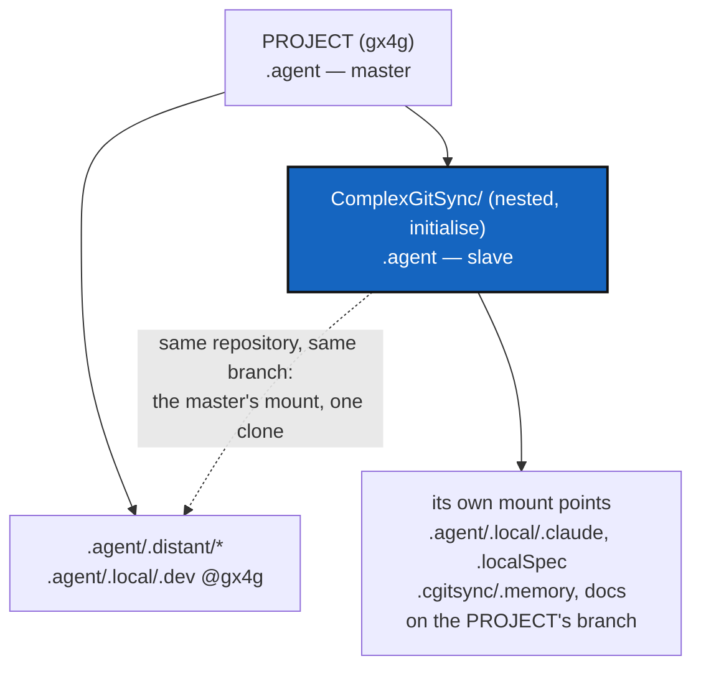

# NestedAgentMaster — one `.agent` per tree: a nested project's agentics answer to PROJECT, and PROJECT's orchestrator can mobilise them

*Created: 2026-10-27*

*Branch: main*

> **Ticket review — 2026-10-27, owner's decision: merged with AgenticControl.**
> *"je viens d'ajouter une analyse et des specs qui viennent d'un pb concret
> de montage identifié dans gx4g merge tickets AgenticControl and
> NestedAgentMaster."* This ticket was filed by the owner at `main_1-9`, and
> AgenticControl at `main_1-8` from the short ticket `mount` (closed as
> `archive/.closedUserTicket/20261027_mount.md`). They are one ticket at
> `main_1-8` now, under this name, because the concrete problem below is the
> case the clarification was about.
> - §1–§6 are the owner's analysis and rule. Only the abstract's list of
>   sections changed, and N7 was added in §4.
> - §7 is AgenticControl's model, Project → Parent → Leaf, with the questions
>   the owner's rule (§3) already answers marked as answered.
> - BeforeBeta runs it as step S10, because it blocks the DEV session of every
>   project that nests ComplexGitSync's developer spec, gx4g first. That
>   answers AgenticControl's D1.

> **Owner's decision — 2026-10-27.** Filed from gx4g's DEV bootstrap
> (`examples/gx4g4dev.cgs`, gx4g 0.1.1, run by cgitsync 6.10.0), which
> cloned fifteen repositories and then refused its own State. The three files
> at fault (`registry.py`, `gts_document.py`, `gts_integrity.py`) are
> unchanged at 7.3.0 `a492f07`, so 7.3.0 fails the same way. The owner's
> direction: build the PROJECT's agentic system from ComplexGitSync's.
> ComplexGitSync keeps its own agents and mount points, but under
> `initialise` its `.agent` is the **slave** of the PROJECT's. Standalone
> (`bootstrap`), it is its own master. Prioritary: it blocks the DEV session
> of every project that nests ComplexGitSync's developer spec. End of pile 1.

## Abstract — read this first

**The one-line version.** A tree that nests another project's developer
spec mounts the shared repositories twice. Its State then refuses itself,
because two repositories share a `relative_path`. This ticket makes the
State's key unique across the tree. It also makes the PROJECT's `.agent`
the master: a nested entry naming a repository and branch the PROJECT
already mounts *is* that mount, cloned once.

**What this document is.**
- §1: what happened. §2: why the `.cgs` cannot fix it.
- §3: the owner's rule. §4: the steps.
- §5: the decisions. §6: acceptance.
- §7: the wider model, how a PROJECT's orchestrator mobilises the local
  agents its tree mounts, as far as each mount allows (merged from
  AgenticControl).

**Why it exists.** DevSpecs puts every conforming project's agentics at the
same paths: `.agent/.distant/{ticket,dev-sync,documentation}` and
`.agent/.local/.dev`. As soon as one conforming project nests another's
developer spec, the paths meet.

**Who it is for.** Whoever works on discovery, the registry, or the State's
integrity schema.

**What you need to do with it.** Read §1 and §3. Answer D1 to D4 before
starting N3, and §7's open questions (Q2, Q4, Q6) before N7.



---

## 1. What happened

```
pixi run cgitsync bootstrap ../examples/gx4g4dev.cgs gx4g
...
command_end status=error
  Invalid .gts document: [repo_state] duplicate relative_path '.agent/.distant/dev-sync' in one State
  tree_lifecycle_state: READY
```

The tree was fully cloned. Only the State failed.

| Path in the tree | Parent | `relative_path` (from parent) | Repository | Branch wanted |
|---|---|---|---|---|
| `.agent/.distant/dev-sync` | root (gx4g) | `.agent/.distant/dev-sync` | `github:flipoyo/DevSpec` | main |
| `ComplexGitSync/.agent/.distant/dev-sync` | ComplexGitSync | `.agent/.distant/dev-sync` | `github:flipoyo/DevSpec` | main |
| `.agent/.distant/ticket`, `documentation` | root | same as nested | `.ticketing`, `DocSpec` | main |
| `.agent/.local/.dev` | root | `.agent/.local/.dev` | `github:flipoyo/.dev` | **gx4g** |
| `ComplexGitSync/.agent/.local/.dev` | ComplexGitSync | `.agent/.local/.dev` | `github:flipoyo/.dev` | **gx4g** |

**The cause.** `RegistryTranslator` stores each entry's path *from its
parent* (`registry.py`, `_placement` → `relative_path=path_from_parent`).
`GtsDocument.repo_leaf` hashes it, and `GtsIntegrity.ordered_leaves` keys
the GitTree by it. Two repositories at the same depth under two different
parents therefore collide. The `.cgs` check (`register_relative_path`,
context `root`) sees one document at a time, so `validate` passes. The
clones then run to the end before the State refuses.

**A second fault behind the first.** `private_local_branch` correctly sends
ComplexGitSync's nested `.dev` to the PROJECT's branch, `gx4g`. That makes
it the same repository and branch as gx4g's own `.dev`, so one tree holds
two writable clones of `github:flipoyo/.dev@gx4g`. Fixing the key alone
(N1) would let the bootstrap pass with that double clone in place.

## 2. Why `gx4g4dev.cgs` cannot fix it

- **Declaring ComplexGitSync's entries directly** (`nested_config =
  "disabled"` plus `ComplexGitSync/.agent/...` entries) gives the same
  path from the parent. The registry places them under the ComplexGitSync
  repository, so they collide the same way.
- **Dropping gx4g's own `.agent`** leaves gx4g non-conforming to DevSpecs.
  The `.local/.dev` collision also remains.
- **The only interim is `nested_config = "install.cgs"`** for ComplexGitSync.
  That keeps the tool and its `docs/`, and drops ComplexGitSync's agentics
  from the PROJECT's tree.

## 3. The rule (owner)

| How ComplexGitSync is installed | Whose `.agent` is master | ComplexGitSync's entries |
|---|---|---|
| `initialise`: nested in PROJECT | PROJECT's | Each entry is either the master's mount or its own mount point, on the PROJECT's branch. |
| `bootstrap`: standalone | ComplexGitSync's own | Unchanged. The memory is the twin's, `ComplexGitSync_<Project>` (EnvConnect C8, done). |

**Nested, an entry of the slave spec takes one of two forms.**

- **It is the master's mount.** This applies when its identity, the
  repository plus the branch after `private_local_branch`, equals an entry
  an ancestor spec already mounts. It is not cloned again, and the State
  holds one leaf. Its path in the slave is an alias (D2). In gx4g's tree,
  this covers the three `.distant` mounts and `.local/.dev`.
- **It is the slave's own mount point.** This applies when the master has no
  entry with that identity: `.agent/.local/.claude`, `.agent/.local/.localSpec`,
  `.cgitsync/.memory` and `docs`. It stays where ComplexGitSync declares it,
  on the PROJECT's branch (already what `private_local_branch` does). Its
  `.memory` is the Project's memory, as the install frontier says.

So in gx4g's tree, ComplexGitSync's agents read gx4g's tickets and the same
DevSpecs, and keep their own skills and AdditionalSpecs on branch `gx4g`.

## 4. Steps

- **N1 — a State key unique across the tree.** Integrity schema 2 adds a
  `tree_path` (POSIX, from the tree root) to each leaf, and orders and
  checks duplicates on it. Schema-1 States keep verifying under their own
  rule, because a released schema is immutable (`gts_integrity.py`). That
  keeps every registered State's `gittree_root`. `.gts` → `.cgs` round
  trips keep working.
- **N2 — refuse before cloning.** Check tree-wide uniqueness each time a
  nested spec is discovered, before any of its children is cloned, naming
  both entries and both spec files. `validate` reports it too.
- **N3 — master and slave under `initialise`.** Deduplicate on identity, as
  §3 says. One clone, one leaf, and the slave's path recorded as an alias of
  the master's `tree_path`. The same repository on a different branch is D3.
- **N4 — materialise the alias**, as D2 decides.
- **N5 — `bootstrap` standalone is unchanged**, the twin's memory included.
- **N6 — documentation.** Tutorial 5 (private repositories) and
  AdditionalSpecs' install frontier: one `.agent` per tree, and whose it is.
- **N7 — the mobilisation rules (§7).** They are written into AGENT.md's
  handoff rules and AgentConduct §4, upstream in `DevSpec` if Q6 says
  pattern. A code ticket is filed for whatever `cgitsync` must compute (Q4),
  with a row in Minimalism's map.

## 5. Decisions

- **D1 — the key.** Recommended: add `tree_path` in schema 2 and keep
  `relative_path`. The alternative, making `relative_path` itself
  root-relative, rehashes every nested leaf ever written.
- **D2 — what sits at the slave's path.** Recommended: a relative symlink to
  the master's mount, so ComplexGitSync's agents keep their paths. The
  alternatives are nothing (the slave's agents are pointed at the master's
  paths) or a read-only worktree.
- **D3 — same repository, different branch.** An example is a slave
  `.localSpec` pinned to `ComplexGitSync`. Recommended: refuse by name,
  naming both entries, because two branches of one repository in one tree
  is a choice for the owner, not for discovery.
- **D4 — `bootstrap` of a spec that nests ComplexGitSync.** gx4g's DEV
  Operating Space is opened today with `bootstrap ../examples/gx4g4dev.cgs`.
  Under §3, the master/slave relation belongs to `initialise`.
  - **Either** the DEV Operating Space is opened with `initialise` (a `.cgs`
    only, since 7.0.0);
  - **or** the relation follows the tree rather than the command: wherever
    ComplexGitSync sits under a PROJECT, it is the slave, and "standalone"
    means only a tree whose root is ComplexGitSync itself.

  *Install decides, Git remembers* (AdditionalSpecs) already settles the
  memory once, at install (`Installer._mark_twin`). Whichever answer is
  chosen, the master/slave relation is decided at the same moment and by
  the same rule, never re-derived from the copy that runs. To be answered by
  the owner.

## 6. Acceptance

- Opening `examples/gx4g4dev.cgs` (with the command D4 names) completes.
  The tree holds:
  - `.agent/.distant/*` and `.agent/.local/.dev`, cloned once each;
  - ComplexGitSync's `.claude`, `.localSpec` and `.memory` on branch `gx4g`,
    or its fallback while the branch does not yet exist.
- Every State has one leaf per clone, and no two leaves share a `tree_path`.
- No tree ever holds two writable clones of one repository and branch.
- Two nested specs placing different repositories at the same path from
  their parents produce a valid State (N1). A real duplicate is refused
  before any clone (N2).
- A standalone `bootstrap examples/complexgitsync4dev.cgs` behaves as today.
  Every schema-1 State already registered still verifies.

Related: `archive/20261027_EnvConnect_DevPlanTicket.md` (the install
frontier, the twin's memory) and gx4g's
`main_1-1_EnvConnect_DevPlanTicket.md` (the DEV Operating Space).

## 7. The wider model: Project → Parent → Leaf (merged from AgenticControl)

### 7.1 The three levels

| Level | What it is | Example |
|---|---|---|
| **Project** | The root of the tree, whose `.cgs` is installed and whose `.agent` is master (§3) | gx4g, in `examples/gx4g4dev.cgs` |
| **Parent** | A mounted repository that brings its own `.cgs` (`nested_config` set), and so its own agentic entries: each is the master's mount or its own mount point (§3) | ComplexGitSync in gx4g, through `nested_config = "examples/complexgitsync4dev.cgs"` |
| **Leaf** | A mounted repository that brings nothing (`nested_config = "disabled"`) | ComplexGitSync in gx4g's user `install.cgs` |

A **local agent** is one whose instructions (`.claude`), specs
(`.localSpec`) and planning surface (`.dev`) are a level's own
`private/local` mounts. A **distant** mount is a shared, read-only rule set.

### 7.2 What the mount allows: the cases the adaptation covers

| Case | What the Parent's agentic entries give | What its local agent can do |
|---|---|---|
| USER tree (no private repository) | Nothing | No local agent |
| Leaf | Nothing at that level | None; the Project's own agent only |
| `private/distant` only | The master's mount (§3), read-only | Follow the shared rules; record nothing of its own |
| Own `private/local` mount point, on the Project's branch | Its own `.claude` and `.localSpec`, writable; the master's `.dev` | Plan in the master's tickets, implement, and record in the Project's memory |
| Own mount point on its fallback branch (branch missing, EnvConnect C7) | Readable, not to be committed | Read and propose only, until the branch is created |
| `bootstrap` standalone | ComplexGitSync is its own master (§3) | Its own agent, outside any PROJECT |

### 7.3 The questions, and what §3 already answers

- **Q1 — Who leads inside a Parent. Answered by §3.** The PROJECT's `.agent`
  is master under `initialise`. The PROJECT's orchestrator leads, and the
  Parent's agent works as its worker.
- **Q2 — Which instructions bind there. Partly answered.** The Parent's agent
  reads the master's tickets and the same shared specs, and keeps its own
  skills and `AdditionalSpecs` (§3). Still open: the rest.
  - Inside the Parent's source, does its own `CLAUDE.md` checklist bind
    (lint, ceilings, bump-build)?
  - Do the PROJECT's rules apply only where the two meet: the commit message,
    the shared release?
- **Q3 — Where it is recorded. Answered by §3.** In the master's
  `.agent/.local/.dev` tickets, the master's mount. And in the PROJECT's
  memory, which the Parent's `.memory` is under `initialise`.
- **Q4 — How the capabilities are found. Open.** Computed from the State,
  read-only? The `.gts` already says, per repository, whether it is private,
  whether it is writable, its branch, whether it fell back, its nested
  config, and after N3 which entries are aliases of the master. Or declared
  by each level? Under Minimalism, a computed answer comes through an
  existing output such as `status --json`, unless the map gives it a row.
- **Q5 — Standalone. Answered by §3.** ComplexGitSync is its own master.
  Whether a `bootstrap` of a spec that nests ComplexGitSync counts as
  standalone is D4.
- **Q6 — A shared pattern or a local rule. Open.** Either the model becomes a
  pattern in `DevSpec`, which is `private/distant` and read-only here, so it
  is changed upstream, and each project fills it in. Or it stays a rule of
  this project.
