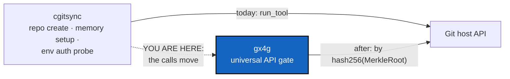

# ProviderMigration — every Git host API call and every Omniscience register write moves to gx4g; cgitsync only executes

*Created: 2026-10-27*

*Branch: main*

> **Owner's answers, 2026-10-27 (Minimalism D1, D7).** *"La gate ne possède que
> Omniscience. Les autres registres restent dans le projet protégé. cgitsync doit
> pouvoir tourner en local. Il garde ainsi ses registres."* So the scope is wider than
> §1a: **all 12 `omniscience *` commands leave `cgitsync`, the nine reads as well as the
> three writes**, with `repo create`, which makes 13 withdrawals. They are carried out
> here, when gx4g offers each one (Minimalism §7.3, D1). Two things stay: `omniscience
> record`, because `cgitsync` produces the record gx4g writes, and every register of
> the protected project: the ledger, the memory and the self-history. `cgitsync` runs
> with no gx4g, and a standalone one prints the provider command (`gh repo create …`)
> instead of running it.

> **Ticket review — 2026-10-27, seventh pass (short ticket `gitRepo`).**
> Rank unchanged, scope widened. *"GX4G manages access privileges to GitRepo.
> It holds the GitProvider API and omniscience."* The answer through
> `AskUserQuestion` was **"gx4g writes, cgitsync produces"**. Every write to
> the Omniscience register (`omniscience mount`, `register`, `observe`, and
> BranchProtection's dead-branch findings) moves to gx4g with the provider
> calls. `cgitsync` keeps building what is written: a State's record, by
> hash256(MerkleRoot) (`omniscience record`), and the findings. Which
> register *reads* stay is Minimalism's map's verdict (§1a).

> **From the owner's short ticket `minimalism` (2026-10-27).** Filed at
> `main_2-10`, the end of pile 2, by the ticket review of the same day. It is
> stand-by because it needs gx4g to offer each call first. The owner's words:
> *"Les interactions GitRepo en écriture sont le privilège de gx4g. cgitsync
> n'est qu'un exécutant. Cela veut dire qu'il faut un diagnostic de toutes les
> méthodes faisant appel aux API GitProvider pour les faire migrer vers gx4g.
> La migration vers gx4g se fera grâce au hash256(MerkleRoot) des states et
> GitRepo concernés."* Scope (owner, the same review): **every** provider call,
> the reads as well as the writes. Before beta, no new call enters `cgitsync`.

## Abstract — read this first

**The one-line version.** `cgitsync` runs `gh`, `glab` or `tea` in two places
today: one write (`repo create`, which `memory setup` reuses) and one read
(the sign-in check every Environment record makes). Both move to gx4g. gx4g
addresses what it acts on by the MerkleRoot hash of the State and of the
repository. Since the short ticket `gitRepo`, the Omniscience register's
writes go too (§1a): gx4g holds the register, and `cgitsync` produces what is
written. `cgitsync` keeps Git itself, and nothing else.

**What this document is.** The calls (§1), what gx4g must offer for each
(§2), how a call is addressed (§3), the decisions (§4) and acceptance (§5).

**Why it exists.** A tool that can create repositories and read sign-in state
on a host is a larger attack surface than a tool that runs Git in a tree. The
owner draws the line at the host: gx4g is the one gate to it.

**Who it is for.** The owner and gx4g's developers, who decide when gx4g
offers each call. The worker removes them here afterwards.

**What you need to do with it.** Nothing until gx4g offers the call. Until
then, Minimalism's provider-call check keeps the list from growing.

---

## 1. The calls, as of 2026-10-27 (`cgitsync-7.3.0`)

The authoritative list is Minimalism's §7 provider table. The table below is
what it starts from.

| Call | Kind | Reached by | In `src/` |
|---|---|---|---|
| `gh`/`glab`/`tea` `repo create` | write | `repo create`, `memory setup`, the DEV prompt after a recording command | `provider.creation_plan`, `DiscoveryCommands.repo_create`, `MemorySetup` |
| `gh auth status` and peers | read | `env show`, `env check`, and every Environment record a State write makes | `TreeObserver._provider_auth` (`tree_env.py`) |
| Role, protection, login (`gh api …`) | read and write | none: planned by BranchProtection M0–M4, which moved to gx4g | — |

### 1a. The register writes (short ticket `gitRepo`)

| Write | Reached by | In `src/` |
|---|---|---|
| Declare and clone the register | `omniscience mount` | `OmniscienceCommands` |
| Append a State's record and extend the `_global` chain | `omniscience register` | `IntegrityControl`, `RegisterAppender`, `GlobalCheckpoints` |
| Append observations | `omniscience observe` | `OmniscienceObserver`, `RegisterAppender` |
| Dead-branch findings | none, by design: BranchProtection M5 hands them to gx4g | — |

What `cgitsync` keeps:
- `omniscience record`, which builds the record a State would register and
  writes nothing;
- the findings (BranchProtection M5), handed to gx4g;
- no read: Minimalism D7 sends the nine reads to gx4g with the register, and the
  proof is checked inside `MerkleRoot` and never shown (D3).

## 2. What gx4g must offer for each

- **Hold the register.** gx4g writes records, checkpoints, observations and
  findings, with the guarantees `cgitsync`'s writer has today (fast-forward
  only, never forced, never edited; `AdditionalSpecs.md`, *Appending to the
  register*). It takes what `cgitsync` produced, byte for byte, so every
  name and `H_GLOBAL` stays the same.
- **Create a repository.** It takes a provider, an owner, a name and
  visibility, and answers with the identifier `cgitsync` then declares in the
  `.cgs`. Until then `memory setup` prints the command instead of running it,
  as `memory init` already does.
- **Credentials.** An Environment record says whether the tree's providers
  are reachable. Without the probe it records "not observed by cgitsync", and
  that never changes a State's name (Environment records sit beside a State,
  outside its hash).
- **Protection and roles** (BranchProtection §9, the requirement handed to
  gx4g).

## 3. How a call is addressed: hash256(MerkleRoot)

gx4g acts on a repository and a State by the hashes MerkleRoot computes. A
repository is addressed by its leaf in `H_GITTREE`, a State by `H_STATE`, and
the Operating Space by `os_id`. It is never addressed by a path or URL that
`cgitsync` hands over. MerkleRoot must therefore land first.

## 4. Decisions for the owner

| D | Question | Recommendation |
|---|---|---|
| **D1** | Order: the write first, or both together? | **The write first.** It is the larger privilege. The read can stay until gx4g offers an equivalent. |
| **D2** | Once gx4g offers `repo create`, does `cgitsync repo create` go (CliReduction's withdraw), or call gx4g? | **Go.** `cgitsync` does not call gx4g, gx4g calls `cgitsync`. |

## 5. Acceptance

- No `run_tool` call to a provider's CLI is left in `src/`. Minimalism's
  provider-call check is tightened to zero.
- No register write is left in `cgitsync`: `RegisterAppender` and the
  `mount`, `register` and `observe` commands are gone. `omniscience record`
  still builds a record byte-identical to the one gx4g appends.
- `memory setup` and `env show` still work, with the provider step handed to
  gx4g or printed.
- Every State name and every Environment record already written still
  verifies.
- `pixi run lint`, `pixi run test`, `bump-build`, and `cgitsync status` with
  `errors=0`.
