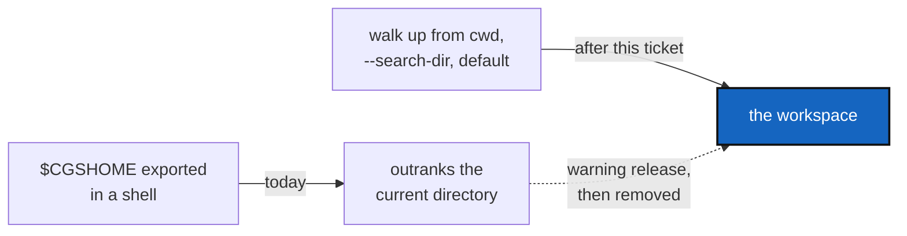

# CgshomeInternal — the workspace is found from where you stand, not from a system variable

*Created: 2026-10-30*

*Branch: main*

> **From the owner's answer of 2026-10-30 to CgshomeMismatch Q2** ("unset
> CGSHOME … it would even be better to have an internal $CGSHOME and not a
> system one that disturbs things. $CGSHOME should leave in ring0"). The
> evaluation is in section 4 of
> [CgshomeMismatch](../archive/20261030_CgshomeMismatch_DevPlanTicket.md); this ticket is
> its option C, held back until the refusal (option A) has shipped.

## Abstract — read this first

**The one-line version.** `$CGSHOME` stops being how a command finds its
workspace. A workspace is found by walking up from the current directory, or
named by `--search-dir`, or the default workspace; `bootstrap` prints a `cd`
and a `--search-dir` line instead of `export CGSHOME=…`. Two trees can no
longer be mixed up by a variable left in a shell.

**What this document is.** A plan to retire a system variable, with a warning
release before the removal. Nothing is decided: §3 lists what the owner must
decide first.

**Why it exists.** A system variable is global to a shell and invisible in the
command line; the 2026-10-30 session wrote the wrong workspace because of one.
CgshomeMismatch refuses that case for writing commands. Retiring the variable
removes the whole class, for reads too, and makes isolation a property of the
command rather than of the shell.

**Who it is for.** The worker and orchestrator who implement it, and the owner
who answers §3.

**What you need to do with it.** Answer §3, then follow §2.

---

## 1. What is read today

- `describe_cgshome` (`tree/snapshot_resolver.py`) reads `$CGSHOME` for every
  command that finds a workspace; `resolve_named_cgshome` (`tree/paths.py`)
  reads it for `initialise` without `--output-path`. Neither is Ring 0; Ring 0's
  purity check already forbids `os.environ`.
- `bootstrap` does not read it: it makes `~/.cgs/<name>-<stamp>`.
- `bootstrap`'s output, the README, six tutorials and the user guide tell the
  user to `export CGSHOME=…`. `tests/conftest.py` unsets it for every test,
  and about 80 test lines mention it.

## 2. Steps (to be confirmed by §3)

1. **Warn.** `$CGSHOME` still chooses the workspace, but every command that
   uses it says it is deprecated and names the replacement. `bootstrap` prints
   both the old line and the new one.
2. **Replace.** Print `cd <workspace>` and `--search-dir <workspace>`; rewrite
   the README, tutorials 01–04, the getting-started guide and the user guide.
3. **Remove.** `$CGSHOME` is no longer read; the workspace identity is the
   current directory's `.cgitsync` (or `--search-dir`), as the loaded `.gts`
   already records its own root. CgshomeMismatch's guard is then unnecessary
   and is deleted with it.
4. Tests: `conftest.py` stops unsetting a variable nobody reads; the tests that
   set it move to `--search-dir` or `chdir`.

## 3. Decisions for the owner

- **Q1 — removal or deprecation only?** Remove `$CGSHOME` after one release of
  warnings, or keep it forever as a warned, lowest-priority input (below the
  current directory)? A variable ranked below the current directory is inert
  whenever you stand in a workspace.
- **Q2 — `CGSPATH`.** It is the same kind of variable for `initialise` and the
  default workspace. In scope or left alone?
- **Q3 — scripts and CI.** `.github/workflows/ci.yml` uses `--output-path`;
  anything else that exports it (the owner's shell profiles) is the owner's to
  change. Is a release note enough?
- **Q4 — "leaves Ring 0".** The variable is already read outside Ring 0. Is
  the intent that `Settings` (or a CLI layer) reads the environment and every
  other layer receives a path, so `tree/paths.py` stops calling
  `os.environ`? That is a separate refactor and can follow.

## 4. Acceptance

- With `$CGSHOME` set to workspace A and the current directory in workspace B,
  every command works on B (after step 3), or says it ignored A (step 1).
- `bootstrap` prints a line that cannot affect another shell session.
- The README, the tutorials and the user guide no longer tell the user to
  export it.
- `pixi run lint`, `pixi run test` pass; `cgitsync status` shows `errors=0`.
