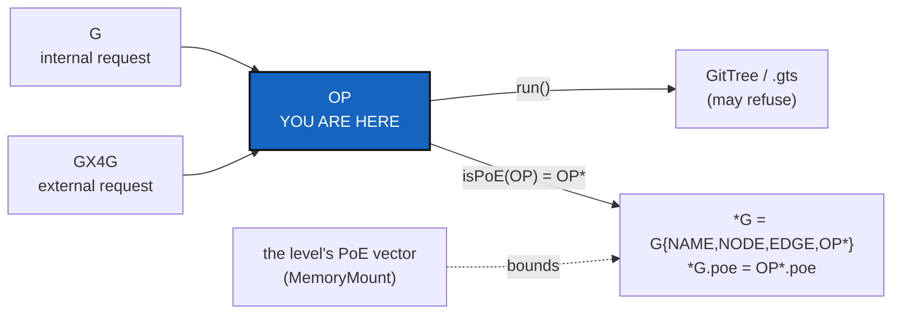

# OpBoundary — `OP`, the one class through which an operation on G enters ComplexGitSync

*Created: 2026-10-29*

*Branch: main*

> **Extracted from MemoryMount (`gx4g-main_1-1`) on the owner's word, 2026-10-29:** *"extrait
> l'implementation de OP comme ticket ComplexGitSync"*. The model comes from the owner's short
> ticket `ExplDistantLocal` (closed as `archive/.closedUserTicket/20261029_ExplDistantLocal.md`):
> *"G{NAME,NODE,EDGE,OP} - CORR OP not OP\*. G->\*G is automatically synchronised with the results
> of OP.isPoE. OP\* is OP.poe if and only if OP.isPoE is TRUE"*. The owner asked for *"le
> développement explicite de la classe OP comme classe frontière dans ComplexGitSync permettant de
> tester le comportement de CGS-ALPHA soumis à des requêtes internes depuis G ou des requêtes
> externes depuis GX4G"*. MemoryMount keeps the install protocol and depends on this ticket.
>
> Ranked at the end of pile 2 until the next ticket review places it (MemoryMount's Q7).

> **Owner's refinement, 2026-10-29:** *"isPoE(OP) returns OP\*. For gx4g \*G = G{NAME,NODE,EDGE,OP\*}.
> \*G.poe = OP\*.poe"*. `isPoE` is a function, not a test: it maps an operation to its
> Proof-of-Existence form `OP*`. What gx4g sees, `*G`, is G with `OP` replaced by `OP*`, and the
> PoE of `*G` is that of `OP*`. This supersedes the reading "`OP* = OP.poe` iff `OP.isPoE` is true".

> **Owner's rule, 2026-10-29: the PoE register.** *"Seuls les Graphs typés PoE, \*G sont inscrits au
> registre PoE par Timestamp NAME SHA256(G.MerkleRoot). .omniscience enregistre la valeur Sigma de
> \*G dans le registre de manière visible."* Only a PoE-typed graph, a `*G`, is entered in the PoE
> register, as `(Timestamp, NAME, SHA256(G.MerkleRoot))`. `.omniscience` records `*G`'s Sigma in the
> register, visibly. G itself is never registered.

## Abstract — read this first

**The one-line version.** `OP` is the boundary class every operation on G goes through, whether
G asks (internal) or GX4G asks (external). It runs the operation on the GitTree, and `isPoE(OP)`
returns `OP*`, the operation's Proof-of-Existence form. What gx4g sees is
`*G = G{NAME, NODE, EDGE, OP*}`, and `*G.poe = OP*.poe`, bounded by the level's PoE vector.

**What this document is.** The model (§1), what exists (§2), the class (§3), the steps (§4), the
decisions (§5) and acceptance (§6).

**Why it exists.** No single place in `cgitsync` says what an operation may expose. No test can
send the same request from G and from GX4G and compare what `cgitsync` does.

**Who it is for.** The worker who builds `OP`, the orchestrator who quotes it, and the owner, for §5.

**What you need to do with it.** Owner: answer §5 at `implement`. Worker: §4 in order.

---

## 1. The model

- **G is a graph with four parts:** `NAME`, `NODE`, `EDGE` and `OP`. `OP` is the operations run on G.
- **`OP`, not `OP*`.** `cgitsync` operates on `OP`, the real operation. `isPoE(OP)` returns `OP*`, its
  Proof-of-Existence form: what of the operation can be proved to exist, never the operation itself.
- **`G → *G`, automatically.** For gx4g, `*G = G{NAME, NODE, EDGE, OP*}`: the same graph, with every
  operation replaced by its `OP*`. Nobody writes `*G`; it is synchronised from the results of `isPoE`.
- **`*G.poe = OP*.poe`.** The proof `*G` gives is the proof its `OP*` give, bounded by the PoE vector of the
  level the tree was installed at:

  | Level | PoE `{NAME,NODE,EDGE,OP}` | Exposes |
  |---|---|---|
  | `.PUBLIC` | `{1,1,1,1}` | everything |
  | `.USER` | `{1,1,0,0}` | the name and the nodes |
  | `.DEV` | `{1,0,0,0}` | the name |
  | `.OPX` | `{0,0,0,0}` | nothing |

  MemoryMount records the vector at install. This ticket reads it.

- **Only `*G` is registered** (owner, 2026-10-29). The PoE register holds PoE-typed graphs, never G. One
  entry is `(Timestamp, NAME, SHA256(G.MerkleRoot))`: when, which graph by name, and the hash of its Merkle root
  (the root `MerkleRoot` computes; the register stores its SHA-256, never the root or any leaf). `.omniscience`
  writes `*G`'s Sigma, the number of parts its PoE vector exposes, as a visible field of the
  `OmniscienceRecord` (Q6, Q7, O6).

## 2. What exists

- **The client is the door today.** `ComplexGitSyncClient` holds every operation, and the CLI mirrors it one way
  (Minimalism D2). Nothing records who asked.
- **The GitTree may refuse.** A request can be denied (IntegrityMount), and the `.gts` is the only reference.
- **What an operation exposes is decided command by command:** a memory pushed, a commit message in the commit
  log, a record appended to the register.
- **`OperatingSpace` is the API of OPX** (Minimalism D5). The Omniscience register and the provider calls are
  gx4g's (Minimalism D7, ProviderMigration).
- **CGS-ALPHA is ComplexGitSync** (owner, 2026-10-29): the tests drive ComplexGitSync itself, as it stands, through `OP`.
- **The register today** (`omniscience register`, OmniscienceAppend) appends an `OmniscienceRecord` with the
  Operating Space's `os_id` and its leaves, for any registered tree, without a PoE type or a Sigma. It is gx4g's
  (Minimalism D7, ProviderMigration); `cgitsync` still writes it until gx4g does.

## 3. The class

- **What it carries:**
  - the operation: one client method, by name, with its arguments;
  - its origin: `internal` (G: the tree's own CLI, scripts or agents) or `external` (GX4G);
  - the tree's level and PoE vector.
- **What it answers:**
  - `run()` → the result on the GitTree, including a refusal (IntegrityMount);
  - `isPoE(OP)` → `OP*`, the operation's Proof-of-Existence form, bounded by the level's vector (at `.OPX`,
    an `OP*` that proves nothing);
  - `OP*.poe` → the proof `OP*` gives.
- **What follows from it:** `*G = G{NAME, NODE, EDGE, OP*}`, and `*G.poe = OP*.poe`. gx4g reads `*G`, never `G`.
- **What it never does:**
  - call a provider;
  - write to the Omniscience register;
  - add a command. It wraps the client's methods (Minimalism).
- **Ring:** above the client (ring 3) or at it, as §5 Q1 decides.

## 4. Steps

- **O1. The class.** `OP` with origin, level, `run`, and `isPoE(OP) → OP*` with `OP*.poe`, in its own module, with its rows in
  `AdditionalSpecs.md`'s module and ring tables.
- **O2. The routing.** Route the client's operations through `OP`, as §5 Q2 decides: every method, or those that
  write or reach outside the tree. The CLI enters as `internal`.
- **O3. `OP*` per kind of result,** as §5 Q4 decides: what `isPoE` keeps of a State's name, a branch, a commit message, bounded by the level's vector.
- **O4. `*G`.** Derive `*G = G{NAME, NODE, EDGE, OP*}` and `*G.poe = OP*.poe` from the `isPoE` results. It is computed and never written by hand. Where it is
  stored is MemoryMount's Q4.
- **O5. The CGS-ALPHA tests.** For each level and each origin (G, GX4G), run the same operations through `OP`
  on a real tree, and assert:
  - the GitTree's result;
  - what reaches `*G`, and that `*G.poe = OP*.poe`;
  - that an external request gets nothing an internal one would not;
  - that `.OPX` exposes nothing and `.DEV` only `NAME`.
- **O6. Sigma in `OmniscienceRecord`** (owner, Q6 and Q7). Only a `*G` is registered, and its record carries
  `sigma`, the number of parts its PoE vector exposes, done the way the environment and memory fields already are:
  - **committed when present, absent when not.** Like `published_state_id` in the record and `environment` in a
    ledger entry, `sigma` enters the record's preimage only when it is set, so a record written without it keeps
    its hash and verifies byte for byte, and `GLOBAL_SCHEMA` stays 1;
  - **visible.** It is written in the record's `[record]` table, beside `project`, so `omniscience` lists show it;
  - **the Timestamp** is the record's existing `recorded_at`, read through `universal_clock` as every dated
    fact is, and kept outside the hash as the claim it already is;
  - **NAME** is the record's `project`, and `SHA256(G.MerkleRoot)` is what it already commits through
    `gittree_root` and its own `record_hash`.

  A G that is not PoE-typed gets no record. Writing stays `.omniscience`'s: the existing appender until
  ProviderMigration hands the register to gx4g.
- **O7. Documentation:** `AdditionalSpecs.md`, `digest.md`, and `api_python.tex` for `OP`'s public surface.

## 5. Decisions for the owner

Asked through `AskUserQuestion` at `implement`, before the first edit.

| Q | Question |
|---|---|
| **Q1** | `OP` wraps the client (ring 3, a caller of `ComplexGitSyncClient`), or the client becomes `OP`'s implementation (every client method is an `OP`)? |
| **Q2** | Does every client method go through `OP` (one door), or only the ones that write or reach outside the tree? |
| **Q3** | ~~What CGS-ALPHA is.~~ **Answered 2026-10-29: CGS-ALPHA = ComplexGitSync.** |
| **Q4** | What `OP*` keeps of each kind of result (a State's name, a branch, a commit message, a register record), before the level's vector bounds it? |
| **Q5** | How an external request from GX4G reaches `OP`: through the Python API only, or through a transport (a file, a process) that this ticket defines? |
| **Q6** | ~~New entry or `OmniscienceRecord`?~~ **Answered 2026-10-29: `*G`'s Sigma is added to `OmniscienceRecord`.** No second entry type. |
| **Q7** | ~~Sigma inside or outside the hash; the Timestamp's clock?~~ **Answered 2026-10-29: as already done for the environment and memory records, and the same for the Timestamp** (O6 says what that is). |

## 6. Acceptance

- Only a `*G` is registered, and its `OmniscienceRecord` shows its `sigma`, committed when present; every record
  written without it verifies byte for byte and `GLOBAL_SCHEMA` stays 1. A G that is not PoE-typed gets no record.

- Every routed operation enters through `OP` with its origin and level, and no command is added.
- For each level and each origin, a test shows the GitTree's result and what reaches `*G`, as §1's table says, and that `*G.poe = OP*.poe`.
- An external request is never exposed more than the same internal one.
- `OP` calls no provider and writes nothing to the Omniscience register.
- `pixi run lint`, `pixi run test`, `bump-build`, `check-ceilings`, `check-oo` and `check-spectree` pass, and
  `cgitsync status` shows `errors=0`.

Related: `gx4g-main_1-1_MemoryMount_DevPlanTicket.md` (the protocol and the PoE vector at install, which depends
on this ticket); `archive/20261029_IntegrityMount_DevPlanTicket.md`; BeforeBeta §3c.
