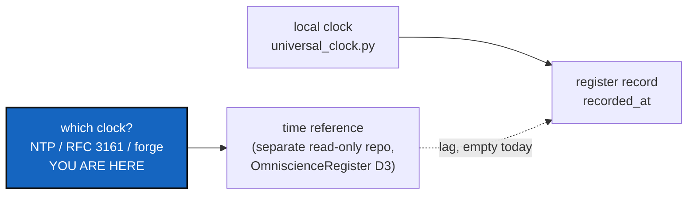

# UniversalTime — which clock the Omniscience register's lag fields read

*Created: 2026-10-27*

*Branch: main*

> **Ticket review — 2026-10-27, seventh pass (short ticket `gitRepo`).**
> Rank unchanged. The lag fields are filled when a record is written to the
> register, and gx4g holds the register now (ProviderMigration §1a). So D2
> ("read by the command that writes to the register") makes the clock read
> gx4g's. `cgitsync` could only measure an offset and hand it over with the
> record. That choice is a new D4, asked when the ticket is picked up.

> **Ticket review — 2026-10-27, sixth pass (short ticket `minimalism`).**
> Rank unchanged. *The forge's push time* (§3) is read through the provider's
> API, which is gx4g's privilege now (ProviderMigration). If D1 ever picks
> that option, gx4g reads the time and `cgitsync` records what gx4g hands
> it. NTP and RFC 3161 are not provider calls and are unaffected.

> **Ticket review — 2026-10-27, owner's decision.** Filed when Omniscience
> was archived. Omniscience's D8 ("what the universal clock is") was carried
> to OmniscienceRegister, which answered it **"none in this milestone"**: the
> lag fields stay empty and sit outside every hash preimage. The owner chose
> to keep the question in a stand-by ticket of its own, so archiving
> Omniscience loses nothing. Stand-by, end of pile 2.

## Abstract — read this first

**The one-line version.** The register records when something happened by
the contributor's local clock. It has fields for that clock's lag behind a
shared reference, and they are empty. This ticket decides which reference
fills them, and how, without changing any hash.

**What this document is.** The question (§1), what exists today (§2), the
options (§3), the decisions (§4) and acceptance (§5).

**Why it exists.** Two contributors' records can be ordered by the register's
checkpoint chain, but not placed on one timeline: a machine whose clock is an
hour off is not detectable from the register alone. It matters once
contributors on several machines, or gx4g, compare when things happened.

**What you need to do with it.** Nothing until the owner moves it to pile 1.

---

## 1. The question

What fills the register's lag fields: which external clock, read how, and
recorded where.

## 2. What exists today

- **`universal_clock.py`** is the only reader of the wall clock. Every dated
  fact goes through an injected `ClockProtocol`.
- **The time reference.** OmniscienceRegister D3, answered (a): a separate,
  private/distant, read-only repository holds the time reference, and lag
  measurements are appended to Omniscience. Not built.
- **The lag fields.** They exist and are empty. They are outside the record's
  preimage, so filling them later renames nothing (OmniscienceRegister D4,
  answered (d)).
- **The ledger.** It already catches a clock that moves backwards within one
  chain (`TIME_REGRESSION`, `time-inconsistent`). It cannot see a clock that
  is consistently wrong.

## 3. The options (Omniscience D8, as first written)

| Option | Gives | Costs |
|---|---|---|
| **NTP** | An offset and an uncertainty, at the moment of writing | A network call; a server to trust; nothing signed |
| **RFC 3161 timestamp authority** | A signed token, verifiable later by anyone | A TSA to trust, a token to store, a dependency to parse it |
| **The forge's push time** | Free, already recorded by the host | Only as honest as the host; not available offline; not per record |

## 4. Decisions for the owner

| D | Question | Recommendation |
|---|---|---|
| **D1** | Which clock? | **NTP**, recorded as offset plus uncertainty, the recommendation the ticket first made. RFC 3161 is the upgrade if a signed time is ever required. |
| **D2** | When is it read: at every register write, or by a separate command? | By the command that writes to the register, once per run. A failed read leaves the fields empty and never blocks the write. |
| **D3** | Does it need the separate time-reference repository (OmniscienceRegister D3) built first? | Only for RFC 3161 or a shared server list; NTP alone does not. |
| **D4** | *(short ticket `gitRepo`)* Who reads the clock: gx4g, which writes the record, or `cgitsync`, which hands an offset over with it? | **gx4g,** since it holds the register; `cgitsync` adds no network read. |

## 5. Acceptance, when it is picked up

- The lag fields are filled from the chosen clock, through
  `universal_clock.py`'s seam, with a fake in tests.
- Every record hash, `H_GLOBAL` and every proof are byte-identical before and
  after.
- No network read happens in a test, and none blocks a write when it fails.
- `pixi run lint`, `pixi run test`, and `cgitsync status` with `errors=0`.
