# RustGuide — GX4G's architecture and the Rust ideas under it, in ten diagrams

*Created: 2026-10-27*

## Abstract — read this first

**What this document is.** Ten Mermaid diagrams that explain how GX4G is
built and the Rust ideas it rests on, for someone who does not write Rust.
Each diagram has one sentence saying what to look at. The running example is
the code that exists (`Gateway`, `ExecutionContext`, `CgsError`,
`ExecutionHash`, `GitProvider`), so nothing here is invented for teaching.

**Why it exists.** The owner asked for clear diagrams of the architecture and
of the Rust concepts under it (BeforeCgitsyncMerge, short ticket
`security-robustness`). This file holds all ten. The seven that explain the
*public* architecture are redrawn in TikZ as a chapter of the book
(`doc/Text/rust_guide.tex`). The three that show the threat model stay here,
in the private `.dev`, until the owner says otherwise.

**What you will find.** Diagrams 1 to 6 explain the code and the Rust ideas.
Diagram 7 shows why a proof cannot be forged. Diagram 8 shows where a secret
lives. Diagram 9 shows the test layers. Diagram 10 follows one request.
Last, a short glossary.

**Who it is for.** The owner, and anyone new to Rust joining the project.

**What you need to do with it.** Read the diagrams in order. This file
explains and links. It does not state rules: the rules are in
[AdditionalSpecs.md](../.localSpec/AdditionalSpecs.md), and when the two
disagree, that file is right.

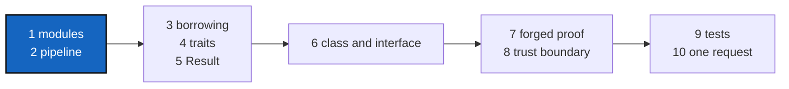

---

## 1. The module map

*Look at the two boxes: everything on the left is hidden, and only the
names on the right can be used by someone else.*

Rust code is split into **modules**. A module's contents are private unless
marked `pub`. `lib.rs` is the front door: it lists, with `pub use`, the few
names it hands out.

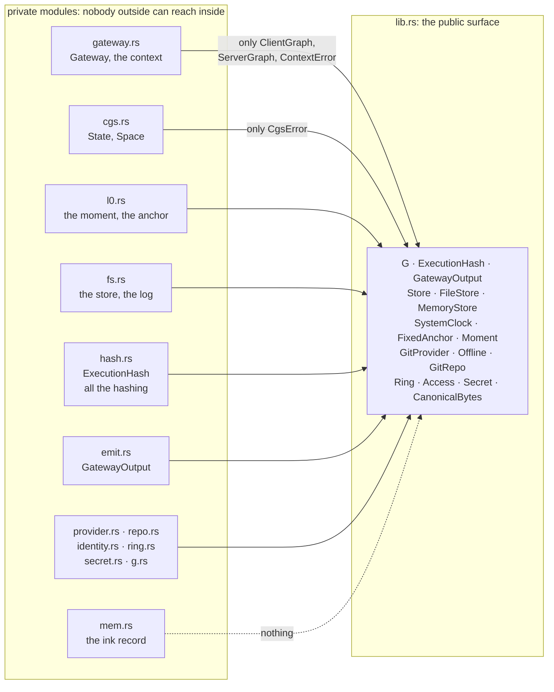

The phase functions, and every type that passes between the phases, are on
the private side and are **not** in the list on the right. `mem.rs` exports
nothing at all. That is the whole security idea of the kernel, and diagram 7
shows why.

## 2. The path, and what passes along it

*Look at the labels on the arrows: each step receives one value and hands on
one value, and only the last one leaves.*

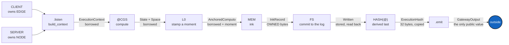

`G::execute` runs all of them in this one order and stops at the first
failure. Nothing else can run a step. Until MEM, every value *borrows* from
the caller's CLIENT and SERVER; MEM is where the bytes are *copied* into a
record the gate owns, which is why the record can be written to disk and
outlive the request.

## 3. Ownership and borrowing

*Look at the dotted arrows: the Gateway and the context point at the client
and the server, they do not hold copies. Look at the solid box: the record is
the first thing that owns its bytes.*

In Rust, every value has one **owner**. Code can instead **borrow** a value:
it gets a reference (`&`) and may look but not keep. The mark `'a` is a
**lifetime**: a promise that the reference does not outlive what it points to.

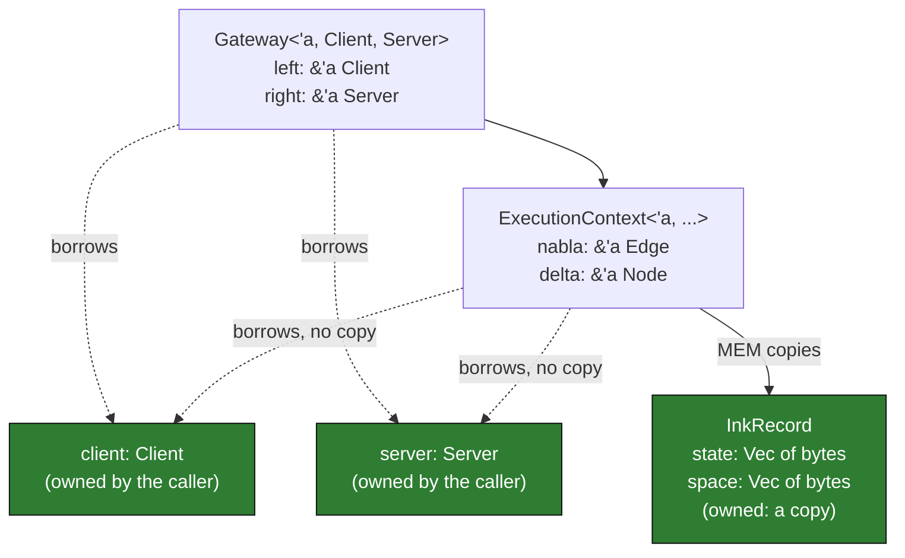

So until MEM nothing is copied: every step looks at the caller's original
objects, and the compiler refuses to let the Gateway outlive them.
The tests check this with `std::ptr::eq`, which asks "is it the very same
object?". After MEM the record owns its bytes, and a test drops the client and
the server and shows the record is still whole.

## 4. Generics and traits

*Look at what `G::execute` needs: not a concrete client, only "anything that
keeps the `ClientGraph` promise". Look at which promises you can keep yourself
and which only the crate can.*

A **trait** is a promise: a list of things a type can do. A **generic** such
as `G<Edge, L0, Mem>` is a recipe that works for any types that keep the
promises asked of them.

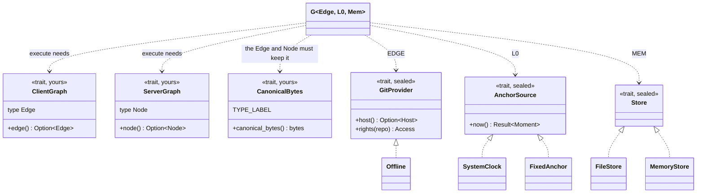

You write the three traits at the top, for your own types. The three **sealed**
ones can only be kept by types inside the crate: a clock, a store or a host
that could be added from outside is one that could lie. `CanonicalBytes` also
asks each type for a **label** (`TYPE_LABEL`). The label goes into the hash,
so a `String` and a `Vec<u8>` holding the same bytes cannot be mistaken for
each other. A type that forgets its label does not compile.

## 5. Result and Option: no null, no exceptions

*Look at the exits of each box: success continues, failure becomes a named
error, and nothing is silent. Nothing after a failure runs.*

Rust has no `null` and no exceptions. A value that may be missing is an
`Option` (`Some(x)` or `None`). An operation that may fail is a `Result`
(`Ok(x)` or `Err(e)`). The `?` mark means "on error, stop here and hand the
error to my caller".

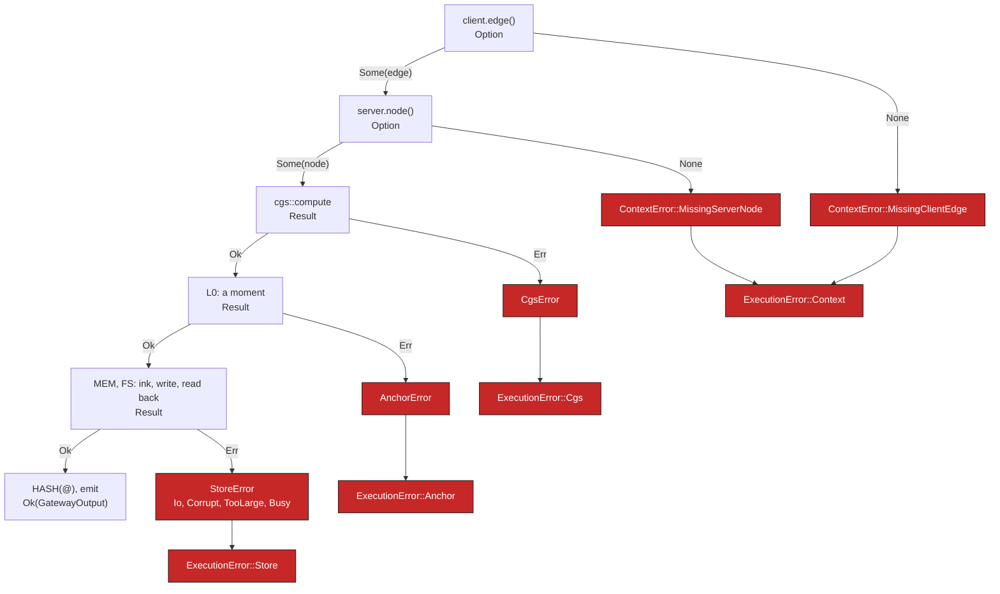

The client is always checked before the server, so two missing pieces always
report the same one first. `ExecutionError` keeps its cause (`source()`), so
the chain can be read back. A missing edge stops before L0 is even asked for a
moment, and before anything is written: the tests count the calls. The
`CgsError` exit cannot happen through `execute` today, because the context
always hands CGS two operands; it stays a typed error because the CGS function
can fail on its own.

## 6. Struct, impl and trait: Rust's class and interface

*Look at the left column of the table, then at the arrows: Rust has no
`class`, but these three parts do the same job.*

| In a class language | In Rust | Here |
|---|---|---|
| class with private fields | `struct` with fields not marked `pub` | `GitRepo`, `Secret`, `ExecutionHash` |
| methods | `impl Type { fn … }` | `G::execute`, `G::access`, `GitRepo::host` |
| interface | `trait` | `GitProvider`, the EDGE of `G` |
| subclass | a type that `impl Trait for Type` (no inheritance) | `Offline`, `FileStore`, `SystemClock`; later Codeberg, GitHub, GitLab |
| constructor that checks | `fn new(…) -> Result<Self, Error>` | `Owner::new`, `GitRepo::open` |

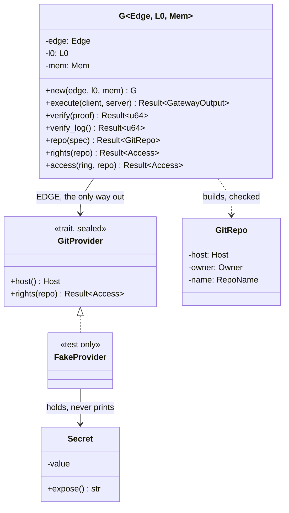

**Sealed** means no code outside the crate can add a provider: a host that
can be added from outside is a host that can lie. A `GitRepo` has private
fields and a crate-private constructor, so the only way to get one is
`G::repo`, which checks it. `G` is the one public API over the Graph.

## 7. Who can build an `ExecutionHash`

*Look at the red path on the left: in 0.1.1 anyone could walk it. Look at the
right: every way in is shut, and even a lying store gives no proof.*

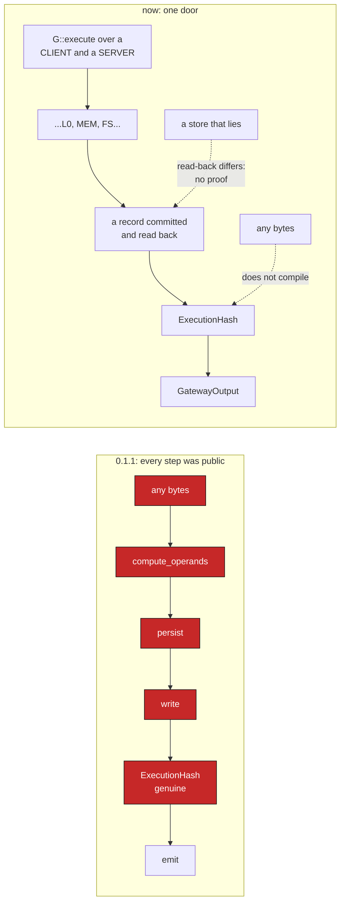

A hash that anyone can forge proves only "these bytes were hashed", not "the
gate ran". Now the phase functions are private, the module paths are private,
the types that pass between the steps cannot even be named, and an
`ExecutionHash` has a private field that only a committed record can fill. And
the proof is derived from what the store *returns when read back*, so a store
that says "written" and keeps nothing gives no proof either. Small programs in
`tests/ui/` try each way in and are required to fail to compile. (Any type may
still claim to be a CLIENT: that is accepted, F06 in `audit.md`.)

## 8. The trust boundary

*Look at where the key icon sits: the secret never leaves the inner box.*

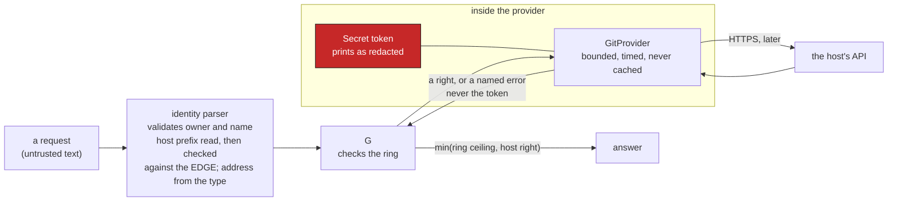

Three things hold at this boundary. Input is validated before anything else
(no `..`, no `/`, no look-alike letters, and the host the text names must be the EDGE's own). The
token is a `Secret` that prints as `<redacted>` and cannot be cloned. And the
host can only **narrow** what the ring allows, never widen it.

## 9. The test layers

*Look at the "sees" column: each layer is there because it can see something
the others cannot.*

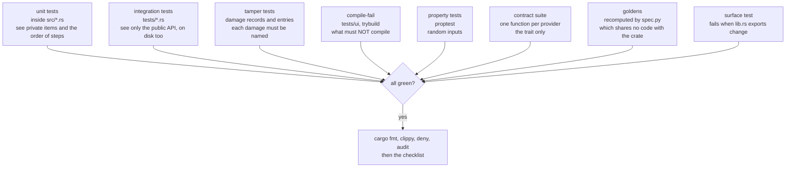

A compile-fail test passes only when the code *fails* to build, and it
records the compiler's exact message, so it cannot start passing for a
different reason. The golden hashes are computed twice, once by the Rust code
and once by a short Python program written from the specification alone: if
they agree, the encoding is what the specification says. And each of these
layers was checked the same way: a deliberate bug was introduced, and the
tests caught it.

## 10. One request, from text to a right

*Read top to bottom: the host is asked every time, and the answer is only
information, never a permit.*

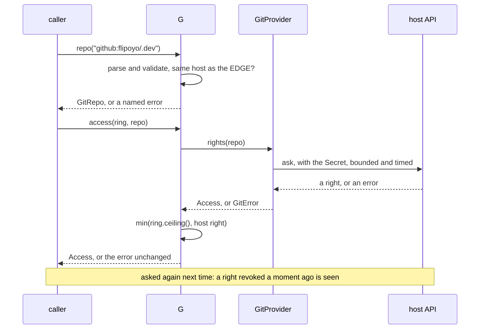

Reading and writing repository *content* are designed but not built: each
will have its own ring and its own step in this sequence.

## Glossary

| Word | In plain terms |
|---|---|
| crate | one Rust package: here, `gx4g` |
| module | a file or folder of code with its own privacy |
| `pub` | "others may use this"; without it, it is private |
| `struct` | a bundle of named fields, like a record |
| `enum` | one of several named cases, like `Access::Read` |
| `trait` | a promise of behaviour, like an interface |
| `impl` | the code that keeps a promise, or adds methods to a type |
| generic | code written once for any type that keeps the promises it asks for |
| `&` | a borrow: look, do not keep |
| `'a` | how long a borrow stays valid |
| `Option` | a value that may be missing |
| `Result` | an operation that may fail, with the reason |
| `?` | on failure, stop and pass the error up |
| `pub(crate)` | visible inside this crate only |
| sealed trait | a trait only this crate may implement |
| compile-fail test | a test that passes only when the code does not compile |
