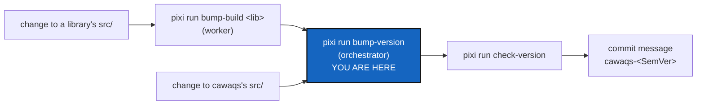

# Versioning — how CaWaQS numbers what it releases

*Created: 2026-09-22*

*Fills in: ../../.distant/dev-sync/Versioning.md*

## Abstract — read this first

**The one-line version.** CaWaQS has one SemVer, kept in `pixi.toml` and
copied into the C code; each library keeps its own build number
`MAJOR.XX`. This file names the files, commands and choices; the rule itself
is [Versioning.md](../../.distant/dev-sync/Versioning.md) in `DevSpec`.

**What this document is.** The fill-in of the shared versioning rule: the
scheme and what the public interface is, where each number lives, the
commands and what they write, how a branch that predates this merges, and
the exceptions stated so far.

**Why it exists.** The shared rule leaves these open on purpose, and the
commands and files are CaWaQS's.

**What you will find.** The scheme, where the numbers live, `bump-version`,
`bump-build`, `check-version`, the merge rule, and the exceptions.

**Who it is for.** The worker who changes a library, the orchestrator who
chooses the release level, and the owner.

**What you need to do with it.** After any change, the orchestrator runs
`bump-version`, then `check-version`, then writes the commit message with the
new version ([cawaqs-dev.md](cawaqs-dev.md), steps 2, 4 and 8).

---

## The scheme, and the public interface

**Real SemVer** (`MAJOR.MINOR.PATCH`), authoritative in `pixi.toml`
`[workspace] version`. **No workflow writes it**: the CI builds and tests,
nothing more.

The public interface of CaWaQS is what a user touches: the `.COMM` command
files, the input data formats, and the output files.

| Position | Increments when |
|---|---|
| **MAJOR** | The public interface breaks: a `.COMM` keyword is removed or changes meaning, an input or output format changes in a way an older file cannot follow |
| **MINOR** | Capability is added, compatibly: a new keyword, a new output, a new coupling |
| **PATCH** | Behaviour is fixed, nothing added: a bug fix, a build or install change with no interface change |

The C code, the libraries' prototypes and the install scripts are not the
public interface, though a library is shared with other programs and its
prototypes change additively only.

**Regular SemVer applies by default.** An exception exists only when the
owner states it for a named release, the release notes say so, and it covers
only that release. Stated so far: **cawaqs 4.2.0 and 4.3.0** take their
breaking changes (the version in C, then `scripts` 1.0.0) as minor bumps,
because 4.x had never been used (BuildSemVerAgenticC, D15).

## Where the numbers live

| Number | Where | Says |
|---|---|---|
| **CaWaQS SemVer** | `pixi.toml` `[workspace] version` (the reference), copied into `src/param_caw.h` `NVERSION_CAW` (a string, printed with `%s`), `src/Makefile` `V_CAW` (unquoted; names the binary `src/cawaqs<SemVer>`), `CITATION.cff` `version` and `date-released`, the README `Current_version` badge and the sentence "the SemVer in `pixi.toml`" | What the project promises |
| **A library's build** `MAJOR.XX` | its own `src/Makefile` `V_xx` and the `#define VERSION_xx` of its `param_*.h`, printed with `%4.2f`; repeated in cawaqs's `src/Makefile` | Which build of a shared library is linked |
| **`scripts`' SemVer** | from `scripts` 1.0.0, a `VERSION` file at its root and `CITATION.cff` | What the install scripts promise |

CaWaQS has **no build number**: only the SemVer. A library's build has one
source (its own files); the other libraries' copies of a `V_xx` may lag, as
the build rewrites them in the `Makefile_tmp` it compiles.

## Who bumps what — the commands

| Who | Does | With |
|---|---|---|
| **Worker** | Bumps the build of each library it changed | `pixi run -e agentic bump-build <lib> [--major]` |
| **Orchestrator** | Decides MAJOR/MINOR/PATCH, bumps the SemVer, checks, writes the commit message | `pixi run -e agentic bump-version {major,minor,patch}`, then `check-version` |
| **CI** | Builds, runs the regression cases | Never writes a version |

All three are `scripts/versioning.py` in this mount, run only in the
`agentic` pixi environment: a user install has no bump task, and without
this mount the script is not there.

## `bump-version`

Writes the new SemVer in **five targets**, all or none:

| File | Field |
|---|---|
| `pixi.toml` | `[workspace].version` |
| `src/param_caw.h` | `#define NVERSION_CAW "<v>"` |
| `src/Makefile` | `V_CAW=<v>` |
| `CITATION.cff` | `version` and `date-released` (today) |
| `README.md` | the `Current_version` badge and the "SemVer in `pixi.toml`" sentence |

It does not touch the `Documentation` badge or the PDF (owner, D7). A field
found other than exactly once, or a copy that already disagrees, stops it
with nothing written. `--dry-run` lists the files and writes nothing. It
ends on `old -> new` and a suggested commit subject `cawaqs-<new>`.

## `bump-build`

`bump-build <lib> [--major]` moves a library's `MAJOR.XX` by 0.01 (`--major`
gives `(MAJOR+1).00`; `.99` needs `--major`) in the library's `src/Makefile`
`V_xx`, in every `#define VERSION_xx` of its header, and in cawaqs's
`src/Makefile`. The other libraries' copies are left alone. No `pixi.toml`
and no agentic file ever enters a library.

## `check-version`

- every SemVer copy agrees with `pixi.toml`;
- each library's `Makefile` and header agree, and cawaqs's copy agrees with
  them;
- the other libraries' lagging copies are listed as information, not as a
  failure;
- `--range A..B` fails a commit of the range that touches cawaqs's `src/`
  without moving `pixi.toml`, or a library's `src/` without moving its
  `Makefile` (D10).

## A branch that predates this (`s-confined`)

Keep 4X's version line at the merge, and bump by what the merge brings.
`NVERSION_CAW` takes 4X's SemVer and `V_CAW` stays unquoted; a `libprint`
commit that changes the log header's signature is dropped, not merged, since
`libprint` 1.25 already accepts a string.

## `cgitsync version`

`cgitsync version diagnose | init | bump` is a development tool of the
Operating Space and reads only the top-level `[tasks]` of `pixi.toml`, so it
cannot drive CaWaQS's bump, which sits in `[feature.agentic.tasks]`. Run
`pixi run -e agentic bump-version` directly. Nothing in CaWaQS waits for
ComplexGitSync; its requests are in `DevTickets/dependency/CGS/`.
