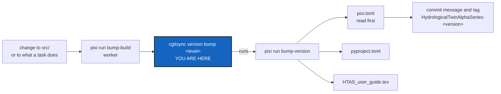

# Versioning — how HydrologicalTwinAlphaSeries numbers what it releases

*Created: 2026-11-19*

*Fills in: ../../.distant/dev-sync/Versioning.md*

## Abstract — read this first

**The one-line version.** HydrologicalTwinAlphaSeries uses real SemVer,
read from `pixi.toml` and copied to `pyproject.toml`, both written by
`pixi run bump-version`, which `cgitsync version bump` runs. Nothing
automatic writes it: there is no CI. The rule itself is
[Versioning.md](../../.distant/dev-sync/Versioning.md) in `DevSpec`.

**What this document is.** The fill-in of the shared versioning rule: the
scheme, the public interface it is measured against, where the version
lives, the commands, and how a release is tagged.

**Why it exists.** Until `000.alpha.40` the version followed an
`III.alpha.NN` scheme in `pyproject.toml`, bumped by a GitHub workflow on
every push to `main`. The owner chose (2026-11-19) ComplexGitSync's layout
and its agentic versioning instead: a `pixi.toml` beside a `pyproject.toml`
kept for the build (and for the coming `htas` CLI's console script).

**What you will find.** The scheme and public interface, where the version
lives, the commands, and the release tag.

**Who it is for.** The worker who changes `src/`, the orchestrator who
chooses the release level, and the owner.

**What you need to do with it.** Before calling a change done, the
orchestrator runs `cgitsync version bump <level>`, and the commit message
carries the new version ([htas-dev.md](htas-dev.md), steps 4 and 8).

---

## The scheme, and the public interface

**Real SemVer** (`MAJOR.MINOR.PATCH`, with an optional `-<stage>.<N>`
pre-release suffix). SemVer's positions are measured against the public
API that [AdditionalSpecs.md](../.localSpec/AdditionalSpecs.md) §4 names:
the `HydrologicalTwin` facade and its nine macro-verbs, the
`HydrologicalTwinClient` methods, the Request / Response / Result
dataclasses they exchange, and the `htas` CLI's commands, options, exit
codes and `--json` output.

| Position | Increments when | For example |
|---|---|---|
| **MAJOR** | The public interface breaks | A macro-verb, a client method, a CLI command or a documented field is removed or renamed; a result changes meaning |
| **MINOR** | Capability is added, compatibly | A new client method or CLI command, a new `kind` for a macro-verb, a new optional field |
| **PATCH** | Behaviour is fixed, nothing added | A bug fix with no interface change |

The first SemVer is `1.0.0` (owner, 2026-11-19, SemVerPixi D1): from then
on, any break of the interface above is a MAJOR bump (SemVer §5). The last
version of the old scheme is tagged `HydrologicalTwinAlphaSeries-000.alpha.40`
(D2).

## Where the version lives

| File | Field | Role |
|---|---|---|
| `pixi.toml` | `[workspace].version` | The one `cgitsync` reads (`VersionScheme`): commit prefix, release tag, `cgitsync version` |
| `pyproject.toml` | `[project].version` | The copy the build needs; `__version__` reads it through the editable install (`importlib.metadata`) |
| `docs/hydrological_twin/HTAS_user_guide.tex` | `\def\version{...}` | The user guide's title page (owner, SemVerPixi D5) |
| `README.md` | the title, `# HydrologicalTwinAlphaSeries v<version>` | The front page (owner, VersionSync D1) |
| `src/HydrologicalTwinAlphaSeries/__init__.py` | `__build__` | The build counter, not the version (below) |

`bump-version` writes every version target or none. A new file that would
hold the version becomes a target of the script (its `TARGETS` list) in the
same change, or holds no literal version at all: `test_version_mirrors`
reads that list and fails on a document that states an HTAS version the
script does not write. A mention after "since" or "from" is history and
passes; another project's number (CaWaQS's, a section number) is not an HTAS
version and passes.

## Who bumps what — the commands

| Who | Does | With |
|---|---|---|
| **Orchestrator** | Decides MAJOR/MINOR/PATCH and bumps; under `implement`, after quoting the work | `cgitsync version bump {patch,minor,major}` from the tree's root (`--dry-run` first), or `pixi run bump-version {major,minor,patch} [--pre <stage>] [--release]` |
| **Worker** | Bumps `__build__` for every change to `src/`; never bumps the version under `implement`; for a fix the owner asks for directly, `patch` | `pixi run bump-build` |
| **CI** | There is none (owner, 2026-11-20): the local gate, `pixi run lint` and `pixi run test`, replaces it | Never writes a version |

## `bump-version`

`scripts/bump_version.py`, in this private mount, ported from
ComplexGitSync's (`.dev`, branch `ComplexGitSync_CGS-ALPHA`), so a
public-only checkout cannot cut a release. It reads the version from
`pixi.toml`, writes the version the caller names to every target above, and
ends on `old -> new`, which `cgitsync version bump` reads. Exactly one of a
level (`major`/`minor`/`patch`) or a pre-release action (`--pre
<alpha|beta|rc>`, `--release`) is required; `--dry-run` writes nothing.
When `docs/hydrological_twin` is absent, it stops with nothing changed and
names the `.cgs` to bootstrap.

**It then rebuilds the user guide**, as ComplexGitSync's bump does
(VersionSync D3): `latexmk -pdf HTAS_user_guide.tex` from
`docs/hydrological_twin`, so the title page shows the new version.
`latexmk` is looked for before anything is written, on a `--dry-run` too: a
missing one stops the bump with nothing changed. `--no-pdf` skips the
rebuild. If `latexmk` fails after the sources are written, the bump says so
and names the rebuild to run by hand. The PDF is untracked, so the rebuild
only refreshes the local copy (owner, VersionSync D3).

## `bump-build`

Adopted from ComplexGitSync (owner, SemVerPixi D3). `scripts/bump_build.py`,
in the public repository as ComplexGitSync's is, writes exactly one field,
`__build__` in `src/HydrologicalTwinAlphaSeries/__init__.py`, a `YYYY.XX`
counter (`XX` rolling 01→99 into `YYYY+1`). It is provenance, never
identity: it says which build produced a result, and the coming
`htas --version` shows it beside the version. A worker step for any change
to `src/`, always followed by a version bump, `patch` at least, in the
same change.

## `check-build-version`

`scripts/check_build_version.py`, ported from ComplexGitSync's (VersionSync
D4): `pixi run check-build-version <base>..<head>` fails when a commit of
the range moves `__build__` and leaves the version in `pixi.toml` where it
was. It reads the commits and writes nothing. The orchestrator runs it
before it proposes the commit message and reports the result in the quote.

## `cgitsync version` — the same bump, across the tree

`cgitsync version bump` runs each modified versioned repository's own
`bump-version` task, leaf first and the root last, checks the root moved by
the level asked, and commits, pushes and tags nothing. ComplexGitSync,
mounted here as the tool, is another project's and is never bumped from
this tree; `docs/hydrological_twin` is not versioned on its own.

## The release tag

A release is tagged `HydrologicalTwinAlphaSeries-<version>` by
`cgitsync release freeze`, the version read from `pixi.toml`. Run it after
the bump, so the tag and the commit prefix carry the same version.
