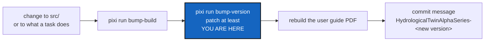

# Versioning — how HydrologicalTwinAlphaSeries numbers what it releases

*Created: 2026-11-19*

*Fills in: ../../.distant/dev-sync/Versioning.md*

## Abstract — read this first

**The one-line version.** HydrologicalTwinAlphaSeries moves to real SemVer,
declared in `pixi.toml` and bumped by a person or the orchestrator through
`pixi run bump-version`, never by CI. This file names the files, commands
and choices; the rule itself is
[Versioning.md](../../.distant/dev-sync/Versioning.md) in `DevSpec`.

**What this document is.** The fill-in of the shared versioning rule: the
scheme, the public interface it is measured against, where each number
lives, the commands and what they write, and how a release is tagged.

**Why it exists.** Until `000.alpha.40` the version followed an
`III.alpha.NN` scheme that a GitHub workflow (`.github/workflows/bump-version.yml`)
bumped on every push to `main`. That breaks two shared rules at once: CI
writes a version, and the level of a change is decided by no one. The owner
chose (2026-11-19) to adopt ComplexGitSync's agentic versioning instead,
installed with ComplexGitSync and managed through `pixi.toml`.

**What you will find.** The scheme and public interface, where the numbers
live, `bump-version`, `bump-build`, `cgitsync version`, and the release tag.

**Who it is for.** The worker who changes `src/`, the orchestrator who
chooses the release level, and the owner.

**What you need to do with it.** After any change to `src/`, run
`bump-build`, then `bump-version` before calling the work done, and write the
commit message with the new version ([htas-dev.md](htas-dev.md), steps 2, 4,
5 and 8). Until the SemVerPixi ticket lands, read *Status* first.

---

## Status — what exists today and what the SemVerPixi ticket builds

This file states the target. The planning ticket SemVerPixi
([openTickets/](DevTickets/openTickets/)) builds it. Until it is archived:

| Today | After SemVerPixi |
|---|---|
| `pyproject.toml` `[project].version = "000.alpha.40"`, `III.alpha.NN` | SemVer in `pixi.toml` `[workspace].version`, copied to `pyproject.toml` |
| Pixi configured in `pyproject.toml` `[tool.pixi.*]` | Pixi configured in a root `pixi.toml` |
| `bump-version.yml` bumps on every push to `main` | Workflow removed; CI only reads |
| No `bump-version`, no `bump-build` task | Both tasks, scripts in `.agent/.local/.dev/scripts/` |
| `HTAS_user_guide.tex` hand-synced, stuck at `000.alpha.18` | Written by `bump-version` |

Until then, **do not bump the version by hand**, and do not push to `main`
without the owner: each push there still fires the old workflow.

## The scheme, and the public interface

**Real SemVer** (`MAJOR.MINOR.PATCH`, with an optional `-<stage>.<N>`
pre-release suffix), authoritative in `pixi.toml`, so that `cgitsync`
(`VersionScheme`) reads the project's version where it reads every
DevSpec project's. **No workflow writes it.**

SemVer's positions are measured against the public API that
[AdditionalSpecs.md](../.localSpec/AdditionalSpecs.md) names: the
`HydrologicalTwin` facade and its eight macro-verbs, the
`HydrologicalTwinClient` methods, and the Request / Response / Result
dataclasses they exchange.

| Position | Increments when | For example |
|---|---|---|
| **MAJOR** | The public interface breaks | A macro-verb, a client method or a documented field is removed or renamed; a result changes meaning; a configuration file an older release wrote no longer loads |
| **MINOR** | Capability is added, compatibly | A new client method, a new `kind` for a macro-verb, a new optional field |
| **PATCH** | Behaviour is fixed, nothing added | A bug fix with no interface change |

The README says no long-term API stability is promised during the
AlphaSeries. SemVer does not change that promise; it says what each release
changed. While MAJOR is `0`, a break bumps MINOR (SemVer §4): the owner
decides the starting version in SemVerPixi (D1).

Pre-release identifiers (`0.41.0-alpha.1`, then `0.41.0`) are what
`bump-version`'s `--pre`/`--release` flags produce.

## Where the numbers live

| Number | Where | Says |
|---|---|---|
| **SemVer** | `pixi.toml` `[workspace].version` (read first), `pyproject.toml` `[project].version` | What the project promises |
| **Build counter** | `src/HydrologicalTwinAlphaSeries/__init__.py`'s `__build__` (SemVerPixi D3) | Exactly which build produced a result |

`__version__` keeps coming from the installed package metadata
(`importlib.metadata`), so it follows `pyproject.toml` with no copy of its own.

## Who bumps what — the commands

| Who | Does | With |
|---|---|---|
| **Worker** | Bumps `__build__`; runs `bump-version patch` itself only for a fix the owner asks for directly, never for a ticket's implementation | `pixi run bump-build` |
| **Orchestrator** | Decides MAJOR/MINOR/PATCH, runs the bump, writes the record | `pixi run bump-version {major,minor,patch} [--pre <stage>] [--release]`, or `cgitsync version bump <level>` across the tree |
| **CI** | Lints and tests | Never writes a version |

## `bump-version`

`scripts/bump_version.py`, in this private mount, ported from ComplexGitSync's
(`.dev`, branch `ComplexGitSync_CGS-ALPHA`), so a public-only checkout cannot
cut a release. It reads the current version from `pixi.toml` and writes the
version the caller names to every target, all or none:

| File | Field |
|---|---|
| `pixi.toml` | `[workspace].version`, the authoritative one |
| `pyproject.toml` | `[project].version` |
| `docs/hydrological_twin/HTAS_user_guide.tex` | `\def\version{...}` |

Exactly one of a level (`major`/`minor`/`patch`) or a pre-release action
(`--pre <alpha|beta|rc>`, `--release`) is required; `--dry-run` previews
`old -> new` and writes nothing. When `docs/hydrological_twin` is absent the
script stops with nothing changed and names the `.cgs` to bootstrap.

**The PDF.** If the user guide PDF is tracked, `bump-version` rebuilds it
after writing, and the PDF is committed in the same change; `--no-pdf` skips
it. Whether HTAS tracks it is SemVerPixi D4.

## `bump-build`

Writes exactly one field, `__build__` in `src/HydrologicalTwinAlphaSeries/__init__.py`,
with the same `--dry-run` convention. A worker step for any change to `src/`,
always followed by `bump-version`, at `patch` at least.

## `cgitsync version` — the same bump, across the tree

`cgitsync version diagnose | init | bump [patch|minor|major]` reads each
repository's `pixi.toml`, runs each modified repository's own
`bump-version` task, leaf first and the root last, and commits, pushes and
tags nothing. HydrologicalTwinAlphaSeries's task is `pixi run bump-version`,
so `cgitsync version bump` from this tree's root runs it. ComplexGitSync,
mounted here as the tool, is another project's and is never bumped from this
tree.

## The release tag

A release is tagged `HydrologicalTwinAlphaSeries-<version>` by
`cgitsync release freeze`, the version read from `pixi.toml`. Run it after
`bump-version`, so the tag and the commit prefix carry the same version.
