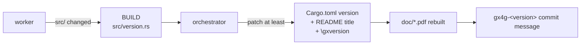

# Versioning — GX4G's choices

*Created: 2026-10-27*

*Fills in: ../../.distant/dev-sync/Versioning.md*

## Abstract — read this first

**What this document is.** GX4G's answers to the six questions the shared
pattern's §8 leaves to a project. It restates none of the pattern's rules.

**Why it exists.** The pattern names no file and no command. These are
GX4G's.

**Who it is for.** The worker who bumps the build, and the orchestrator who
bumps the release.

**What you need to do with it.** Read the pattern once, then use the
tables below.

---

## 1. Scheme and public interface

**SemVer**, because GX4G is a library other code will call, and a `MAJOR`
must mean a break. The public interface is:

- every item re-exported by `src/lib.rs`;
- once EnvConnect E0 lands, every `pixi run gx4g` command and option;
- the `.omniscience` record GX4G writes, and the id's grammar
  (`AdditionalSpecs.md`, *The gate's rules*).

A module's private items, the examples and the tests are not public.

## 2. Where each number lives

| Number | Authoritative | Mirrored in | Seen by |
|---|---|---|---|
| SemVer | `Cargo.toml` `[package].version` | `Cargo.lock`, `gx4g::VERSION` (via `CARGO_PKG_VERSION`), `README.md`'s first line `# GX4G v<version>`, `doc/Setup/Shortcuts.tex` `\gxversion` | everyone |
| Build counter | `BUILD` in `src/version.rs`, `NNNN.NN` | nothing | DEV only. It never appears in the README, `GX4G.md` or `doc/`, which `tests/version_tests.rs` checks |

## 3. The commands, and an exception

There is no bump command yet. EnvConnect E0 adds `pixi run bump-build`
(writes `src/version.rs` only) and `pixi run bump-version {major,minor,patch}`
(writes every SemVer target above, all or none), the script living in this
mount's `scripts/`, never in the public repository.

**Exception, proposed 2026-10-27, for the owner to confirm: until E0, both
bumps are made by hand**,
in one change, touching every target in §2. `cargo` rewrites `Cargo.lock`
on the next build, and `tests/version_tests.rs` is the check that no
mirror was forgotten. This exception ends when E0 lands.

## 4. What is rebuilt after a bump

Every PDF in `doc/`: `latexmk -pdf` on `MASTER.tex` and each `c_*.tex`
([gx4g-dev.md](gx4g-dev.md), *Commands*).

## 5. The release register

None yet. The `.omniscience` register will hold GX4G's registrations once
EnvConnect E4 lands; a release row is not designed.
