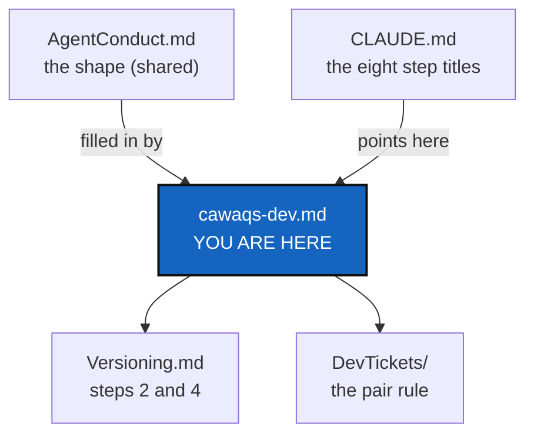

# cawaqs-dev — building, testing and finishing a change in CaWaQS

*Created: 2026-09-21*

*Fills in: ../../.distant/dev-sync/AgentConduct.md*

## Abstract — read this first

**What this document is.** This project's own fill-in for the
before-committing checklist, the pair rule and the testing section that
`DevSpecs.md` and `AgentConduct.md` state in general: which commands, which
repository, which paths, which choices. It restates none of their rules.

**Why it exists.** The shape of "finish a change" is the same for every
project, so it is written once in `AgentConduct.md`. The commands are
CaWaQS's. This is the only place that holds them; `CLAUDE.md` keeps the step
titles.

**What you will find.** The pixi commands, how to bootstrap a working
workspace, the eight checklist steps with CaWaQS's commands, the pair rule's
fill-in, the attribution fill-ins, the doc-impact map and the testing layout.

**Who it is for.** Anyone — human or agent — changing code or docs in this
repository. End users only need [README.md](../../../README.md).

**What you need to do with it.** Follow it before every commit. Read
`AgentConduct.md` first if you want the reason behind a step.



---

## Commands

This project uses pixi for its toolchain (`gcc` and `gfortran` 13, `make`,
`bison`, `flex`). Run them from the cawaqs root.

```bash
pixi run install                 # the Operating Space route: ComplexGitSync assembles the workspace, then builds
pixi run install -s -dev-4X      # the developer workspace, in a new directory
pixi run build                   # recompile with src/make_Cawaqs_fromCGS.sh gcc, no git operation
pixi run version                 # cawaqs <SemVer> (branch <b>, commit <sha>)
pixi run -e agentic check-version              # every copy of a version agrees (--range A..B for a range)
pixi run -e agentic bump-build <lib> [--major] # worker: a library's build, MAJOR.XX
pixi run -e agentic bump-version {major,minor,patch}  # orchestrator only: the CaWaQS SemVer
pixi run -e agentic test-versioning            # pytest of versioning.py
pixi run -e cgs cgitsync status                # the tree, from its own root
```

`--dry-run` on a bump lists what it would write and writes nothing. The
minimalist install, with no agentic mount, is `src/make_Cawaqs.sh` and
`src/make_Cawaqs_from_branches.sh`; see the README.

### Bootstrapping a working workspace

A fresh `git clone` of cawaqs gets the root alone. The developer workspace
is built from `.config/cawaqs-dev-4X.cgs` by the standalone `cgitsync` of the
pixi `dev` environment, which lands the cawaqs root on `4X`, the 17 libraries
and `scripts` on `cawaqs_4X`, and the private mounts under `.agent/`:

```bash
pixi run install -s -dev-4X -d <empty dir>
```

The header of `.config/cawaqs-dev-4X.cgs` describes a new branch line.

## Before committing — this project's own fill-ins

Do all of these as part of the change, not as a follow-up. The shape is
[AgentConduct.md](../../.distant/dev-sync/AgentConduct.md) §1.

1. **`pixi run build` must succeed with no new warning, and the regression
   cases must run.** The cases are `gitlab:cawaqs/gtest/testcases`; the CI
   runs two of them (`HYDRO_COUPLED.COMM`, `HYDRO_REPSUR.COMM`). From a
   clone of `testcases`, run `src/cawaqs<SemVer> <case>.COMM log.txt` on
   each, and read the first line of the log: `# CaWaQS <SemVer> -- Log file`.
   There is no unit-test suite, no `ruff` and no `pytest` for the C code; the
   format check of the CI is commented out and is not a gate yet.
2. **Run `pixi run bump-build <lib>` for each library whose `src/` you
   changed.** It moves that library's `Makefile` `V_xx` and `param_*.h`
   `VERSION_xx`, and cawaqs's copy, in one step. A change to cawaqs's own
   `src/` bumps no build: CaWaQS has no build number, only the SemVer of
   step 4. See [Versioning.md](Versioning.md).
3. **`cgitsync status`, run from this tree's own root, must show
   `errors=0`.** A green build does not prove the tree is describable: a
   row reading `error`/`error` means a change left a repository in a state
   the tool cannot read. Fix it before calling a task finished.
4. **Run `pixi run bump-version {major,minor,patch}`, once per change, by
   the orchestrator, then `pixi run check-version`.** The rule, who decides
   the level and the three cases agents got wrong are the shared
   [Versioning.md](../../.distant/dev-sync/Versioning.md); which files the
   command writes is [Versioning.md](Versioning.md). Never hand-edit a
   version field. Regular SemVer applies unless the owner states an
   exception for the named release.
5. **Documentation.** The PDF documentation is mounted by the owner in the
   development space later; `bump-version` leaves the `Documentation` badge
   and the PDF alone. The doc-impact map below says which other documents a
   change touches.
6. **Update `.agent/.local/.localSpec/AdditionalSpecs.md`** if a layer, the
   frontier or a version rule moved, in the same change.
7. **Document any new option of an install script** in the install tables of
   `README.md`, which is the user's front page: `pixi run install` first,
   then the manual install. Not in this file.
8. **Deliver the commit message.** Finishing a ticket includes writing
   **one** commit message and using it unchanged in every repository the
   change touched. Deliver it as text in the finishing report; whether to
   commit is the owner's call unless the owner asks for it. The message
   reads `cawaqs-4.2.0` (the project name, then the SemVer of `pixi.toml`,
   so run step 4 first), three lines at most, plain English, no backtick, no
   agent-credit trailer. A change taken from another branch cites its hash
   only. `--commit-gitignore` and other messages ComplexGitSync generates
   for itself are not governed by this rule.

### Doc-impact map

| A change to | Also update |
|---|---|
| the SemVer | nothing by hand: `bump-version` moves `pixi.toml`, `param_caw.h`, `src/Makefile`, `CITATION.cff`, the README badge and sentence |
| an install script or its options | the README install tables |
| the `.COMM` grammar or an output file | the release notes, and the PDF documentation when the owner mounts it |
| the code's Doxygen comments | the Doxygen build of the CI (`docs/doxyfile.conf`) |
| a layer, a version rule | `AdditionalSpecs.md` |

## The pair rule — this project's fill-in

The rule in full is
[AgentConduct.md](../../.distant/dev-sync/AgentConduct.md) §4.
Implementing a ticket from [DevTickets/openTickets/](DevTickets/openTickets/)
takes a worker agent that makes the change and an independent orchestrator
agent that quotes it against this checklist, writes the record, and runs
step 4 (`pixi run bump-version`) — the same judgement call as the record
itself, made by the same role for the reason AgentConduct.md §4 gives.
Drafting, ranking, or closing a ticket in `DevTickets/` is orchestration
work already and does not need a second orchestrator to quote it.

**The orders are in [CLAUDE.md](../.claude/CLAUDE.md)**, *When the owner
says `implement <ticket>`*: this project's statement of
[AgentConduct.md](../../.distant/dev-sync/AgentConduct.md) §4.1. It is not
restated here.

## Whose data this is, and attribution — this project's fill-ins

[AgentDataContract.md](../../.distant/dev-sync/AgentDataContract.md) states
the owner's intent and what such a document can and cannot deliver, and
[legalTerms/anthropic.md](../../.distant/dev-sync/legalTerms/anthropic.md)
checks the provider's terms rather than assumes them.
[AgentConduct.md](../../.distant/dev-sync/AgentConduct.md) §3 states the two
attribution rules. This project's fill-ins:

- **Publication rule.** The agent is named in
  [README.md](../../../README.md)'s *LLM assistance* section, and in no
  other public place. Keep that section current.
- **Parametric names in the public repositories.** In the public
  repositories (the cawaqs root, the libraries, `scripts`), any example that
  needs an agent's vendor or model writes the placeholders `vendor-name`
  and `model-name`, never a real one. In the private repositories
  (`.localSpec`, `.claude`, `.dev`, the memory), specs, tickets and records
  name the real vendor and model.
- **No person is named** in a document, a commit message or a ticket. A
  commit that takes a change from another branch cites its hash only.
- **Accounting rule.** What each agent actually did belongs in
  `.cgitsync/.memory/.self-history`, `private = true`, pushed only to a
  private repository. **A self-history record must never reach a public
  repository**, and nothing in it may be copied into one.
  `cgitsync self-history add` writes one.

## Testing — this project's own layout

[DevSpecs.md](../../.distant/dev-sync/DevSpecs.md) *Testing* is the rule.

- **The model**: the regression cases of `gitlab:cawaqs/gtest/testcases`,
  run as in step 1. A change to numerics or to the `.COMM` interface runs
  both CI cases at least, and compares the outputs with the previous
  release's.
- **The build**: `pixi run build` is the compile test; a new warning is a
  failure.
- **The versioning tool**: `pixi run -e agentic test-versioning`, the pytest
  suite in `scripts/tests/` of this mount, on a small fake tree. It is the
  only Python test of the project.
- Tests must not depend on network access or live git remotes, except the
  clone of `testcases` by the CI.
