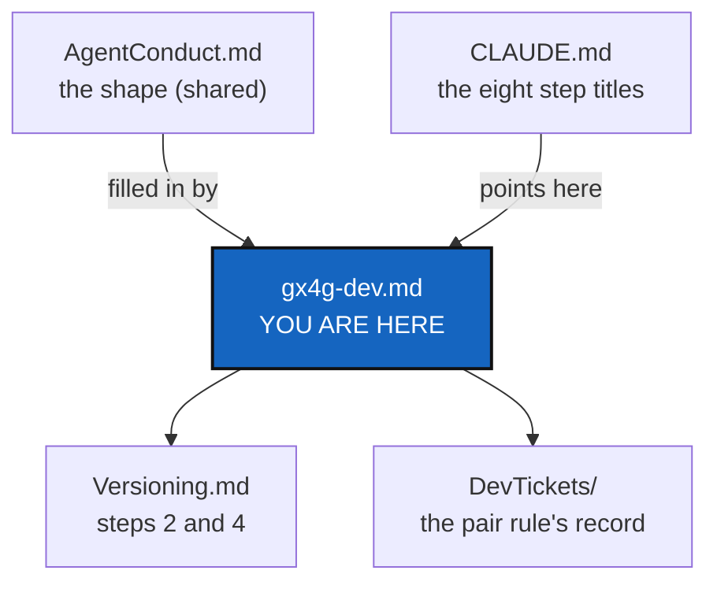

# gx4g-dev — building, testing and finishing a change in GX4G

*Created: 2026-10-27*

*Fills in: ../../.distant/dev-sync/AgentConduct.md*

## Abstract — read this first

**What this document is.** GX4G's own fill-in for the before-committing
checklist, the pair rule and attribution that `AgentConduct.md` states in
general: which commands, which files, which choices. It restates none of
their rules.

**Why it exists.** The shape of "finish a change" is the same for every
project. The commands are GX4G's, and this is the only place that holds
them; `CLAUDE.md` keeps the step titles.

**What you will find.** The commands, how to mount the agentic tree, the
eight checklist steps with GX4G's commands, the pair rule's record, and
attribution.

**Who it is for.** Anyone changing code or docs in this repository.

**What you need to do with it.** Follow it before every commit.



---

## Commands

GX4G has no `pixi.toml` yet (EnvConnect E0). Until it does, the Rust
toolchain comes from Pixi's channels for one command at a time, and no
`rustup` or system toolchain is assumed:

```bash
R="pixi exec -s rust -s c-compiler --"
$R cargo fmt --check
$R cargo clippy --all-targets --all-features -- -D warnings
$R cargo clippy --all-targets -- -D warnings      # and again without the feature
$R cargo test --all-targets --all-features        # `testing` turns on the fake host
$R cargo run --example phase5                     # in memory, fixed anchor: the same proof every run
$R cargo run --example phase6                     # on disk, live clock: writes and removes a temporary directory

python3 tests/spec/spec.py                        # the goldens, recomputed with no Rust: rerun when a hash changes

D="pixi exec -s rust -s c-compiler -s cargo-deny -s cargo-audit --"
$D cargo deny --all-features check                # licences, sources, advisories
$D cargo audit                                    # known advisories in Cargo.lock
```

`cargo test` without `--all-features` skips the provider contract suite and
one compile-fail case: they need the `testing` feature, which exposes the
scripted fake host. A consumer never enables it.

A compile-fail case (`tests/ui/*.rs`) has a `.stderr` snapshot of the
compiler's message. A new toolchain can reword it. To review, run
`TRYBUILD=overwrite $R cargo test --all-features --test ui_tests`, **read each
changed snapshot**, and keep it only if it still fails for the reason its file
says. Overwriting without reading would let a case pass for the wrong reason.

The documentation is built in `doc/`:

```bash
cd doc && latexmk -pdf MASTER.tex c_getting_started.tex c_cgs.tex c_gx4g.tex c_architecture.tex c_rust_guide.tex && latexmk -c
```

When E0 lands, these become `pixi run test`, `pixi run lint`,
`pixi run bump-build` and `pixi run bump-version`, and this section is
rewritten in the same change.

### Mounting the agentic tree

The `.agent/` entries of `examples/gx4g4dev.cgs` list the mounts. Each is mounted by hand, with
plain Git, from the repository root. The shared ones are on `main`, and
GX4G's own on `gx4g`:

```bash
git clone -b main git@github.com:flipoyo/.ticketing   .agent/.distant/ticket
git clone -b main git@github.com:flipoyo/DevSpec      .agent/.distant/dev-sync
git clone -b main git@github.com:flipoyo/DocSpec      .agent/.distant/documentation
git clone -b gx4g git@github.com:flipoyo/.dev         .agent/.local/.dev
git clone -b gx4g git@github.com:flipoyo/.localSpec   .agent/.local/.localSpec
git clone -b gx4g git@github.com:flipoyo/.claude      .agent/.local/.claude
```

`.agent/` is ignored by the gx4g repository, so nothing under it is ever
committed to the public repository.

## Before committing — GX4G's own fill-ins

The shape is [AgentConduct.md](../../.distant/dev-sync/AgentConduct.md) §1.

1. **`cargo fmt --check`, `cargo clippy ... -D warnings` (with and without
   `--all-features`) and `cargo test --all-targets --all-features` pass**, and **`cargo deny` and `cargo audit` pass** (the *Commands*
   above). `tests/version_tests.rs` is part of the suite: it fails when the
   README title or `\gxversion` disagrees with `Cargo.toml`.
2. **Bump the build counter for any change under `src/`**: `BUILD` in
   `src/version.rs`, `NNNN.NN`, by hand until `bump-build` exists
   ([Versioning.md](Versioning.md)).
3. **The tree's own status.** Not applicable: GX4G does not manage its
   own tree yet. When `pixi run gx4g` and the DEV Operating Space exist,
   `pixi run cgitsync status` from the tree's root must show `errors=0`, and
   this step says so.
4. **Bump the release version after every build bump, `patch` at least**,
   and for a change outside `src/` that changes what a command or script
   does. The targets are in [Versioning.md](Versioning.md).
5. **Rebuild the PDFs** in `doc/` after every version bump (every title
   page shows `\gxversion`) and after any change to `doc/`.
6. **Update `AdditionalSpecs.md`** (`.agent/.local/.localSpec/`) if a
   module's responsibility, a phase or a gate rule moved, in the same
   change.
7. **Document what a user sees**: `doc/Text/*.tex`, the tutorial that
   covers it, and the README's *What works today* table when a piece moves
   from designed to built. The README stays a front page: no command
   table, no option list.
8. **Deliver one commit message**, `gx4g-<version>`, plain English, three
   lines at most, used unchanged in every repository the change touched
   (gx4g and each `.agent/.local/` repository). Never commit or push
   without being asked.

## The pair rule — GX4G's fill-in

[AgentConduct.md](../../.distant/dev-sync/AgentConduct.md) §4. The tool
that launches the orchestrator is Claude Code's **Agent** tool, in the
foreground. GX4G has no self-history tool, so **the orchestrator's record
is a section appended to the ticket itself**, before it is archived:

```markdown
## Orchestrator's record

*Quoted: YYYY-MM-DD · worker: <vendor> <model> · orchestrator: <vendor> <model>*

| Step | Verdict | Note |
|---|---|---|
| 1 … 8 | met / defect / n.a. | … |

Release: <old> → <new> (<level>), because …
Re-quotes: <n>. Blocking defects left: none.
```

The ticket lives in the private `.dev`, so the record never reaches a
public repository. No gate refuses a ticket archived without it yet
(AgentConduct §4.2); that is an open risk in `audit.md`.

## Attribution — GX4G's fill-in

[AgentConduct.md](../../.distant/dev-sync/AgentConduct.md) §3. The public
credit is the README's *LLM assistance* section, and nowhere else in the
gx4g repository. Commits carry no co-author trailer and no "generated with"
line. Tickets and records in `.agent/.local/` keep the real vendor and
model.
