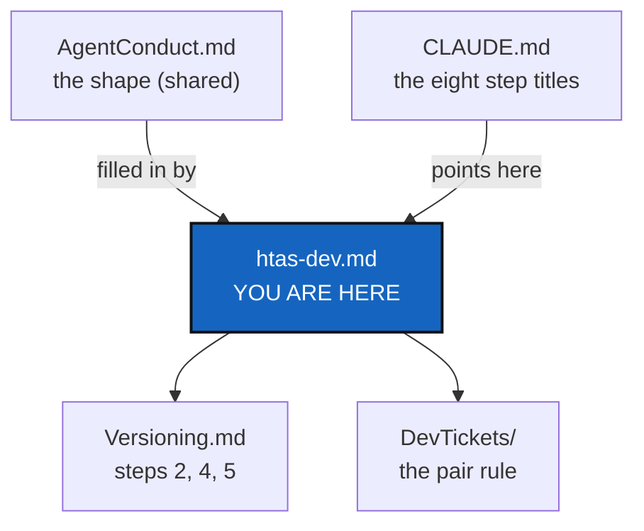

# htas-dev — building, testing and finishing a change in HydrologicalTwinAlphaSeries

*Created: 2026-11-19*

*Fills in: ../../.distant/dev-sync/AgentConduct.md*

## Abstract — read this first

**What this document is.** This project's own fill-in for the
before-committing checklist, the pair rule and the testing section that
`DevSpecs.md` and `AgentConduct.md` state in general: which commands, which
repository, which paths, which choices. It restates none of their rules.

**Why it exists.** The shape of "finish a change" is the same for every
project, so it is written once in `AgentConduct.md`. The commands are this
project's, and this is the only place that holds them; `CLAUDE.md` keeps
the step titles. It was seeded from ComplexGitSync's `cgitsync-dev.md` and
cut down to what HydrologicalTwinAlphaSeries actually has.

**What you will find.** The Pixi commands, how to bootstrap a working
checkout, the eight checklist steps with this project's commands, the pair
rule's fill-in, the attribution fill-ins, and the testing layout.

**Who it is for.** Anyone — human or agent — changing code or docs in this
repository. End users only need [README.md](../../../README.md).

**What you need to do with it.** Follow it before every commit. A step
marked *(SemVerPixi)* names a task that ticket adds; until it lands, say in
the finishing report that the step was not run, and why.



---

## Commands

This project is laid out as ComplexGitSync is (owner, 2026-11-19): a root
`pixi.toml`, the Pixi manifest that holds the version, beside a
`pyproject.toml` kept for the Python build and the coming `htas` console
script *(SemVerPixi)*. Never bare `pip`/`venv`.

```bash
pixi install                         # create/update the environment
pixi run test                        # pytest, tests/unit + tests/integration
pixi run lint                        # ruff check src tests
pixi run run                         # smoke test of the package entry point
cgitsync version diagnose            # how the tree is versioned; reads only
cgitsync version bump <level>        # orchestrator: runs pixi run bump-version     (SemVerPixi)
pixi run bump-version <level>        # writes pixi.toml, pyproject.toml, the guide   (SemVerPixi)
pixi run bump-build                  # worker: bumps __build__                       (SemVerPixi)
```

CI (`.github/workflows/ci.yml`) runs on every push and pull request, on
Linux: `pixi install`, the QGIS-free guard (no `qgis`/`PyQt` import under
`src/`), a sparse clone of the CaWaQS test case
(`gitlab.com/cawaqs/gtest/testcases`, tag `v0.1-cwv-gis-smoke-CI`, exported
as `CWAQS_FIXTURE_ROOT`), `pixi run test`, and `pixi run run`. It never
writes a version once SemVerPixi removes `bump-version.yml`.

### Bootstrapping a working checkout

A plain `git clone` gets the code but neither `docs/hydrological_twin` nor
any agentic mount. Bootstrap the developer spec, `.config/htas-dev-beta.cgs`;
its header lists the install commands in order (bootstrap, `branch create
HT-BETA --private`, `checkout HT-BETA`, `self-history adopt`, `push`).

```bash
pixi run cgitsync bootstrap .config/htas-dev-beta.cgs HydrologicalTwinAlphaSeries
export CGSHOME=...      # copy it from bootstrap's own output
cd "$CGSHOME" && pixi install
```

The private/local mounts (`.agent/.local/*`, `.omniscience`) are on
`HydrologicalTwinAlphaSeries_HT-BETA`, derived by `cgitsync` from the tree;
the distant ones stay on `main`; ComplexGitSync, the tool, stays on
`CGS-ALPHA` and is never written from this tree.

## Before committing — this project's own fill-ins

Do all of these as part of the change, not as a follow-up. The shape is
[AgentConduct.md](../../.distant/dev-sync/AgentConduct.md) §1.

1. **`pixi run lint` and `pixi run test` must both pass**, and the QGIS-free
   guard with them: no `qgis`, `qgis.PyQt`, `PyQt5` import anywhere under
   `src/`. Tests needing the CaWaQS fixture skip without
   `CWAQS_FIXTURE_ROOT`; say so in the report when they did.
2. **`pixi run bump-build` for any change under `src/`** *(SemVerPixi)*,
   the worker's step. It is never the last versioning step: see step 4.
3. **`cgitsync status`, run from this tree's own root, must show
   `errors=0`.** Fix a repository the change left unreadable before calling
   the task finished.
4. **`cgitsync version bump {patch,minor,major}`, from the tree's root,
   for every change under `src/`** and every change to what a task does,
   `patch` at least *(SemVerPixi)*. Run it with `--dry-run` first. The
   level is the orchestrator's call ([Versioning.md](Versioning.md)). Never
   hand-edit a version field: `bump-version` writes every copy, all or
   none. Never let CI write one.
5. **Rebuild the user guide** after every bump and every change to
   `docs/hydrological_twin` (its version is a `bump-version` target,
   SemVerPixi D5).
6. **Update [AdditionalSpecs.md](../.localSpec/AdditionalSpecs.md)** if a
   module's responsibility moved between layers: its layer table and
   diagram, in the same change. A deferred clean-up goes in
   `docs/TODO.md` or a ticket, never only in a commit message.
7. **Document a new public method** (`HydrologicalTwinClient`, a
   macro-verb, a new `kind`) in `docs/api_capabilities.md` and
   `docs/api_examples.md`, and in the user guide when a user sees it. The
   root `README.md` is the front page: no method table there.
8. **Deliver one commit message** and use it unchanged in every repository
   the change touched: `HydrologicalTwinAlphaSeries-<version>`, plain
   English, three lines at most, the version read from `pixi.toml` after
   step 4 (`cgitsync commit` checks it). Until SemVerPixi lands, the
   version is the one `pyproject.toml` holds. Deliver it as text; committing and pushing are the owner's call.

## The pair rule — this project's fill-in

The rule in full is [AgentConduct.md](../../.distant/dev-sync/AgentConduct.md)
§4. Implementing a ticket from [DevTickets/openTickets/](DevTickets/openTickets/)
takes a worker agent that makes the change and an independent orchestrator
agent that quotes it against this checklist, runs step 4
(`cgitsync version bump`), and writes the
record with `cgitsync self-history add` once `self-history adopt` has been
run. Drafting, ranking or closing a ticket is orchestration already. **The
orders are in [CLAUDE.md](../.claude/CLAUDE.md)**, *When the owner says
`implement <ticket>`*.

This project has no `check-tickets` task: the gate is `cgitsync commit`'s
own refusal of a planning ticket archived without its orchestrator's
record, and the orchestrator's re-quote.

## Attribution — this project's fill-ins

[AgentConduct.md](../../.distant/dev-sync/AgentConduct.md) §3 states the
rules; [AgentDataContract.md](../../.distant/dev-sync/AgentDataContract.md)
the owner's intent.

- **No agent credit on a commit**, merge or pull request, in any repository
  of the tree.
- **Public front.** The project's own repositories are
  `HydrologicalTwinAlphaSeries` and `hydrological_twin` (`docs/hydrological_twin`).
  An example there that needs an agent's vendor or model writes
  `vendor-name` and `model-name`. The README has no *LLM assistance*
  section yet; adding one is the owner's decision.
- **Private repositories** (`.localSpec`, `.claude`, `.dev`, `.omniscience`,
  `.memory`, `.self-history`) name the real vendor and model.
- **Accounting.** What an agent did goes in `.cgitsync/.memory/.self-history`
  only, never into a public repository.

## Testing — this project's own layout

[DevSpecs.md](../../.distant/dev-sync/DevSpecs.md) *Testing* is the rule.

- Unit tests: `tests/unit/` (with `services/` and `tools/` subpackages);
  integration tests: `tests/integration/` (facade lifecycle, smoke runs on
  real CaWaQS meshes).
- `pytest` runs with `pythonpath = ["src"]`; the `slow` marker deselects
  long runs (`-m "not slow"`).
- Tests that need real CaWaQS data skip cleanly when it is absent: the
  test case through `CWAQS_FIXTURE_ROOT` (`tests/README.md`), the large
  real meshes of `test_aq_boundary_faces_real_meshes.py` by path. No test
  reaches the network.
